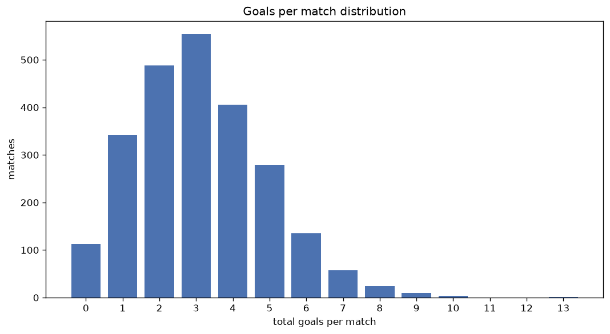
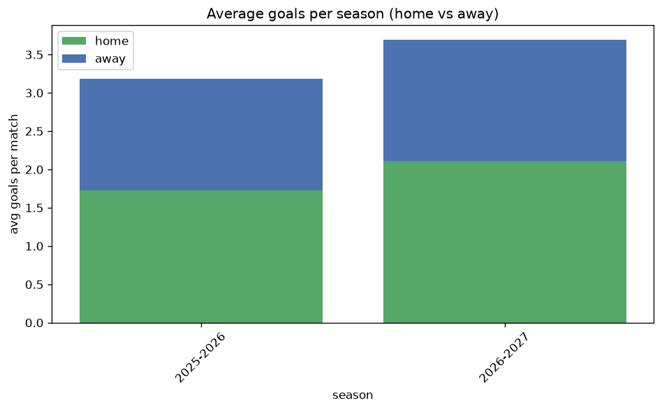

# Goal Analysis
- Report: `goals_analysis`
- Generated: 2026-10-27T01:52:01+00:00
- Script: `backend/scripts/analyze_goals.py` v1.0.0
- League: Eerste Divisie (Netherlands)
- Scope: league `holland2`

## 1. Goals per match distribution
| goals | matches | pct |
|---|---|---|
| 0 | 112 | 4.6% |
| 1 | 342 | 14.2% |
| 2 | 488 | 20.2% |
| 3 | 554 | 23.0% |
| 4 | 406 | 16.8% |
| 5 | 279 | 11.6% |
| 6 | 135 | 5.6% |
| 7 | 57 | 2.4% |
| 8 | 24 | 1.0% |
| 9 | 10 | 0.4% |
| 10 | 4 | 0.2% |
| 11 | 0 | 0.0% |
| 12 | 0 | 0.0% |
| 13 | 1 | 0.0% |

## 2. Goals per match per season
| season | matches | total goals | avg home | avg away | avg total |
|---|---|---|---|---|---|
| 2020-2021 | 380 | 1228 | 1.755 | 1.476 | 3.232 |
| 2021-2022 | 380 | 1165 | 1.629 | 1.437 | 3.066 |
| 2022-2023 | 380 | 1166 | 1.758 | 1.311 | 3.068 |
| 2023-2024 | 380 | 1159 | 1.695 | 1.355 | 3.05 |
| 2024-2025 | 380 | 1146 | 1.697 | 1.318 | 3.016 |
| 2025-2026 | 392 | 1248 | 1.73 | 1.454 | 3.184 |
| 2026-2027 | 120 | 431 | 1.992 | 1.6 | 3.592 |

## 3. Home vs away goal share
- Home goals: **4160** (55.2%)
- Away goals: **3383** (44.8%)
- Home/away ratio: **1.23**

| season | home goals | away goals | total | home pct | away pct |
|---|---|---|---|---|---|
| 2020-2021 | 667 | 561 | 1228 | 54.3% | 45.7% |
| 2021-2022 | 619 | 546 | 1165 | 53.1% | 46.9% |
| 2022-2023 | 668 | 498 | 1166 | 57.3% | 42.7% |
| 2023-2024 | 644 | 515 | 1159 | 55.6% | 44.4% |
| 2024-2025 | 645 | 501 | 1146 | 56.3% | 43.7% |
| 2025-2026 | 678 | 570 | 1248 | 54.3% | 45.7% |
| 2026-2027 | 239 | 192 | 431 | 55.5% | 44.5% |

## 4. BTTS (Both Teams To Score)
- Overall: **1406** of `2412` (58.3%)

| season | matches | BTTS | pct |
|---|---|---|---|
| 2020-2021 | 380 | 216 | 56.8% |
| 2021-2022 | 380 | 214 | 56.3% |
| 2022-2023 | 380 | 218 | 57.4% |
| 2023-2024 | 380 | 229 | 60.3% |
| 2024-2025 | 380 | 205 | 53.9% |
| 2025-2026 | 392 | 241 | 61.5% |
| 2026-2027 | 120 | 83 | 69.2% |

## 5. Clean sheets
- Home clean sheets: **647** (26.8%)
- Away clean sheets: **471** (19.5%)
- Total clean sheets recorded: **1118**
- Matches with at least one clean sheet: **1006** (41.7%)
- Both teams kept clean sheets (0-0): **112**

| season | matches | home CS | away CS | total CS | matches w/ CS |
|---|---|---|---|---|---|
| 2020-2021 | 380 | 104 | 79 | 183 | 164 (43.2%) |
| 2021-2022 | 380 | 103 | 82 | 185 | 166 (43.7%) |
| 2022-2023 | 380 | 97 | 78 | 175 | 162 (42.6%) |
| 2023-2024 | 380 | 103 | 70 | 173 | 151 (39.7%) |
| 2024-2025 | 380 | 120 | 78 | 198 | 175 (46.1%) |
| 2025-2026 | 392 | 97 | 68 | 165 | 151 (38.5%) |
| 2026-2027 | 120 | 23 | 16 | 39 | 37 (30.8%) |

## 6. Scoring intensity
- First-half goals: **3386** (44.9%)
- Second-half goals: **4157** (55.1%)
- Avg first-half goals per match: **1.404**
- Avg second-half goals per match: **1.723**
- Second-half-only scoring (HT 0-0, FT goals >= 1): **463** (19.2%)

| season | matches | 1st half | 2nd half | 1st half pct | 2nd half pct |
|---|---|---|---|---|---|
| 2020-2021 | 380 | 540 | 688 | 44.0% | 56.0% |
| 2021-2022 | 380 | 526 | 639 | 45.2% | 54.8% |
| 2022-2023 | 380 | 532 | 634 | 45.6% | 54.4% |
| 2023-2024 | 380 | 528 | 631 | 45.6% | 54.4% |
| 2024-2025 | 380 | 523 | 623 | 45.6% | 54.4% |
| 2025-2026 | 392 | 540 | 708 | 43.3% | 56.7% |
| 2026-2027 | 120 | 197 | 234 | 45.7% | 54.3% |

## 7. First-goal timing
- Matches with first-goal time recorded: `2300` of `2412` (95.4%)
- Goalless matches: `112`
- Min `1` | Max `97` | Mean `28.26` | Median (p50) `22.0`

| bucket | count | % of matches | % of scoring matches |
|---|---|---|---|
| 1-15 | 856 | 35.5% | 37.2% |
| 16-30 | 592 | 24.5% | 25.7% |
| 31-45 | 352 | 14.6% | 15.3% |
| 46-60 | 262 | 10.9% | 11.4% |
| 61-75 | 123 | 5.1% | 5.3% |
| 76-90 | 84 | 3.5% | 3.7% |
| 91-120 | 31 | 1.3% | 1.3% |

---
*All statistics are computed from PostgreSQL tables (read-only). Run with `python backend/scripts/analyze_goals.py` to regenerate.*

## Charts

