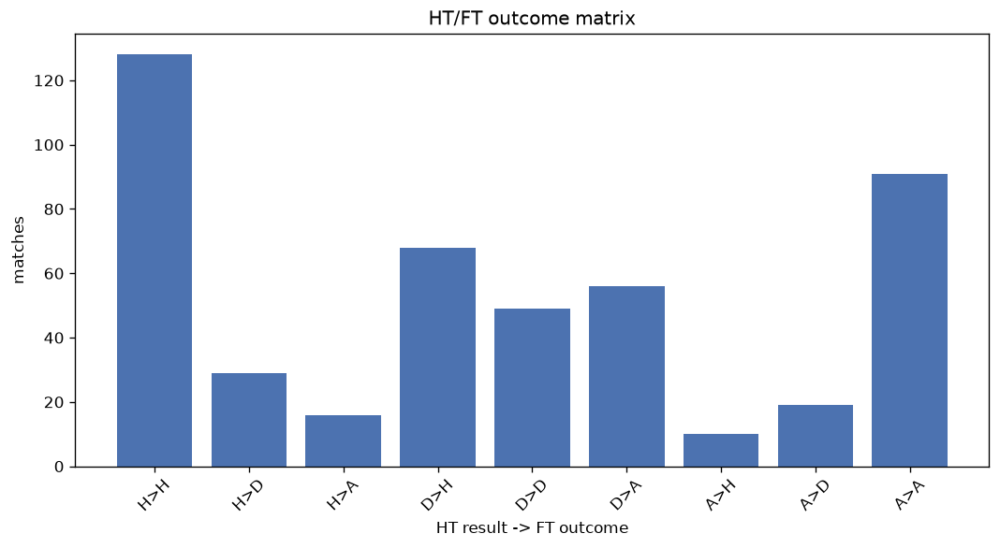
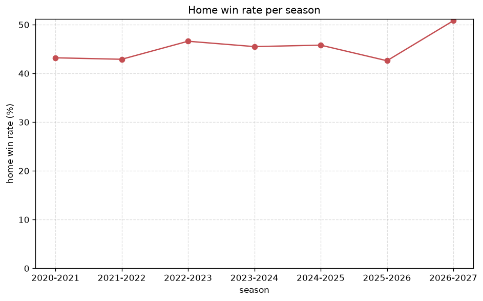

# Match Analysis
- Report: `matches_analysis`
- Generated: 2026-10-29T02:02:38+00:00
- Script: `backend/scripts/analyze_matches.py` v1.0.0
- League: Eerste Divisie (Netherlands)
- Scope: league `holland2`

## 1. Overall summary
| metric | value |
|---|---|
| Matches | 2412 |
| Home wins | 1079 (44.7%) |
| Draws | 530 (22.0%) |
| Away wins | 803 (33.3%) |
| Total goals | 7543 |
| Average goals per match | 3.127 |
| Goalless matches | 112 (4.6%) |

## 2. Per-season breakdown
| season | matches | home wins | draws | away wins | total goals | avg goals | goalless |
|---|---|---|---|---|---|---|---|
| 2020-2021 | 380 | 164 (43.2%) | 78 (20.5%) | 138 (36.3%) | 1228 | 3.232 | 19 (5.0%) |
| 2021-2022 | 380 | 163 (42.9%) | 82 (21.6%) | 135 (35.5%) | 1165 | 3.066 | 19 (5.0%) |
| 2022-2023 | 380 | 177 (46.6%) | 79 (20.8%) | 124 (32.6%) | 1166 | 3.068 | 13 (3.4%) |
| 2023-2024 | 380 | 173 (45.5%) | 94 (24.7%) | 113 (29.7%) | 1159 | 3.05 | 22 (5.8%) |
| 2024-2025 | 380 | 174 (45.8%) | 88 (23.2%) | 118 (31.1%) | 1146 | 3.016 | 23 (6.1%) |
| 2025-2026 | 392 | 167 (42.6%) | 85 (21.7%) | 140 (35.7%) | 1248 | 3.184 | 14 (3.6%) |
| 2026-2027 | 120 | 61 (50.8%) | 24 (20.0%) | 35 (29.2%) | 431 | 3.592 | 2 (1.7%) |

## 3. HT/FT outcome matrix
| HT result \ FT result | Home | Draw | Away | total |
|---|---|---|---|---|
| HT home lead | 668 (76.0%) | 146 (16.6%) | 65 (7.4%) | 879 |
| HT draw | 335 (37.8%) | 280 (31.6%) | 272 (30.7%) | 887 |
| HT away lead | 76 (11.8%) | 104 (16.1%) | 466 (72.1%) | 646 |

## 4. Comeback matches
- Home comebacks (trailing at HT, won at FT): **76** (3.2%)
- Away comebacks (trailing at HT, won at FT): **65** (2.7%)

### Home comebacks
| season | home | away | HT | FT |
|---|---|---|---|---|
| 2020-2021 | Den Bosch | Dordrecht | 0-1 | 2-1 |
| 2020-2021 | NAC Breda | Den Bosch | 0-1 | 2-1 |
| 2020-2021 | Helmond | Dordrecht | 1-2 | 5-2 |
| 2020-2021 | Nijmegen | Excelsior | 0-2 | 3-2 |
| 2020-2021 | Jong AZ | Eindhoven FC | 0-1 | 3-2 |
| 2020-2021 | NAC Breda | Helmond | 0-1 | 3-2 |
| 2020-2021 | Oss | Nijmegen | 0-1 | 2-1 |
| 2020-2021 | FC Volendam | Helmond | 0-1 | 5-1 |
| 2020-2021 | Excelsior | Nijmegen | 0-1 | 2-1 |
| 2020-2021 | Nijmegen | Jong AZ | 0-1 | 3-2 |
| 2020-2021 | Roda | Eindhoven FC | 0-1 | 2-1 |
| 2020-2021 | Cambuur | NAC Breda | 0-1 | 3-2 |
| 2021-2022 | Jong AZ | Almere City | 0-1 | 2-1 |
| 2021-2022 | Excelsior | Dordrecht | 0-1 | 3-1 |
| 2021-2022 | Jong PSV | Jong Ajax | 0-1 | 3-1 |
| 2021-2022 | Excelsior | Jong Utrecht | 0-1 | 2-1 |
| 2021-2022 | Den Haag | Jong AZ | 1-2 | 3-2 |
| 2021-2022 | FC Emmen | Jong Ajax | 0-1 | 2-1 |
| 2021-2022 | Dordrecht | Maastricht | 0-1 | 3-1 |
| 2021-2022 | Den Bosch | Jong PSV | 1-2 | 3-2 |
| 2021-2022 | Roda | Telstar | 1-2 | 4-3 |
| 2022-2023 | Jong AZ | Dordrecht | 0-1 | 3-1 |
| 2022-2023 | Jong Ajax | NAC Breda | 0-1 | 3-1 |
| 2022-2023 | Helmond | Dordrecht | 0-1 | 2-1 |
| 2022-2023 | Maastricht | Willem II | 0-2 | 3-2 |
| 2022-2023 | Almere City | Heracles | 0-2 | 3-2 |
| 2022-2023 | Jong PSV | Jong Utrecht | 0-1 | 2-1 |
| 2022-2023 | Jong PSV | Willem II | 0-1 | 3-2 |
| 2022-2023 | Roda | Maastricht | 0-1 | 2-1 |
| 2022-2023 | Den Bosch | Jong Ajax | 1-2 | 4-2 |
| 2022-2023 | Venlo | Heracles | 0-1 | 3-1 |
| 2022-2023 | Maastricht | Zwolle | 1-2 | 3-2 |
| 2022-2023 | Jong PSV | De Graafschap | 0-1 | 2-1 |
| 2022-2023 | Den Haag | Telstar | 0-1 | 3-1 |
| 2022-2023 | Telstar | NAC Breda | 0-1 | 2-1 |
| 2023-2024 | Willem II | Oss | 0-1 | 2-1 |
| 2023-2024 | Willem II | Jong Utrecht | 0-1 | 2-1 |
| 2023-2024 | Jong Ajax | Helmond | 0-1 | 4-1 |
| 2023-2024 | Groningen | Venlo | 0-1 | 2-1 |
| 2023-2024 | Eindhoven FC | FC Emmen | 1-2 | 3-2 |
| 2023-2024 | Groningen | Jong Utrecht | 0-1 | 2-1 |
| 2023-2024 | Den Haag | De Graafschap | 0-2 | 5-3 |
| 2023-2024 | FC Emmen | Jong Ajax | 0-1 | 4-2 |
| 2023-2024 | Oss | Eindhoven FC | 0-1 | 2-1 |
| 2023-2024 | Jong AZ | FC Emmen | 1-2 | 3-2 |
| 2023-2024 | Jong AZ | Venlo | 0-1 | 2-1 |
| 2023-2024 | Willem II | Telstar | 0-2 | 3-2 |
| 2024-2025 | Oss | Excelsior | 0-1 | 3-1 |
| 2024-2025 | Excelsior | Jong AZ | 1-2 | 4-2 |
| 2024-2025 | Excelsior | Maastricht | 1-2 | 3-2 |
| 2024-2025 | Den Bosch | Vitesse | 0-1 | 4-2 |
| 2024-2025 | FC Volendam | Den Bosch | 1-2 | 3-2 |
| 2024-2025 | Oss | Jong AZ | 0-1 | 2-1 |
| 2024-2025 | FC Emmen | Jong Ajax | 1-2 | 4-2 |
| 2024-2025 | Maastricht | Dordrecht | 0-1 | 2-1 |
| 2024-2025 | Helmond | Den Haag | 0-1 | 2-1 |
| 2024-2025 | Dordrecht | Telstar | 0-1 | 3-2 |
| 2024-2025 | Jong AZ | Jong Ajax | 0-1 | 2-1 |
| 2024-2025 | Cambuur | Telstar | 0-1 | 2-1 |
| 2024-2025 | FC Emmen | Jong PSV | 0-1 | 4-2 |
| 2024-2025 | Den Haag | Eindhoven FC | 0-1 | 2-1 |
| 2024-2025 | Jong Ajax | Excelsior | 0-1 | 3-2 |
| 2024-2025 | Roda | Jong PSV | 0-1 | 2-1 |
| 2024-2025 | Roda | Helmond | 1-2 | 3-2 |
| 2024-2025 | Telstar | Oss | 0-1 | 3-2 |
| 2025-2026 | FC Emmen | Den Bosch | 0-1 | 3-1 |
| 2025-2026 | Helmond | Jong AZ | 1-2 | 4-2 |
| 2025-2026 | Den Haag | De Graafschap | 1-2 | 3-2 |
| 2025-2026 | Jong Utrecht | Jong PSV | 2-3 | 5-3 |
| 2025-2026 | Cambuur | Eindhoven FC | 0-1 | 2-1 |
| 2025-2026 | Oss | Eindhoven FC | 0-1 | 2-1 |
| 2025-2026 | Oss | Jong Utrecht | 0-1 | 3-1 |
| 2025-2026 | Oss | Den Bosch | 0-1 | 4-2 |
| 2025-2026 | Cambuur | Vitesse | 0-1 | 2-1 |
| 2026-2027 | Heracles | Jong AZ | 1-2 | 3-2 |
| 2026-2027 | De Graafschap | Jong Utrecht | 0-1 | 2-1 |

### Away comebacks
| season | home | away | HT | FT |
|---|---|---|---|---|
| 2020-2021 | Helmond | Cambuur | 1-0 | 1-5 |
| 2020-2021 | Cambuur | Jong Ajax | 2-1 | 2-3 |
| 2020-2021 | Jong PSV | Almere City | 1-0 | 1-2 |
| 2020-2021 | Jong Ajax | Telstar | 1-0 | 1-2 |
| 2020-2021 | Telstar | NAC Breda | 1-0 | 1-2 |
| 2020-2021 | FC Volendam | Roda | 2-1 | 3-4 |
| 2020-2021 | NAC Breda | Excelsior | 1-0 | 1-2 |
| 2021-2022 | Jong Ajax | Dordrecht | 1-0 | 1-2 |
| 2021-2022 | Telstar | Roda | 3-1 | 3-4 |
| 2021-2022 | Maastricht | Jong PSV | 1-0 | 1-2 |
| 2021-2022 | Venlo | Jong Utrecht | 1-0 | 1-2 |
| 2021-2022 | Almere City | FC Volendam | 1-0 | 2-3 |
| 2021-2022 | Helmond | Maastricht | 1-0 | 1-2 |
| 2021-2022 | NAC Breda | Dordrecht | 1-0 | 1-2 |
| 2022-2023 | De Graafschap | Almere City | 1-0 | 1-2 |
| 2022-2023 | Jong Ajax | Willem II | 1-0 | 1-2 |
| 2022-2023 | Dordrecht | Jong Ajax | 2-1 | 3-4 |
| 2022-2023 | Willem II | NAC Breda | 1-0 | 1-2 |
| 2022-2023 | Jong PSV | Venlo | 1-0 | 1-2 |
| 2022-2023 | Jong PSV | NAC Breda | 1-0 | 1-2 |
| 2022-2023 | Almere City | Venlo | 1-0 | 1-3 |
| 2022-2023 | Den Haag | Willem II | 1-0 | 1-3 |
| 2022-2023 | Den Haag | Almere City | 2-1 | 2-3 |
| 2022-2023 | Helmond | Zwolle | 2-1 | 2-3 |
| 2023-2024 | Telstar | Venlo | 1-0 | 1-2 |
| 2023-2024 | Jong PSV | Maastricht | 1-0 | 2-3 |
| 2023-2024 | FC Emmen | Den Haag | 2-1 | 2-3 |
| 2023-2024 | Den Bosch | Venlo | 1-0 | 1-2 |
| 2023-2024 | Jong PSV | Den Haag | 1-0 | 1-2 |
| 2023-2024 | Helmond | Maastricht | 1-0 | 1-2 |
| 2023-2024 | Jong AZ | Den Haag | 1-0 | 1-2 |
| 2023-2024 | FC Emmen | NAC Breda | 2-0 | 2-3 |
| 2023-2024 | Willem II | Roda | 2-1 | 2-3 |
| 2023-2024 | Jong Utrecht | FC Emmen | 1-0 | 2-3 |
| 2023-2024 | FC Emmen | Maastricht | 1-0 | 1-3 |
| 2023-2024 | Telstar | FC Emmen | 2-0 | 2-3 |
| 2024-2025 | Jong Utrecht | FC Emmen | 1-0 | 1-2 |
| 2024-2025 | Jong Ajax | Jong AZ | 1-0 | 1-2 |
| 2024-2025 | Venlo | Dordrecht | 2-1 | 2-3 |
| 2024-2025 | Jong Utrecht | Roda | 1-0 | 1-3 |
| 2024-2025 | Den Bosch | Dordrecht | 2-0 | 2-3 |
| 2024-2025 | Jong PSV | Roda | 1-0 | 2-3 |
| 2024-2025 | FC Emmen | Eindhoven FC | 1-0 | 1-2 |
| 2024-2025 | Eindhoven FC | Jong Utrecht | 1-0 | 1-2 |
| 2024-2025 | Jong PSV | Dordrecht | 1-0 | 1-2 |
| 2024-2025 | Maastricht | Excelsior | 1-0 | 1-2 |
| 2024-2025 | Jong Utrecht | FC Volendam | 2-1 | 2-3 |
| 2025-2026 | Almere City | Jong PSV | 2-0 | 2-4 |
| 2025-2026 | Den Bosch | Jong AZ | 2-1 | 2-3 |
| 2025-2026 | Dordrecht | Waalwijk | 1-0 | 1-2 |
| 2025-2026 | Helmond | Dordrecht | 1-0 | 1-2 |
| 2025-2026 | Jong Utrecht | FC Emmen | 1-0 | 1-2 |
| 2025-2026 | De Graafschap | Roda | 2-0 | 2-3 |
| 2025-2026 | Jong PSV | Almere City | 1-0 | 2-3 |
| 2025-2026 | Oss | De Graafschap | 1-0 | 2-3 |
| 2025-2026 | Vitesse | Dordrecht | 1-0 | 1-2 |
| 2025-2026 | Oss | Vitesse | 1-0 | 1-2 |
| 2025-2026 | Jong Utrecht | Almere City | 2-1 | 2-3 |
| 2025-2026 | Jong PSV | Eindhoven FC | 1-0 | 1-2 |
| 2025-2026 | Waalwijk | Den Bosch | 1-0 | 2-3 |
| 2025-2026 | Den Bosch | Almere City | 2-0 | 2-3 |
| 2026-2027 | Oss | NAC Breda | 1-0 | 1-2 |
| 2026-2027 | NAC Breda | Jong Utrecht | 2-1 | 2-3 |
| 2026-2027 | Jong Utrecht | Roda | 1-0 | 1-2 |
| 2026-2027 | Almere City | Roda | 1-0 | 2-3 |

## 5. HT lead conversion
| HT state | matches | converted to win | held as draw | collapsed to loss |
|---|---|---|---|---|
| Home lead | 879 | 668 (76.0%) | 146 (16.6%) | 65 (7.4%) |
| Away lead | 646 | 466 (72.1%) | 104 (16.1%) | 76 (11.8%) |

### Matches level at half-time
| FT result | count | pct |
|---|---|---|
| Home win | 335 | 37.8% |
| Draw | 280 | 31.6% |
| Away win | 272 | 30.7% |

## 6. First-goal timing
- Matches with a first-goal time recorded: `2300` of `2412` (95.4%)

Outcome distribution by first-goal timing bucket:
| bucket | matches | % of matches | home | draw | away |
|---|---|---|---|---|---|
| 1-15 | 856 | 35.5% | 417 (48.7%) | 157 (18.3%) | 282 (32.9%) |
| 16-30 | 592 | 24.5% | 281 (47.5%) | 107 (18.1%) | 204 (34.5%) |
| 31-45 | 352 | 14.6% | 150 (42.6%) | 70 (19.9%) | 132 (37.5%) |
| 46-60 | 262 | 10.9% | 119 (45.4%) | 57 (21.8%) | 86 (32.8%) |
| 61-75 | 123 | 5.1% | 59 (48.0%) | 18 (14.6%) | 46 (37.4%) |
| 76-90 | 84 | 3.5% | 33 (39.3%) | 7 (8.3%) | 44 (52.4%) |
| 91-120 | 31 | 1.3% | 20 (64.5%) | 2 (6.5%) | 9 (29.0%) |

## 7. Goalless matches
- Overall: **112** of `2412` (4.6%)

| season | matches | goalless | pct |
|---|---|---|---|
| 2020-2021 | 380 | 19 | 5.0% |
| 2021-2022 | 380 | 19 | 5.0% |
| 2022-2023 | 380 | 13 | 3.4% |
| 2023-2024 | 380 | 22 | 5.8% |
| 2024-2025 | 380 | 23 | 6.1% |
| 2025-2026 | 392 | 14 | 3.6% |
| 2026-2027 | 120 | 2 | 1.7% |

---
*All statistics are computed from PostgreSQL tables (read-only). Run with `python backend/scripts/analyze_matches.py` to regenerate.*

## Charts

