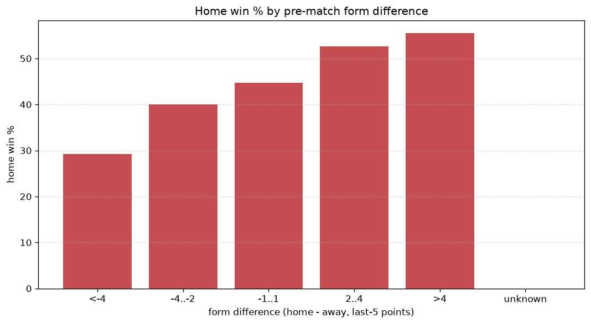
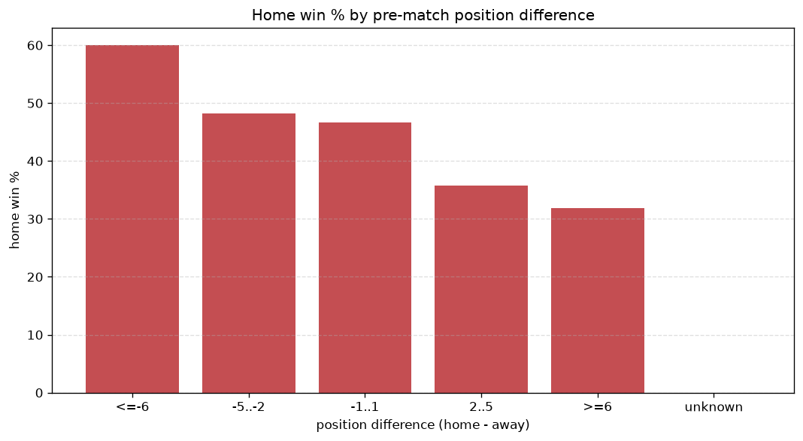

# Relationships Analysis
- Report: `relationships`
- Generated: 2026-10-26T01:35:31+00:00
- Script: `backend/scripts/analyze_relationships.py` v1.0.0
- League: Eerste Divisie (Netherlands)
- Scope: league `holland2`

- Matches analysed: **2292** (23 leakage-safe pre-match features).

## 1. Correlation matrix
_Pearson correlation of each pre-match feature with observed goals; sorted by |corr(total goals)|._

| feature | corr(home) | corr(away) | corr(total) |
|---|---|---|---|
| home_team_goals_scored_last_5 | 0.137 | -0.063 | 0.062 |
| home_team_wins_last_5 | 0.118 | -0.062 | 0.049 |
| home_team_home_goals_avg | 0.123 | -0.068 | 0.048 |
| home_team_points_last_5 | 0.117 | -0.069 | 0.042 |
| home_rest_days | 0.002 | 0.058 | 0.042 |
| rest_days_difference | 0.014 | 0.039 | 0.038 |
| away_team_goals_scored_last_5 | -0.027 | 0.080 | 0.036 |
| points_difference | 0.216 | -0.194 | 0.031 |
| position_difference | -0.205 | 0.187 | -0.028 |
| home_position_before_match | -0.150 | 0.129 | -0.026 |
| away_team_goals_conceded_last_5 | 0.095 | -0.070 | 0.024 |
| away_team_away_goals_avg | -0.069 | 0.102 | 0.018 |
| away_points_before_match | -0.066 | 0.052 | -0.015 |
| home_team_home_conceded_avg | -0.020 | 0.042 | 0.014 |
| away_rest_days | -0.010 | 0.030 | 0.013 |
| away_position_before_match | 0.137 | -0.133 | 0.013 |
| away_team_away_conceded_avg | 0.080 | -0.075 | 0.009 |
| away_team_wins_last_5 | -0.080 | 0.102 | 0.009 |
| home_team_goals_conceded_last_5 | -0.061 | 0.056 | -0.008 |
| home_points_before_match | 0.092 | -0.090 | 0.008 |
| home_team_home_win_rate | 0.078 | -0.076 | 0.007 |
| away_team_points_last_5 | -0.079 | 0.093 | 0.004 |
| away_team_away_win_rate | -0.085 | 0.098 | 0.003 |

## 2. Form vs outcome
_Home win/draw/away % per bucket of `home_team_points_last_5 - away_team_points_last_5`._

| bucket | matches | home | draw | away | home % | draw % | away % |
|---|---|---|---|---|---|---|---|
| <-4 | 387 | 113 | 107 | 167 | 29.2% | 27.6% | 43.2% |
| -4..-2 | 487 | 195 | 102 | 190 | 40.0% | 20.9% | 39.0% |
| -1..1 | 584 | 261 | 126 | 197 | 44.7% | 21.6% | 33.7% |
| 2..4 | 470 | 247 | 101 | 122 | 52.6% | 21.5% | 26.0% |
| >4 | 364 | 202 | 70 | 92 | 55.5% | 19.2% | 25.3% |
| unknown | 0 | 0 | 0 | 0 | - | - | - |

## 3. Position vs outcome
_Home win/draw/away % per bucket of `position_difference` (home position - away position; negative favours the home team)._

| bucket | matches | home | draw | away | home % | draw % | away % |
|---|---|---|---|---|---|---|---|
| <=-6 | 583 | 350 | 115 | 118 | 60.0% | 19.7% | 20.2% |
| -5..-2 | 398 | 192 | 93 | 113 | 48.2% | 23.4% | 28.4% |
| -1..1 | 285 | 133 | 61 | 91 | 46.7% | 21.4% | 31.9% |
| 2..5 | 411 | 147 | 111 | 153 | 35.8% | 27.0% | 37.2% |
| >=6 | 615 | 196 | 126 | 293 | 31.9% | 20.5% | 47.6% |
| unknown | 0 | 0 | 0 | 0 | - | - | - |

## 4. Rest advantage
_Home win/draw/away % per bucket of `rest_days_difference` (home rest - away rest). Matches with unknown rest are bucketed separately._

| bucket | matches | home | draw | away | home % | draw % | away % |
|---|---|---|---|---|---|---|---|
| <-1 | 448 | 192 | 106 | 150 | 42.9% | 23.7% | 33.5% |
| -1..0 | 148 | 67 | 29 | 52 | 45.3% | 19.6% | 35.1% |
| 0 | 1087 | 480 | 245 | 362 | 44.2% | 22.5% | 33.3% |
| 1..2 | 260 | 110 | 58 | 92 | 42.3% | 22.3% | 35.4% |
| >2 | 287 | 140 | 52 | 95 | 48.8% | 18.1% | 33.1% |
| unknown | 62 | 29 | 16 | 17 | 46.8% | 25.8% | 27.4% |
- *62 match(es) had unknown rest difference (missing rest data on at least one side).*

## 5. Home team quality
_Home win rate by `home_team_home_win_rate` tier (split at 0.5)._

- `< 0.5` tier: **40.1%** home win (558/1393)
- `>= 0.5` tier: **51.2%** home win (460/899)
- Home-win gap (>= split minus < split): **+11.1 pp**

| tier | label | matches | home | draw | away | home % |
|---|---|---|---|---|---|---|
| low | < 0.5 | 1393 | 558 | 314 | 521 | 40.1% |
| high | >= 0.5 | 899 | 460 | 192 | 247 | 51.2% |

## 6. Feature averages by result
_Mean feature value per outcome; `range` is home-minus-away spread of the group means._

| feature | home mean | draw mean | away mean | range |
|---|---|---|---|---|
| points_difference | 3.467 | -1.352 | -4.201 | 7.667 |
| home_points_before_match | 27.975 | 25.474 | 23.155 | 4.820 |
| position_difference | -1.959 | 0.723 | 2.637 | 4.595 |
| away_points_before_match | 24.509 | 26.826 | 27.355 | 2.847 |
| home_position_before_match | 9.587 | 10.846 | 11.893 | 2.306 |
| away_position_before_match | 11.546 | 10.123 | 9.257 | 2.290 |
| home_team_goals_scored_last_5 | 7.547 | 7.077 | 6.547 | 1.000 |
| away_team_points_last_5 | 5.986 | 6.769 | 6.939 | 0.953 |
| home_team_points_last_5 | 6.809 | 6.174 | 5.885 | 0.924 |
| away_team_goals_conceded_last_5 | 7.471 | 6.980 | 6.648 | 0.822 |
| home_team_goals_conceded_last_5 | 6.866 | 7.619 | 7.465 | 0.752 |
| away_team_goals_scored_last_5 | 6.908 | 7.401 | 7.583 | 0.676 |
| home_rest_days | 7.114 | 6.933 | 7.477 | 0.544 |
| away_team_wins_last_5 | 1.649 | 1.911 | 1.997 | 0.348 |
| home_team_wins_last_5 | 1.934 | 1.725 | 1.637 | 0.297 |
| rest_days_difference | -0.106 | -0.294 | -0.008 | 0.286 |
| away_rest_days | 7.213 | 7.227 | 7.491 | 0.278 |
| home_team_home_goals_avg | 1.695 | 1.608 | 1.480 | 0.215 |
| away_team_away_goals_avg | 1.255 | 1.365 | 1.428 | 0.173 |
| away_team_away_conceded_avg | 1.680 | 1.587 | 1.518 | 0.163 |
| home_team_home_conceded_avg | 1.297 | 1.369 | 1.364 | 0.072 |
| home_team_home_win_rate | 0.442 | 0.407 | 0.381 | 0.061 |
| away_team_away_win_rate | 0.299 | 0.342 | 0.361 | 0.061 |

---
*All features are leakage-safe pre-match values built by `ml.features.build_features.build_rows` from strictly prior matches. Run with `python backend/scripts/analyze_relationships.py` to regenerate.*

## Charts

