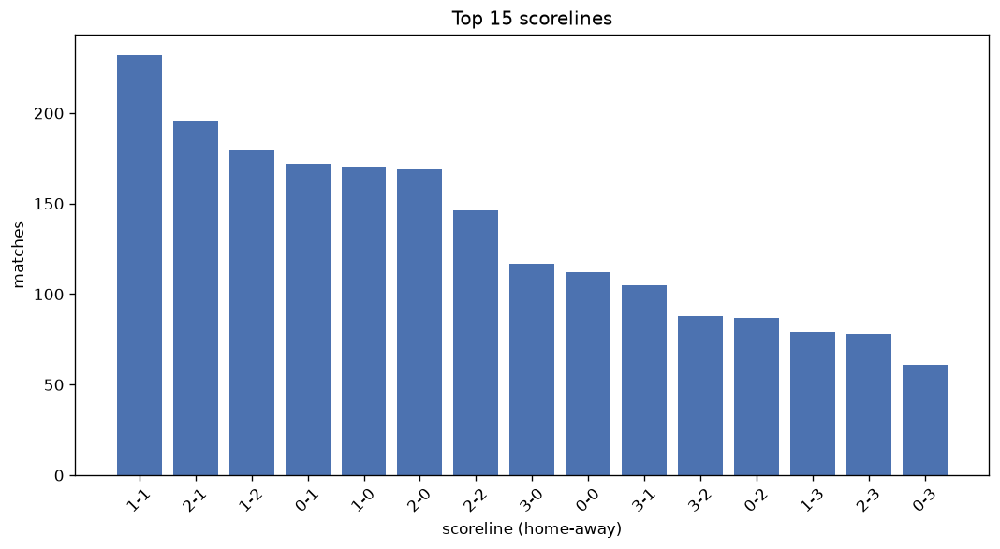
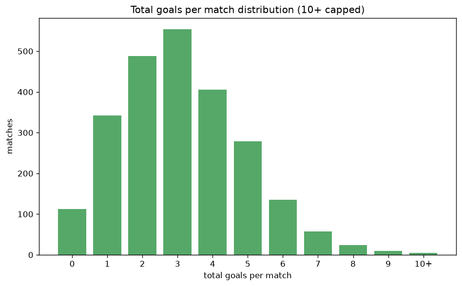

# Scoreline Analysis
- Report: `scoreline_analysis`
- Generated: 2026-10-29T02:02:45+00:00
- Script: `backend/scripts/analyze_scorelines.py` v1.0.0
- League: Eerste Divisie (Netherlands)
- Scope: league `holland2`

## 1. Scoreline frequency
- Matches analysed: **2412** across **7** seasons.
- Distinct scorelines seen: **54**.

| scoreline | count | pct |
|---|---|---|
| 1-1 | 232 | 9.6% |
| 2-1 | 196 | 8.1% |
| 1-2 | 180 | 7.5% |
| 0-1 | 172 | 7.1% |
| 1-0 | 170 | 7.0% |
| 2-0 | 169 | 7.0% |
| 2-2 | 146 | 6.1% |
| 3-0 | 117 | 4.9% |
| 0-0 | 112 | 4.6% |
| 3-1 | 105 | 4.4% |
| 3-2 | 88 | 3.6% |
| 0-2 | 87 | 3.6% |
| 1-3 | 79 | 3.3% |
| 2-3 | 78 | 3.2% |
| 0-3 | 61 | 2.5% |
| 4-0 | 53 | 2.2% |
| 4-1 | 49 | 2.0% |
| 1-4 | 37 | 1.5% |
| 3-3 | 35 | 1.5% |
| 4-2 | 30 | 1.2% |

## 2. Scoreline frequency per season

### 2020-2021
| scoreline | count | pct |
|---|---|---|
| 1-1 | 33 | 8.7% |
| 2-0 | 31 | 8.2% |
| 1-2 | 29 | 7.6% |
| 0-1 | 29 | 7.6% |
| 2-1 | 27 | 7.1% |

### 2021-2022
| scoreline | count | pct |
|---|---|---|
| 0-1 | 33 | 8.7% |
| 2-1 | 31 | 8.2% |
| 1-1 | 30 | 7.9% |
| 2-0 | 30 | 7.9% |
| 1-2 | 30 | 7.9% |

### 2022-2023
| scoreline | count | pct |
|---|---|---|
| 1-1 | 40 | 10.5% |
| 0-1 | 34 | 8.9% |
| 1-2 | 32 | 8.4% |
| 1-0 | 30 | 7.9% |
| 2-1 | 30 | 7.9% |

### 2023-2024
| scoreline | count | pct |
|---|---|---|
| 1-1 | 43 | 11.3% |
| 2-1 | 36 | 9.5% |
| 2-0 | 29 | 7.6% |
| 1-0 | 25 | 6.6% |
| 1-2 | 25 | 6.6% |

### 2024-2025
| scoreline | count | pct |
|---|---|---|
| 1-1 | 37 | 9.7% |
| 1-0 | 29 | 7.6% |
| 2-1 | 27 | 7.1% |
| 2-0 | 26 | 6.8% |
| 1-2 | 24 | 6.3% |

### 2025-2026
| scoreline | count | pct |
|---|---|---|
| 1-1 | 36 | 9.2% |
| 1-2 | 34 | 8.7% |
| 2-1 | 32 | 8.2% |
| 1-0 | 29 | 7.4% |
| 2-2 | 28 | 7.1% |

### 2026-2027
| scoreline | count | pct |
|---|---|---|
| 2-1 | 13 | 10.8% |
| 1-1 | 13 | 10.8% |
| 1-0 | 9 | 7.5% |
| 3-1 | 8 | 6.7% |
| 3-2 | 7 | 5.8% |

## 3. Total-goal histogram
_10+ groups all matches with 10 or more total goals._

| total goals | matches | pct |
|---|---|---|
| 0 | 112 | 4.6% |
| 1 | 342 | 14.2% |
| 2 | 488 | 20.2% |
| 3 | 554 | 23.0% |
| 4 | 406 | 16.8% |
| 5 | 279 | 11.6% |
| 6 | 135 | 5.6% |
| 7 | 57 | 2.4% |
| 8 | 24 | 1.0% |
| 9 | 10 | 0.4% |
| 10+ | 5 | 0.2% |

## 4. Extreme scorelines
- Matches with 7+ total goals: **96**

| season | date | scoreline | total goals |
|---|---|---|---|
| 2022-2023 | 2023-03-03 | 13-0 | 13 |
| 2020-2021 | 2020-09-06 | 4-6 | 10 |
| 2020-2021 | 2020-09-21 | 7-3 | 10 |
| 2024-2025 | 2024-12-20 | 6-4 | 10 |
| 2026-2027 | 2026-08-17 | 4-6 | 10 |
| 2020-2021 | 2020-11-15 | 7-2 | 9 |
| 2020-2021 | 2021-04-05 | 7-2 | 9 |
| 2021-2022 | 2021-09-13 | 6-3 | 9 |
| 2021-2022 | 2022-03-07 | 6-3 | 9 |
| 2022-2023 | 2022-12-16 | 8-1 | 9 |
| 2022-2023 | 2023-04-17 | 5-4 | 9 |
| 2023-2024 | 2023-11-06 | 1-8 | 9 |
| 2024-2025 | 2025-05-09 | 2-7 | 9 |
| 2026-2027 | 2026-09-05 | 3-6 | 9 |
| 2026-2027 | 2026-10-23 | 5-4 | 9 |
| 2020-2021 | 2020-09-05 | 1-7 | 8 |
| 2020-2021 | 2020-10-19 | 2-6 | 8 |
| 2020-2021 | 2020-10-23 | 7-1 | 8 |
| 2020-2021 | 2021-01-30 | 4-4 | 8 |
| 2020-2021 | 2021-04-09 | 3-5 | 8 |
| 2020-2021 | 2021-04-16 | 2-6 | 8 |
| 2021-2022 | 2021-09-10 | 7-1 | 8 |
| 2021-2022 | 2021-10-01 | 2-6 | 8 |
| 2021-2022 | 2021-10-22 | 3-5 | 8 |
| 2021-2022 | 2021-11-14 | 4-4 | 8 |
| 2021-2022 | 2021-11-19 | 4-4 | 8 |
| 2021-2022 | 2022-02-11 | 6-2 | 8 |
| 2021-2022 | 2022-04-15 | 5-3 | 8 |
| 2022-2023 | 2022-09-09 | 5-3 | 8 |
| 2022-2023 | 2022-11-14 | 4-4 | 8 |
| 2022-2023 | 2023-01-24 | 5-3 | 8 |
| 2022-2023 | 2023-03-13 | 2-6 | 8 |
| 2022-2023 | 2023-04-07 | 5-3 | 8 |
| 2023-2024 | 2024-01-12 | 5-3 | 8 |
| 2025-2026 | 2025-09-26 | 5-3 | 8 |
| 2025-2026 | 2026-01-19 | 5-3 | 8 |
| 2026-2027 | 2026-09-04 | 5-3 | 8 |
| 2026-2027 | 2026-10-16 | 4-4 | 8 |
| 2026-2027 | 2026-10-23 | 6-2 | 8 |
| 2020-2021 | 2020-08-29 | 1-6 | 7 |
| 2020-2021 | 2020-08-29 | 6-1 | 7 |
| 2020-2021 | 2020-09-25 | 5-2 | 7 |
| 2020-2021 | 2020-09-28 | 6-1 | 7 |
| 2020-2021 | 2020-11-07 | 2-5 | 7 |
| 2020-2021 | 2021-01-02 | 5-2 | 7 |
| 2020-2021 | 2021-01-03 | 2-5 | 7 |
| 2020-2021 | 2021-01-03 | 5-2 | 7 |
| 2020-2021 | 2021-01-15 | 2-5 | 7 |
| 2020-2021 | 2021-03-05 | 0-7 | 7 |
| 2020-2021 | 2021-03-06 | 3-4 | 7 |
| 2020-2021 | 2021-03-15 | 1-6 | 7 |
| 2020-2021 | 2021-03-19 | 4-3 | 7 |
| 2020-2021 | 2021-04-23 | 7-0 | 7 |
| 2021-2022 | 2021-08-20 | 3-4 | 7 |
| 2021-2022 | 2021-08-27 | 3-4 | 7 |
| 2021-2022 | 2021-10-30 | 3-4 | 7 |
| 2021-2022 | 2021-11-06 | 2-5 | 7 |
| 2021-2022 | 2021-12-03 | 2-5 | 7 |
| 2021-2022 | 2022-03-11 | 2-5 | 7 |
| 2021-2022 | 2022-04-25 | 6-1 | 7 |
| 2021-2022 | 2022-05-06 | 4-3 | 7 |
| 2022-2023 | 2022-11-04 | 3-4 | 7 |
| 2022-2023 | 2022-11-11 | 5-2 | 7 |
| 2022-2023 | 2023-02-03 | 4-3 | 7 |
| 2022-2023 | 2023-02-03 | 6-1 | 7 |
| 2022-2023 | 2023-02-24 | 7-0 | 7 |
| 2023-2024 | 2023-09-18 | 5-2 | 7 |
| 2023-2024 | 2023-09-29 | 3-4 | 7 |
| 2023-2024 | 2023-10-06 | 5-2 | 7 |
| 2023-2024 | 2023-10-23 | 3-4 | 7 |
| 2023-2024 | 2023-12-15 | 2-5 | 7 |
| 2023-2024 | 2024-01-12 | 5-2 | 7 |
| 2023-2024 | 2024-02-02 | 6-1 | 7 |
| 2023-2024 | 2024-04-12 | 2-5 | 7 |
| 2024-2025 | 2024-08-11 | 4-3 | 7 |
| 2024-2025 | 2024-08-12 | 6-1 | 7 |
| 2024-2025 | 2024-11-04 | 4-3 | 7 |
| 2024-2025 | 2024-11-22 | 3-4 | 7 |
| 2024-2025 | 2025-05-02 | 3-4 | 7 |
| 2025-2026 | 2025-08-24 | 5-2 | 7 |
| 2025-2026 | 2025-08-25 | 4-3 | 7 |
| 2025-2026 | 2025-09-19 | 3-4 | 7 |
| 2025-2026 | 2025-11-02 | 3-4 | 7 |
| 2025-2026 | 2025-11-21 | 5-2 | 7 |
| 2025-2026 | 2025-12-12 | 3-4 | 7 |
| 2025-2026 | 2025-12-12 | 3-4 | 7 |
| 2025-2026 | 2026-01-26 | 3-4 | 7 |
| 2025-2026 | 2026-03-20 | 3-4 | 7 |
| 2025-2026 | 2026-04-06 | 6-1 | 7 |
| 2026-2027 | 2026-08-07 | 3-4 | 7 |
| 2026-2027 | 2026-08-17 | 2-5 | 7 |
| 2026-2027 | 2026-08-21 | 5-2 | 7 |
| 2026-2027 | 2026-08-24 | 1-6 | 7 |
| 2026-2027 | 2026-08-28 | 6-1 | 7 |
| 2026-2027 | 2026-09-14 | 6-1 | 7 |
| 2026-2027 | 2026-09-18 | 6-1 | 7 |

## 5. Margin-of-victory distribution (decided matches)
- Decided matches: **1882** (draws: **530**)
- Average winning margin: **1.92**

| margin | matches | pct |
|---|---|---|
| 1 | 908 | 48.2% |
| 2 | 503 | 26.7% |
| 3+ | 471 | 25.0% |

## 6. Margin by outcome

### Home wins
- Matches: **1079** | avg margin: **2.03** | max margin: **13**
| margin | matches | pct |
|---|---|---|
| 1 | 462 | 42.8% |
| 2 | 313 | 29.0% |
| 3+ | 304 | 28.2% |
- *Full match-by-match list available in `scoreline_analysis.json`.*

### Away wins
- Matches: **803** | avg margin: **1.76** | max margin: **7**
| margin | matches | pct |
|---|---|---|
| 1 | 446 | 55.5% |
| 2 | 190 | 23.7% |
| 3+ | 167 | 20.8% |
- *Full match-by-match list available in `scoreline_analysis.json`.*

## 7. Most common exact score by outcome type
| outcome | matches | most common score | count | pct |
|---|---|---|---|---|
| home | 1079 | 2-1 | 196 | 18.2% |
| draw | 530 | 1-1 | 232 | 43.8% |
| away | 803 | 1-2 | 180 | 22.4% |

---
*All statistics are computed from PostgreSQL tables (read-only). Run with `python backend/scripts/analyze_scorelines.py` to regenerate.*

## Charts

