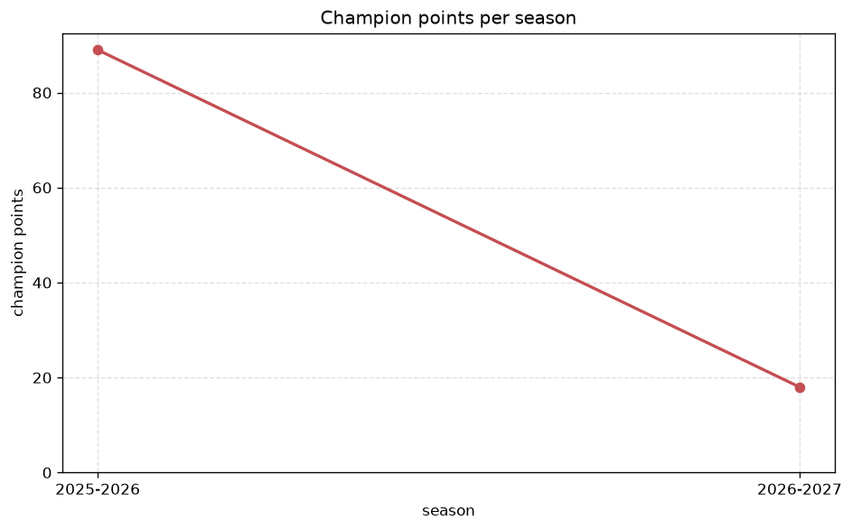
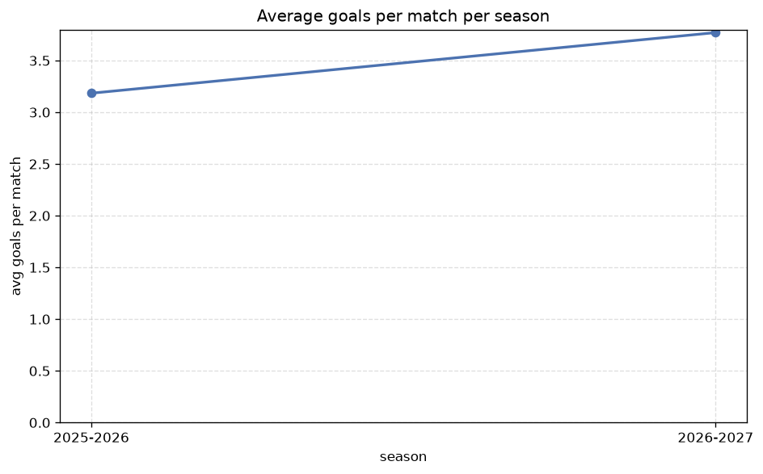

# Season Trends Analysis
- Report: `season_trends`
- Generated: 2026-10-27T01:52:08+00:00
- Script: `backend/scripts/analyze_seasons.py` v1.0.0
- League: Eerste Divisie (Netherlands)
- Scope: league `holland2`

## 1. Champions per season
| season | champion | pts | runner-up | margin |
|---|---|---|---|---|
| 2020-2021 | Cambuur | 92 | G.A. Eagles | 15 pts |
| 2021-2022 | FC Emmen | 83 | FC Volendam | 8 pts |
| 2022-2023 | Heracles | 85 | Zwolle | 0 pts |
| 2023-2024 | Willem II | 79 | Groningen | 4 pts |
| 2024-2025 | FC Volendam | 82 | Excelsior | 8 pts |
| 2025-2026 | Den Haag | 89 | Cambuur | 11 pts |
| 2026-2027 | Heracles | 29 | Venlo | 4 pts |

## 2. Title-race tightness
- Tight races (margin <= 3 pts): **1** of 7 seasons
- Tightest race: **2022-2023** - Heracles beat Zwolle by **0** pts

| season | margin | tight |
|---|---|---|
| 2020-2021 | 15 pts |  |
| 2021-2022 | 8 pts |  |
| 2022-2023 | 0 pts | yes |
| 2023-2024 | 4 pts |  |
| 2024-2025 | 8 pts |  |
| 2025-2026 | 11 pts |  |
| 2026-2027 | 4 pts |  |

## 3. Points thresholds
_Position-specific points per season. Key: 1 = champion, 2 = runner-up, 4 = CL line, 6 = Europa, 17 = last safe, 20 = bottom._

| season | pos 1 | pos 2 | pos 4 | pos 6 | pos 17 | pos 20 |
|---|---|---|---|---|---|---|
| 2020-2021 | 92 | 77 | 75 | 66 | 38 | 27 |
| 2021-2022 | 83 | 75 | 71 | 66 | 39 | 31 |
| 2022-2023 | 85 | 85 | 68 | 59 | 37 | 28 |
| 2023-2024 | 79 | 75 | 69 | 63 | 35 | 26 |
| 2024-2025 | 82 | 74 | 70 | 65 | 38 | 23 |
| 2025-2026 | 89 | 78 | 68 | 60 | 40 | 35 |
| 2026-2027 | 29 | 25 | 22 | 21 | 11 | 7 |

## 4. Relegation battle
| season | safe pos | safe pts | drop pos | drop pts | gap |
|---|---|---|---|---|---|
| 2020-2021 | 17 | 38 | 18 | 35 | 3 pts |
| 2021-2022 | 17 | 39 | 18 | 38 | 1 pts |
| 2022-2023 | 17 | 37 | 18 | 35 | 2 pts |
| 2023-2024 | 17 | 35 | 18 | 34 | 1 pts |
| 2024-2025 | 17 | 38 | 18 | 36 | 2 pts |
| 2025-2026 | 17 | 40 | 18 | 39 | 1 pts |
| 2026-2027 | 17 | 11 | 18 | 11 | 0 pts |

## 5. League-level trends
| season | matches | total goals | avg goals | home win | draw | away win | goalless | avg pts/team |
|---|---|---|---|---|---|---|---|---|
| 2020-2021 | 380 | 1228 | 3.232 | 43.2% | 20.5% | 36.3% | 5.0% | 53.1 |
| 2021-2022 | 380 | 1165 | 3.066 | 42.9% | 21.6% | 35.5% | 5.0% | 52.9 |
| 2022-2023 | 380 | 1166 | 3.068 | 46.6% | 20.8% | 32.6% | 3.4% | 53.05 |
| 2023-2024 | 380 | 1159 | 3.05 | 45.5% | 24.7% | 29.7% | 5.8% | 52.3 |
| 2024-2025 | 380 | 1146 | 3.016 | 45.8% | 23.2% | 31.1% | 6.1% | 52.6 |
| 2025-2026 | 392 | 1248 | 3.184 | 42.6% | 21.7% | 35.7% | 3.6% | 51.67 |
| 2026-2027 | 120 | 431 | 3.592 | 50.8% | 20.0% | 29.2% | 1.7% | 16.8 |

## 6. View divergence
- Largest divergence: **2020-2021** (goals view, avg abs position diff = 7.100)

_Avg absolute position difference between classic view and alternative view per season._

| season | classic vs luck | classic vs goals |
|---|---|---|
| 2020-2021 | 3.400 | 7.100 |
| 2021-2022 | 4.300 | 6.100 |
| 2022-2023 | 3.700 | 5.100 |
| 2023-2024 | 3.700 | 6.100 |
| 2024-2025 | 3.000 | 5.800 |
| 2025-2026 | 5.429 | 5.905 |
| 2026-2027 | 2.400 | 6.400 |

---
*All statistics are computed from PostgreSQL tables (read-only). Run with `python backend/scripts/analyze_seasons.py` to regenerate.*

## Charts

