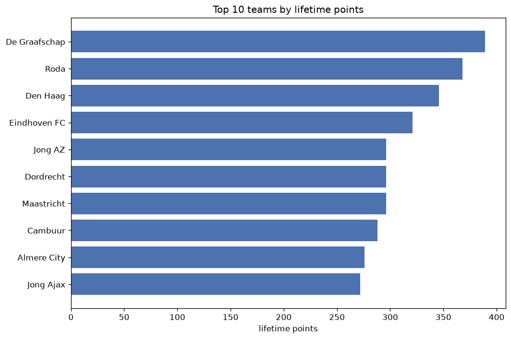
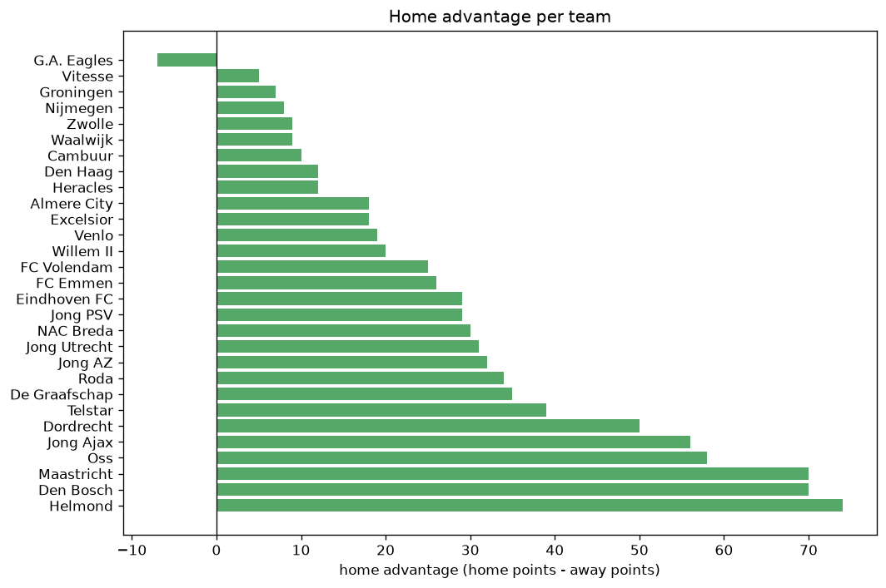

# Team Analysis
- Report: `teams_analysis`
- Generated: 2026-10-27T01:52:04+00:00
- Script: `backend/scripts/analyze_teams.py` v1.0.0
- League: Eerste Divisie (Netherlands)
- Scope: league `holland2`

- Teams: **29** | Seasons: **7** | Matches: **2412**

## 1. Team standings (lifetime)
| team | seasons | played | W | D | L | pts | GF | GA | GD | avg pts/season | best pos | worst pos | titles |
|---|---|---|---|---|---|---|---|---|---|---|---|---|---|
| De Graafschap | 7 | 242 | 112 | 53 | 77 | 389 | 409 | 335 | 74 | 55.57 | 3 | 16 | 0 |
| Roda | 7 | 242 | 99 | 71 | 72 | 368 | 387 | 329 | 58 | 52.57 | 3 | 15 | 0 |
| Den Haag | 5 | 190 | 101 | 43 | 46 | 346 | 358 | 244 | 114 | 69.2 | 1 | 12 | 1 |
| Eindhoven FC | 7 | 240 | 87 | 60 | 93 | 321 | 347 | 374 | -27 | 45.86 | 4 | 17 | 0 |
| Jong AZ | 7 | 240 | 84 | 44 | 112 | 296 | 378 | 426 | -48 | 42.29 | 8 | 17 | 0 |
| Dordrecht | 7 | 240 | 80 | 56 | 104 | 296 | 337 | 426 | -89 | 42.29 | 4 | 20 | 0 |
| Maastricht | 7 | 240 | 83 | 47 | 110 | 296 | 331 | 431 | -100 | 42.29 | 5 | 19 | 0 |
| Cambuur | 4 | 152 | 87 | 27 | 38 | 288 | 318 | 200 | 118 | 72.0 | 1 | 13 | 1 |
| Almere City | 5 | 170 | 82 | 30 | 58 | 276 | 304 | 241 | 63 | 55.2 | 3 | 14 | 0 |
| Jong Ajax | 7 | 240 | 71 | 59 | 110 | 272 | 365 | 429 | -64 | 38.86 | 7 | 20 | 0 |
| Jong PSV | 7 | 240 | 73 | 52 | 115 | 271 | 375 | 441 | -66 | 38.71 | 9 | 19 | 0 |
| NAC Breda | 5 | 164 | 77 | 37 | 50 | 268 | 285 | 226 | 59 | 53.6 | 5 | 8 | 0 |
| Den Bosch | 7 | 242 | 73 | 49 | 120 | 268 | 323 | 443 | -120 | 38.29 | 9 | 19 | 0 |
| FC Emmen | 5 | 164 | 80 | 26 | 58 | 266 | 263 | 228 | 35 | 53.2 | 1 | 15 | 1 |
| Venlo | 6 | 202 | 75 | 40 | 87 | 265 | 287 | 320 | -33 | 44.17 | 2 | 15 | 0 |
| Helmond | 7 | 240 | 68 | 60 | 112 | 264 | 296 | 401 | -105 | 37.71 | 11 | 20 | 0 |
| Oss | 7 | 240 | 67 | 53 | 120 | 254 | 269 | 406 | -137 | 36.29 | 10 | 18 | 0 |
| FC Volendam | 5 | 128 | 73 | 26 | 29 | 245 | 279 | 177 | 102 | 49.0 | 1 | 21 | 1 |
| Willem II | 3 | 120 | 66 | 30 | 24 | 228 | 213 | 121 | 92 | 76.0 | 1 | 4 | 1 |
| Telstar | 5 | 190 | 58 | 51 | 81 | 225 | 259 | 302 | -43 | 45.0 | 7 | 19 | 0 |
| Jong Utrecht | 7 | 240 | 52 | 47 | 141 | 203 | 269 | 458 | -189 | 29.0 | 13 | 20 | 0 |
| Excelsior | 3 | 114 | 55 | 23 | 36 | 188 | 221 | 161 | 60 | 62.67 | 2 | 9 | 0 |
| Vitesse | 3 | 88 | 31 | 24 | 33 | 117 | 134 | 145 | -11 | 39.0 | 7 | 14 | 0 |
| Heracles | 2 | 50 | 36 | 6 | 8 | 114 | 140 | 56 | 84 | 57.0 | 1 | 1 | 2 |
| Zwolle | 1 | 38 | 27 | 4 | 7 | 85 | 99 | 43 | 56 | 85.0 | 2 | 2 | 0 |
| Waalwijk | 2 | 54 | 20 | 19 | 15 | 79 | 96 | 80 | 16 | 39.5 | 6 | 11 | 0 |
| G.A. Eagles | 1 | 38 | 23 | 8 | 7 | 77 | 62 | 25 | 37 | 77.0 | 2 | 2 | 0 |
| Groningen | 1 | 38 | 22 | 9 | 7 | 75 | 71 | 30 | 41 | 75.0 | 2 | 2 | 0 |
| Nijmegen | 1 | 38 | 20 | 6 | 12 | 66 | 68 | 45 | 23 | 66.0 | 7 | 7 | 0 |

## 2. Home vs away split
| team | home P | H-W | H-D | H-L | H-pts | away P | A-W | A-D | A-L | A-pts | adv |
|---|---|---|---|---|---|---|---|---|---|---|---|
| Helmond | 120 | 46 | 31 | 43 | 169 | 120 | 22 | 29 | 69 | 95 | 74 |
| Maastricht | 120 | 53 | 24 | 43 | 183 | 120 | 30 | 23 | 67 | 113 | 70 |
| Den Bosch | 122 | 46 | 31 | 45 | 169 | 120 | 27 | 18 | 75 | 99 | 70 |
| Oss | 120 | 45 | 21 | 54 | 156 | 120 | 22 | 32 | 66 | 98 | 58 |
| Jong Ajax | 120 | 44 | 32 | 44 | 164 | 120 | 27 | 27 | 66 | 108 | 56 |
| Dordrecht | 120 | 47 | 32 | 41 | 173 | 120 | 33 | 24 | 63 | 123 | 50 |
| Telstar | 95 | 35 | 27 | 33 | 132 | 95 | 23 | 24 | 48 | 93 | 39 |
| De Graafschap | 121 | 62 | 26 | 33 | 212 | 121 | 50 | 27 | 44 | 177 | 35 |
| Roda | 120 | 55 | 36 | 29 | 201 | 122 | 44 | 35 | 43 | 167 | 34 |
| Jong AZ | 120 | 47 | 23 | 50 | 164 | 120 | 37 | 21 | 62 | 132 | 32 |
| Jong Utrecht | 120 | 31 | 24 | 65 | 117 | 120 | 21 | 23 | 76 | 86 | 31 |
| NAC Breda | 82 | 44 | 17 | 21 | 149 | 82 | 33 | 20 | 29 | 119 | 30 |
| Eindhoven FC | 121 | 48 | 31 | 42 | 175 | 119 | 39 | 29 | 51 | 146 | 29 |
| Jong PSV | 120 | 41 | 27 | 52 | 150 | 120 | 32 | 25 | 63 | 121 | 29 |
| FC Emmen | 82 | 45 | 11 | 26 | 146 | 82 | 35 | 15 | 32 | 120 | 26 |
| FC Volendam | 64 | 43 | 6 | 15 | 135 | 64 | 30 | 20 | 14 | 110 | 25 |
| Willem II | 60 | 38 | 10 | 12 | 124 | 60 | 28 | 20 | 12 | 104 | 20 |
| Venlo | 101 | 40 | 22 | 39 | 142 | 101 | 35 | 18 | 48 | 123 | 19 |
| Almere City | 85 | 44 | 15 | 26 | 147 | 85 | 38 | 15 | 32 | 129 | 18 |
| Excelsior | 57 | 31 | 10 | 16 | 103 | 57 | 24 | 13 | 20 | 85 | 18 |
| Den Haag | 95 | 53 | 20 | 22 | 179 | 95 | 48 | 23 | 24 | 167 | 12 |
| Heracles | 24 | 20 | 3 | 1 | 63 | 26 | 16 | 3 | 7 | 51 | 12 |
| Cambuur | 76 | 45 | 14 | 17 | 149 | 76 | 42 | 13 | 21 | 139 | 10 |
| Zwolle | 19 | 15 | 2 | 2 | 47 | 19 | 12 | 2 | 5 | 38 | 9 |
| Waalwijk | 27 | 12 | 8 | 7 | 44 | 27 | 8 | 11 | 8 | 35 | 9 |
| Nijmegen | 19 | 11 | 4 | 4 | 37 | 19 | 9 | 2 | 8 | 29 | 8 |
| Groningen | 19 | 12 | 5 | 2 | 41 | 19 | 10 | 4 | 5 | 34 | 7 |
| Vitesse | 44 | 16 | 13 | 15 | 61 | 44 | 15 | 11 | 18 | 56 | 5 |
| G.A. Eagles | 19 | 10 | 5 | 4 | 35 | 19 | 13 | 3 | 3 | 42 | -7 |

## 3. Top performers
### Best points per game (PPG)
| rank | team | PPG |
|---|---|---|
| 1 | Heracles | 2.28 |
| 2 | Zwolle | 2.24 |
| 3 | G.A. Eagles | 2.03 |
| 4 | Groningen | 1.97 |
| 5 | FC Volendam | 1.91 |

### Most goals scored
| rank | team | goals |
|---|---|---|
| 1 | De Graafschap | 409 |
| 2 | Roda | 387 |
| 3 | Jong AZ | 378 |
| 4 | Jong PSV | 375 |
| 5 | Jong Ajax | 365 |

### Best goal difference
| rank | team | GD |
|---|---|---|
| 1 | Cambuur | 118 |
| 2 | Den Haag | 114 |
| 3 | FC Volendam | 102 |
| 4 | Willem II | 92 |
| 5 | Heracles | 84 |

### Best defence (goals against per match, standings)
| rank | team | GA/match |
|---|---|---|
| 1 | G.A. Eagles | 0.658 |
| 2 | Groningen | 0.789 |
| 3 | Willem II | 1.008 |
| 4 | Heracles | 1.120 |
| 5 | Zwolle | 1.132 |

## 4. Team consistency
- Teams present in all **7** seasons: **12**

De Graafschap, Den Bosch, Dordrecht, Eindhoven FC, Helmond, Jong AZ, Jong Ajax, Jong PSV, Jong Utrecht, Maastricht, Oss, Roda

## 5. Head-to-head dominance
- Distinct fixtures: **368** (showing the 15 most frequent)

| fixture | meetings | home wins | draws | away wins | home pct | draw pct | away pct |
|---|---|---|---|---|---|---|---|
| Den Bosch vs Oss | 13 | 12 | 0 | 1 | 92.3% | 0.0% | 7.7% |
| Maastricht vs Eindhoven FC | 13 | 9 | 1 | 3 | 69.2% | 7.7% | 23.1% |
| Den Bosch vs Helmond | 13 | 8 | 3 | 2 | 61.5% | 23.1% | 15.4% |
| Helmond vs Jong PSV | 13 | 8 | 3 | 2 | 61.5% | 23.1% | 15.4% |
| Jong AZ vs Dordrecht | 13 | 8 | 3 | 2 | 61.5% | 23.1% | 15.4% |
| De Graafschap vs Den Bosch | 13 | 7 | 3 | 3 | 53.8% | 23.1% | 23.1% |
| De Graafschap vs Jong AZ | 13 | 7 | 3 | 3 | 53.8% | 23.1% | 23.1% |
| Den Bosch vs Dordrecht | 13 | 7 | 3 | 3 | 53.8% | 23.1% | 23.1% |
| Den Bosch vs Eindhoven FC | 13 | 7 | 2 | 4 | 53.8% | 15.4% | 30.8% |
| Den Bosch vs Jong PSV | 13 | 7 | 2 | 4 | 53.8% | 15.4% | 30.8% |
| Den Bosch vs Maastricht | 13 | 7 | 3 | 3 | 53.8% | 23.1% | 23.1% |
| Helmond vs Jong AZ | 13 | 7 | 2 | 4 | 53.8% | 15.4% | 30.8% |
| Helmond vs Jong Ajax | 13 | 7 | 5 | 1 | 53.8% | 38.5% | 7.7% |
| Maastricht vs Jong Utrecht | 13 | 7 | 2 | 4 | 53.8% | 15.4% | 30.8% |
| Oss vs Jong PSV | 13 | 7 | 4 | 2 | 53.8% | 30.8% | 15.4% |

## 6. Position per season (classic view)
_Cells show final position; '-' when the team was absent from that season._

| team | 2020-2021 | 2021-2022 | 2022-2023 | 2023-2024 | 2024-2025 | 2025-2026 | 2026-2027 |
|---|---|---|---|---|---|---|---|
| De Graafschap | 3 | 9 | 10 | 6 | 6 | 5 | 16 |
| Roda | 8 | 5 | 15 | 3 | 12 | 8 | 5 |
| Den Haag | - | 3 | 12 | 5 | 4 | 1 | - |
| Eindhoven FC | 15 | 4 | 8 | 14 | 11 | 12 | 17 |
| Jong AZ | 17 | 13 | 11 | 10 | 10 | 17 | 8 |
| Dordrecht | 20 | 17 | 18 | 4 | 5 | 11 | 18 |
| Maastricht | 11 | 16 | 5 | 9 | 16 | 19 | 10 |
| Cambuur | 1 | - | - | 13 | 3 | 2 | - |
| Almere City | 4 | 14 | 3 | - | - | 4 | 4 |
| Jong Ajax | 16 | 7 | 13 | 15 | 18 | 20 | 15 |
| Jong PSV | 14 | 12 | 14 | 16 | 19 | 9 | 12 |
| NAC Breda | 5 | 8 | 6 | 8 | - | - | 6 |
| Den Bosch | 19 | 11 | 19 | 19 | 9 | 10 | 13 |
| FC Emmen | - | 1 | - | 7 | 8 | 15 | 3 |
| Venlo | - | 10 | 7 | 12 | 15 | 14 | 2 |
| Helmond | 12 | 20 | 16 | 11 | 13 | 18 | 19 |
| Oss | 10 | 15 | 17 | 18 | 17 | 16 | 14 |
| FC Volendam | 6 | 2 | - | - | 1 | 21 | 7 |
| Willem II | - | - | 4 | 1 | - | 3 | - |
| Telstar | 13 | 19 | 9 | 17 | 7 | - | - |
| Jong Utrecht | 18 | 18 | 20 | 20 | 20 | 13 | 20 |
| Excelsior | 9 | 6 | - | - | 2 | - | - |
| Vitesse | - | - | - | - | 14 | 7 | 9 |
| Heracles | - | - | 1 | - | - | - | 1 |
| Zwolle | - | - | 2 | - | - | - | - |
| Waalwijk | - | - | - | - | - | 6 | 11 |
| G.A. Eagles | 2 | - | - | - | - | - | - |
| Groningen | - | - | - | 2 | - | - | - |
| Nijmegen | 7 | - | - | - | - | - | - |

---
*All statistics are computed from PostgreSQL tables (read-only). Run with `python backend/scripts/analyze_teams.py` to regenerate.*

## Charts

