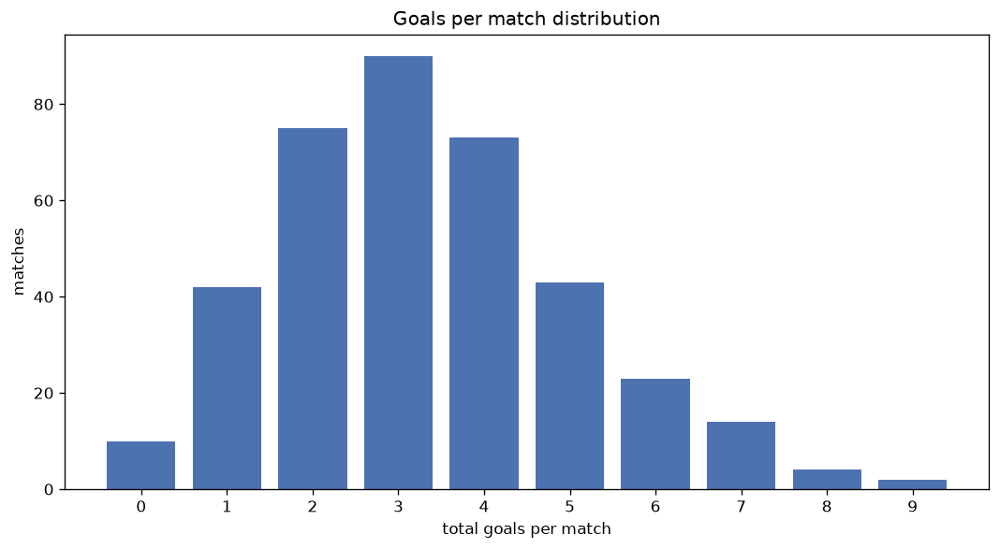
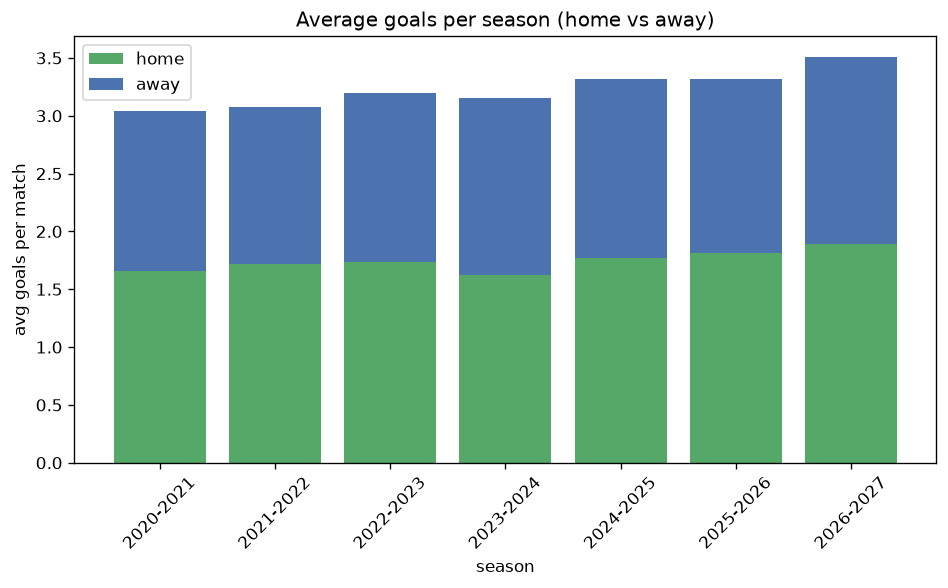

# Goal Analysis
- Report: `goals_analysis`
- Generated: 2026-10-29T02:02:57+00:00
- Script: `backend/scripts/analyze_goals.py` v1.0.0
- League: Tweede Divisie (Netherlands)
- Scope: league `holland3`

## 1. Goals per match distribution
| goals | matches | pct |
|---|---|---|
| 0 | 58 | 3.4% |
| 1 | 201 | 11.9% |
| 2 | 370 | 21.9% |
| 3 | 381 | 22.5% |
| 4 | 310 | 18.3% |
| 5 | 200 | 11.8% |
| 6 | 104 | 6.1% |
| 7 | 47 | 2.8% |
| 8 | 16 | 0.9% |
| 9 | 3 | 0.2% |
| 10 | 2 | 0.1% |
| 11 | 1 | 0.1% |

## 2. Goals per match per season
| season | matches | total goals | avg home | avg away | avg total |
|---|---|---|---|---|---|
| 2020-2021 | 47 | 143 | 1.66 | 1.383 | 3.043 |
| 2021-2022 | 306 | 940 | 1.716 | 1.356 | 3.072 |
| 2022-2023 | 306 | 978 | 1.739 | 1.458 | 3.196 |
| 2023-2024 | 306 | 966 | 1.624 | 1.533 | 3.157 |
| 2024-2025 | 306 | 1016 | 1.768 | 1.552 | 3.32 |
| 2025-2026 | 322 | 1069 | 1.814 | 1.506 | 3.32 |
| 2026-2027 | 100 | 351 | 1.89 | 1.62 | 3.51 |

## 3. Home vs away goal share
- Home goals: **2946** (53.9%)
- Away goals: **2517** (46.1%)
- Home/away ratio: **1.17**

| season | home goals | away goals | total | home pct | away pct |
|---|---|---|---|---|---|
| 2020-2021 | 78 | 65 | 143 | 54.5% | 45.5% |
| 2021-2022 | 525 | 415 | 940 | 55.9% | 44.1% |
| 2022-2023 | 532 | 446 | 978 | 54.4% | 45.6% |
| 2023-2024 | 497 | 469 | 966 | 51.4% | 48.6% |
| 2024-2025 | 541 | 475 | 1016 | 53.2% | 46.8% |
| 2025-2026 | 584 | 485 | 1069 | 54.6% | 45.4% |
| 2026-2027 | 189 | 162 | 351 | 53.8% | 46.2% |

## 4. BTTS (Both Teams To Score)
- Overall: **1006** of `1693` (59.4%)

| season | matches | BTTS | pct |
|---|---|---|---|
| 2020-2021 | 47 | 31 | 66.0% |
| 2021-2022 | 306 | 169 | 55.2% |
| 2022-2023 | 306 | 178 | 58.2% |
| 2023-2024 | 306 | 186 | 60.8% |
| 2024-2025 | 306 | 180 | 58.8% |
| 2025-2026 | 322 | 196 | 60.9% |
| 2026-2027 | 100 | 66 | 66.0% |

## 5. Clean sheets
- Home clean sheets: **414** (24.5%)
- Away clean sheets: **331** (19.6%)
- Total clean sheets recorded: **745**
- Matches with at least one clean sheet: **687** (40.6%)
- Both teams kept clean sheets (0-0): **58**

| season | matches | home CS | away CS | total CS | matches w/ CS |
|---|---|---|---|---|---|
| 2020-2021 | 47 | 7 | 11 | 18 | 16 (34.0%) |
| 2021-2022 | 306 | 87 | 59 | 146 | 137 (44.8%) |
| 2022-2023 | 306 | 78 | 64 | 142 | 128 (41.8%) |
| 2023-2024 | 306 | 66 | 66 | 132 | 120 (39.2%) |
| 2024-2025 | 306 | 73 | 63 | 136 | 126 (41.2%) |
| 2025-2026 | 322 | 84 | 52 | 136 | 126 (39.1%) |
| 2026-2027 | 100 | 19 | 16 | 35 | 34 (34.0%) |

## 6. Scoring intensity
- First-half goals: **2386** (43.7%)
- Second-half goals: **3075** (56.3%)
- Avg first-half goals per match: **1.41**
- Avg second-half goals per match: **1.817**
- Second-half-only scoring (HT 0-0, FT goals >= 1): **336** (19.8%)
- *1 match(es) excluded (no HT score recorded).*

| season | matches | 1st half | 2nd half | 1st half pct | 2nd half pct |
|---|---|---|---|---|---|
| 2020-2021 | 47 | 69 | 74 | 48.3% | 51.7% |
| 2021-2022 | 306 | 417 | 523 | 44.4% | 55.6% |
| 2022-2023 | 306 | 422 | 556 | 43.1% | 56.9% |
| 2023-2024 | 306 | 432 | 534 | 44.7% | 55.3% |
| 2024-2025 | 306 | 415 | 601 | 40.8% | 59.2% |
| 2025-2026 | 322 | 473 | 596 | 44.2% | 55.8% |
| 2026-2027 | 100 | 158 | 191 | 45.3% | 54.7% |

## 7. First-goal timing
- Matches with first-goal time recorded: `1634` of `1693` (96.5%)
- Goalless matches: `59`
- Min `1` | Max `96` | Mean `28.65` | Median (p50) `23.0`

| bucket | count | % of matches | % of scoring matches |
|---|---|---|---|
| 1-15 | 585 | 34.6% | 35.8% |
| 16-30 | 413 | 24.4% | 25.3% |
| 31-45 | 272 | 16.1% | 16.6% |
| 46-60 | 193 | 11.4% | 11.8% |
| 61-75 | 108 | 6.4% | 6.6% |
| 76-90 | 45 | 2.7% | 2.8% |
| 91-120 | 18 | 1.1% | 1.1% |

---
*All statistics are computed from PostgreSQL tables (read-only). Run with `python backend/scripts/analyze_goals.py` to regenerate.*

## Charts

