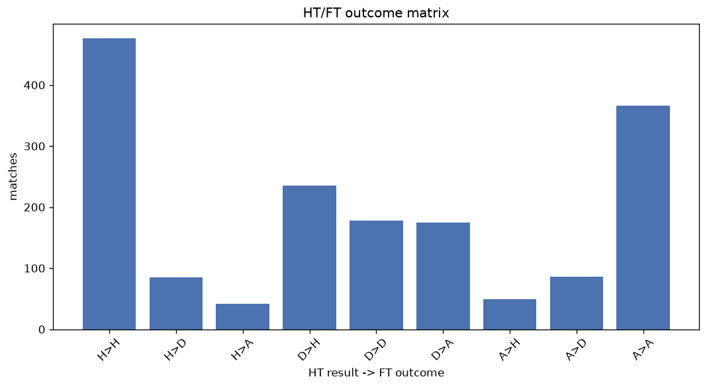
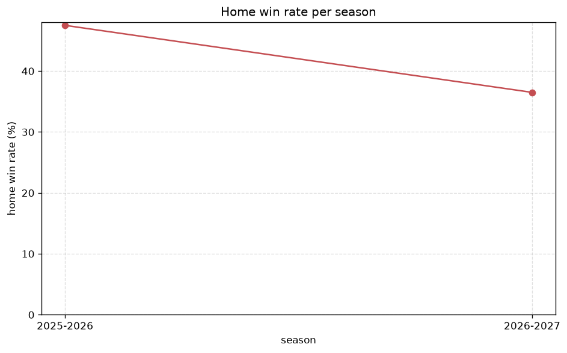

# Match Analysis
- Report: `matches_analysis`
- Generated: 2026-10-30T03:55:09+00:00
- Script: `backend/scripts/analyze_matches.py` v1.0.0
- League: Tweede Divisie (Netherlands)
- Scope: league `holland3`

## 1. Overall summary
| metric | value |
|---|---|
| Matches | 1693 |
| Home wins | 760 (44.9%) |
| Draws | 349 (20.6%) |
| Away wins | 584 (34.5%) |
| Total goals | 5463 |
| Average goals per match | 3.227 |
| Goalless matches | 58 (3.4%) |

## 2. Per-season breakdown
| season | matches | home wins | draws | away wins | total goals | avg goals | goalless |
|---|---|---|---|---|---|---|---|
| 2020-2021 | 47 | 20 (42.6%) | 15 (31.9%) | 12 (25.5%) | 143 | 3.043 | 2 (4.3%) |
| 2021-2022 | 306 | 154 (50.3%) | 60 (19.6%) | 92 (30.1%) | 940 | 3.072 | 9 (2.9%) |
| 2022-2023 | 306 | 138 (45.1%) | 65 (21.2%) | 103 (33.7%) | 978 | 3.196 | 14 (4.6%) |
| 2023-2024 | 306 | 119 (38.9%) | 71 (23.2%) | 116 (37.9%) | 966 | 3.157 | 12 (3.9%) |
| 2024-2025 | 306 | 134 (43.8%) | 55 (18.0%) | 117 (38.2%) | 1016 | 3.32 | 10 (3.3%) |
| 2025-2026 | 322 | 153 (47.5%) | 63 (19.6%) | 106 (32.9%) | 1069 | 3.32 | 10 (3.1%) |
| 2026-2027 | 100 | 42 (42.0%) | 20 (20.0%) | 38 (38.0%) | 351 | 3.51 | 1 (1.0%) |

## 3. HT/FT outcome matrix
| HT result \ FT result | Home | Draw | Away | total |
|---|---|---|---|---|
| HT home lead | 476 (78.9%) | 85 (14.1%) | 42 (7.0%) | 603 |
| HT draw | 235 (40.0%) | 178 (30.3%) | 175 (29.8%) | 588 |
| HT away lead | 49 (9.8%) | 86 (17.2%) | 366 (73.1%) | 501 |
- *1 match(es) excluded (no HT score recorded).*

## 4. Comeback matches
- Home comebacks (trailing at HT, won at FT): **49** (2.9%)
- Away comebacks (trailing at HT, won at FT): **42** (2.5%)

### Home comebacks
| season | home | away | HT | FT |
|---|---|---|---|---|
| 2020-2021 | IJsselmeervogels | Jong Volendam | 0-2 | 4-3 |
| 2020-2021 | Spakenburg | Katwijk | 1-2 | 3-2 |
| 2020-2021 | Hardenberg | Jong Sparta Rotterdam | 0-1 | 3-1 |
| 2021-2022 | HFC | ASWH | 0-2 | 3-2 |
| 2021-2022 | IJsselmeervogels | ASWH | 0-1 | 3-2 |
| 2021-2022 | HFC | IJsselmeervogels | 0-1 | 4-1 |
| 2021-2022 | Hardenberg | Noordwijk | 0-1 | 2-1 |
| 2021-2022 | Excelsior Maassluis | Rijnsburgse Boys | 0-2 | 3-2 |
| 2021-2022 | Jong Sparta Rotterdam | GVVV | 0-1 | 2-1 |
| 2021-2022 | Scheveningen | Kozakken Boys | 0-1 | 2-1 |
| 2021-2022 | Rijnsburgse Boys | Jong Sparta Rotterdam | 0-1 | 2-1 |
| 2022-2023 | De Treffers | TEC | 0-1 | 2-1 |
| 2022-2023 | Katwijk | Hardenberg | 0-1 | 2-1 |
| 2022-2023 | Katwijk | Jong Sparta Rotterdam | 0-1 | 3-1 |
| 2022-2023 | Oostzaan | Excelsior Maassluis | 0-1 | 3-1 |
| 2022-2023 | Noordwijk | HFC | 0-1 | 2-1 |
| 2022-2023 | AFC | TEC | 0-1 | 2-1 |
| 2022-2023 | TEC | Excelsior Maassluis | 0-1 | 2-1 |
| 2022-2023 | IJsselmeervogels | Spakenburg | 0-1 | 4-1 |
| 2023-2024 | Katwijk | Lisse | 0-1 | 3-1 |
| 2023-2024 | Scheveningen | GVVV | 0-1 | 3-1 |
| 2023-2024 | HFC | Spakenburg | 0-1 | 2-1 |
| 2023-2024 | Spakenburg | Excelsior Maassluis | 0-1 | 4-2 |
| 2023-2024 | Jong Sparta Rotterdam | HFC | 0-1 | 4-1 |
| 2023-2024 | Rijnsburgse Boys | Hardenberg | 0-1 | 2-1 |
| 2023-2024 | Hardenberg | HFC | 1-2 | 3-2 |
| 2023-2024 | De Treffers | Jong Sparta Rotterdam | 0-1 | 2-1 |
| 2023-2024 | Jong Almere City | Lisse | 0-1 | 6-1 |
| 2023-2024 | Excelsior Maassluis | AFC | 0-1 | 2-1 |
| 2024-2025 | HFC | Jong Almere City | 0-1 | 2-1 |
| 2024-2025 | ACV Assen | AFC | 1-2 | 3-2 |
| 2024-2025 | RKAV Volendam | ACV Assen | 0-1 | 3-2 |
| 2024-2025 | Spakenburg | Noordwijk | 0-1 | 2-1 |
| 2024-2025 | AFC | RKAV Volendam | 0-1 | 2-1 |
| 2025-2026 | Kozakken Boys | IJsselmeervogels | 0-2 | 4-3 |
| 2025-2026 | HFC | Jong Almere City | 0-1 | 2-1 |
| 2025-2026 | Hoek | IJsselmeervogels | 0-1 | 2-1 |
| 2025-2026 | Spakenburg | AFC | 0-1 | 2-1 |
| 2025-2026 | Katwijk | GVVV | 0-1 | 2-1 |
| 2025-2026 | Katwijk | Kozakken Boys | 0-1 | 2-1 |
| 2025-2026 | GVVV | IJsselmeervogels | 0-1 | 3-1 |
| 2025-2026 | Jong Almere City | RKAV Volendam | 0-2 | 3-2 |
| 2025-2026 | RKAV Volendam | Barendrecht | 0-1 | 5-2 |
| 2025-2026 | HFC | Spakenburg | 0-1 | 3-2 |
| 2025-2026 | Jong Sparta Rotterdam | Groningen U21 | 1-2 | 3-2 |
| 2026-2027 | Jong Sparta Rotterdam | Raalte | 0-1 | 6-1 |
| 2026-2027 | Kozakken Boys | GVVV | 1-2 | 3-2 |
| 2026-2027 | HFC | Kloetinge | 0-1 | 2-1 |
| 2026-2027 | Quick Boys | Hoek | 0-1 | 3-1 |

### Away comebacks
| season | home | away | HT | FT |
|---|---|---|---|---|
| 2020-2021 | TEC | HFC | 1-0 | 1-2 |
| 2021-2022 | Kozakken Boys | AFC | 1-0 | 1-3 |
| 2021-2022 | Noordwijk | Spakenburg | 1-0 | 2-3 |
| 2021-2022 | Scheveningen | AFC | 1-0 | 1-2 |
| 2021-2022 | ASWH | Katwijk | 1-0 | 1-3 |
| 2022-2023 | TEC | Quick Boys | 1-0 | 1-3 |
| 2022-2023 | Noordwijk | Lisse | 1-0 | 1-2 |
| 2022-2023 | Kozakken Boys | Noordwijk | 1-0 | 2-3 |
| 2022-2023 | Quick Boys | AFC | 1-0 | 1-3 |
| 2022-2023 | Oostzaan | Rijnsburgse Boys | 2-1 | 2-3 |
| 2022-2023 | TEC | De Treffers | 1-0 | 1-2 |
| 2022-2023 | De Treffers | Rijnsburgse Boys | 1-0 | 1-2 |
| 2022-2023 | Kozakken Boys | Lisse | 1-0 | 1-2 |
| 2022-2023 | Jong Sparta Rotterdam | AFC | 2-1 | 2-3 |
| 2022-2023 | Rijnsburgse Boys | HFC | 1-0 | 2-3 |
| 2023-2024 | HFC | ACV Assen | 2-1 | 2-4 |
| 2023-2024 | Lisse | Rijnsburgse Boys | 1-0 | 1-2 |
| 2023-2024 | Quick Boys | De Treffers | 2-1 | 2-4 |
| 2023-2024 | AFC | Noordwijk | 1-0 | 1-3 |
| 2023-2024 | Noordwijk | ACV Assen | 2-0 | 2-3 |
| 2023-2024 | Katwijk | Jong Sparta Rotterdam | 2-1 | 3-4 |
| 2024-2025 | Jong Sparta Rotterdam | ADO 20 Heemskerk | 1-0 | 1-2 |
| 2024-2025 | Spakenburg | AFC | 1-0 | 1-2 |
| 2024-2025 | HFC | Quick Boys | 1-0 | 1-2 |
| 2024-2025 | Jong Almere City | Jong Sparta Rotterdam | 2-1 | 3-4 |
| 2024-2025 | Jong Almere City | Rijnsburgse Boys | 2-1 | 2-3 |
| 2024-2025 | De Treffers | Excelsior Maassluis | 1-0 | 3-4 |
| 2024-2025 | Hardenberg | Katwijk | 1-0 | 1-2 |
| 2025-2026 | ACV Assen | Kozakken Boys | 1-0 | 1-2 |
| 2025-2026 | IJsselmeervogels | Barendrecht | 1-0 | 1-3 |
| 2025-2026 | HFC | Rijnsburgse Boys | 1-0 | 1-2 |
| 2025-2026 | ACV Assen | Jong Sparta Rotterdam | 1-0 | 1-2 |
| 2025-2026 | Spakenburg | RKAV Volendam | 1-0 | 3-4 |
| 2025-2026 | ACV Assen | RKAV Volendam | 1-0 | 1-2 |
| 2025-2026 | IJsselmeervogels | Katwijk | 2-1 | 2-3 |
| 2025-2026 | Spakenburg | Kozakken Boys | 3-1 | 3-4 |
| 2025-2026 | Barendrecht | Katwijk | 2-1 | 2-3 |
| 2025-2026 | Hoek | Kozakken Boys | 1-0 | 1-2 |
| 2025-2026 | HFC | Barendrecht | 1-0 | 1-2 |
| 2026-2027 | Kozakken Boys | IJsselmeervogels | 1-0 | 1-2 |
| 2026-2027 | Jong Almere City | HFC | 1-0 | 1-2 |
| 2026-2027 | Raalte | Kozakken Boys | 1-0 | 1-2 |

## 5. HT lead conversion
| HT state | matches | converted to win | held as draw | collapsed to loss |
|---|---|---|---|---|
| Home lead | 603 | 476 (78.9%) | 85 (14.1%) | 42 (7.0%) |
| Away lead | 501 | 366 (73.1%) | 86 (17.2%) | 49 (9.8%) |

### Matches level at half-time
| FT result | count | pct |
|---|---|---|
| Home win | 235 | 40.0% |
| Draw | 178 | 30.3% |
| Away win | 175 | 29.8% |
- *1 match(es) excluded (no HT score recorded).*

## 6. First-goal timing
- Matches with a first-goal time recorded: `1634` of `1693` (96.5%)

Outcome distribution by first-goal timing bucket:
| bucket | matches | % of matches | home | draw | away |
|---|---|---|---|---|---|
| 1-15 | 585 | 34.6% | 281 (48.0%) | 102 (17.4%) | 202 (34.5%) |
| 16-30 | 413 | 24.4% | 194 (47.0%) | 69 (16.7%) | 150 (36.3%) |
| 31-45 | 272 | 16.1% | 116 (42.6%) | 61 (22.4%) | 95 (34.9%) |
| 46-60 | 193 | 11.4% | 88 (45.6%) | 34 (17.6%) | 71 (36.8%) |
| 61-75 | 108 | 6.4% | 53 (49.1%) | 18 (16.7%) | 37 (34.3%) |
| 76-90 | 45 | 2.7% | 19 (42.2%) | 6 (13.3%) | 20 (44.4%) |
| 91-120 | 18 | 1.1% | 9 (50.0%) | 1 (5.6%) | 8 (44.4%) |

## 7. Goalless matches
- Overall: **58** of `1693` (3.4%)

| season | matches | goalless | pct |
|---|---|---|---|
| 2020-2021 | 47 | 2 | 4.3% |
| 2021-2022 | 306 | 9 | 2.9% |
| 2022-2023 | 306 | 14 | 4.6% |
| 2023-2024 | 306 | 12 | 3.9% |
| 2024-2025 | 306 | 10 | 3.3% |
| 2025-2026 | 322 | 10 | 3.1% |
| 2026-2027 | 100 | 1 | 1.0% |

---
*All statistics are computed from PostgreSQL tables (read-only). Run with `python backend/scripts/analyze_matches.py` to regenerate.*

## Charts

