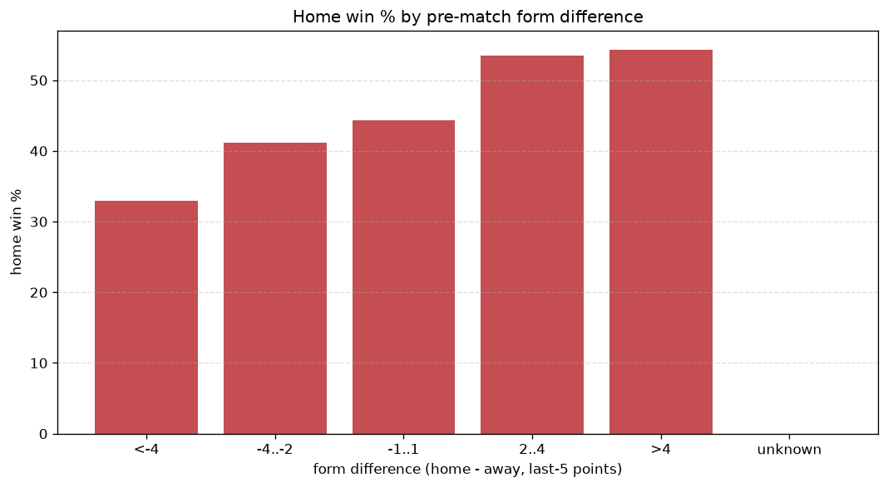
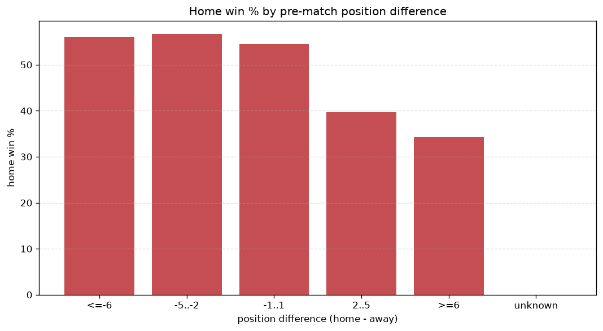

# Relationships Analysis
- Report: `relationships`
- Generated: 2026-10-27T01:52:49+00:00
- Script: `backend/scripts/analyze_relationships.py` v1.0.0
- League: Tweede Divisie (Netherlands)
- Scope: league `holland3`

- Matches analysed: **1593** (23 leakage-safe pre-match features).

## 1. Correlation matrix
_Pearson correlation of each pre-match feature with observed goals; sorted by |corr(total goals)|._

| feature | corr(home) | corr(away) | corr(total) |
|---|---|---|---|
| home_team_goals_scored_last_5 | 0.108 | -0.025 | 0.067 |
| home_team_home_goals_avg | 0.097 | -0.024 | 0.059 |
| home_points_before_match | 0.117 | -0.051 | 0.055 |
| away_team_away_conceded_avg | 0.085 | -0.021 | 0.052 |
| rest_days_difference | 0.056 | 0.000 | 0.044 |
| away_team_away_goals_avg | -0.051 | 0.113 | 0.044 |
| position_difference | -0.212 | 0.168 | -0.043 |
| home_team_home_conceded_avg | -0.058 | 0.120 | 0.043 |
| away_position_before_match | 0.138 | -0.095 | 0.039 |
| home_team_goals_conceded_last_5 | -0.041 | 0.089 | 0.034 |
| away_points_before_match | -0.038 | 0.083 | 0.032 |
| points_difference | 0.206 | -0.178 | 0.031 |
| away_team_goals_scored_last_5 | -0.081 | 0.127 | 0.030 |
| home_team_wins_last_5 | 0.090 | -0.058 | 0.029 |
| away_team_goals_conceded_last_5 | 0.082 | -0.055 | 0.024 |
| away_team_wins_last_5 | -0.093 | 0.127 | 0.021 |
| home_position_before_match | -0.154 | 0.136 | -0.021 |
| home_team_points_last_5 | 0.080 | -0.058 | 0.020 |
| home_rest_days | 0.035 | -0.013 | 0.018 |
| away_rest_days | -0.009 | -0.012 | -0.016 |
| home_team_home_win_rate | 0.096 | -0.084 | 0.013 |
| away_team_away_win_rate | -0.058 | 0.074 | 0.009 |
| away_team_points_last_5 | -0.108 | 0.124 | 0.006 |

## 2. Form vs outcome
_Home win/draw/away % per bucket of `home_team_points_last_5 - away_team_points_last_5`._

| bucket | matches | home | draw | away | home % | draw % | away % |
|---|---|---|---|---|---|---|---|
| <-4 | 276 | 91 | 59 | 126 | 33.0% | 21.4% | 45.7% |
| -4..-2 | 320 | 132 | 64 | 124 | 41.2% | 20.0% | 38.8% |
| -1..1 | 438 | 194 | 91 | 153 | 44.3% | 20.8% | 34.9% |
| 2..4 | 312 | 167 | 59 | 86 | 53.5% | 18.9% | 27.6% |
| >4 | 247 | 134 | 56 | 57 | 54.3% | 22.7% | 23.1% |
| unknown | 0 | 0 | 0 | 0 | - | - | - |

## 3. Position vs outcome
_Home win/draw/away % per bucket of `position_difference` (home position - away position; negative favours the home team)._

| bucket | matches | home | draw | away | home % | draw % | away % |
|---|---|---|---|---|---|---|---|
| <=-6 | 376 | 222 | 74 | 80 | 59.0% | 19.7% | 21.3% |
| -5..-2 | 284 | 148 | 58 | 78 | 52.1% | 20.4% | 27.5% |
| -1..1 | 228 | 104 | 50 | 74 | 45.6% | 21.9% | 32.5% |
| 2..5 | 329 | 121 | 66 | 142 | 36.8% | 20.1% | 43.2% |
| >=6 | 376 | 123 | 81 | 172 | 32.7% | 21.5% | 45.7% |
| unknown | 0 | 0 | 0 | 0 | - | - | - |

## 4. Rest advantage
_Home win/draw/away % per bucket of `rest_days_difference` (home rest - away rest). Matches with unknown rest are bucketed separately._

| bucket | matches | home | draw | away | home % | draw % | away % |
|---|---|---|---|---|---|---|---|
| <-1 | 77 | 25 | 26 | 26 | 32.5% | 33.8% | 33.8% |
| -1..0 | 45 | 21 | 7 | 17 | 46.7% | 15.6% | 37.8% |
| 0 | 1302 | 597 | 263 | 442 | 45.9% | 20.2% | 33.9% |
| 1..2 | 50 | 19 | 11 | 20 | 38.0% | 22.0% | 40.0% |
| >2 | 60 | 31 | 7 | 22 | 51.7% | 11.7% | 36.7% |
| unknown | 59 | 25 | 15 | 19 | 42.4% | 25.4% | 32.2% |
- *59 match(es) had unknown rest difference (missing rest data on at least one side).*

## 5. Home team quality
_Home win rate by `home_team_home_win_rate` tier (split at 0.5)._

- `< 0.5` tier: **40.4%** home win (361/894)
- `>= 0.5` tier: **51.1%** home win (357/699)
- Home-win gap (>= split minus < split): **+10.7 pp**

| tier | label | matches | home | draw | away | home % |
|---|---|---|---|---|---|---|
| low | < 0.5 | 894 | 361 | 189 | 344 | 40.4% |
| high | >= 0.5 | 699 | 357 | 140 | 202 | 51.1% |

## 6. Feature averages by result
_Mean feature value per outcome; `range` is home-minus-away spread of the group means._

| feature | home mean | draw mean | away mean | range |
|---|---|---|---|---|
| points_difference | 2.844 | -0.520 | -3.592 | 6.436 |
| position_difference | -1.585 | 0.371 | 2.346 | 3.931 |
| home_points_before_match | 24.217 | 21.106 | 20.632 | 3.585 |
| away_points_before_match | 21.373 | 21.626 | 24.223 | 2.850 |
| home_position_before_match | 8.922 | 9.912 | 10.998 | 2.076 |
| away_position_before_match | 10.507 | 9.541 | 8.652 | 1.855 |
| away_team_points_last_5 | 5.834 | 6.277 | 7.024 | 1.190 |
| away_team_goals_scored_last_5 | 6.666 | 7.146 | 7.846 | 1.180 |
| rest_days_difference | 0.159 | -0.930 | -0.159 | 1.089 |
| home_rest_days | 8.830 | 7.898 | 8.070 | 0.932 |
| away_team_goals_conceded_last_5 | 7.397 | 7.106 | 6.584 | 0.813 |
| home_team_goals_scored_last_5 | 7.425 | 6.781 | 6.700 | 0.725 |
| home_team_points_last_5 | 6.492 | 6.073 | 5.789 | 0.702 |
| away_rest_days | 8.671 | 8.829 | 8.222 | 0.608 |
| home_team_goals_conceded_last_5 | 6.890 | 7.109 | 7.491 | 0.601 |
| away_team_wins_last_5 | 1.646 | 1.781 | 2.029 | 0.383 |
| home_team_wins_last_5 | 1.864 | 1.717 | 1.615 | 0.248 |
| home_team_home_conceded_avg | 1.258 | 1.353 | 1.443 | 0.184 |
| home_team_home_goals_avg | 1.672 | 1.537 | 1.495 | 0.177 |
| away_team_away_conceded_avg | 1.648 | 1.618 | 1.491 | 0.157 |
| away_team_away_goals_avg | 1.282 | 1.349 | 1.406 | 0.125 |
| home_team_home_win_rate | 0.448 | 0.400 | 0.365 | 0.083 |
| away_team_away_win_rate | 0.308 | 0.309 | 0.347 | 0.039 |

---
*All features are leakage-safe pre-match values built by `ml.features.build_features.build_rows` from strictly prior matches. Run with `python backend/scripts/analyze_relationships.py` to regenerate.*

## Charts

