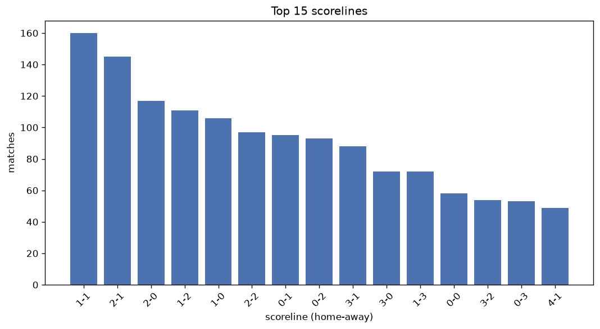
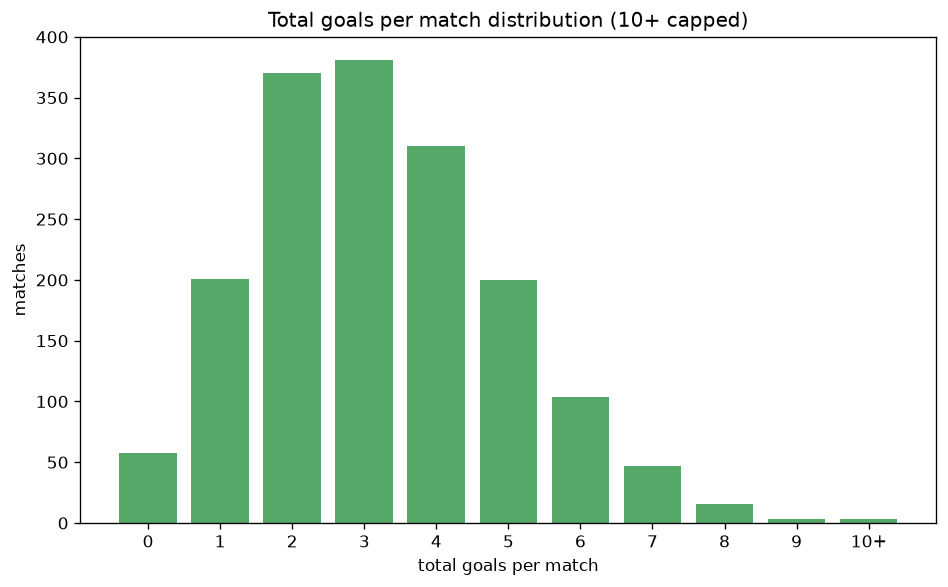

# Scoreline Analysis
- Report: `scoreline_analysis`
- Generated: 2026-10-26T01:35:45+00:00
- Script: `backend/scripts/analyze_scorelines.py` v1.0.0
- League: Tweede Divisie (Netherlands)
- Scope: league `holland3`

## 1. Scoreline frequency
- Matches analysed: **1693** across **7** seasons.
- Distinct scorelines seen: **50**.

| scoreline | count | pct |
|---|---|---|
| 1-1 | 160 | 9.5% |
| 2-1 | 145 | 8.6% |
| 2-0 | 117 | 6.9% |
| 1-2 | 111 | 6.6% |
| 1-0 | 106 | 6.3% |
| 2-2 | 97 | 5.7% |
| 0-1 | 95 | 5.6% |
| 0-2 | 93 | 5.5% |
| 3-1 | 88 | 5.2% |
| 3-0 | 72 | 4.3% |
| 1-3 | 72 | 4.3% |
| 0-0 | 58 | 3.4% |
| 3-2 | 54 | 3.2% |
| 0-3 | 53 | 3.1% |
| 4-1 | 49 | 2.9% |
| 2-3 | 42 | 2.5% |
| 4-0 | 37 | 2.2% |
| 1-4 | 31 | 1.8% |
| 3-3 | 30 | 1.8% |
| 4-2 | 21 | 1.2% |

## 2. Scoreline frequency per season

### 2020-2021
| scoreline | count | pct |
|---|---|---|
| 2-2 | 7 | 14.9% |
| 1-1 | 6 | 12.8% |
| 0-2 | 5 | 10.6% |
| 3-1 | 5 | 10.6% |
| 2-1 | 4 | 8.5% |

### 2021-2022
| scoreline | count | pct |
|---|---|---|
| 2-0 | 34 | 11.1% |
| 2-1 | 33 | 10.8% |
| 1-1 | 29 | 9.5% |
| 1-0 | 20 | 6.5% |
| 0-2 | 18 | 5.9% |

### 2022-2023
| scoreline | count | pct |
|---|---|---|
| 2-1 | 30 | 9.8% |
| 1-1 | 29 | 9.5% |
| 1-0 | 22 | 7.2% |
| 0-1 | 19 | 6.2% |
| 2-0 | 18 | 5.9% |

### 2023-2024
| scoreline | count | pct |
|---|---|---|
| 1-1 | 34 | 11.1% |
| 2-1 | 24 | 7.8% |
| 1-2 | 23 | 7.5% |
| 2-2 | 23 | 7.5% |
| 0-1 | 21 | 6.9% |

### 2024-2025
| scoreline | count | pct |
|---|---|---|
| 1-2 | 27 | 8.8% |
| 1-1 | 23 | 7.5% |
| 2-0 | 21 | 6.9% |
| 1-0 | 20 | 6.5% |
| 0-1 | 19 | 6.2% |

### 2025-2026
| scoreline | count | pct |
|---|---|---|
| 1-1 | 29 | 9.0% |
| 2-1 | 28 | 8.7% |
| 1-0 | 26 | 8.1% |
| 1-2 | 25 | 7.8% |
| 2-0 | 18 | 5.6% |

### 2026-2027
| scoreline | count | pct |
|---|---|---|
| 1-1 | 10 | 10.0% |
| 2-1 | 9 | 9.0% |
| 1-2 | 7 | 7.0% |
| 1-3 | 7 | 7.0% |
| 0-1 | 7 | 7.0% |

## 3. Total-goal histogram
_10+ groups all matches with 10 or more total goals._

| total goals | matches | pct |
|---|---|---|
| 0 | 58 | 3.4% |
| 1 | 201 | 11.9% |
| 2 | 370 | 21.9% |
| 3 | 381 | 22.5% |
| 4 | 310 | 18.3% |
| 5 | 200 | 11.8% |
| 6 | 104 | 6.1% |
| 7 | 47 | 2.8% |
| 8 | 16 | 0.9% |
| 9 | 3 | 0.2% |
| 10+ | 3 | 0.2% |

## 4. Extreme scorelines
- Matches with 7+ total goals: **69**

| season | date | scoreline | total goals |
|---|---|---|---|
| 2023-2024 | 2023-09-16 | 4-7 | 11 |
| 2022-2023 | 2022-09-03 | 5-5 | 10 |
| 2026-2027 | 2026-10-10 | 2-8 | 10 |
| 2022-2023 | 2022-11-05 | 7-2 | 9 |
| 2025-2026 | 2026-05-23 | 5-4 | 9 |
| 2026-2027 | 2026-08-22 | 3-6 | 9 |
| 2021-2022 | 2021-08-28 | 2-6 | 8 |
| 2021-2022 | 2022-04-30 | 3-5 | 8 |
| 2022-2023 | 2022-12-03 | 2-6 | 8 |
| 2022-2023 | 2023-04-15 | 6-2 | 8 |
| 2022-2023 | 2023-05-06 | 5-3 | 8 |
| 2022-2023 | 2023-05-20 | 4-4 | 8 |
| 2022-2023 | 2023-05-27 | 7-1 | 8 |
| 2023-2024 | 2023-09-02 | 5-3 | 8 |
| 2023-2024 | 2024-04-06 | 8-0 | 8 |
| 2024-2025 | 2024-09-07 | 3-5 | 8 |
| 2024-2025 | 2024-10-19 | 5-3 | 8 |
| 2024-2025 | 2025-05-03 | 0-8 | 8 |
| 2025-2026 | 2025-08-23 | 4-4 | 8 |
| 2025-2026 | 2025-10-11 | 4-4 | 8 |
| 2025-2026 | 2025-11-15 | 8-0 | 8 |
| 2025-2026 | 2026-04-11 | 6-2 | 8 |
| 2020-2021 | 2020-09-26 | 4-3 | 7 |
| 2021-2022 | 2021-09-04 | 2-5 | 7 |
| 2021-2022 | 2021-11-06 | 2-5 | 7 |
| 2021-2022 | 2022-03-26 | 4-3 | 7 |
| 2021-2022 | 2022-04-23 | 3-4 | 7 |
| 2021-2022 | 2022-04-30 | 5-2 | 7 |
| 2021-2022 | 2022-05-07 | 2-5 | 7 |
| 2022-2023 | 2022-08-20 | 7-0 | 7 |
| 2022-2023 | 2022-09-07 | 5-2 | 7 |
| 2022-2023 | 2022-10-01 | 1-6 | 7 |
| 2022-2023 | 2023-04-08 | 3-4 | 7 |
| 2022-2023 | 2023-04-10 | 7-0 | 7 |
| 2022-2023 | 2023-04-22 | 6-1 | 7 |
| 2022-2023 | 2023-05-20 | 4-3 | 7 |
| 2022-2023 | 2023-05-27 | 4-3 | 7 |
| 2023-2024 | 2023-10-28 | 4-3 | 7 |
| 2023-2024 | 2023-11-18 | 3-4 | 7 |
| 2023-2024 | 2024-02-10 | 6-1 | 7 |
| 2023-2024 | 2024-02-17 | 2-5 | 7 |
| 2023-2024 | 2024-03-09 | 4-3 | 7 |
| 2023-2024 | 2024-03-23 | 3-4 | 7 |
| 2023-2024 | 2024-05-04 | 3-4 | 7 |
| 2024-2025 | 2024-08-17 | 6-1 | 7 |
| 2024-2025 | 2024-09-07 | 5-2 | 7 |
| 2024-2025 | 2024-09-21 | 1-6 | 7 |
| 2024-2025 | 2024-10-12 | 2-5 | 7 |
| 2024-2025 | 2024-11-09 | 2-5 | 7 |
| 2024-2025 | 2024-12-14 | 3-4 | 7 |
| 2024-2025 | 2025-02-22 | 3-4 | 7 |
| 2024-2025 | 2025-03-08 | 2-5 | 7 |
| 2024-2025 | 2025-03-15 | 1-6 | 7 |
| 2024-2025 | 2025-04-19 | 3-4 | 7 |
| 2024-2025 | 2025-05-24 | 3-4 | 7 |
| 2025-2026 | 2025-08-16 | 4-3 | 7 |
| 2025-2026 | 2025-09-27 | 4-3 | 7 |
| 2025-2026 | 2025-09-27 | 5-2 | 7 |
| 2025-2026 | 2025-10-04 | 5-2 | 7 |
| 2025-2026 | 2025-10-25 | 4-3 | 7 |
| 2025-2026 | 2025-12-13 | 3-4 | 7 |
| 2025-2026 | 2026-01-31 | 3-4 | 7 |
| 2025-2026 | 2026-03-07 | 4-3 | 7 |
| 2025-2026 | 2026-03-21 | 3-4 | 7 |
| 2025-2026 | 2026-05-16 | 5-2 | 7 |
| 2025-2026 | 2026-05-23 | 7-0 | 7 |
| 2025-2026 | 2026-06-03 | 0-7 | 7 |
| 2026-2027 | 2026-08-15 | 6-1 | 7 |
| 2026-2027 | 2026-09-12 | 6-1 | 7 |

## 5. Margin-of-victory distribution (decided matches)
- Decided matches: **1344** (draws: **349**)
- Average winning margin: **2.0**

| margin | matches | pct |
|---|---|---|
| 1 | 576 | 42.9% |
| 2 | 411 | 30.6% |
| 3+ | 357 | 26.6% |

## 6. Margin by outcome

### Home wins
- Matches: **760** | avg margin: **2.05** | max margin: **8**
| margin | matches | pct |
|---|---|---|
| 1 | 316 | 41.6% |
| 2 | 229 | 30.1% |
| 3+ | 215 | 28.3% |
- *Full match-by-match list available in `scoreline_analysis.json`.*

### Away wins
- Matches: **584** | avg margin: **1.93** | max margin: **8**
| margin | matches | pct |
|---|---|---|
| 1 | 260 | 44.5% |
| 2 | 182 | 31.2% |
| 3+ | 142 | 24.3% |
- *Full match-by-match list available in `scoreline_analysis.json`.*

## 7. Most common exact score by outcome type
| outcome | matches | most common score | count | pct |
|---|---|---|---|---|
| home | 760 | 2-1 | 145 | 19.1% |
| draw | 349 | 1-1 | 160 | 45.8% |
| away | 584 | 1-2 | 111 | 19.0% |

---
*All statistics are computed from PostgreSQL tables (read-only). Run with `python backend/scripts/analyze_scorelines.py` to regenerate.*

## Charts

