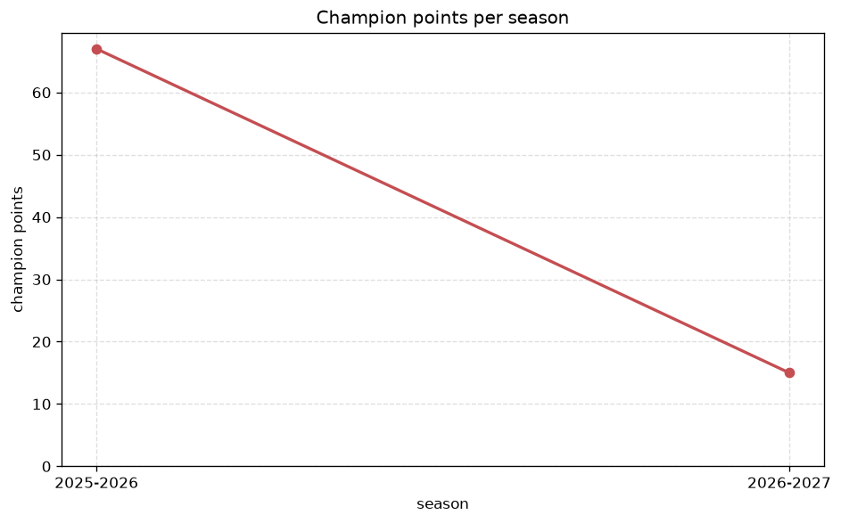
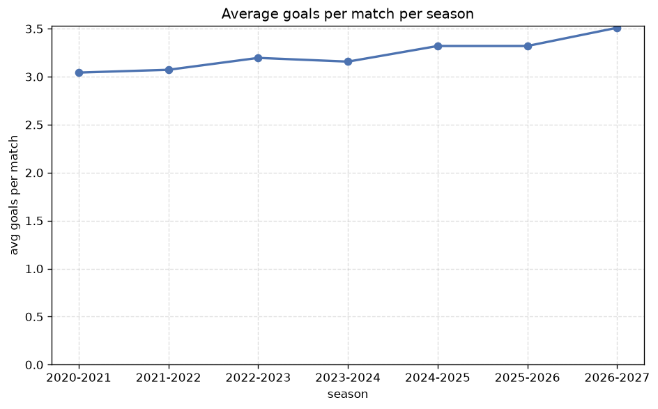

# Season Trends Analysis
- Report: `season_trends`
- Generated: 2026-10-30T03:55:18+00:00
- Script: `backend/scripts/analyze_seasons.py` v1.0.0
- League: Tweede Divisie (Netherlands)
- Scope: league `holland3`

## 1. Champions per season
| season | champion | pts | runner-up | margin |
|---|---|---|---|---|
| 2020-2021 | AFC | 13 | ASWH | 1 pts |
| 2021-2022 | Katwijk | 71 | Hardenberg | 9 pts |
| 2022-2023 | Katwijk | 71 | Rijnsburgse Boys | 2 pts |
| 2023-2024 | Spakenburg | 82 | De Treffers | 11 pts |
| 2024-2025 | Quick Boys | 79 | Rijnsburgse Boys | 7 pts |
| 2025-2026 | Quick Boys | 67 | De Treffers | 4 pts |
| 2026-2027 | Quick Boys | 28 | De Treffers | 6 pts |

## 2. Title-race tightness
- Tight races (margin <= 3 pts): **2** of 7 seasons
- Tightest race: **2020-2021** - AFC beat ASWH by **1** pts

| season | margin | tight |
|---|---|---|
| 2020-2021 | 1 pts | yes |
| 2021-2022 | 9 pts |  |
| 2022-2023 | 2 pts | yes |
| 2023-2024 | 11 pts |  |
| 2024-2025 | 7 pts |  |
| 2025-2026 | 4 pts |  |
| 2026-2027 | 6 pts |  |

## 3. Points thresholds
_Position-specific points per season. Key: 1 = champion, 2 = runner-up, 4 = CL line, 6 = Europa, 15 = last safe, 18 = bottom._

| season | pos 1 | pos 2 | pos 4 | pos 6 | pos 15 | pos 18 |
|---|---|---|---|---|---|---|
| 2020-2021 | 13 | 12 | 12 | 8 | 4 | 2 |
| 2021-2022 | 71 | 62 | 55 | 54 | 41 | 21 |
| 2022-2023 | 71 | 69 | 60 | 56 | 39 | 20 |
| 2023-2024 | 82 | 71 | 59 | 54 | 33 | 19 |
| 2024-2025 | 79 | 72 | 58 | 56 | 38 | 13 |
| 2025-2026 | 67 | 63 | 56 | 56 | 42 | 30 |
| 2026-2027 | 28 | 22 | 21 | 21 | 10 | 1 |

## 4. Relegation battle
| season | safe pos | safe pts | drop pos | drop pts | gap |
|---|---|---|---|---|---|
| 2020-2021 | 15 | 4 | 16 | 3 | 1 pts |
| 2021-2022 | 15 | 41 | 16 | 35 | 6 pts |
| 2022-2023 | 15 | 39 | 16 | 33 | 6 pts |
| 2023-2024 | 15 | 33 | 16 | 32 | 1 pts |
| 2024-2025 | 15 | 38 | 16 | 38 | 0 pts |
| 2025-2026 | 15 | 42 | 16 | 39 | 3 pts |
| 2026-2027 | 15 | 10 | 16 | 9 | 1 pts |

## 5. League-level trends
| season | matches | total goals | avg goals | home win | draw | away win | goalless | avg pts/team |
|---|---|---|---|---|---|---|---|---|
| 2020-2021 | 47 | 143 | 3.043 | 42.6% | 31.9% | 25.5% | 4.3% | 7.0 |
| 2021-2022 | 306 | 940 | 3.072 | 50.3% | 19.6% | 30.1% | 2.9% | 47.67 |
| 2022-2023 | 306 | 978 | 3.196 | 45.1% | 21.2% | 33.7% | 4.6% | 47.39 |
| 2023-2024 | 306 | 966 | 3.157 | 38.9% | 23.2% | 37.9% | 3.9% | 47.06 |
| 2024-2025 | 306 | 1016 | 3.32 | 43.8% | 18.0% | 38.2% | 3.3% | 47.94 |
| 2025-2026 | 322 | 1069 | 3.32 | 47.5% | 19.6% | 32.9% | 3.1% | 35.88 |
| 2026-2027 | 100 | 351 | 3.51 | 42.0% | 20.0% | 38.0% | 1.0% | 15.56 |

## 6. View divergence
- Largest divergence: **2022-2023** (goals view, avg abs position diff = 6.778)

_Avg absolute position difference between classic view and alternative view per season._

| season | classic vs luck | classic vs goals |
|---|---|---|
| 2020-2021 | 1.667 | 4.333 |
| 2021-2022 | 2.333 | 6.222 |
| 2022-2023 | 2.778 | 6.778 |
| 2023-2024 | 2.889 | 3.889 |
| 2024-2025 | 3.111 | 6.667 |
| 2025-2026 | 6.400 | 5.920 |
| 2026-2027 | 2.333 | 6.000 |

---
*All statistics are computed from PostgreSQL tables (read-only). Run with `python backend/scripts/analyze_seasons.py` to regenerate.*

## Charts

