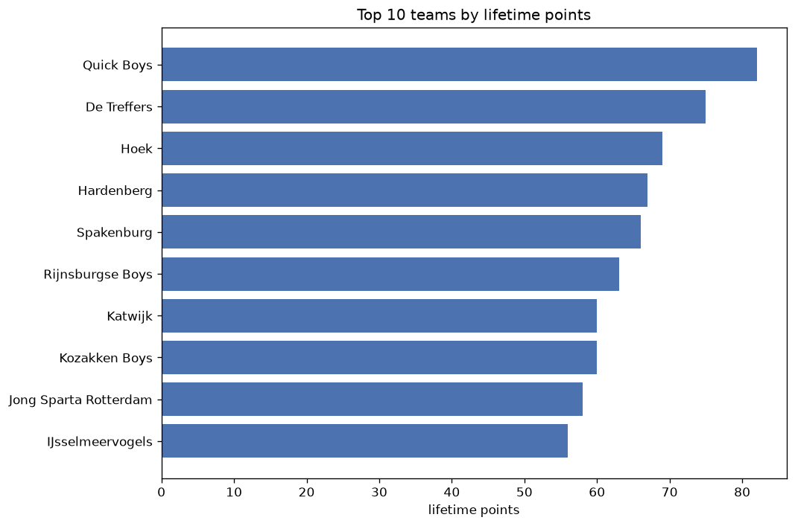
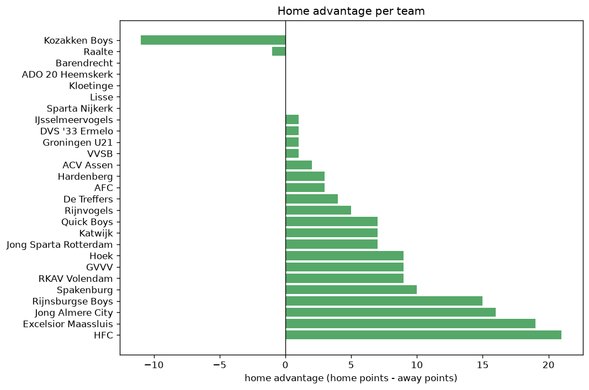

# Team Analysis
- Report: `teams_analysis`
- Generated: 2026-10-27T01:52:38+00:00
- Script: `backend/scripts/analyze_teams.py` v1.0.0
- League: Tweede Divisie (Netherlands)
- Scope: league `holland3`

- Teams: **33** | Seasons: **7** | Matches: **1693**

## 1. Team standings (lifetime)
| team | seasons | played | W | D | L | pts | GF | GA | GD | avg pts/season | best pos | worst pos | titles |
|---|---|---|---|---|---|---|---|---|---|---|---|---|---|
| Quick Boys | 7 | 187 | 104 | 36 | 47 | 348 | 373 | 232 | 141 | 49.71 | 1 | 12 | 3 |
| Katwijk | 7 | 186 | 101 | 30 | 55 | 333 | 351 | 252 | 99 | 47.57 | 1 | 10 | 2 |
| AFC | 7 | 186 | 91 | 43 | 52 | 316 | 328 | 245 | 83 | 45.14 | 1 | 13 | 1 |
| Rijnsburgse Boys | 7 | 186 | 93 | 35 | 58 | 314 | 368 | 268 | 100 | 44.86 | 2 | 14 | 0 |
| Spakenburg | 7 | 187 | 91 | 40 | 56 | 313 | 365 | 282 | 83 | 44.71 | 1 | 11 | 1 |
| De Treffers | 7 | 186 | 89 | 40 | 57 | 307 | 328 | 267 | 61 | 43.86 | 2 | 18 | 0 |
| Hardenberg | 7 | 187 | 88 | 34 | 65 | 298 | 310 | 251 | 59 | 42.57 | 2 | 11 | 0 |
| HFC | 7 | 185 | 73 | 43 | 69 | 262 | 251 | 240 | 11 | 37.43 | 3 | 16 | 0 |
| Jong Sparta Rotterdam | 7 | 189 | 70 | 41 | 78 | 251 | 348 | 348 | 0 | 35.86 | 5 | 16 | 0 |
| GVVV | 6 | 154 | 60 | 29 | 65 | 209 | 243 | 262 | -19 | 34.83 | 5 | 17 | 0 |
| Excelsior Maassluis | 6 | 181 | 54 | 40 | 87 | 202 | 229 | 309 | -80 | 33.67 | 10 | 17 | 0 |
| Noordwijk | 5 | 141 | 46 | 39 | 56 | 177 | 212 | 222 | -10 | 35.4 | 7 | 17 | 0 |
| Kozakken Boys | 6 | 152 | 46 | 36 | 70 | 174 | 216 | 263 | -47 | 29.0 | 4 | 17 | 0 |
| Jong Almere City | 4 | 113 | 48 | 24 | 41 | 168 | 240 | 191 | 49 | 42.0 | 6 | 12 | 0 |
| IJsselmeervogels | 5 | 125 | 46 | 14 | 65 | 152 | 182 | 209 | -27 | 30.4 | 3 | 16 | 0 |
| Scheveningen | 5 | 140 | 36 | 39 | 65 | 147 | 152 | 231 | -79 | 29.4 | 8 | 17 | 0 |
| ACV Assen | 3 | 102 | 33 | 21 | 48 | 120 | 140 | 178 | -38 | 40.0 | 9 | 18 | 0 |
| Barendrecht | 3 | 79 | 33 | 12 | 34 | 111 | 137 | 161 | -24 | 37.0 | 7 | 13 | 0 |
| RKAV Volendam | 3 | 79 | 30 | 11 | 38 | 101 | 133 | 156 | -23 | 33.67 | 8 | 14 | 0 |
| TEC | 3 | 72 | 22 | 19 | 31 | 85 | 91 | 129 | -38 | 28.33 | 13 | 15 | 0 |
| Jong Volendam | 3 | 74 | 22 | 10 | 42 | 76 | 120 | 160 | -40 | 25.33 | 11 | 17 | 0 |
| Hoek | 2 | 45 | 21 | 10 | 14 | 73 | 72 | 55 | 17 | 36.5 | 3 | 15 | 0 |
| Lisse | 3 | 70 | 14 | 19 | 37 | 61 | 80 | 138 | -58 | 20.33 | 12 | 24 | 0 |
| ADO 20 Heemskerk | 3 | 72 | 17 | 10 | 45 | 61 | 73 | 154 | -81 | 20.33 | 12 | 20 | 0 |
| ASWH | 2 | 40 | 9 | 6 | 25 | 33 | 50 | 87 | -37 | 16.5 | 2 | 18 | 0 |
| Oostzaan | 1 | 34 | 4 | 8 | 22 | 20 | 33 | 89 | -56 | 20.0 | 18 | 18 | 0 |
| Rijnvogels | 1 | 4 | 2 | 1 | 1 | 7 | 6 | 6 | 0 | 7.0 | 19 | 19 | 0 |
| Kloetinge | 1 | 11 | 1 | 4 | 6 | 7 | 16 | 29 | -13 | 7.0 | 17 | 17 | 0 |
| DVS '33 Ermelo | 1 | 2 | 0 | 1 | 1 | 1 | 2 | 3 | -1 | 1.0 | 22 | 22 | 0 |
| Groningen U21 | 1 | 2 | 0 | 1 | 1 | 1 | 3 | 4 | -1 | 1.0 | 21 | 21 | 0 |
| VVSB | 1 | 2 | 0 | 1 | 1 | 1 | 1 | 4 | -3 | 1.0 | 23 | 23 | 0 |
| Raalte | 1 | 11 | 0 | 1 | 10 | 1 | 9 | 33 | -24 | 1.0 | 18 | 18 | 0 |
| Sparta Nijkerk | 1 | 2 | 0 | 0 | 2 | 0 | 1 | 5 | -4 | 0.0 | 25 | 25 | 0 |

## 2. Home vs away split
| team | home P | H-W | H-D | H-L | H-pts | away P | A-W | A-D | A-L | A-pts | adv |
|---|---|---|---|---|---|---|---|---|---|---|---|
| Excelsior Maassluis | 91 | 38 | 19 | 34 | 133 | 90 | 16 | 21 | 53 | 69 | 64 |
| Spakenburg | 93 | 56 | 17 | 20 | 185 | 94 | 35 | 23 | 36 | 128 | 57 |
| HFC | 92 | 45 | 21 | 26 | 156 | 93 | 28 | 22 | 43 | 106 | 50 |
| Hardenberg | 93 | 53 | 14 | 26 | 173 | 94 | 35 | 20 | 39 | 125 | 48 |
| Rijnsburgse Boys | 94 | 54 | 15 | 25 | 177 | 92 | 39 | 20 | 33 | 137 | 40 |
| GVVV | 77 | 34 | 18 | 25 | 120 | 77 | 26 | 11 | 40 | 89 | 31 |
| Quick Boys | 94 | 58 | 15 | 21 | 189 | 93 | 46 | 21 | 26 | 159 | 30 |
| AFC | 93 | 50 | 22 | 21 | 172 | 93 | 41 | 21 | 31 | 144 | 28 |
| IJsselmeervogels | 63 | 28 | 6 | 29 | 90 | 62 | 18 | 8 | 36 | 62 | 28 |
| Barendrecht | 39 | 20 | 5 | 14 | 65 | 40 | 13 | 7 | 20 | 46 | 19 |
| Jong Sparta Rotterdam | 94 | 37 | 23 | 34 | 134 | 95 | 33 | 18 | 44 | 117 | 17 |
| Katwijk | 92 | 55 | 9 | 28 | 174 | 94 | 46 | 21 | 27 | 159 | 15 |
| Noordwijk | 71 | 25 | 21 | 25 | 96 | 70 | 21 | 18 | 31 | 81 | 15 |
| Jong Almere City | 56 | 27 | 10 | 19 | 91 | 57 | 21 | 14 | 22 | 77 | 14 |
| RKAV Volendam | 39 | 17 | 6 | 16 | 57 | 40 | 13 | 5 | 22 | 44 | 13 |
| Hoek | 22 | 12 | 7 | 3 | 43 | 23 | 9 | 3 | 11 | 30 | 13 |
| ASWH | 20 | 6 | 5 | 9 | 23 | 20 | 3 | 1 | 16 | 10 | 13 |
| Jong Volendam | 37 | 12 | 7 | 18 | 43 | 37 | 10 | 3 | 24 | 33 | 10 |
| Oostzaan | 17 | 3 | 5 | 9 | 14 | 17 | 1 | 3 | 13 | 6 | 8 |
| TEC | 37 | 11 | 13 | 13 | 46 | 35 | 11 | 6 | 18 | 39 | 7 |
| Lisse | 35 | 8 | 10 | 17 | 34 | 35 | 6 | 9 | 20 | 27 | 7 |
| Kozakken Boys | 76 | 25 | 15 | 36 | 90 | 76 | 21 | 21 | 34 | 84 | 6 |
| ACV Assen | 51 | 18 | 9 | 24 | 63 | 51 | 15 | 12 | 24 | 57 | 6 |
| Rijnvogels | 2 | 2 | 0 | 0 | 6 | 2 | 0 | 1 | 1 | 1 | 5 |
| Kloetinge | 6 | 0 | 4 | 2 | 4 | 5 | 1 | 0 | 4 | 3 | 1 |
| DVS '33 Ermelo | 1 | 0 | 1 | 0 | 1 | 1 | 0 | 0 | 1 | 0 | 1 |
| Groningen U21 | 1 | 0 | 1 | 0 | 1 | 1 | 0 | 0 | 1 | 0 | 1 |
| VVSB | 1 | 0 | 1 | 0 | 1 | 1 | 0 | 0 | 1 | 0 | 1 |
| Sparta Nijkerk | 1 | 0 | 0 | 1 | 0 | 1 | 0 | 0 | 1 | 0 | 0 |
| ADO 20 Heemskerk | 36 | 8 | 6 | 22 | 30 | 36 | 9 | 4 | 23 | 31 | -1 |
| Raalte | 6 | 0 | 0 | 6 | 0 | 5 | 0 | 1 | 4 | 1 | -1 |
| De Treffers | 93 | 42 | 26 | 25 | 152 | 93 | 47 | 14 | 32 | 155 | -3 |
| Scheveningen | 70 | 16 | 18 | 36 | 66 | 70 | 20 | 21 | 29 | 81 | -15 |

## 3. Top performers
### Best points per game (PPG)
| rank | team | PPG |
|---|---|---|
| 1 | Quick Boys | 1.86 |
| 2 | Katwijk | 1.79 |
| 3 | Rijnvogels | 1.75 |
| 4 | AFC | 1.70 |
| 5 | Rijnsburgse Boys | 1.69 |

### Most goals scored
| rank | team | goals |
|---|---|---|
| 1 | Quick Boys | 373 |
| 2 | Rijnsburgse Boys | 368 |
| 3 | Spakenburg | 365 |
| 4 | Katwijk | 351 |
| 5 | Jong Sparta Rotterdam | 348 |

### Best goal difference
| rank | team | GD |
|---|---|---|
| 1 | Quick Boys | 141 |
| 2 | Rijnsburgse Boys | 100 |
| 3 | Katwijk | 99 |
| 4 | AFC | 83 |
| 5 | Spakenburg | 83 |

### Best defence (goals against per match, standings)
| rank | team | GA/match |
|---|---|---|
| 1 | Rijnvogels | 1.000 |
| 2 | Hoek | 1.222 |
| 3 | Quick Boys | 1.241 |
| 4 | HFC | 1.297 |
| 5 | AFC | 1.317 |

## 4. Team consistency
- Teams present in all **7** seasons: **9**

AFC, De Treffers, HFC, Hardenberg, Jong Sparta Rotterdam, Katwijk, Quick Boys, Rijnsburgse Boys, Spakenburg

## 5. Head-to-head dominance
- Distinct fixtures: **318** (showing the 15 most frequent)

| fixture | meetings | home wins | draws | away wins | home pct | draw pct | away pct |
|---|---|---|---|---|---|---|---|
| Spakenburg vs Katwijk | 12 | 6 | 4 | 2 | 50.0% | 33.3% | 16.7% |
| Hardenberg vs Jong Sparta Rotterdam | 12 | 5 | 1 | 6 | 41.7% | 8.3% | 50.0% |
| Hardenberg vs De Treffers | 12 | 4 | 5 | 3 | 33.3% | 41.7% | 25.0% |
| AFC vs Hardenberg | 12 | 3 | 5 | 4 | 25.0% | 41.7% | 33.3% |
| HFC vs De Treffers | 12 | 3 | 3 | 6 | 25.0% | 25.0% | 50.0% |
| Quick Boys vs HFC | 12 | 3 | 4 | 5 | 25.0% | 33.3% | 41.7% |
| Spakenburg vs Jong Sparta Rotterdam | 12 | 3 | 4 | 5 | 25.0% | 33.3% | 41.7% |
| Rijnsburgse Boys vs Excelsior Maassluis | 11 | 9 | 1 | 1 | 81.8% | 9.1% | 9.1% |
| HFC vs Jong Sparta Rotterdam | 11 | 8 | 3 | 0 | 72.7% | 27.3% | 0.0% |
| Spakenburg vs HFC | 11 | 8 | 1 | 2 | 72.7% | 9.1% | 18.2% |
| Quick Boys vs Hardenberg | 11 | 7 | 1 | 3 | 63.6% | 9.1% | 27.3% |
| AFC vs Rijnsburgse Boys | 11 | 6 | 2 | 3 | 54.5% | 18.2% | 27.3% |
| Katwijk vs Excelsior Maassluis | 11 | 6 | 2 | 3 | 54.5% | 18.2% | 27.3% |
| Quick Boys vs Jong Sparta Rotterdam | 11 | 6 | 2 | 3 | 54.5% | 18.2% | 27.3% |
| Spakenburg vs Quick Boys | 11 | 6 | 3 | 2 | 54.5% | 27.3% | 18.2% |

## 6. Position per season (classic view)
_Cells show final position; '-' when the team was absent from that season._

| team | 2020-2021 | 2021-2022 | 2022-2023 | 2023-2024 | 2024-2025 | 2025-2026 | 2026-2027 |
|---|---|---|---|---|---|---|---|
| Quick Boys | 4 | 12 | 6 | 3 | 1 | 1 | 1 |
| Katwijk | 8 | 1 | 1 | 4 | 4 | 7 | 10 |
| AFC | 1 | 6 | 3 | 5 | 3 | 11 | 13 |
| Rijnsburgse Boys | 6 | 4 | 2 | 13 | 2 | 4 | 14 |
| Spakenburg | 3 | 9 | 11 | 1 | 5 | 6 | 9 |
| De Treffers | 18 | 15 | 5 | 2 | 10 | 2 | 2 |
| Hardenberg | 9 | 2 | 4 | 10 | 11 | 5 | 6 |
| HFC | 10 | 3 | 7 | 11 | 8 | 16 | 16 |
| Jong Sparta Rotterdam | 14 | 5 | 10 | 7 | 16 | 9 | 11 |
| GVVV | 12 | 17 | - | 6 | 7 | 15 | 5 |
| Excelsior Maassluis | 15 | 10 | 14 | 16 | 14 | 17 | - |
| Noordwijk | 17 | 7 | 9 | 14 | 15 | - | - |
| Kozakken Boys | 7 | 16 | 13 | 17 | - | 10 | 4 |
| Jong Almere City | - | - | - | 8 | 6 | 8 | 12 |
| IJsselmeervogels | 5 | 13 | 16 | - | - | 12 | 3 |
| Scheveningen | 16 | 8 | 8 | 15 | 17 | - | - |
| ACV Assen | - | - | - | 9 | 12 | 18 | - |
| Barendrecht | - | - | - | - | 9 | 13 | 7 |
| RKAV Volendam | - | - | - | - | 13 | 14 | 8 |
| TEC | 13 | 14 | 15 | - | - | - | - |
| Jong Volendam | 11 | 11 | 17 | - | - | - | - |
| Hoek | - | - | - | - | - | 3 | 15 |
| Lisse | - | - | 12 | 18 | - | 24 | - |
| ADO 20 Heemskerk | - | - | - | 12 | 18 | 20 | - |
| ASWH | 2 | 18 | - | - | - | - | - |
| Oostzaan | - | - | 18 | - | - | - | - |
| Rijnvogels | - | - | - | - | - | 19 | - |
| Kloetinge | - | - | - | - | - | - | 17 |
| DVS '33 Ermelo | - | - | - | - | - | 22 | - |
| Groningen U21 | - | - | - | - | - | 21 | - |
| VVSB | - | - | - | - | - | 23 | - |
| Raalte | - | - | - | - | - | - | 18 |
| Sparta Nijkerk | - | - | - | - | - | 25 | - |

---
*All statistics are computed from PostgreSQL tables (read-only). Run with `python backend/scripts/analyze_teams.py` to regenerate.*

## Charts

