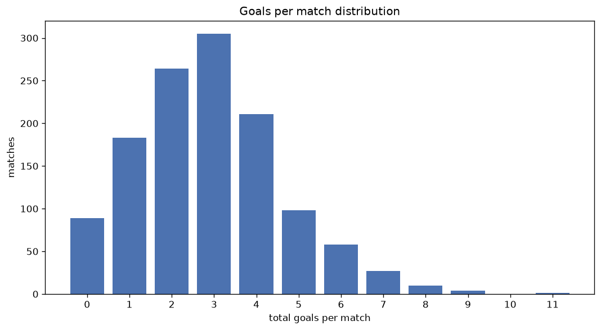
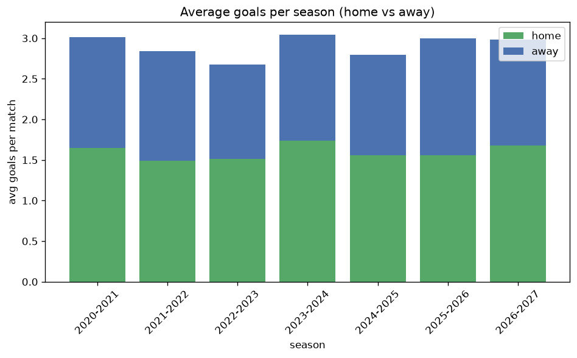

# Goal Analysis
- Report: `goals_analysis`
- Generated: 2026-10-26T01:35:58+00:00
- Script: `backend/scripts/analyze_goals.py` v1.0.0
- League: NB I. (Hungary)
- Scope: league `hungary1`

## 1. Goals per match distribution
| goals | matches | pct |
|---|---|---|
| 0 | 89 | 7.1% |
| 1 | 183 | 14.6% |
| 2 | 264 | 21.1% |
| 3 | 305 | 24.4% |
| 4 | 211 | 16.9% |
| 5 | 98 | 7.8% |
| 6 | 58 | 4.6% |
| 7 | 27 | 2.2% |
| 8 | 10 | 0.8% |
| 9 | 4 | 0.3% |
| 10 | 0 | 0.0% |
| 11 | 1 | 0.1% |

## 2. Goals per match per season
| season | matches | total goals | avg home | avg away | avg total |
|---|---|---|---|---|---|
| 2020-2021 | 198 | 597 | 1.646 | 1.369 | 3.015 |
| 2021-2022 | 198 | 562 | 1.49 | 1.348 | 2.838 |
| 2022-2023 | 198 | 530 | 1.51 | 1.167 | 2.677 |
| 2023-2024 | 198 | 603 | 1.737 | 1.308 | 3.045 |
| 2024-2025 | 198 | 553 | 1.561 | 1.232 | 2.793 |
| 2025-2026 | 198 | 594 | 1.556 | 1.444 | 3.0 |
| 2026-2027 | 62 | 185 | 1.677 | 1.306 | 2.984 |

## 3. Home vs away goal share
- Home goals: **1985** (54.8%)
- Away goals: **1639** (45.2%)
- Home/away ratio: **1.211**

| season | home goals | away goals | total | home pct | away pct |
|---|---|---|---|---|---|
| 2020-2021 | 326 | 271 | 597 | 54.6% | 45.4% |
| 2021-2022 | 295 | 267 | 562 | 52.5% | 47.5% |
| 2022-2023 | 299 | 231 | 530 | 56.4% | 43.6% |
| 2023-2024 | 344 | 259 | 603 | 57.0% | 43.0% |
| 2024-2025 | 309 | 244 | 553 | 55.9% | 44.1% |
| 2025-2026 | 308 | 286 | 594 | 51.9% | 48.1% |
| 2026-2027 | 104 | 81 | 185 | 56.2% | 43.8% |

## 4. BTTS (Both Teams To Score)
- Overall: **721** of `1250` (57.7%)

| season | matches | BTTS | pct |
|---|---|---|---|
| 2020-2021 | 198 | 113 | 57.1% |
| 2021-2022 | 198 | 115 | 58.1% |
| 2022-2023 | 198 | 111 | 56.1% |
| 2023-2024 | 198 | 115 | 58.1% |
| 2024-2025 | 198 | 110 | 55.6% |
| 2025-2026 | 198 | 119 | 60.1% |
| 2026-2027 | 62 | 38 | 61.3% |

## 5. Clean sheets
- Home clean sheets: **347** (27.8%)
- Away clean sheets: **271** (21.7%)
- Total clean sheets recorded: **618**
- Matches with at least one clean sheet: **529** (42.3%)
- Both teams kept clean sheets (0-0): **89**

| season | matches | home CS | away CS | total CS | matches w/ CS |
|---|---|---|---|---|---|
| 2020-2021 | 198 | 59 | 40 | 99 | 85 (42.9%) |
| 2021-2022 | 198 | 54 | 47 | 101 | 83 (41.9%) |
| 2022-2023 | 198 | 60 | 43 | 103 | 87 (43.9%) |
| 2023-2024 | 198 | 57 | 37 | 94 | 83 (41.9%) |
| 2024-2025 | 198 | 58 | 50 | 108 | 88 (44.4%) |
| 2025-2026 | 198 | 45 | 42 | 87 | 79 (39.9%) |
| 2026-2027 | 62 | 14 | 12 | 26 | 24 (38.7%) |

## 6. Scoring intensity
- First-half goals: **1605** (44.3%)
- Second-half goals: **2016** (55.7%)
- Avg first-half goals per match: **1.285**
- Avg second-half goals per match: **1.614**
- Second-half-only scoring (HT 0-0, FT goals >= 1): **272** (21.8%)
- *1 match(es) excluded (no HT score recorded).*

| season | matches | 1st half | 2nd half | 1st half pct | 2nd half pct |
|---|---|---|---|---|---|
| 2020-2021 | 198 | 264 | 330 | 44.4% | 55.6% |
| 2021-2022 | 198 | 261 | 301 | 46.4% | 53.6% |
| 2022-2023 | 198 | 230 | 300 | 43.4% | 56.6% |
| 2023-2024 | 198 | 270 | 333 | 44.8% | 55.2% |
| 2024-2025 | 198 | 244 | 309 | 44.1% | 55.9% |
| 2025-2026 | 198 | 259 | 335 | 43.6% | 56.4% |
| 2026-2027 | 62 | 77 | 108 | 41.6% | 58.4% |

## 7. First-goal timing
- Matches with first-goal time recorded: `1160` of `1250` (92.8%)
- Goalless matches: `90`
- Min `1` | Max `95` | Mean `30.44` | Median (p50) `24.0`

| bucket | count | % of matches | % of scoring matches |
|---|---|---|---|
| 1-15 | 390 | 31.2% | 33.6% |
| 16-30 | 280 | 22.4% | 24.1% |
| 31-45 | 196 | 15.7% | 16.9% |
| 46-60 | 152 | 12.2% | 13.1% |
| 61-75 | 73 | 5.8% | 6.3% |
| 76-90 | 55 | 4.4% | 4.7% |
| 91-120 | 14 | 1.1% | 1.2% |

---
*All statistics are computed from PostgreSQL tables (read-only). Run with `python backend/scripts/analyze_goals.py` to regenerate.*

## Charts

