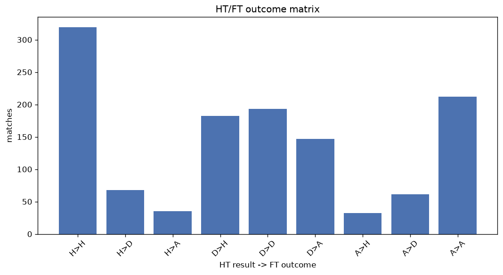
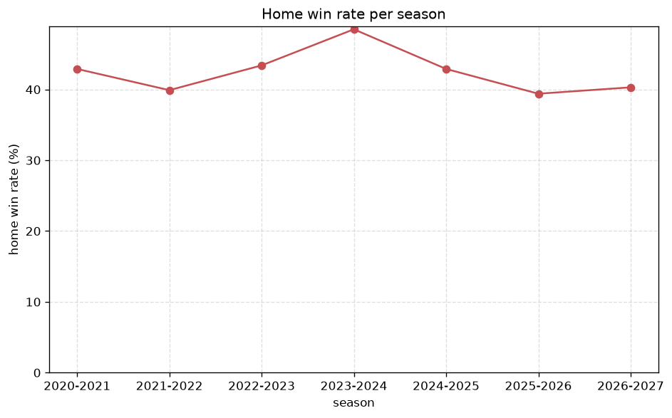

# Match Analysis
- Report: `matches_analysis`
- Generated: 2026-10-26T01:35:56+00:00
- Script: `backend/scripts/analyze_matches.py` v1.0.0
- League: NB I. (Hungary)
- Scope: league `hungary1`

## 1. Overall summary
| metric | value |
|---|---|
| Matches | 1250 |
| Home wins | 534 (42.7%) |
| Draws | 322 (25.8%) |
| Away wins | 394 (31.5%) |
| Total goals | 3624 |
| Average goals per match | 2.899 |
| Goalless matches | 89 (7.1%) |

## 2. Per-season breakdown
| season | matches | home wins | draws | away wins | total goals | avg goals | goalless |
|---|---|---|---|---|---|---|---|
| 2020-2021 | 198 | 85 (42.9%) | 46 (23.2%) | 67 (33.8%) | 597 | 3.015 | 14 (7.1%) |
| 2021-2022 | 198 | 79 (39.9%) | 53 (26.8%) | 66 (33.3%) | 562 | 2.838 | 18 (9.1%) |
| 2022-2023 | 198 | 86 (43.4%) | 59 (29.8%) | 53 (26.8%) | 530 | 2.677 | 16 (8.1%) |
| 2023-2024 | 198 | 96 (48.5%) | 39 (19.7%) | 63 (31.8%) | 603 | 3.045 | 11 (5.6%) |
| 2024-2025 | 198 | 85 (42.9%) | 58 (29.3%) | 55 (27.8%) | 553 | 2.793 | 20 (10.1%) |
| 2025-2026 | 198 | 78 (39.4%) | 49 (24.7%) | 71 (35.9%) | 594 | 3.0 | 8 (4.0%) |
| 2026-2027 | 62 | 25 (40.3%) | 18 (29.0%) | 19 (30.6%) | 185 | 2.984 | 2 (3.2%) |

## 3. HT/FT outcome matrix
| HT result \ FT result | Home | Draw | Away | total |
|---|---|---|---|---|
| HT home lead | 319 (75.6%) | 68 (16.1%) | 35 (8.3%) | 422 |
| HT draw | 182 (34.9%) | 193 (37.0%) | 147 (28.2%) | 522 |
| HT away lead | 32 (10.5%) | 61 (20.0%) | 212 (69.5%) | 305 |
- *1 match(es) excluded (no HT score recorded).*

## 4. Comeback matches
- Home comebacks (trailing at HT, won at FT): **32** (2.6%)
- Away comebacks (trailing at HT, won at FT): **35** (2.8%)

### Home comebacks
| season | home | away | HT | FT |
|---|---|---|---|---|
| 2020-2021 | Honved | MTK Budapest | 1-2 | 3-2 |
| 2020-2021 | Paks | Puskas Academy | 0-1 | 4-2 |
| 2021-2022 | Videoton | MTK Budapest | 0-1 | 2-1 |
| 2021-2022 | Kisvarda | Debrecen | 0-1 | 2-1 |
| 2021-2022 | Debrecen | Honved | 1-3 | 5-3 |
| 2021-2022 | Kisvarda | Honved | 1-2 | 3-2 |
| 2021-2022 | Paks | Videoton | 1-2 | 3-2 |
| 2021-2022 | Ferencvaros | Kisvarda | 0-1 | 2-1 |
| 2021-2022 | Videoton | Kisvarda | 2-3 | 5-3 |
| 2022-2023 | Ujpest | Honved | 0-1 | 2-1 |
| 2023-2024 | Paks | Mezokovesd-Zsory | 0-1 | 2-1 |
| 2023-2024 | Videoton | Ujpest | 0-1 | 2-1 |
| 2023-2024 | Kecskemeti TE | Zalaegerszegi | 0-1 | 2-1 |
| 2024-2025 | Debrecen | Zalaegerszegi | 0-1 | 3-1 |
| 2024-2025 | Paks | Puskas Academy | 0-1 | 2-1 |
| 2024-2025 | Paks | MTK Budapest | 1-2 | 4-2 |
| 2024-2025 | Zalaegerszegi | DVTK | 0-1 | 2-1 |
| 2024-2025 | Puskas Academy | Zalaegerszegi | 0-1 | 2-1 |
| 2024-2025 | DVTK | Kecskemeti TE | 0-1 | 2-1 |
| 2024-2025 | Debrecen | Zalaegerszegi | 1-2 | 4-3 |
| 2024-2025 | DVTK | MTK Budapest | 0-1 | 2-1 |
| 2025-2026 | Puskas Academy | Nyiregyhaza | 1-2 | 3-2 |
| 2025-2026 | Nyiregyhaza | Zalaegerszegi | 0-1 | 3-1 |
| 2025-2026 | Kisvarda | Gyor | 1-2 | 3-2 |
| 2025-2026 | Debrecen | DVTK | 1-2 | 3-2 |
| 2025-2026 | Nyiregyhaza | MTK Budapest | 1-2 | 4-2 |
| 2025-2026 | Zalaegerszegi | Ferencvaros | 0-1 | 3-1 |
| 2025-2026 | Kisvarda | Paks | 0-1 | 2-1 |
| 2025-2026 | Ferencvaros | DVTK | 0-1 | 3-1 |
| 2026-2027 | Nyiregyhaza | Ujpest | 0-1 | 2-1 |
| 2026-2027 | Ujpest | Zalaegerszegi | 0-1 | 2-1 |
| 2026-2027 | Zalaegerszegi | Nyiregyhaza | 0-1 | 5-1 |

### Away comebacks
| season | home | away | HT | FT |
|---|---|---|---|---|
| 2020-2021 | Honved | Ujpest | 1-0 | 1-2 |
| 2020-2021 | Honved | Budafoki | 2-1 | 2-3 |
| 2020-2021 | Videoton | MTK Budapest | 1-0 | 1-2 |
| 2020-2021 | Videoton | DVTK | 1-0 | 1-3 |
| 2020-2021 | Paks | Ujpest | 1-0 | 1-3 |
| 2020-2021 | Honved | Videoton | 2-1 | 2-3 |
| 2020-2021 | Mezokovesd-Zsory | Videoton | 1-0 | 1-3 |
| 2020-2021 | Honved | Ferencvaros | 1-0 | 1-2 |
| 2021-2022 | Honved | Debrecen | 1-0 | 1-4 |
| 2021-2022 | MTK Budapest | Kisvarda | 1-0 | 1-2 |
| 2021-2022 | Zalaegerszegi | Puskas Academy | 1-0 | 1-3 |
| 2021-2022 | Honved | Ujpest | 1-0 | 1-2 |
| 2021-2022 | Zalaegerszegi | Paks | 2-1 | 2-3 |
| 2021-2022 | Mezokovesd-Zsory | Ujpest | 1-0 | 2-3 |
| 2022-2023 | Zalaegerszegi | Puskas Academy | 1-0 | 1-2 |
| 2022-2023 | Mezokovesd-Zsory | Paks | 1-0 | 1-2 |
| 2022-2023 | Kecskemeti TE | Paks | 2-0 | 2-3 |
| 2022-2023 | Mezokovesd-Zsory | Zalaegerszegi | 1-0 | 1-2 |
| 2022-2023 | Ferencvaros | Debrecen | 1-0 | 1-3 |
| 2023-2024 | Mezokovesd-Zsory | Puskas Academy | 1-0 | 1-3 |
| 2023-2024 | Zalaegerszegi | Debrecen | 1-0 | 1-2 |
| 2023-2024 | Paks | Zalaegerszegi | 2-0 | 3-4 |
| 2023-2024 | Kecskemeti TE | Puskas Academy | 1-0 | 1-2 |
| 2023-2024 | Ujpest | MTK Budapest | 1-0 | 1-2 |
| 2023-2024 | Mezokovesd-Zsory | Zalaegerszegi | 1-0 | 1-2 |
| 2024-2025 | Videoton | Paks | 1-0 | 1-2 |
| 2024-2025 | Zalaegerszegi | Gyor | 1-0 | 1-2 |
| 2024-2025 | Debrecen | Puskas Academy | 1-0 | 1-2 |
| 2024-2025 | Ujpest | Zalaegerszegi | 1-0 | 1-2 |
| 2024-2025 | Paks | Ferencvaros | 1-0 | 2-3 |
| 2025-2026 | Debrecen | Nyiregyhaza | 1-0 | 1-2 |
| 2025-2026 | Ujpest | MTK Budapest | 1-0 | 1-2 |
| 2025-2026 | DVTK | Puskas Academy | 1-0 | 1-2 |
| 2026-2027 | Honved | Vasas | 1-0 | 1-2 |
| 2026-2027 | Debrecen | Vasas | 2-1 | 2-4 |

## 5. HT lead conversion
| HT state | matches | converted to win | held as draw | collapsed to loss |
|---|---|---|---|---|
| Home lead | 422 | 319 (75.6%) | 68 (16.1%) | 35 (8.3%) |
| Away lead | 305 | 212 (69.5%) | 61 (20.0%) | 32 (10.5%) |

### Matches level at half-time
| FT result | count | pct |
|---|---|---|
| Home win | 182 | 34.9% |
| Draw | 193 | 37.0% |
| Away win | 147 | 28.2% |
- *1 match(es) excluded (no HT score recorded).*

## 6. First-goal timing
- Matches with a first-goal time recorded: `1160` of `1250` (92.8%)

Outcome distribution by first-goal timing bucket:
| bucket | matches | % of matches | home | draw | away |
|---|---|---|---|---|---|
| 1-15 | 390 | 31.2% | 195 (50.0%) | 68 (17.4%) | 127 (32.6%) |
| 16-30 | 280 | 22.4% | 128 (45.7%) | 58 (20.7%) | 94 (33.6%) |
| 31-45 | 196 | 15.7% | 80 (40.8%) | 48 (24.5%) | 68 (34.7%) |
| 46-60 | 152 | 12.2% | 67 (44.1%) | 39 (25.7%) | 46 (30.3%) |
| 61-75 | 73 | 5.8% | 29 (39.7%) | 12 (16.4%) | 32 (43.8%) |
| 76-90 | 55 | 4.4% | 27 (49.1%) | 8 (14.5%) | 20 (36.4%) |
| 91-120 | 14 | 1.1% | 7 (50.0%) | 0 (0.0%) | 7 (50.0%) |

## 7. Goalless matches
- Overall: **89** of `1250` (7.1%)

| season | matches | goalless | pct |
|---|---|---|---|
| 2020-2021 | 198 | 14 | 7.1% |
| 2021-2022 | 198 | 18 | 9.1% |
| 2022-2023 | 198 | 16 | 8.1% |
| 2023-2024 | 198 | 11 | 5.6% |
| 2024-2025 | 198 | 20 | 10.1% |
| 2025-2026 | 198 | 8 | 4.0% |
| 2026-2027 | 62 | 2 | 3.2% |

---
*All statistics are computed from PostgreSQL tables (read-only). Run with `python backend/scripts/analyze_matches.py` to regenerate.*

## Charts

