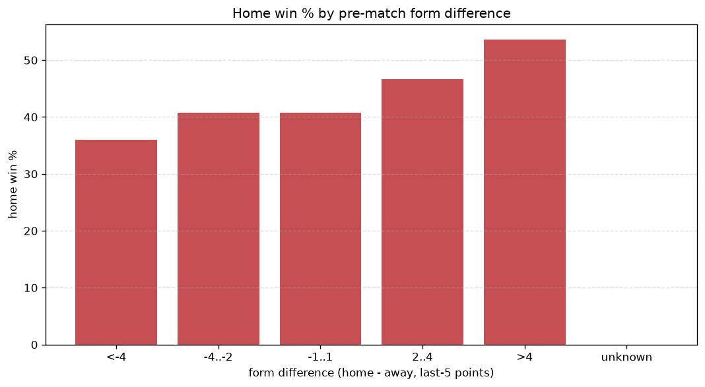
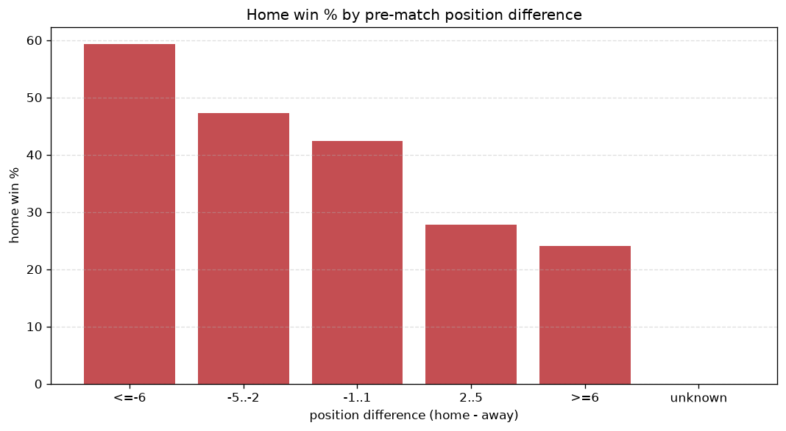

# Relationships Analysis
- Report: `relationships`
- Generated: 2026-10-27T01:53:22+00:00
- Script: `backend/scripts/analyze_relationships.py` v1.0.0
- League: NB I. (Hungary)
- Scope: league `hungary1`

- Matches analysed: **1188** (23 leakage-safe pre-match features).

## 1. Correlation matrix
_Pearson correlation of each pre-match feature with observed goals; sorted by |corr(total goals)|._

| feature | corr(home) | corr(away) | corr(total) |
|---|---|---|---|
| away_team_away_goals_avg | -0.032 | 0.125 | 0.062 |
| away_points_before_match | -0.079 | 0.007 | -0.055 |
| home_team_points_last_5 | 0.025 | -0.107 | -0.055 |
| home_team_wins_last_5 | 0.023 | -0.096 | -0.049 |
| rest_days_difference | 0.055 | 0.003 | 0.044 |
| points_difference | 0.177 | -0.144 | 0.035 |
| home_points_before_match | 0.044 | -0.094 | -0.032 |
| away_team_goals_scored_last_5 | -0.027 | 0.074 | 0.031 |
| home_team_home_win_rate | 0.031 | -0.078 | -0.030 |
| away_team_points_last_5 | -0.082 | 0.053 | -0.025 |
| home_team_goals_scored_last_5 | 0.036 | -0.073 | -0.023 |
| away_rest_days | -0.023 | -0.006 | -0.022 |
| away_team_wins_last_5 | -0.082 | 0.060 | -0.021 |
| away_team_away_conceded_avg | 0.065 | -0.044 | 0.019 |
| home_team_goals_conceded_last_5 | -0.062 | 0.053 | -0.010 |
| away_position_before_match | 0.116 | -0.112 | 0.010 |
| home_team_home_conceded_avg | -0.015 | 0.029 | 0.008 |
| home_position_before_match | -0.095 | 0.112 | 0.006 |
| home_team_home_goals_avg | 0.052 | -0.051 | 0.004 |
| away_team_away_win_rate | -0.068 | 0.081 | 0.004 |
| position_difference | -0.147 | 0.157 | -0.003 |
| away_team_goals_conceded_last_5 | 0.062 | -0.072 | -0.003 |
| home_rest_days | 0.005 | -0.005 | 0.000 |

## 2. Form vs outcome
_Home win/draw/away % per bucket of `home_team_points_last_5 - away_team_points_last_5`._

| bucket | matches | home | draw | away | home % | draw % | away % |
|---|---|---|---|---|---|---|---|
| <-4 | 178 | 64 | 39 | 75 | 36.0% | 21.9% | 42.1% |
| -4..-2 | 263 | 107 | 67 | 89 | 40.7% | 25.5% | 33.8% |
| -1..1 | 354 | 144 | 98 | 112 | 40.7% | 27.7% | 31.6% |
| 2..4 | 240 | 112 | 60 | 68 | 46.7% | 25.0% | 28.3% |
| >4 | 153 | 82 | 40 | 31 | 53.6% | 26.1% | 20.3% |
| unknown | 0 | 0 | 0 | 0 | - | - | - |

## 3. Position vs outcome
_Home win/draw/away % per bucket of `position_difference` (home position - away position; negative favours the home team)._

| bucket | matches | home | draw | away | home % | draw % | away % |
|---|---|---|---|---|---|---|---|
| <=-6 | 172 | 94 | 41 | 37 | 54.7% | 23.8% | 21.5% |
| -5..-2 | 269 | 136 | 65 | 68 | 50.6% | 24.2% | 25.3% |
| -1..1 | 245 | 108 | 61 | 76 | 44.1% | 24.9% | 31.0% |
| 2..5 | 325 | 121 | 91 | 113 | 37.2% | 28.0% | 34.8% |
| >=6 | 177 | 50 | 46 | 81 | 28.2% | 26.0% | 45.8% |
| unknown | 0 | 0 | 0 | 0 | - | - | - |

## 4. Rest advantage
_Home win/draw/away % per bucket of `rest_days_difference` (home rest - away rest). Matches with unknown rest are bucketed separately._

| bucket | matches | home | draw | away | home % | draw % | away % |
|---|---|---|---|---|---|---|---|
| <-1 | 100 | 39 | 30 | 31 | 39.0% | 30.0% | 31.0% |
| -1..0 | 292 | 128 | 79 | 85 | 43.8% | 27.1% | 29.1% |
| 0 | 372 | 163 | 87 | 122 | 43.8% | 23.4% | 32.8% |
| 1..2 | 350 | 145 | 87 | 118 | 41.4% | 24.9% | 33.7% |
| >2 | 35 | 21 | 7 | 7 | 60.0% | 20.0% | 20.0% |
| unknown | 39 | 13 | 14 | 12 | 33.3% | 35.9% | 30.8% |
- *39 match(es) had unknown rest difference (missing rest data on at least one side).*

## 5. Home team quality
_Home win rate by `home_team_home_win_rate` tier (split at 0.5)._

- `< 0.5` tier: **40.2%** home win (288/716)
- `>= 0.5` tier: **46.8%** home win (221/472)
- Home-win gap (>= split minus < split): **+6.6 pp**

| tier | label | matches | home | draw | away | home % |
|---|---|---|---|---|---|---|
| low | < 0.5 | 716 | 288 | 190 | 238 | 40.2% |
| high | >= 0.5 | 472 | 221 | 114 | 137 | 46.8% |

## 6. Feature averages by result
_Mean feature value per outcome; `range` is home-minus-away spread of the group means._

| feature | home mean | draw mean | away mean | range |
|---|---|---|---|---|
| points_difference | 2.041 | -1.026 | -3.109 | 5.151 |
| away_points_before_match | 20.825 | 22.914 | 23.584 | 2.759 |
| home_points_before_match | 22.866 | 21.888 | 20.475 | 2.392 |
| position_difference | -0.841 | 0.388 | 1.379 | 2.220 |
| away_position_before_match | 7.194 | 6.398 | 5.989 | 1.205 |
| home_position_before_match | 6.354 | 6.786 | 7.368 | 1.014 |
| home_team_goals_conceded_last_5 | 6.409 | 6.247 | 7.085 | 0.839 |
| away_team_goals_scored_last_5 | 6.534 | 6.207 | 6.992 | 0.785 |
| away_team_points_last_5 | 6.069 | 6.095 | 6.795 | 0.726 |
| away_rest_days | 8.962 | 9.500 | 8.780 | 0.720 |
| home_team_points_last_5 | 6.477 | 6.066 | 5.845 | 0.632 |
| away_team_goals_conceded_last_5 | 6.780 | 6.461 | 6.224 | 0.556 |
| rest_days_difference | 0.202 | -0.269 | 0.000 | 0.471 |
| home_rest_days | 9.171 | 9.231 | 8.773 | 0.458 |
| home_team_goals_scored_last_5 | 6.750 | 6.312 | 6.336 | 0.438 |
| away_team_wins_last_5 | 1.631 | 1.655 | 1.896 | 0.265 |
| home_team_wins_last_5 | 1.758 | 1.632 | 1.568 | 0.190 |
| away_team_away_goals_avg | 1.254 | 1.244 | 1.429 | 0.184 |
| away_team_away_conceded_avg | 1.571 | 1.463 | 1.471 | 0.109 |
| home_team_home_conceded_avg | 1.265 | 1.250 | 1.356 | 0.106 |
| home_team_home_goals_avg | 1.568 | 1.474 | 1.495 | 0.094 |
| away_team_away_win_rate | 0.277 | 0.292 | 0.335 | 0.058 |
| home_team_home_win_rate | 0.430 | 0.389 | 0.387 | 0.044 |

---
*All features are leakage-safe pre-match values built by `ml.features.build_features.build_rows` from strictly prior matches. Run with `python backend/scripts/analyze_relationships.py` to regenerate.*

## Charts

