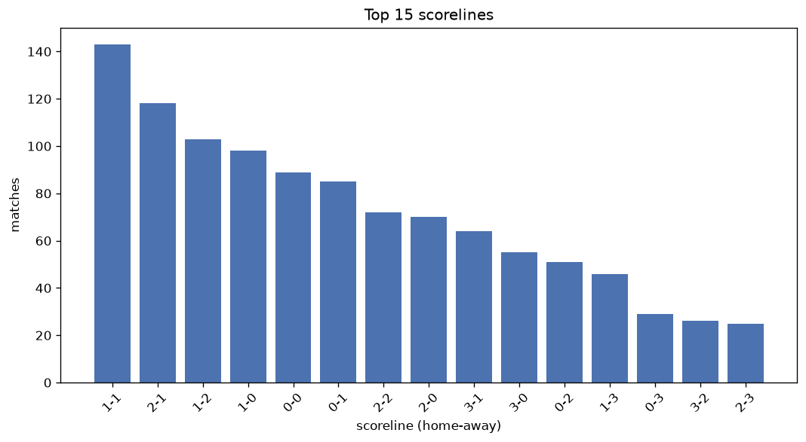
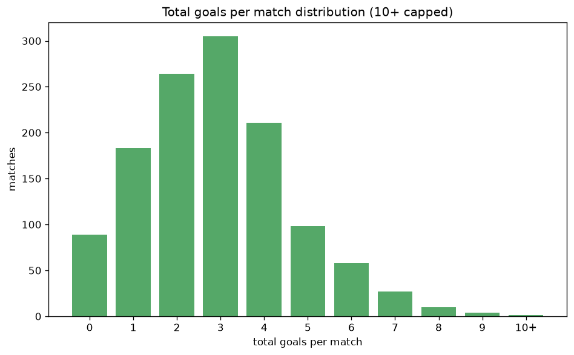

# Scoreline Analysis
- Report: `scoreline_analysis`
- Generated: 2026-10-26T01:36:03+00:00
- Script: `backend/scripts/analyze_scorelines.py` v1.0.0
- League: NB I. (Hungary)
- Scope: league `hungary1`

## 1. Scoreline frequency
- Matches analysed: **1250** across **7** seasons.
- Distinct scorelines seen: **43**.

| scoreline | count | pct |
|---|---|---|
| 1-1 | 143 | 11.4% |
| 2-1 | 118 | 9.4% |
| 1-2 | 103 | 8.2% |
| 1-0 | 98 | 7.8% |
| 0-0 | 89 | 7.1% |
| 0-1 | 85 | 6.8% |
| 2-2 | 72 | 5.8% |
| 2-0 | 70 | 5.6% |
| 3-1 | 64 | 5.1% |
| 3-0 | 55 | 4.4% |
| 0-2 | 51 | 4.1% |
| 1-3 | 46 | 3.7% |
| 0-3 | 29 | 2.3% |
| 3-2 | 26 | 2.1% |
| 2-3 | 25 | 2.0% |
| 4-0 | 20 | 1.6% |
| 3-3 | 17 | 1.4% |
| 4-1 | 15 | 1.2% |
| 4-2 | 15 | 1.2% |
| 5-0 | 13 | 1.0% |

## 2. Scoreline frequency per season

### 2020-2021
| scoreline | count | pct |
|---|---|---|
| 1-2 | 21 | 10.6% |
| 1-1 | 18 | 9.1% |
| 2-1 | 15 | 7.6% |
| 0-0 | 14 | 7.1% |
| 2-0 | 14 | 7.1% |

### 2021-2022
| scoreline | count | pct |
|---|---|---|
| 1-1 | 22 | 11.1% |
| 2-1 | 20 | 10.1% |
| 1-2 | 18 | 9.1% |
| 0-0 | 18 | 9.1% |
| 1-0 | 15 | 7.6% |

### 2022-2023
| scoreline | count | pct |
|---|---|---|
| 1-1 | 27 | 13.6% |
| 2-1 | 21 | 10.6% |
| 1-0 | 18 | 9.1% |
| 0-1 | 16 | 8.1% |
| 0-0 | 16 | 8.1% |

### 2023-2024
| scoreline | count | pct |
|---|---|---|
| 1-2 | 23 | 11.6% |
| 2-1 | 19 | 9.6% |
| 1-0 | 19 | 9.6% |
| 1-1 | 18 | 9.1% |
| 3-1 | 14 | 7.1% |

### 2024-2025
| scoreline | count | pct |
|---|---|---|
| 1-1 | 22 | 11.1% |
| 0-0 | 20 | 10.1% |
| 2-1 | 19 | 9.6% |
| 1-0 | 17 | 8.6% |
| 2-2 | 14 | 7.1% |

### 2025-2026
| scoreline | count | pct |
|---|---|---|
| 1-1 | 25 | 12.6% |
| 2-1 | 20 | 10.1% |
| 0-1 | 18 | 9.1% |
| 1-3 | 14 | 7.1% |
| 2-2 | 13 | 6.6% |

### 2026-2027
| scoreline | count | pct |
|---|---|---|
| 1-1 | 11 | 17.7% |
| 0-1 | 6 | 9.7% |
| 1-0 | 5 | 8.1% |
| 1-2 | 5 | 8.1% |
| 2-1 | 4 | 6.5% |

## 3. Total-goal histogram
_10+ groups all matches with 10 or more total goals._

| total goals | matches | pct |
|---|---|---|
| 0 | 89 | 7.1% |
| 1 | 183 | 14.6% |
| 2 | 264 | 21.1% |
| 3 | 305 | 24.4% |
| 4 | 211 | 16.9% |
| 5 | 98 | 7.8% |
| 6 | 58 | 4.6% |
| 7 | 27 | 2.2% |
| 8 | 10 | 0.8% |
| 9 | 4 | 0.3% |
| 10+ | 1 | 0.1% |

## 4. Extreme scorelines
- Matches with 7+ total goals: **42**

| season | date | scoreline | total goals |
|---|---|---|---|
| 2020-2021 | 2021-04-25 | 2-9 | 11 |
| 2020-2021 | 2021-05-08 | 5-4 | 9 |
| 2024-2025 | 2024-12-05 | 5-4 | 9 |
| 2025-2026 | 2025-08-17 | 2-7 | 9 |
| 2025-2026 | 2026-04-17 | 7-2 | 9 |
| 2020-2021 | 2020-11-07 | 6-2 | 8 |
| 2020-2021 | 2021-01-31 | 4-4 | 8 |
| 2021-2022 | 2021-11-06 | 5-3 | 8 |
| 2021-2022 | 2022-04-02 | 5-3 | 8 |
| 2021-2022 | 2022-05-04 | 5-3 | 8 |
| 2023-2024 | 2023-08-06 | 3-5 | 8 |
| 2023-2024 | 2023-09-03 | 2-6 | 8 |
| 2023-2024 | 2023-10-21 | 5-3 | 8 |
| 2023-2024 | 2024-04-20 | 5-3 | 8 |
| 2025-2026 | 2025-11-08 | 5-3 | 8 |
| 2020-2021 | 2020-12-13 | 4-3 | 7 |
| 2020-2021 | 2021-03-14 | 5-2 | 7 |
| 2021-2022 | 2021-08-08 | 1-6 | 7 |
| 2021-2022 | 2021-09-24 | 2-5 | 7 |
| 2021-2022 | 2021-12-12 | 4-3 | 7 |
| 2022-2023 | 2022-10-01 | 4-3 | 7 |
| 2022-2023 | 2023-05-14 | 6-1 | 7 |
| 2023-2024 | 2023-08-27 | 6-1 | 7 |
| 2023-2024 | 2023-09-30 | 1-6 | 7 |
| 2023-2024 | 2023-10-21 | 2-5 | 7 |
| 2023-2024 | 2024-02-16 | 3-4 | 7 |
| 2023-2024 | 2024-02-18 | 6-1 | 7 |
| 2023-2024 | 2024-05-04 | 7-0 | 7 |
| 2023-2024 | 2024-05-12 | 4-3 | 7 |
| 2024-2025 | 2024-11-03 | 3-4 | 7 |
| 2024-2025 | 2024-11-03 | 6-1 | 7 |
| 2024-2025 | 2024-12-14 | 3-4 | 7 |
| 2024-2025 | 2025-02-22 | 4-3 | 7 |
| 2024-2025 | 2025-03-14 | 6-1 | 7 |
| 2024-2025 | 2025-04-19 | 4-3 | 7 |
| 2024-2025 | 2025-04-20 | 7-0 | 7 |
| 2024-2025 | 2025-05-24 | 4-3 | 7 |
| 2025-2026 | 2025-10-26 | 5-2 | 7 |
| 2025-2026 | 2025-12-13 | 3-4 | 7 |
| 2025-2026 | 2026-02-22 | 3-4 | 7 |
| 2025-2026 | 2026-05-03 | 5-2 | 7 |
| 2026-2027 | 2026-08-03 | 5-2 | 7 |

## 5. Margin-of-victory distribution (decided matches)
- Decided matches: **928** (draws: **322**)
- Average winning margin: **1.83**

| margin | matches | pct |
|---|---|---|
| 1 | 469 | 50.5% |
| 2 | 263 | 28.3% |
| 3+ | 196 | 21.1% |

## 6. Margin by outcome

### Home wins
- Matches: **534** | avg margin: **1.92** | max margin: **7**
| margin | matches | pct |
|---|---|---|
| 1 | 251 | 47.0% |
| 2 | 155 | 29.0% |
| 3+ | 128 | 24.0% |
- *Full match-by-match list available in `scoreline_analysis.json`.*

### Away wins
- Matches: **394** | avg margin: **1.72** | max margin: **7**
| margin | matches | pct |
|---|---|---|
| 1 | 218 | 55.3% |
| 2 | 108 | 27.4% |
| 3+ | 68 | 17.3% |
- *Full match-by-match list available in `scoreline_analysis.json`.*

## 7. Most common exact score by outcome type
| outcome | matches | most common score | count | pct |
|---|---|---|---|---|
| home | 534 | 2-1 | 118 | 22.1% |
| draw | 322 | 1-1 | 143 | 44.4% |
| away | 394 | 1-2 | 103 | 26.1% |

---
*All statistics are computed from PostgreSQL tables (read-only). Run with `python backend/scripts/analyze_scorelines.py` to regenerate.*

## Charts

