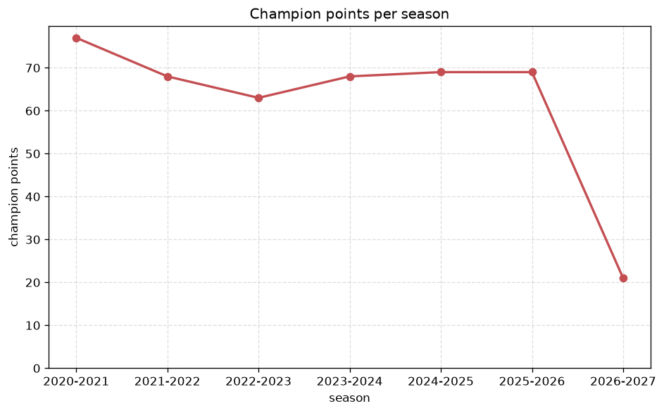
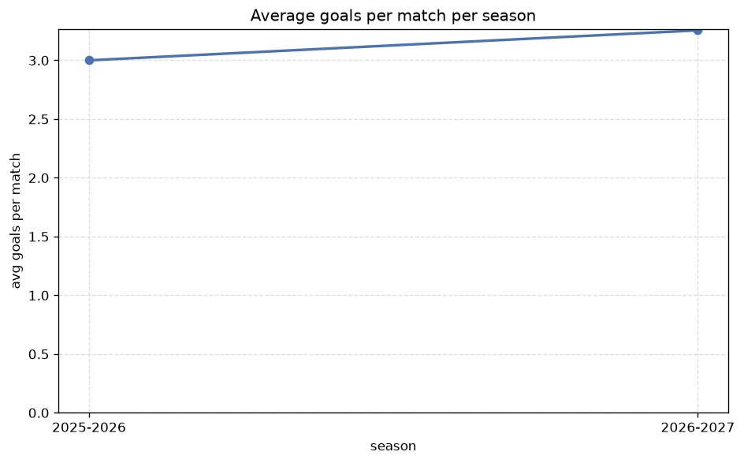

# Season Trends Analysis
- Report: `season_trends`
- Generated: 2026-10-29T02:03:19+00:00
- Script: `backend/scripts/analyze_seasons.py` v1.0.0
- League: NB I. (Hungary)
- Scope: league `hungary1`

## 1. Champions per season
| season | champion | pts | runner-up | margin |
|---|---|---|---|---|
| 2020-2021 | Ferencvaros | 77 | Puskas Academy | 19 pts |
| 2021-2022 | Ferencvaros | 68 | Kisvarda | 12 pts |
| 2022-2023 | Ferencvaros | 63 | Kecskemeti TE | 6 pts |
| 2023-2024 | Ferencvaros | 68 | Paks | 13 pts |
| 2024-2025 | Ferencvaros | 69 | Puskas Academy | 3 pts |
| 2025-2026 | Gyor | 69 | Ferencvaros | 1 pts |
| 2026-2027 | Gyor | 21 | Puskas Academy | 0 pts |

## 2. Title-race tightness
- Tight races (margin <= 3 pts): **3** of 7 seasons
- Tightest race: **2026-2027** - Gyor beat Puskas Academy by **0** pts

| season | margin | tight |
|---|---|---|
| 2020-2021 | 19 pts |  |
| 2021-2022 | 12 pts |  |
| 2022-2023 | 6 pts |  |
| 2023-2024 | 13 pts |  |
| 2024-2025 | 3 pts | yes |
| 2025-2026 | 1 pts | yes |
| 2026-2027 | 0 pts | yes |

## 3. Points thresholds
_Position-specific points per season. Key: 1 = champion, 2 = runner-up, 4 = CL line, 6 = Europa, 9 = last safe, 12 = bottom._

| season | pos 1 | pos 2 | pos 4 | pos 6 | pos 9 | pos 12 |
|---|---|---|---|---|---|---|
| 2020-2021 | 77 | 58 | 50 | 40 | 36 | 27 |
| 2021-2022 | 68 | 56 | 44 | 40 | 36 | 20 |
| 2022-2023 | 63 | 57 | 51 | 41 | 33 | 22 |
| 2023-2024 | 68 | 55 | 49 | 43 | 37 | 11 |
| 2024-2025 | 69 | 66 | 53 | 44 | 34 | 25 |
| 2025-2026 | 69 | 68 | 53 | 46 | 40 | 22 |
| 2026-2027 | 21 | 21 | 17 | 15 | 12 | 10 |

## 4. Relegation battle
| season | safe pos | safe pts | drop pos | drop pts | gap |
|---|---|---|---|---|---|
| 2020-2021 | 9 | 36 | 10 | 33 | 3 pts |
| 2021-2022 | 9 | 36 | 10 | 35 | 1 pts |
| 2022-2023 | 9 | 33 | 10 | 32 | 1 pts |
| 2023-2024 | 9 | 37 | 10 | 37 | 0 pts |
| 2024-2025 | 9 | 34 | 10 | 34 | 0 pts |
| 2025-2026 | 9 | 40 | 10 | 38 | 2 pts |
| 2026-2027 | 9 | 12 | 10 | 11 | 1 pts |

## 5. League-level trends
| season | matches | total goals | avg goals | home win | draw | away win | goalless | avg pts/team |
|---|---|---|---|---|---|---|---|---|
| 2020-2021 | 198 | 597 | 3.015 | 42.9% | 23.2% | 33.8% | 7.1% | 41.83 |
| 2021-2022 | 198 | 562 | 2.838 | 39.9% | 26.8% | 33.3% | 9.1% | 41.58 |
| 2022-2023 | 198 | 530 | 2.677 | 43.4% | 29.8% | 26.8% | 8.1% | 40.67 |
| 2023-2024 | 198 | 603 | 3.045 | 48.5% | 19.7% | 31.8% | 5.6% | 42.33 |
| 2024-2025 | 198 | 553 | 2.793 | 42.9% | 29.3% | 27.8% | 10.1% | 44.67 |
| 2025-2026 | 198 | 594 | 3.0 | 39.4% | 24.7% | 35.9% | 4.0% | 45.42 |
| 2026-2027 | 65 | 195 | 3.0 | 40.0% | 27.7% | 32.3% | 3.1% | 14.75 |

## 6. View divergence
- Largest divergence: **2021-2022** (luck view, avg abs position diff = 8.667)

_Avg absolute position difference between classic view and alternative view per season._

| season | classic vs luck | classic vs goals |
|---|---|---|
| 2020-2021 | 7.167 | 7.500 |
| 2021-2022 | 8.667 | 6.417 |
| 2022-2023 | 8.167 | 6.333 |
| 2023-2024 | 7.833 | 7.333 |
| 2024-2025 | 1.333 | 2.833 |
| 2025-2026 | 2.000 | 5.000 |
| 2026-2027 | 1.833 | 4.667 |

---
*All statistics are computed from PostgreSQL tables (read-only). Run with `python backend/scripts/analyze_seasons.py` to regenerate.*

## Charts

