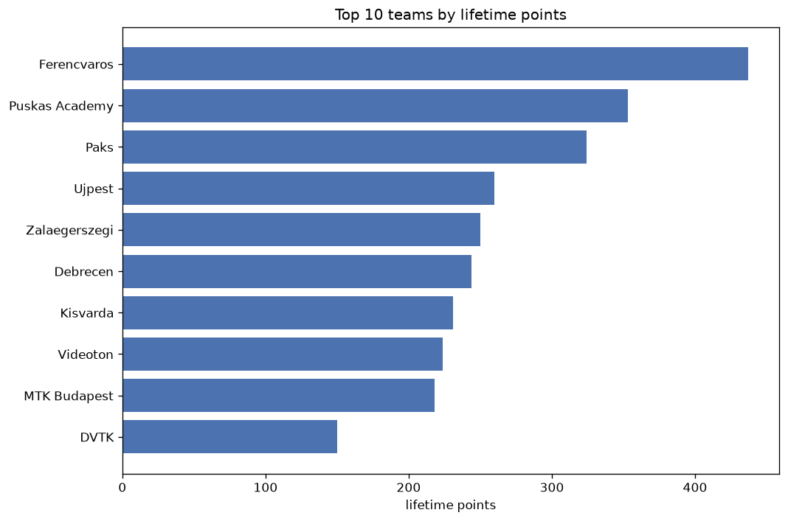
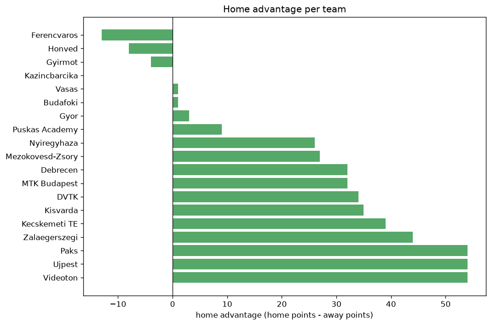

# Team Analysis
- Report: `teams_analysis`
- Generated: 2026-10-29T02:03:17+00:00
- Script: `backend/scripts/analyze_teams.py` v1.0.0
- League: NB I. (Hungary)
- Scope: league `hungary1`

- Teams: **19** | Seasons: **7** | Matches: **1253**

## 1. Team standings (lifetime)
| team | seasons | played | W | D | L | pts | GF | GA | GD | avg pts/season | best pos | worst pos | titles |
|---|---|---|---|---|---|---|---|---|---|---|---|---|---|
| Ferencvaros | 7 | 208 | 132 | 44 | 32 | 440 | 420 | 188 | 232 | 62.86 | 1 | 3 | 5 |
| Puskas Academy | 7 | 209 | 101 | 50 | 58 | 353 | 320 | 246 | 74 | 50.43 | 2 | 6 | 0 |
| Paks | 7 | 209 | 93 | 48 | 68 | 327 | 409 | 338 | 71 | 46.71 | 2 | 5 | 0 |
| Ujpest | 7 | 209 | 70 | 50 | 89 | 260 | 287 | 354 | -67 | 37.14 | 5 | 10 | 0 |
| Zalaegerszegi | 7 | 209 | 65 | 55 | 89 | 250 | 290 | 326 | -36 | 35.71 | 5 | 12 | 0 |
| Debrecen | 6 | 176 | 66 | 46 | 64 | 244 | 267 | 255 | 12 | 40.67 | 4 | 9 | 0 |
| Kisvarda | 6 | 176 | 60 | 51 | 65 | 231 | 211 | 236 | -25 | 38.5 | 2 | 11 | 0 |
| Videoton | 5 | 165 | 61 | 41 | 63 | 224 | 243 | 216 | 27 | 44.8 | 3 | 11 | 0 |
| MTK Budapest | 6 | 176 | 57 | 47 | 72 | 218 | 239 | 292 | -53 | 36.33 | 5 | 10 | 0 |
| DVTK | 4 | 132 | 38 | 36 | 58 | 150 | 166 | 225 | -59 | 37.5 | 6 | 11 | 0 |
| Gyor | 3 | 77 | 40 | 23 | 14 | 143 | 133 | 79 | 54 | 47.67 | 1 | 4 | 2 |
| Mezokovesd-Zsory | 4 | 132 | 37 | 32 | 63 | 143 | 148 | 201 | -53 | 35.75 | 12 | 13 | 0 |
| Kecskemeti TE | 3 | 99 | 32 | 31 | 36 | 127 | 124 | 130 | -6 | 42.33 | 2 | 12 | 0 |
| Honved | 4 | 109 | 29 | 31 | 49 | 118 | 141 | 167 | -26 | 29.5 | 8 | 11 | 0 |
| Nyiregyhaza | 3 | 77 | 22 | 21 | 34 | 87 | 90 | 130 | -40 | 29.0 | 8 | 10 | 0 |
| Vasas | 2 | 44 | 8 | 17 | 19 | 41 | 47 | 58 | -11 | 20.5 | 6 | 12 | 0 |
| Gyirmot | 1 | 33 | 7 | 11 | 15 | 32 | 34 | 49 | -15 | 32.0 | 11 | 11 | 0 |
| Budafoki | 1 | 33 | 7 | 6 | 20 | 27 | 34 | 74 | -40 | 27.0 | 12 | 12 | 0 |
| Kazincbarcika | 1 | 33 | 6 | 4 | 23 | 22 | 31 | 70 | -39 | 22.0 | 12 | 12 | 0 |

## 2. Home vs away split
| team | home P | H-W | H-D | H-L | H-pts | away P | A-W | A-D | A-L | A-pts | adv |
|---|---|---|---|---|---|---|---|---|---|---|---|
| Ujpest | 106 | 43 | 28 | 35 | 157 | 103 | 27 | 22 | 54 | 103 | 54 |
| Videoton | 80 | 39 | 22 | 19 | 139 | 85 | 22 | 19 | 44 | 85 | 54 |
| Paks | 104 | 57 | 18 | 29 | 189 | 105 | 36 | 30 | 39 | 138 | 51 |
| Zalaegerszegi | 105 | 39 | 30 | 36 | 147 | 104 | 26 | 25 | 53 | 103 | 44 |
| Kecskemeti TE | 51 | 22 | 17 | 12 | 83 | 48 | 10 | 14 | 24 | 44 | 39 |
| Kisvarda | 88 | 36 | 25 | 27 | 133 | 88 | 24 | 26 | 38 | 98 | 35 |
| DVTK | 67 | 23 | 23 | 21 | 92 | 65 | 15 | 13 | 37 | 58 | 34 |
| Debrecen | 88 | 39 | 21 | 28 | 138 | 88 | 27 | 25 | 36 | 106 | 32 |
| MTK Budapest | 89 | 35 | 20 | 34 | 125 | 87 | 22 | 27 | 38 | 93 | 32 |
| Mezokovesd-Zsory | 65 | 24 | 13 | 28 | 85 | 67 | 13 | 19 | 35 | 58 | 27 |
| Nyiregyhaza | 39 | 14 | 13 | 12 | 55 | 38 | 8 | 8 | 22 | 32 | 23 |
| Puskas Academy | 102 | 53 | 22 | 27 | 181 | 107 | 48 | 28 | 31 | 172 | 9 |
| Gyor | 39 | 22 | 7 | 10 | 73 | 38 | 18 | 16 | 4 | 70 | 3 |
| Vasas | 23 | 4 | 9 | 10 | 21 | 21 | 4 | 8 | 9 | 20 | 1 |
| Budafoki | 17 | 4 | 2 | 11 | 14 | 16 | 3 | 4 | 9 | 13 | 1 |
| Kazincbarcika | 17 | 3 | 2 | 12 | 11 | 16 | 3 | 2 | 11 | 11 | 0 |
| Gyirmot | 17 | 2 | 8 | 7 | 14 | 16 | 5 | 3 | 8 | 18 | -4 |
| Honved | 54 | 12 | 19 | 23 | 55 | 55 | 17 | 12 | 26 | 63 | -8 |
| Ferencvaros | 102 | 64 | 23 | 15 | 215 | 106 | 68 | 21 | 17 | 225 | -10 |

## 3. Top performers
### Best points per game (PPG)
| rank | team | PPG |
|---|---|---|
| 1 | Ferencvaros | 2.12 |
| 2 | Gyor | 1.86 |
| 3 | Puskas Academy | 1.69 |
| 4 | Paks | 1.56 |
| 5 | Debrecen | 1.39 |

### Most goals scored
| rank | team | goals |
|---|---|---|
| 1 | Ferencvaros | 420 |
| 2 | Paks | 409 |
| 3 | Puskas Academy | 320 |
| 4 | Zalaegerszegi | 290 |
| 5 | Ujpest | 287 |

### Best goal difference
| rank | team | GD |
|---|---|---|
| 1 | Ferencvaros | 232 |
| 2 | Puskas Academy | 74 |
| 3 | Paks | 71 |
| 4 | Gyor | 54 |
| 5 | Videoton | 27 |

### Best defence (goals against per match, standings)
| rank | team | GA/match |
|---|---|---|
| 1 | Ferencvaros | 0.906 |
| 2 | Gyor | 1.026 |
| 3 | Puskas Academy | 1.186 |
| 4 | Videoton | 1.314 |
| 5 | Kecskemeti TE | 1.320 |

## 4. Team consistency
- Teams present in all **7** seasons: **5**

Ferencvaros, Paks, Puskas Academy, Ujpest, Zalaegerszegi

## 5. Head-to-head dominance
- Distinct fixtures: **150** (showing the 15 most frequent)

| fixture | meetings | home wins | draws | away wins | home pct | draw pct | away pct |
|---|---|---|---|---|---|---|---|
| Puskas Academy vs Paks | 19 | 12 | 1 | 6 | 63.2% | 5.3% | 31.6% |
| Ferencvaros vs Paks | 19 | 10 | 1 | 8 | 52.6% | 5.3% | 42.1% |
| Ferencvaros vs Ujpest | 19 | 10 | 3 | 6 | 52.6% | 15.8% | 31.6% |
| Ujpest vs Zalaegerszegi | 19 | 10 | 4 | 5 | 52.6% | 21.1% | 26.3% |
| Ferencvaros vs Zalaegerszegi | 19 | 8 | 2 | 9 | 42.1% | 10.5% | 47.4% |
| Paks vs Ujpest | 19 | 8 | 3 | 8 | 42.1% | 15.8% | 42.1% |
| Paks vs Zalaegerszegi | 19 | 7 | 8 | 4 | 36.8% | 42.1% | 21.1% |
| Puskas Academy vs Ujpest | 19 | 7 | 5 | 7 | 36.8% | 26.3% | 36.8% |
| Puskas Academy vs Zalaegerszegi | 19 | 7 | 3 | 9 | 36.8% | 15.8% | 47.4% |
| Ferencvaros vs Puskas Academy | 19 | 6 | 7 | 6 | 31.6% | 36.8% | 31.6% |
| Ujpest vs Debrecen | 16 | 10 | 2 | 4 | 62.5% | 12.5% | 25.0% |
| Ujpest vs Kisvarda | 16 | 10 | 3 | 3 | 62.5% | 18.8% | 18.8% |
| Zalaegerszegi vs Debrecen | 16 | 10 | 3 | 3 | 62.5% | 18.8% | 18.8% |
| Paks vs MTK Budapest | 16 | 9 | 2 | 5 | 56.2% | 12.5% | 31.2% |
| MTK Budapest vs Zalaegerszegi | 16 | 8 | 4 | 4 | 50.0% | 25.0% | 25.0% |

## 6. Position per season (classic view)
_Cells show final position; '-' when the team was absent from that season._

| team | 2020-2021 | 2021-2022 | 2022-2023 | 2023-2024 | 2024-2025 | 2025-2026 | 2026-2027 |
|---|---|---|---|---|---|---|---|
| Ferencvaros | 1 | 1 | 1 | 1 | 1 | 2 | 3 |
| Puskas Academy | 2 | 3 | 3 | 4 | 2 | 6 | 2 |
| Paks | 4 | 5 | 5 | 2 | 3 | 3 | 4 |
| Ujpest | 5 | 6 | 7 | 10 | 7 | 7 | 7 |
| Zalaegerszegi | 9 | 7 | 9 | 9 | 10 | 5 | 12 |
| Debrecen | - | 9 | 4 | 5 | 9 | 4 | 5 |
| Kisvarda | 6 | 2 | 6 | 11 | - | 9 | 8 |
| Videoton | 3 | 4 | 8 | 3 | 11 | - | - |
| MTK Budapest | 7 | 10 | - | 6 | 5 | 10 | 9 |
| DVTK | 10 | - | - | 8 | 6 | 11 | - |
| Gyor | - | - | - | - | 4 | 1 | 1 |
| Mezokovesd-Zsory | 13 | 12 | 13 | 12 | - | - | - |
| Kecskemeti TE | - | - | 2 | 7 | 12 | - | - |
| Honved | 8 | 8 | 10 | - | - | - | 11 |
| Nyiregyhaza | - | - | - | - | 8 | 8 | 10 |
| Vasas | - | - | 12 | - | - | - | 6 |
| Gyirmot | - | 11 | - | - | - | - | - |
| Budafoki | 12 | - | - | - | - | - | - |
| Kazincbarcika | - | - | - | - | - | 12 | - |

---
*All statistics are computed from PostgreSQL tables (read-only). Run with `python backend/scripts/analyze_teams.py` to regenerate.*

## Charts

