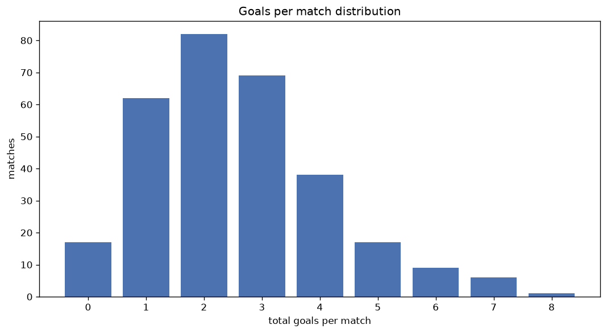
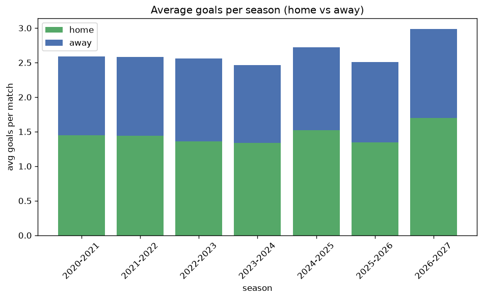

# Goal Analysis
- Report: `goals_analysis`
- Generated: 2026-10-29T02:03:33+00:00
- Script: `backend/scripts/analyze_goals.py` v1.0.0
- League: NB II. (Hungary)
- Scope: league `hungary2`

## 1. Goals per match distribution
| goals | matches | pct |
|---|---|---|
| 0 | 146 | 7.3% |
| 1 | 423 | 21.0% |
| 2 | 500 | 24.8% |
| 3 | 421 | 20.9% |
| 4 | 265 | 13.2% |
| 5 | 153 | 7.6% |
| 6 | 60 | 3.0% |
| 7 | 33 | 1.6% |
| 8 | 7 | 0.3% |
| 9 | 3 | 0.1% |
| 10 | 2 | 0.1% |

## 2. Goals per match per season
| season | matches | total goals | avg home | avg away | avg total |
|---|---|---|---|---|---|
| 2020-2021 | 380 | 984 | 1.445 | 1.145 | 2.589 |
| 2021-2022 | 380 | 981 | 1.442 | 1.139 | 2.582 |
| 2022-2023 | 380 | 972 | 1.363 | 1.195 | 2.558 |
| 2023-2024 | 306 | 753 | 1.337 | 1.124 | 2.461 |
| 2024-2025 | 240 | 653 | 1.521 | 1.2 | 2.721 |
| 2025-2026 | 240 | 602 | 1.342 | 1.167 | 2.508 |
| 2026-2027 | 87 | 260 | 1.701 | 1.287 | 2.989 |

## 3. Home vs away goal share
- Home goals: **2859** (54.9%)
- Away goals: **2346** (45.1%)
- Home/away ratio: **1.219**

| season | home goals | away goals | total | home pct | away pct |
|---|---|---|---|---|---|
| 2020-2021 | 549 | 435 | 984 | 55.8% | 44.2% |
| 2021-2022 | 548 | 433 | 981 | 55.9% | 44.1% |
| 2022-2023 | 518 | 454 | 972 | 53.3% | 46.7% |
| 2023-2024 | 409 | 344 | 753 | 54.3% | 45.7% |
| 2024-2025 | 365 | 288 | 653 | 55.9% | 44.1% |
| 2025-2026 | 322 | 280 | 602 | 53.5% | 46.5% |
| 2026-2027 | 148 | 112 | 260 | 56.9% | 43.1% |

## 4. BTTS (Both Teams To Score)
- Overall: **1031** of `2013` (51.2%)

| season | matches | BTTS | pct |
|---|---|---|---|
| 2020-2021 | 380 | 182 | 47.9% |
| 2021-2022 | 380 | 186 | 48.9% |
| 2022-2023 | 380 | 206 | 54.2% |
| 2023-2024 | 306 | 149 | 48.7% |
| 2024-2025 | 240 | 142 | 59.2% |
| 2025-2026 | 240 | 116 | 48.3% |
| 2026-2027 | 87 | 50 | 57.5% |

## 5. Clean sheets
- Home clean sheets: **629** (31.2%)
- Away clean sheets: **499** (24.8%)
- Total clean sheets recorded: **1128**
- Matches with at least one clean sheet: **982** (48.8%)
- Both teams kept clean sheets (0-0): **146**

| season | matches | home CS | away CS | total CS | matches w/ CS |
|---|---|---|---|---|---|
| 2020-2021 | 380 | 132 | 94 | 226 | 198 (52.1%) |
| 2021-2022 | 380 | 127 | 101 | 228 | 194 (51.1%) |
| 2022-2023 | 380 | 110 | 89 | 199 | 174 (45.8%) |
| 2023-2024 | 306 | 100 | 79 | 179 | 157 (51.3%) |
| 2024-2025 | 240 | 63 | 55 | 118 | 98 (40.8%) |
| 2025-2026 | 240 | 72 | 67 | 139 | 124 (51.7%) |
| 2026-2027 | 87 | 25 | 14 | 39 | 37 (42.5%) |

## 6. Scoring intensity
- First-half goals: **2324** (44.8%)
- Second-half goals: **2869** (55.2%)
- Avg first-half goals per match: **1.157**
- Avg second-half goals per match: **1.428**
- Second-half-only scoring (HT 0-0, FT goals >= 1): **476** (23.6%)
- *4 match(es) excluded (no HT score recorded).*

| season | matches | 1st half | 2nd half | 1st half pct | 2nd half pct |
|---|---|---|---|---|---|
| 2020-2021 | 380 | 403 | 572 | 41.3% | 58.7% |
| 2021-2022 | 380 | 453 | 528 | 46.2% | 53.8% |
| 2022-2023 | 380 | 451 | 518 | 46.5% | 53.5% |
| 2023-2024 | 306 | 339 | 414 | 45.0% | 55.0% |
| 2024-2025 | 240 | 297 | 356 | 45.5% | 54.5% |
| 2025-2026 | 240 | 267 | 335 | 44.4% | 55.6% |
| 2026-2027 | 87 | 114 | 146 | 43.8% | 56.2% |

## 7. First-goal timing
- Matches with first-goal time recorded: `1863` of `2013` (92.5%)
- Goalless matches: `150`
- Min `1` | Max `95` | Mean `32.02` | Median (p50) `27`

| bucket | count | % of matches | % of scoring matches |
|---|---|---|---|
| 1-15 | 588 | 29.2% | 31.6% |
| 16-30 | 439 | 21.8% | 23.6% |
| 31-45 | 337 | 16.7% | 18.1% |
| 46-60 | 245 | 12.2% | 13.2% |
| 61-75 | 133 | 6.6% | 7.1% |
| 76-90 | 103 | 5.1% | 5.5% |
| 91-120 | 18 | 0.9% | 1.0% |

---
*All statistics are computed from PostgreSQL tables (read-only). Run with `python backend/scripts/analyze_goals.py` to regenerate.*

## Charts

