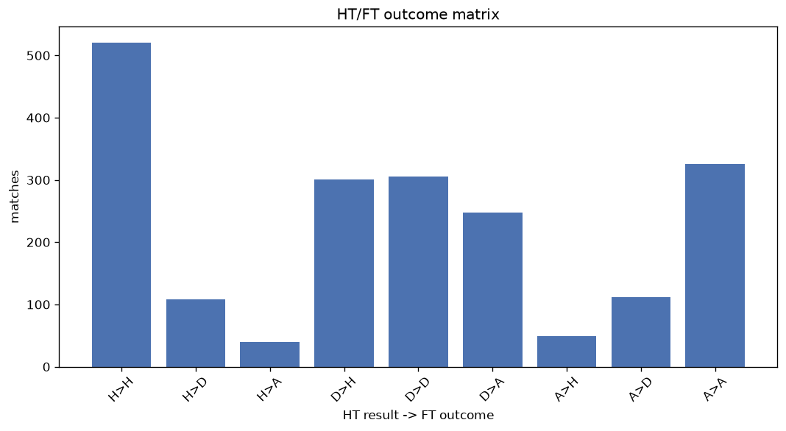
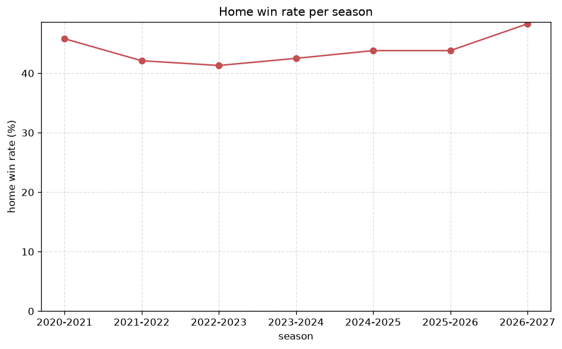

# Match Analysis
- Report: `matches_analysis`
- Generated: 2026-10-30T03:56:10+00:00
- Script: `backend/scripts/analyze_matches.py` v1.0.0
- League: NB II. (Hungary)
- Scope: league `hungary2`

## 1. Overall summary
| metric | value |
|---|---|
| Matches | 2013 |
| Home wins | 873 (43.4%) |
| Draws | 526 (26.1%) |
| Away wins | 614 (30.5%) |
| Total goals | 5205 |
| Average goals per match | 2.586 |
| Goalless matches | 146 (7.3%) |

## 2. Per-season breakdown
| season | matches | home wins | draws | away wins | total goals | avg goals | goalless |
|---|---|---|---|---|---|---|---|
| 2020-2021 | 380 | 174 (45.8%) | 90 (23.7%) | 116 (30.5%) | 984 | 2.589 | 28 (7.4%) |
| 2021-2022 | 380 | 160 (42.1%) | 102 (26.8%) | 118 (31.1%) | 981 | 2.582 | 34 (8.9%) |
| 2022-2023 | 380 | 157 (41.3%) | 103 (27.1%) | 120 (31.6%) | 972 | 2.558 | 25 (6.6%) |
| 2023-2024 | 306 | 130 (42.5%) | 81 (26.5%) | 95 (31.0%) | 753 | 2.461 | 22 (7.2%) |
| 2024-2025 | 240 | 105 (43.8%) | 70 (29.2%) | 65 (27.1%) | 653 | 2.721 | 20 (8.3%) |
| 2025-2026 | 240 | 105 (43.8%) | 60 (25.0%) | 75 (31.2%) | 602 | 2.508 | 15 (6.2%) |
| 2026-2027 | 87 | 42 (48.3%) | 20 (23.0%) | 25 (28.7%) | 260 | 2.989 | 2 (2.3%) |

## 3. HT/FT outcome matrix
| HT result \ FT result | Home | Draw | Away | total |
|---|---|---|---|---|
| HT home lead | 520 (77.8%) | 108 (16.2%) | 40 (6.0%) | 668 |
| HT draw | 301 (35.2%) | 306 (35.8%) | 247 (28.9%) | 854 |
| HT away lead | 49 (10.1%) | 112 (23.0%) | 326 (66.9%) | 487 |
- *4 match(es) excluded (no HT score recorded).*

## 4. Comeback matches
- Home comebacks (trailing at HT, won at FT): **49** (2.4%)
- Away comebacks (trailing at HT, won at FT): **40** (2.0%)

### Home comebacks
| season | home | away | HT | FT |
|---|---|---|---|---|
| 2020-2021 | Debreceni EAC | Gyor | 0-2 | 3-2 |
| 2020-2021 | Soroksar | Haladas | 0-1 | 2-1 |
| 2020-2021 | Vasas | Szeged | 0-1 | 3-1 |
| 2020-2021 | Kazincbarcika | Csakvari | 0-1 | 2-1 |
| 2020-2021 | Budaorsi SC | Nyiregyhaza | 0-2 | 3-2 |
| 2020-2021 | Csakvari | Gyirmot | 0-1 | 2-1 |
| 2020-2021 | Debrecen | Siofok | 0-1 | 2-1 |
| 2020-2021 | Soroksar | Budaorsi SC | 0-2 | 5-4 |
| 2020-2021 | Bekescsaba 1912 | Szolnoki MAV | 1-2 | 3-2 |
| 2021-2022 | Nyiregyhaza | Dorogi | 0-2 | 3-2 |
| 2021-2022 | DVTK | Csakvari | 0-1 | 3-2 |
| 2021-2022 | Tiszakecske | Bekescsaba 1912 | 0-1 | 2-1 |
| 2021-2022 | Soroksar | Szolnoki MAV | 1-2 | 3-2 |
| 2021-2022 | Csakvari | Kecskemeti TE | 0-1 | 2-1 |
| 2021-2022 | Bekescsaba 1912 | Ajka | 0-2 | 3-2 |
| 2021-2022 | Vasas | Szeged | 0-1 | 3-1 |
| 2021-2022 | Szeged | Szolnoki MAV | 0-1 | 2-1 |
| 2022-2023 | MTK Budapest | Szeged | 0-1 | 2-1 |
| 2022-2023 | Mosonmagyarovari TE | Ajka | 0-1 | 2-1 |
| 2022-2023 | Csakvari | Szentlorinc | 0-1 | 2-1 |
| 2022-2023 | Szentlorinc | Nyiregyhaza | 0-1 | 2-1 |
| 2022-2023 | Pecsi MFC | Soroksar | 0-1 | 2-1 |
| 2022-2023 | Soroksar | Kazincbarcika | 0-1 | 3-1 |
| 2022-2023 | DVTK | Budafoki | 0-1 | 2-1 |
| 2022-2023 | Ajka | Haladas | 0-1 | 2-1 |
| 2022-2023 | MTK Budapest | Nyiregyhaza | 0-1 | 2-1 |
| 2023-2024 | Gyor | Budafoki | 0-1 | 4-1 |
| 2023-2024 | Nyiregyhaza | Ajka | 0-1 | 2-1 |
| 2023-2024 | Soroksar | BVSC-Zuglo | 0-1 | 2-1 |
| 2023-2024 | Szeged | Haladas | 0-1 | 2-1 |
| 2023-2024 | Nyiregyhaza | Gyirmot | 0-1 | 3-1 |
| 2024-2025 | Tatabanya | Szeged | 0-1 | 3-2 |
| 2024-2025 | Szeged | Soroksar | 0-1 | 2-1 |
| 2024-2025 | Kazincbarcika | Gyirmot | 0-1 | 2-1 |
| 2024-2025 | Vasas | Ajka | 0-1 | 3-2 |
| 2024-2025 | Gyirmot | Honved | 0-1 | 3-1 |
| 2024-2025 | Vasas | Szentlorinc | 0-1 | 3-1 |
| 2024-2025 | Szentlorinc | Budafoki | 0-1 | 3-2 |
| 2024-2025 | Tatabanya | Gyirmot | 0-1 | 2-1 |
| 2024-2025 | Kozarmisleny SE | Gyirmot | 0-1 | 3-2 |
| 2024-2025 | Kisvarda | BVSC-Zuglo | 1-2 | 3-2 |
| 2024-2025 | Mezokovesd-Zsory | Tatabanya | 1-2 | 4-2 |
| 2024-2025 | Kazincbarcika | Soroksar | 0-1 | 3-2 |
| 2025-2026 | BVSC-Zuglo | Szentlorinc | 0-1 | 2-1 |
| 2025-2026 | Karcagi | Bekescsaba 1912 | 0-1 | 4-2 |
| 2025-2026 | Karcagi | Budafoki | 0-1 | 3-2 |
| 2025-2026 | Szentlorinc | Videoton | 0-1 | 2-1 |
| 2025-2026 | Kozarmisleny SE | Karcagi | 0-1 | 2-1 |
| 2026-2027 | Videoton | DVTK | 0-1 | 2-1 |

### Away comebacks
| season | home | away | HT | FT |
|---|---|---|---|---|
| 2020-2021 | Siofok | Kaposvar | 1-0 | 1-2 |
| 2020-2021 | Csakvari | Gyor | 1-0 | 1-3 |
| 2020-2021 | Siofok | Soroksar | 1-0 | 2-3 |
| 2020-2021 | Csakvari | Bekescsaba 1912 | 2-1 | 3-5 |
| 2020-2021 | Debreceni EAC | Budaorsi SC | 1-0 | 2-3 |
| 2020-2021 | Gyirmot | Szentlorinc | 1-0 | 1-2 |
| 2020-2021 | Szolnoki MAV | Gyirmot | 1-0 | 1-2 |
| 2021-2022 | Budaorsi SC | Szolnoki MAV | 2-0 | 2-3 |
| 2021-2022 | Soroksar | Nyiregyhaza | 1-0 | 2-3 |
| 2021-2022 | Budaorsi SC | Szeged | 1-0 | 1-4 |
| 2021-2022 | Tiszakecske | Szentlorinc | 1-0 | 1-2 |
| 2021-2022 | Csakvari | Bekescsaba 1912 | 1-0 | 1-2 |
| 2021-2022 | Ajka | Soroksar | 1-0 | 1-2 |
| 2021-2022 | Haladas | Siofok | 1-0 | 1-2 |
| 2021-2022 | Bekescsaba 1912 | Gyor | 2-0 | 2-3 |
| 2022-2023 | Gyor | Szeged | 1-0 | 1-2 |
| 2022-2023 | Kozarmisleny SE | Szentlorinc | 1-0 | 1-2 |
| 2022-2023 | Gyirmot | Haladas | 1-0 | 1-2 |
| 2022-2023 | Kozarmisleny SE | Csakvari | 1-0 | 1-3 |
| 2022-2023 | Szentlorinc | Budafoki | 1-0 | 1-2 |
| 2023-2024 | Honved | Kozarmisleny SE | 1-0 | 1-2 |
| 2023-2024 | Tiszakecske | Haladas | 2-1 | 2-3 |
| 2023-2024 | Tiszakecske | Vasas | 1-0 | 1-2 |
| 2023-2024 | Gyirmot | Nyiregyhaza | 2-0 | 2-4 |
| 2023-2024 | Gyirmot | Kozarmisleny SE | 3-1 | 3-5 |
| 2023-2024 | Siofok | Csakvari | 1-0 | 1-2 |
| 2023-2024 | Kazincbarcika | Gyor | 2-1 | 2-3 |
| 2023-2024 | Haladas | Ajka | 1-0 | 1-3 |
| 2023-2024 | Mosonmagyarovari TE | Siofok | 1-0 | 1-3 |
| 2024-2025 | Soroksar | Gyirmot | 1-0 | 1-2 |
| 2024-2025 | Bekescsaba 1912 | Mezokovesd-Zsory | 1-0 | 1-2 |
| 2024-2025 | Mezokovesd-Zsory | Szeged | 1-0 | 1-2 |
| 2024-2025 | Budafoki | Kisvarda | 2-0 | 2-4 |
| 2024-2025 | Kozarmisleny SE | Kisvarda | 2-1 | 2-3 |
| 2024-2025 | Ajka | Vasas | 2-1 | 2-3 |
| 2024-2025 | Csakvari | Budafoki | 1-0 | 1-2 |
| 2024-2025 | Gyirmot | Kozarmisleny SE | 2-1 | 2-3 |
| 2025-2026 | Szentlorinc | Kecskemeti TE | 2-1 | 3-4 |
| 2026-2027 | Kozarmisleny SE | Szeged | 1-0 | 1-2 |
| 2026-2027 | Csakvari | Kecskemeti TE | 1-0 | 1-2 |

## 5. HT lead conversion
| HT state | matches | converted to win | held as draw | collapsed to loss |
|---|---|---|---|---|
| Home lead | 668 | 520 (77.8%) | 108 (16.2%) | 40 (6.0%) |
| Away lead | 487 | 326 (66.9%) | 112 (23.0%) | 49 (10.1%) |

### Matches level at half-time
| FT result | count | pct |
|---|---|---|
| Home win | 301 | 35.2% |
| Draw | 306 | 35.8% |
| Away win | 247 | 28.9% |
- *4 match(es) excluded (no HT score recorded).*

## 6. First-goal timing
- Matches with a first-goal time recorded: `1863` of `2013` (92.5%)

Outcome distribution by first-goal timing bucket:
| bucket | matches | % of matches | home | draw | away |
|---|---|---|---|---|---|
| 1-15 | 588 | 29.2% | 297 (50.5%) | 125 (21.3%) | 166 (28.2%) |
| 16-30 | 439 | 21.8% | 199 (45.3%) | 97 (22.1%) | 143 (32.6%) |
| 31-45 | 337 | 16.7% | 150 (44.5%) | 73 (21.7%) | 114 (33.8%) |
| 46-60 | 245 | 12.2% | 110 (44.9%) | 56 (22.9%) | 79 (32.2%) |
| 61-75 | 133 | 6.6% | 53 (39.8%) | 22 (16.5%) | 58 (43.6%) |
| 76-90 | 103 | 5.1% | 53 (51.5%) | 7 (6.8%) | 43 (41.7%) |
| 91-120 | 18 | 0.9% | 8 (44.4%) | 0 (0.0%) | 10 (55.6%) |

## 7. Goalless matches
- Overall: **146** of `2013` (7.3%)

| season | matches | goalless | pct |
|---|---|---|---|
| 2020-2021 | 380 | 28 | 7.4% |
| 2021-2022 | 380 | 34 | 8.9% |
| 2022-2023 | 380 | 25 | 6.6% |
| 2023-2024 | 306 | 22 | 7.2% |
| 2024-2025 | 240 | 20 | 8.3% |
| 2025-2026 | 240 | 15 | 6.2% |
| 2026-2027 | 87 | 2 | 2.3% |

---
*All statistics are computed from PostgreSQL tables (read-only). Run with `python backend/scripts/analyze_matches.py` to regenerate.*

## Charts

