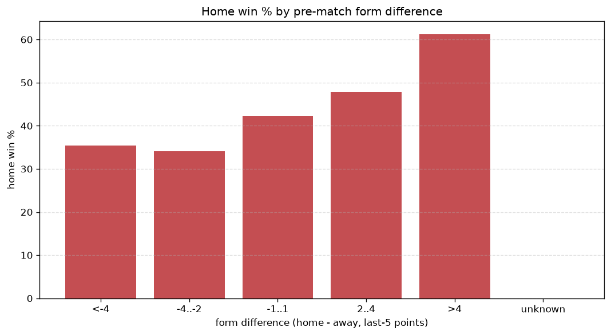
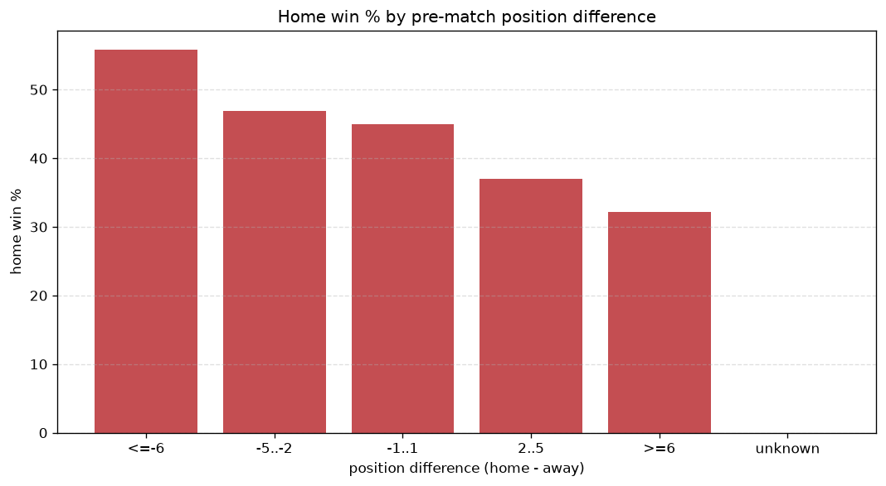

# Relationships Analysis
- Report: `relationships`
- Generated: 2026-10-29T02:03:40+00:00
- Script: `backend/scripts/analyze_relationships.py` v1.0.0
- League: NB II. (Hungary)
- Scope: league `hungary2`

- Matches analysed: **1926** (23 leakage-safe pre-match features).

## 1. Correlation matrix
_Pearson correlation of each pre-match feature with observed goals; sorted by |corr(total goals)|._

| feature | corr(home) | corr(away) | corr(total) |
|---|---|---|---|
| away_team_goals_conceded_last_5 | 0.086 | -0.016 | 0.053 |
| home_team_goals_scored_last_5 | 0.123 | -0.059 | 0.051 |
| away_team_away_conceded_avg | 0.060 | 0.004 | 0.048 |
| rest_days_difference | -0.084 | 0.030 | -0.042 |
| points_difference | 0.192 | -0.164 | 0.032 |
| home_team_home_goals_avg | 0.097 | -0.060 | 0.032 |
| away_team_points_last_5 | -0.109 | 0.073 | -0.032 |
| away_position_before_match | 0.128 | -0.099 | 0.029 |
| away_team_away_goals_avg | -0.032 | 0.075 | 0.027 |
| away_team_wins_last_5 | -0.107 | 0.079 | -0.026 |
| away_team_away_win_rate | -0.061 | 0.029 | -0.026 |
| position_difference | -0.182 | 0.164 | -0.025 |
| away_team_goals_scored_last_5 | -0.057 | 0.089 | 0.018 |
| away_points_before_match | -0.068 | 0.053 | -0.015 |
| home_team_goals_conceded_last_5 | -0.055 | 0.043 | -0.012 |
| away_rest_days | 0.016 | -0.001 | 0.011 |
| home_points_before_match | 0.063 | -0.059 | 0.007 |
| home_rest_days | 0.006 | 0.003 | 0.006 |
| home_team_points_last_5 | 0.079 | -0.096 | -0.006 |
| home_team_home_win_rate | 0.071 | -0.086 | -0.006 |
| home_position_before_match | -0.126 | 0.129 | -0.006 |
| home_team_wins_last_5 | 0.086 | -0.089 | 0.003 |
| home_team_home_conceded_avg | -0.056 | 0.058 | -0.002 |

## 2. Form vs outcome
_Home win/draw/away % per bucket of `home_team_points_last_5 - away_team_points_last_5`._

| bucket | matches | home | draw | away | home % | draw % | away % |
|---|---|---|---|---|---|---|---|
| <-4 | 314 | 111 | 83 | 120 | 35.4% | 26.4% | 38.2% |
| -4..-2 | 408 | 139 | 133 | 136 | 34.1% | 32.6% | 33.3% |
| -1..1 | 551 | 233 | 135 | 183 | 42.3% | 24.5% | 33.2% |
| 2..4 | 385 | 184 | 97 | 104 | 47.8% | 25.2% | 27.0% |
| >4 | 268 | 164 | 58 | 46 | 61.2% | 21.6% | 17.2% |
| unknown | 0 | 0 | 0 | 0 | - | - | - |

## 3. Position vs outcome
_Home win/draw/away % per bucket of `position_difference` (home position - away position; negative favours the home team)._

| bucket | matches | home | draw | away | home % | draw % | away % |
|---|---|---|---|---|---|---|---|
| <=-6 | 453 | 253 | 92 | 108 | 55.8% | 20.3% | 23.8% |
| -5..-2 | 358 | 168 | 112 | 78 | 46.9% | 31.3% | 21.8% |
| -1..1 | 271 | 122 | 64 | 85 | 45.0% | 23.6% | 31.4% |
| 2..5 | 341 | 126 | 99 | 116 | 37.0% | 29.0% | 34.0% |
| >=6 | 503 | 162 | 139 | 202 | 32.2% | 27.6% | 40.2% |
| unknown | 0 | 0 | 0 | 0 | - | - | - |

## 4. Rest advantage
_Home win/draw/away % per bucket of `rest_days_difference` (home rest - away rest). Matches with unknown rest are bucketed separately._

| bucket | matches | home | draw | away | home % | draw % | away % |
|---|---|---|---|---|---|---|---|
| <-1 | 28 | 18 | 5 | 5 | 64.3% | 17.9% | 17.9% |
| -1..0 | 128 | 73 | 26 | 29 | 57.0% | 20.3% | 22.7% |
| 0 | 1562 | 664 | 420 | 478 | 42.5% | 26.9% | 30.6% |
| 1..2 | 131 | 40 | 41 | 50 | 30.5% | 31.3% | 38.2% |
| >2 | 22 | 9 | 4 | 9 | 40.9% | 18.2% | 40.9% |
| unknown | 55 | 27 | 10 | 18 | 49.1% | 18.2% | 32.7% |
- *55 match(es) had unknown rest difference (missing rest data on at least one side).*

## 5. Home team quality
_Home win rate by `home_team_home_win_rate` tier (split at 0.5)._

- `< 0.5` tier: **39.0%** home win (455/1166)
- `>= 0.5` tier: **49.5%** home win (376/760)
- Home-win gap (>= split minus < split): **+10.5 pp**

| tier | label | matches | home | draw | away | home % |
|---|---|---|---|---|---|---|
| low | < 0.5 | 1166 | 455 | 319 | 392 | 39.0% |
| high | >= 0.5 | 760 | 376 | 187 | 197 | 49.5% |

## 6. Feature averages by result
_Mean feature value per outcome; `range` is home-minus-away spread of the group means._

| feature | home mean | draw mean | away mean | range |
|---|---|---|---|---|
| points_difference | 2.258 | -0.721 | -3.421 | 5.679 |
| away_points_before_match | 22.272 | 22.723 | 26.127 | 3.855 |
| position_difference | -1.468 | 0.791 | 2.253 | 3.721 |
| home_points_before_match | 24.529 | 22.002 | 22.706 | 2.528 |
| home_position_before_match | 9.096 | 10.401 | 11.042 | 1.946 |
| away_position_before_match | 10.564 | 9.611 | 8.789 | 1.775 |
| away_team_points_last_5 | 5.942 | 6.496 | 6.840 | 0.898 |
| home_team_points_last_5 | 6.522 | 5.955 | 5.756 | 0.767 |
| home_team_goals_scored_last_5 | 6.149 | 5.573 | 5.385 | 0.764 |
| away_team_goals_scored_last_5 | 5.643 | 5.913 | 6.253 | 0.610 |
| away_team_goals_conceded_last_5 | 5.992 | 5.678 | 5.499 | 0.492 |
| home_team_goals_conceded_last_5 | 5.669 | 6.036 | 6.129 | 0.460 |
| away_rest_days | 8.853 | 8.506 | 8.550 | 0.347 |
| away_team_wins_last_5 | 1.564 | 1.767 | 1.885 | 0.320 |
| home_team_wins_last_5 | 1.776 | 1.577 | 1.509 | 0.267 |
| rest_days_difference | -0.112 | 0.060 | 0.098 | 0.210 |
| home_rest_days | 8.741 | 8.567 | 8.648 | 0.175 |
| home_team_home_goals_avg | 1.421 | 1.311 | 1.274 | 0.147 |
| home_team_home_conceded_avg | 1.058 | 1.125 | 1.150 | 0.092 |
| away_team_away_conceded_avg | 1.389 | 1.342 | 1.320 | 0.068 |
| away_team_away_goals_avg | 1.070 | 1.134 | 1.121 | 0.065 |
| home_team_home_win_rate | 0.436 | 0.393 | 0.384 | 0.052 |
| away_team_away_win_rate | 0.255 | 0.283 | 0.280 | 0.027 |

---
*All features are leakage-safe pre-match values built by `ml.features.build_features.build_rows` from strictly prior matches. Run with `python backend/scripts/analyze_relationships.py` to regenerate.*

## Charts

