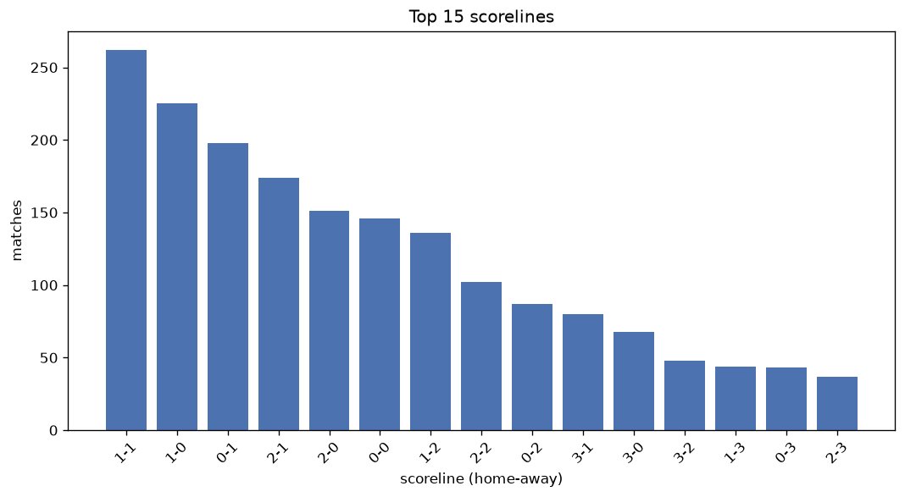
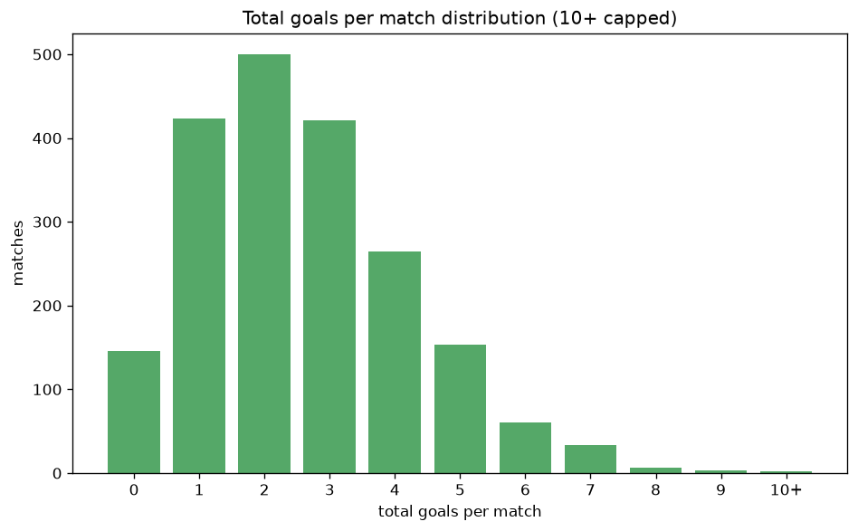

# Scoreline Analysis
- Report: `scoreline_analysis`
- Generated: 2026-10-27T01:53:54+00:00
- Script: `backend/scripts/analyze_scorelines.py` v1.0.0
- League: NB II. (Hungary)
- Scope: league `hungary2`

## 1. Scoreline frequency
- Matches analysed: **2013** across **7** seasons.
- Distinct scorelines seen: **43**.

| scoreline | count | pct |
|---|---|---|
| 1-1 | 262 | 13.0% |
| 1-0 | 225 | 11.2% |
| 0-1 | 198 | 9.8% |
| 2-1 | 174 | 8.6% |
| 2-0 | 151 | 7.5% |
| 0-0 | 146 | 7.3% |
| 1-2 | 136 | 6.8% |
| 2-2 | 102 | 5.1% |
| 0-2 | 87 | 4.3% |
| 3-1 | 80 | 4.0% |
| 3-0 | 68 | 3.4% |
| 3-2 | 48 | 2.4% |
| 1-3 | 44 | 2.2% |
| 0-3 | 43 | 2.1% |
| 2-3 | 37 | 1.8% |
| 4-1 | 32 | 1.6% |
| 4-0 | 26 | 1.3% |
| 1-4 | 20 | 1.0% |
| 4-2 | 17 | 0.8% |
| 4-3 | 15 | 0.7% |

## 2. Scoreline frequency per season

### 2020-2021
| scoreline | count | pct |
|---|---|---|
| 1-1 | 44 | 11.6% |
| 1-0 | 43 | 11.3% |
| 0-1 | 37 | 9.7% |
| 2-1 | 30 | 7.9% |
| 2-0 | 29 | 7.6% |

### 2021-2022
| scoreline | count | pct |
|---|---|---|
| 1-1 | 46 | 12.1% |
| 0-1 | 42 | 11.1% |
| 1-0 | 41 | 10.8% |
| 0-0 | 34 | 8.9% |
| 2-0 | 30 | 7.9% |

### 2022-2023
| scoreline | count | pct |
|---|---|---|
| 1-1 | 57 | 15.0% |
| 1-0 | 47 | 12.4% |
| 0-1 | 37 | 9.7% |
| 2-1 | 36 | 9.5% |
| 1-2 | 29 | 7.6% |

### 2023-2024
| scoreline | count | pct |
|---|---|---|
| 1-0 | 41 | 13.4% |
| 1-1 | 40 | 13.1% |
| 0-1 | 32 | 10.5% |
| 2-1 | 27 | 8.8% |
| 2-0 | 24 | 7.8% |

### 2024-2025
| scoreline | count | pct |
|---|---|---|
| 1-1 | 33 | 13.8% |
| 0-1 | 23 | 9.6% |
| 2-1 | 23 | 9.6% |
| 0-0 | 20 | 8.3% |
| 2-0 | 20 | 8.3% |

### 2025-2026
| scoreline | count | pct |
|---|---|---|
| 1-1 | 33 | 13.8% |
| 1-0 | 27 | 11.2% |
| 2-1 | 26 | 10.8% |
| 0-1 | 22 | 9.2% |
| 2-0 | 18 | 7.5% |

### 2026-2027
| scoreline | count | pct |
|---|---|---|
| 1-0 | 11 | 12.6% |
| 1-1 | 9 | 10.3% |
| 1-2 | 9 | 10.3% |
| 2-1 | 7 | 8.0% |
| 2-2 | 6 | 6.9% |

## 3. Total-goal histogram
_10+ groups all matches with 10 or more total goals._

| total goals | matches | pct |
|---|---|---|
| 0 | 146 | 7.3% |
| 1 | 423 | 21.0% |
| 2 | 500 | 24.8% |
| 3 | 421 | 20.9% |
| 4 | 265 | 13.2% |
| 5 | 153 | 7.6% |
| 6 | 60 | 3.0% |
| 7 | 33 | 1.6% |
| 8 | 7 | 0.3% |
| 9 | 3 | 0.1% |
| 10+ | 2 | 0.1% |

## 4. Extreme scorelines
- Matches with 7+ total goals: **45**

| season | date | scoreline | total goals |
|---|---|---|---|
| 2022-2023 | 2022-11-27 | 6-4 | 10 |
| 2024-2025 | 2024-10-20 | 6-4 | 10 |
| 2020-2021 | 2021-02-28 | 2-7 | 9 |
| 2020-2021 | 2021-03-14 | 5-4 | 9 |
| 2021-2022 | 2022-05-22 | 7-2 | 9 |
| 2020-2021 | 2020-09-13 | 5-3 | 8 |
| 2020-2021 | 2020-10-18 | 3-5 | 8 |
| 2020-2021 | 2021-04-28 | 4-4 | 8 |
| 2022-2023 | 2022-10-30 | 2-6 | 8 |
| 2023-2024 | 2023-11-26 | 1-7 | 8 |
| 2023-2024 | 2024-04-28 | 3-5 | 8 |
| 2025-2026 | 2026-02-01 | 5-3 | 8 |
| 2020-2021 | 2020-08-30 | 4-3 | 7 |
| 2020-2021 | 2020-12-06 | 3-4 | 7 |
| 2020-2021 | 2021-05-09 | 4-3 | 7 |
| 2021-2022 | 2021-08-08 | 5-2 | 7 |
| 2021-2022 | 2021-10-31 | 6-1 | 7 |
| 2021-2022 | 2021-11-28 | 4-3 | 7 |
| 2021-2022 | 2021-12-05 | 4-3 | 7 |
| 2021-2022 | 2022-03-09 | 4-3 | 7 |
| 2021-2022 | 2022-03-13 | 3-4 | 7 |
| 2021-2022 | 2022-03-20 | 4-3 | 7 |
| 2021-2022 | 2022-05-08 | 7-0 | 7 |
| 2022-2023 | 2022-08-07 | 6-1 | 7 |
| 2022-2023 | 2022-08-14 | 5-2 | 7 |
| 2022-2023 | 2022-08-22 | 4-3 | 7 |
| 2022-2023 | 2022-09-04 | 6-1 | 7 |
| 2022-2023 | 2022-10-22 | 4-3 | 7 |
| 2022-2023 | 2022-10-30 | 4-3 | 7 |
| 2022-2023 | 2022-12-04 | 5-2 | 7 |
| 2023-2024 | 2023-08-05 | 4-3 | 7 |
| 2023-2024 | 2023-10-08 | 4-3 | 7 |
| 2023-2024 | 2023-11-26 | 7-0 | 7 |
| 2023-2024 | 2024-05-05 | 3-4 | 7 |
| 2024-2025 | 2024-09-01 | 0-7 | 7 |
| 2024-2025 | 2025-04-27 | 4-3 | 7 |
| 2025-2026 | 2025-08-11 | 4-3 | 7 |
| 2025-2026 | 2025-09-22 | 4-3 | 7 |
| 2025-2026 | 2025-09-29 | 5-2 | 7 |
| 2025-2026 | 2025-10-05 | 3-4 | 7 |
| 2025-2026 | 2025-10-26 | 5-2 | 7 |
| 2025-2026 | 2026-03-22 | 6-1 | 7 |
| 2026-2027 | 2026-10-10 | 4-3 | 7 |
| 2026-2027 | 2026-10-12 | 5-2 | 7 |
| 2026-2027 | 2026-10-24 | 5-2 | 7 |

## 5. Margin-of-victory distribution (decided matches)
- Decided matches: **1487** (draws: **526**)
- Average winning margin: **1.7**

| margin | matches | pct |
|---|---|---|
| 1 | 838 | 56.4% |
| 2 | 392 | 26.4% |
| 3+ | 257 | 17.3% |

## 6. Margin by outcome

### Home wins
- Matches: **873** | avg margin: **1.74** | max margin: **7**
| margin | matches | pct |
|---|---|---|
| 1 | 463 | 53.0% |
| 2 | 252 | 28.9% |
| 3+ | 158 | 18.1% |
- *Full match-by-match list available in `scoreline_analysis.json`.*

### Away wins
- Matches: **614** | avg margin: **1.64** | max margin: **7**
| margin | matches | pct |
|---|---|---|
| 1 | 375 | 61.1% |
| 2 | 140 | 22.8% |
| 3+ | 99 | 16.1% |
- *Full match-by-match list available in `scoreline_analysis.json`.*

## 7. Most common exact score by outcome type
| outcome | matches | most common score | count | pct |
|---|---|---|---|---|
| home | 873 | 1-0 | 225 | 25.8% |
| draw | 526 | 1-1 | 262 | 49.8% |
| away | 614 | 0-1 | 198 | 32.2% |

---
*All statistics are computed from PostgreSQL tables (read-only). Run with `python backend/scripts/analyze_scorelines.py` to regenerate.*

## Charts

