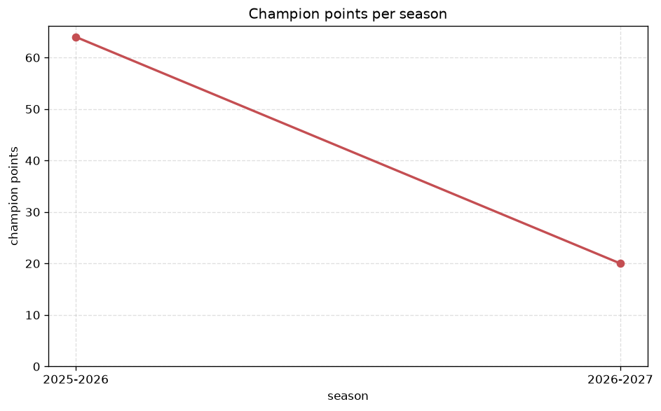
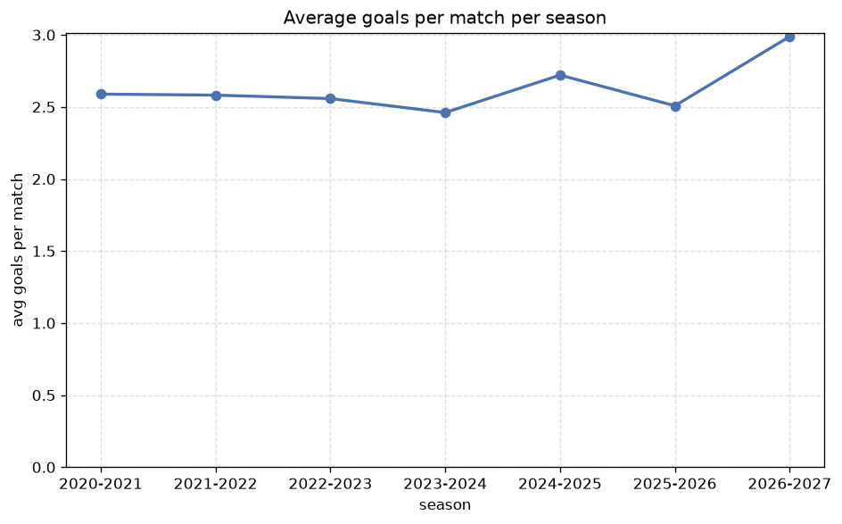

# Season Trends Analysis
- Report: `season_trends`
- Generated: 2026-10-27T01:53:51+00:00
- Script: `backend/scripts/analyze_seasons.py` v1.0.0
- League: NB II. (Hungary)
- Scope: league `hungary2`

## 1. Champions per season
| season | champion | pts | runner-up | margin |
|---|---|---|---|---|
| 2020-2021 | Debrecen | 80 | Vasas | 2 pts |
| 2021-2022 | Vasas | 85 | Kecskemeti TE | 8 pts |
| 2022-2023 | DVTK | 87 | MTK Budapest | 13 pts |
| 2023-2024 | Nyiregyhaza | 76 | Gyor | 7 pts |
| 2024-2025 | Kisvarda | 55 | Vasas | 3 pts |
| 2025-2026 | Vasas | 64 | Honved | 5 pts |
| 2026-2027 | Soroksar | 24 | Tiszakecske | 1 pts |

## 2. Title-race tightness
- Tight races (margin <= 3 pts): **3** of 7 seasons
- Tightest race: **2026-2027** - Soroksar beat Tiszakecske by **1** pts

| season | margin | tight |
|---|---|---|
| 2020-2021 | 2 pts | yes |
| 2021-2022 | 8 pts |  |
| 2022-2023 | 13 pts |  |
| 2023-2024 | 7 pts |  |
| 2024-2025 | 3 pts | yes |
| 2025-2026 | 5 pts |  |
| 2026-2027 | 1 pts | yes |

## 3. Points thresholds
_Position-specific points per season. Key: 1 = champion, 2 = runner-up, 4 = CL line, 6 = Europa, 13 = last safe, 16 = bottom._

| season | pos 1 | pos 2 | pos 4 | pos 6 | pos 13 | pos 16 |
|---|---|---|---|---|---|---|
| 2020-2021 | 80 | 78 | 64 | 59 | 45 | 42 |
| 2021-2022 | 85 | 77 | 66 | 57 | 42 | 42 |
| 2022-2023 | 87 | 74 | 64 | 60 | 46 | 41 |
| 2023-2024 | 76 | 69 | 57 | 46 | 38 | 31 |
| 2024-2025 | 55 | 52 | 43 | 38 | 29 | 22 |
| 2025-2026 | 64 | 59 | 48 | 46 | 33 | 28 |
| 2026-2027 | 24 | 23 | 20 | 20 | 10 | 4 |

## 4. Relegation battle
| season | safe pos | safe pts | drop pos | drop pts | gap |
|---|---|---|---|---|---|
| 2020-2021 | 13 | 45 | 14 | 44 | 1 pts |
| 2021-2022 | 13 | 42 | 14 | 42 | 0 pts |
| 2022-2023 | 13 | 46 | 14 | 45 | 1 pts |
| 2023-2024 | 13 | 38 | 14 | 35 | 3 pts |
| 2024-2025 | 13 | 29 | 14 | 24 | 5 pts |
| 2025-2026 | 13 | 33 | 14 | 33 | 0 pts |
| 2026-2027 | 13 | 10 | 14 | 9 | 1 pts |

## 5. League-level trends
| season | matches | total goals | avg goals | home win | draw | away win | goalless | avg pts/team |
|---|---|---|---|---|---|---|---|---|
| 2020-2021 | 380 | 984 | 2.589 | 45.8% | 23.7% | 30.5% | 7.4% | 52.5 |
| 2021-2022 | 380 | 981 | 2.582 | 42.1% | 26.8% | 31.1% | 8.9% | 51.9 |
| 2022-2023 | 380 | 972 | 2.558 | 41.3% | 27.1% | 31.6% | 6.6% | 51.85 |
| 2023-2024 | 306 | 753 | 2.461 | 42.5% | 26.5% | 31.0% | 7.2% | 43.83 |
| 2024-2025 | 240 | 653 | 2.721 | 43.8% | 29.2% | 27.1% | 8.3% | 36.12 |
| 2025-2026 | 240 | 602 | 2.508 | 43.8% | 25.0% | 31.2% | 6.2% | 41.25 |
| 2026-2027 | 87 | 260 | 2.989 | 48.3% | 23.0% | 28.7% | 2.3% | 15.06 |

## 6. View divergence
- Largest divergence: **2024-2025** (luck view, avg abs position diff = 18.250)

_Avg absolute position difference between classic view and alternative view per season._

| season | classic vs luck | classic vs goals |
|---|---|---|
| 2020-2021 | 3.000 | 6.500 |
| 2021-2022 | 2.700 | 6.400 |
| 2022-2023 | 3.400 | 6.300 |
| 2023-2024 | 10.444 | 7.000 |
| 2024-2025 | 18.250 | 10.875 |
| 2025-2026 | 2.875 | 4.375 |
| 2026-2027 | 1.750 | 2.750 |

---
*All statistics are computed from PostgreSQL tables (read-only). Run with `python backend/scripts/analyze_seasons.py` to regenerate.*

## Charts

