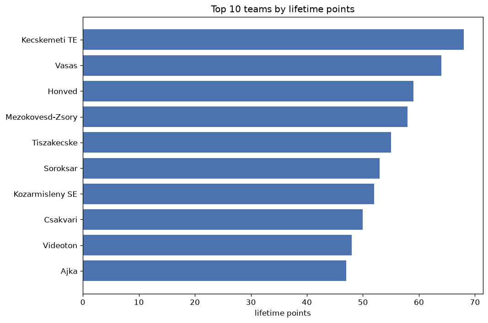
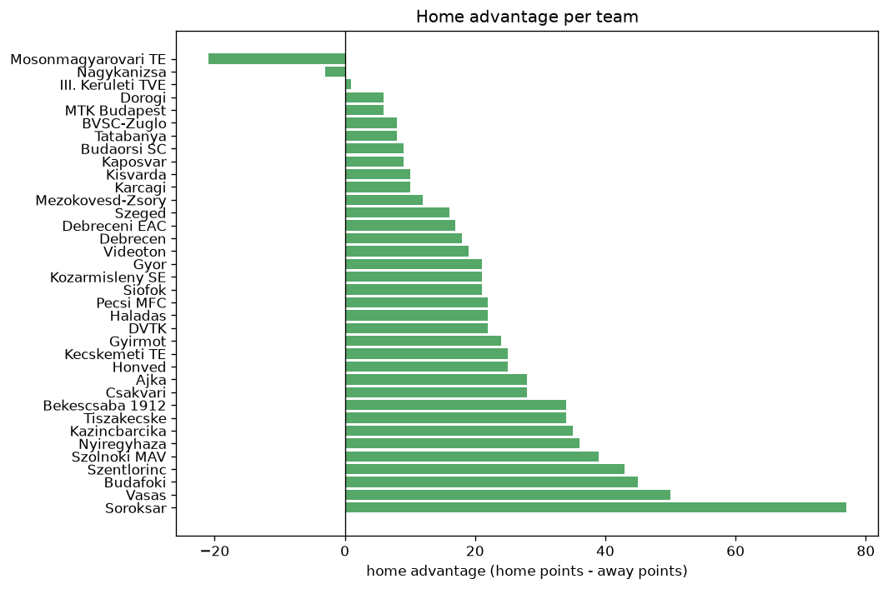

# Team Analysis
- Report: `teams_analysis`
- Generated: 2026-10-29T02:03:35+00:00
- Script: `backend/scripts/analyze_teams.py` v1.0.0
- League: NB II. (Hungary)
- Scope: league `hungary2`

- Teams: **36** | Seasons: **7** | Matches: **2013**

## 1. Team standings (lifetime)
| team | seasons | played | W | D | L | pts | GF | GA | GD | avg pts/season | best pos | worst pos | titles |
|---|---|---|---|---|---|---|---|---|---|---|---|---|---|
| Vasas | 5 | 170 | 103 | 37 | 30 | 346 | 323 | 151 | 172 | 69.2 | 1 | 3 | 2 |
| Szeged | 7 | 218 | 89 | 67 | 62 | 334 | 270 | 229 | 41 | 47.71 | 4 | 13 | 0 |
| Ajka | 7 | 219 | 89 | 43 | 87 | 310 | 268 | 258 | 10 | 44.29 | 3 | 14 | 0 |
| Soroksar | 7 | 219 | 82 | 61 | 76 | 307 | 326 | 304 | 22 | 43.86 | 1 | 12 | 1 |
| Csakvari | 7 | 219 | 63 | 63 | 93 | 252 | 282 | 331 | -49 | 36.0 | 5 | 17 | 0 |
| Gyirmot | 5 | 151 | 66 | 40 | 45 | 238 | 228 | 186 | 42 | 47.6 | 3 | 13 | 0 |
| Nyiregyhaza | 4 | 148 | 62 | 38 | 48 | 224 | 200 | 164 | 36 | 56.0 | 1 | 18 | 1 |
| Gyor | 4 | 148 | 61 | 34 | 53 | 217 | 212 | 173 | 39 | 54.25 | 2 | 12 | 0 |
| Szentlorinc | 6 | 185 | 53 | 58 | 74 | 217 | 206 | 256 | -50 | 36.17 | 4 | 17 | 0 |
| Pecsi MFC | 4 | 148 | 51 | 53 | 44 | 206 | 147 | 142 | 5 | 51.5 | 4 | 14 | 0 |
| Haladas | 4 | 148 | 53 | 41 | 54 | 200 | 183 | 180 | 3 | 50.0 | 6 | 13 | 0 |
| Budafoki | 5 | 170 | 51 | 44 | 75 | 197 | 192 | 242 | -50 | 39.4 | 8 | 15 | 0 |
| Kozarmisleny SE | 5 | 143 | 54 | 33 | 56 | 195 | 193 | 210 | -17 | 39.0 | 4 | 16 | 0 |
| Kazincbarcika | 5 | 151 | 50 | 45 | 56 | 195 | 181 | 202 | -21 | 39.0 | 3 | 18 | 0 |
| Siofok | 4 | 148 | 51 | 38 | 59 | 191 | 172 | 206 | -34 | 47.75 | 5 | 16 | 0 |
| Tiszakecske | 5 | 151 | 48 | 40 | 63 | 184 | 173 | 214 | -41 | 36.8 | 2 | 16 | 0 |
| Bekescsaba 1912 | 5 | 174 | 43 | 55 | 76 | 184 | 200 | 265 | -65 | 36.8 | 8 | 19 | 0 |
| DVTK | 3 | 87 | 53 | 15 | 19 | 174 | 153 | 95 | 58 | 58.0 | 1 | 8 | 1 |
| Kecskemeti TE | 3 | 79 | 46 | 13 | 20 | 151 | 147 | 89 | 58 | 50.33 | 2 | 3 | 0 |
| Honved | 3 | 94 | 40 | 23 | 31 | 143 | 129 | 101 | 28 | 47.67 | 2 | 9 | 0 |
| BVSC-Zuglo | 4 | 104 | 33 | 29 | 42 | 128 | 107 | 116 | -9 | 32.0 | 7 | 19 | 0 |
| Dorogi | 3 | 114 | 29 | 29 | 56 | 116 | 101 | 171 | -70 | 38.67 | 14 | 20 | 0 |
| Mezokovesd-Zsory | 3 | 71 | 31 | 17 | 23 | 110 | 101 | 80 | 21 | 36.67 | 4 | 16 | 0 |
| Budaorsi SC | 2 | 76 | 26 | 19 | 31 | 97 | 102 | 120 | -18 | 48.5 | 6 | 19 | 0 |
| Szolnoki MAV | 2 | 76 | 24 | 23 | 29 | 95 | 78 | 95 | -17 | 47.5 | 9 | 18 | 0 |
| Debrecen | 1 | 38 | 24 | 8 | 6 | 80 | 89 | 40 | 49 | 80.0 | 1 | 1 | 1 |
| MTK Budapest | 1 | 38 | 22 | 8 | 8 | 74 | 86 | 48 | 38 | 74.0 | 2 | 2 | 0 |
| Mosonmagyarovari TE | 2 | 72 | 17 | 16 | 39 | 67 | 65 | 113 | -48 | 33.5 | 12 | 18 | 0 |
| Kisvarda | 1 | 30 | 17 | 7 | 6 | 58 | 57 | 44 | 13 | 58.0 | 1 | 1 | 1 |
| Videoton | 2 | 41 | 14 | 9 | 18 | 51 | 52 | 47 | 5 | 25.5 | 8 | 10 | 0 |
| Karcagi | 2 | 41 | 11 | 13 | 17 | 46 | 45 | 62 | -17 | 23.0 | 11 | 12 | 0 |
| III. Keruleti TVE | 1 | 38 | 9 | 10 | 19 | 37 | 36 | 62 | -26 | 37.0 | 20 | 20 | 0 |
| Kaposvar | 1 | 38 | 7 | 12 | 19 | 33 | 33 | 65 | -32 | 33.0 | 19 | 19 | 0 |
| Tatabanya | 1 | 30 | 6 | 6 | 18 | 24 | 28 | 60 | -32 | 24.0 | 14 | 14 | 0 |
| Debreceni EAC | 1 | 38 | 6 | 5 | 27 | 23 | 32 | 68 | -36 | 23.0 | 20 | 20 | 0 |
| Nagykanizsa | 1 | 11 | 3 | 0 | 8 | 9 | 8 | 16 | -8 | 9.0 | 14 | 14 | 0 |

## 2. Home vs away split
| team | home P | H-W | H-D | H-L | H-pts | away P | A-W | A-D | A-L | A-pts | adv |
|---|---|---|---|---|---|---|---|---|---|---|---|
| Soroksar | 110 | 55 | 27 | 28 | 192 | 109 | 27 | 34 | 48 | 115 | 77 |
| Vasas | 85 | 60 | 18 | 7 | 198 | 85 | 43 | 19 | 23 | 148 | 50 |
| Budafoki | 85 | 31 | 28 | 26 | 121 | 85 | 20 | 16 | 49 | 76 | 45 |
| Szentlorinc | 93 | 33 | 31 | 29 | 130 | 92 | 20 | 27 | 45 | 87 | 43 |
| Szolnoki MAV | 38 | 19 | 10 | 9 | 67 | 38 | 5 | 13 | 20 | 28 | 39 |
| Nyiregyhaza | 74 | 37 | 19 | 18 | 130 | 74 | 25 | 19 | 30 | 94 | 36 |
| Kazincbarcika | 75 | 31 | 22 | 22 | 115 | 76 | 19 | 23 | 34 | 80 | 35 |
| Bekescsaba 1912 | 87 | 25 | 34 | 28 | 109 | 87 | 18 | 21 | 48 | 75 | 34 |
| Tiszakecske | 76 | 31 | 16 | 29 | 109 | 75 | 17 | 24 | 34 | 75 | 34 |
| Ajka | 110 | 48 | 25 | 37 | 169 | 109 | 41 | 18 | 50 | 141 | 28 |
| Csakvari | 110 | 37 | 29 | 44 | 140 | 109 | 26 | 34 | 49 | 112 | 28 |
| Kecskemeti TE | 39 | 28 | 4 | 7 | 88 | 40 | 18 | 9 | 13 | 63 | 25 |
| Honved | 47 | 25 | 9 | 13 | 84 | 47 | 15 | 14 | 18 | 59 | 25 |
| Gyirmot | 77 | 37 | 20 | 20 | 131 | 74 | 29 | 20 | 25 | 107 | 24 |
| Pecsi MFC | 74 | 29 | 27 | 18 | 114 | 74 | 22 | 26 | 26 | 92 | 22 |
| Haladas | 74 | 29 | 24 | 21 | 111 | 74 | 24 | 17 | 33 | 89 | 22 |
| DVTK | 43 | 30 | 8 | 5 | 98 | 44 | 23 | 7 | 14 | 76 | 22 |
| Gyor | 74 | 34 | 17 | 23 | 119 | 74 | 27 | 17 | 30 | 98 | 21 |
| Kozarmisleny SE | 70 | 31 | 15 | 24 | 108 | 73 | 23 | 18 | 32 | 87 | 21 |
| Siofok | 74 | 28 | 22 | 24 | 106 | 74 | 23 | 16 | 35 | 85 | 21 |
| Videoton | 21 | 10 | 5 | 6 | 35 | 20 | 4 | 4 | 12 | 16 | 19 |
| Debrecen | 19 | 16 | 1 | 2 | 49 | 19 | 8 | 7 | 4 | 31 | 18 |
| Debreceni EAC | 19 | 6 | 2 | 11 | 20 | 19 | 0 | 3 | 16 | 3 | 17 |
| Szeged | 107 | 50 | 25 | 32 | 175 | 111 | 39 | 42 | 30 | 159 | 16 |
| Mezokovesd-Zsory | 36 | 17 | 10 | 9 | 61 | 35 | 14 | 7 | 14 | 49 | 12 |
| Kisvarda | 15 | 10 | 4 | 1 | 34 | 15 | 7 | 3 | 5 | 24 | 10 |
| Karcagi | 20 | 8 | 4 | 8 | 28 | 21 | 3 | 9 | 9 | 18 | 10 |
| Budaorsi SC | 38 | 15 | 8 | 15 | 53 | 38 | 11 | 11 | 16 | 44 | 9 |
| Kaposvar | 19 | 5 | 6 | 8 | 21 | 19 | 2 | 6 | 11 | 12 | 9 |
| BVSC-Zuglo | 53 | 17 | 17 | 19 | 68 | 51 | 16 | 12 | 23 | 60 | 8 |
| Tatabanya | 15 | 4 | 4 | 7 | 16 | 15 | 2 | 2 | 11 | 8 | 8 |
| Dorogi | 57 | 16 | 13 | 28 | 61 | 57 | 13 | 16 | 28 | 55 | 6 |
| MTK Budapest | 19 | 12 | 4 | 3 | 40 | 19 | 10 | 4 | 5 | 34 | 6 |
| III. Keruleti TVE | 19 | 4 | 7 | 8 | 19 | 19 | 5 | 3 | 11 | 18 | 1 |
| Nagykanizsa | 5 | 1 | 0 | 4 | 3 | 6 | 2 | 0 | 4 | 6 | -3 |
| Mosonmagyarovari TE | 36 | 4 | 11 | 21 | 23 | 36 | 13 | 5 | 18 | 44 | -21 |

## 3. Top performers
### Best points per game (PPG)
| rank | team | PPG |
|---|---|---|
| 1 | Debrecen | 2.10 |
| 2 | Vasas | 2.04 |
| 3 | DVTK | 2.00 |
| 4 | MTK Budapest | 1.95 |
| 5 | Kisvarda | 1.93 |

### Most goals scored
| rank | team | goals |
|---|---|---|
| 1 | Soroksar | 326 |
| 2 | Vasas | 323 |
| 3 | Csakvari | 282 |
| 4 | Szeged | 270 |
| 5 | Ajka | 268 |

### Best goal difference
| rank | team | GD |
|---|---|---|
| 1 | Vasas | 172 |
| 2 | DVTK | 58 |
| 3 | Kecskemeti TE | 58 |
| 4 | Debrecen | 49 |
| 5 | Gyirmot | 42 |

### Best defence (goals against per match, standings)
| rank | team | GA/match |
|---|---|---|
| 1 | Vasas | 0.874 |
| 2 | Pecsi MFC | 0.966 |
| 3 | Debrecen | 1.053 |
| 4 | Szeged | 1.060 |
| 5 | Honved | 1.077 |

## 4. Team consistency
- Teams present in all **7** seasons: **4**

Ajka, Csakvari, Soroksar, Szeged

## 5. Head-to-head dominance
- Distinct fixtures: **468** (showing the 15 most frequent)

| fixture | meetings | home wins | draws | away wins | home pct | draw pct | away pct |
|---|---|---|---|---|---|---|---|
| Soroksar vs Csakvari | 13 | 8 | 2 | 3 | 61.5% | 15.4% | 23.1% |
| Ajka vs Csakvari | 13 | 5 | 4 | 4 | 38.5% | 30.8% | 30.8% |
| Ajka vs Soroksar | 13 | 5 | 4 | 4 | 38.5% | 30.8% | 30.8% |
| Szeged vs Csakvari | 13 | 3 | 7 | 3 | 23.1% | 53.8% | 23.1% |
| Soroksar vs Szeged | 12 | 5 | 5 | 2 | 41.7% | 41.7% | 16.7% |
| Ajka vs Szeged | 12 | 2 | 4 | 6 | 16.7% | 33.3% | 50.0% |
| Ajka vs Szentlorinc | 11 | 5 | 0 | 6 | 45.5% | 0.0% | 54.5% |
| Soroksar vs Szentlorinc | 11 | 5 | 2 | 4 | 45.5% | 18.2% | 36.4% |
| Szentlorinc vs Csakvari | 11 | 3 | 4 | 4 | 27.3% | 36.4% | 36.4% |
| Budafoki vs Szeged | 10 | 6 | 1 | 3 | 60.0% | 10.0% | 30.0% |
| Soroksar vs Bekescsaba 1912 | 10 | 6 | 3 | 1 | 60.0% | 30.0% | 10.0% |
| Ajka vs Bekescsaba 1912 | 10 | 5 | 0 | 5 | 50.0% | 0.0% | 50.0% |
| Budafoki vs Soroksar | 10 | 5 | 4 | 1 | 50.0% | 40.0% | 10.0% |
| Vasas vs Ajka | 10 | 5 | 2 | 3 | 50.0% | 20.0% | 30.0% |
| Vasas vs Soroksar | 10 | 5 | 3 | 2 | 50.0% | 30.0% | 20.0% |

## 6. Position per season (classic view)
_Cells show final position; '-' when the team was absent from that season._

| team | 2020-2021 | 2021-2022 | 2022-2023 | 2023-2024 | 2024-2025 | 2025-2026 | 2026-2027 |
|---|---|---|---|---|---|---|---|
| Vasas | 2 | 1 | - | 3 | 2 | 1 | - |
| Szeged | 10 | 4 | 4 | 4 | 6 | 10 | 13 |
| Ajka | 5 | 9 | 3 | 12 | 9 | 14 | 7 |
| Soroksar | 8 | 8 | 5 | 11 | 12 | 12 | 1 |
| Csakvari | 17 | 12 | 15 | 10 | 10 | 5 | 16 |
| Gyirmot | 3 | - | 6 | 6 | 13 | - | 6 |
| Nyiregyhaza | 7 | 10 | 18 | 1 | - | - | - |
| Gyor | 12 | 7 | 11 | 2 | - | - | - |
| Szentlorinc | 16 | 15 | 17 | - | 4 | 13 | 9 |
| Pecsi MFC | 4 | 11 | 7 | 14 | - | - | - |
| Haladas | 11 | 6 | 9 | 13 | - | - | - |
| Budafoki | - | 13 | 10 | 8 | 11 | 15 | - |
| Kozarmisleny SE | - | - | 16 | 5 | 5 | 4 | 15 |
| Kazincbarcika | 18 | - | 14 | 7 | 3 | - | 5 |
| Siofok | 13 | 5 | 8 | 16 | - | - | - |
| Tiszakecske | - | 16 | 13 | 15 | - | 9 | 2 |
| Bekescsaba 1912 | 15 | 14 | 19 | - | 8 | 16 | - |
| DVTK | - | 3 | 1 | - | - | - | 8 |
| Kecskemeti TE | - | 2 | - | - | - | 3 | 3 |
| Honved | - | - | - | 9 | 7 | 2 | - |
| BVSC-Zuglo | - | - | - | 19 | 17 | 7 | 11 |
| Dorogi | 14 | 17 | 20 | - | - | - | - |
| Mezokovesd-Zsory | - | - | - | - | 16 | 6 | 4 |
| Budaorsi SC | 6 | 19 | - | - | - | - | - |
| Szolnoki MAV | 9 | 18 | - | - | - | - | - |
| Debrecen | 1 | - | - | - | - | - | - |
| MTK Budapest | - | - | 2 | - | - | - | - |
| Mosonmagyarovari TE | - | - | 12 | 18 | - | - | - |
| Kisvarda | - | - | - | - | 1 | - | - |
| Videoton | - | - | - | - | - | 8 | 10 |
| Karcagi | - | - | - | - | - | 11 | 12 |
| III. Keruleti TVE | - | 20 | - | - | - | - | - |
| Kaposvar | 19 | - | - | - | - | - | - |
| Tatabanya | - | - | - | - | 14 | - | - |
| Debreceni EAC | 20 | - | - | - | - | - | - |
| Nagykanizsa | - | - | - | - | - | - | 14 |

---
*All statistics are computed from PostgreSQL tables (read-only). Run with `python backend/scripts/analyze_teams.py` to regenerate.*

## Charts

