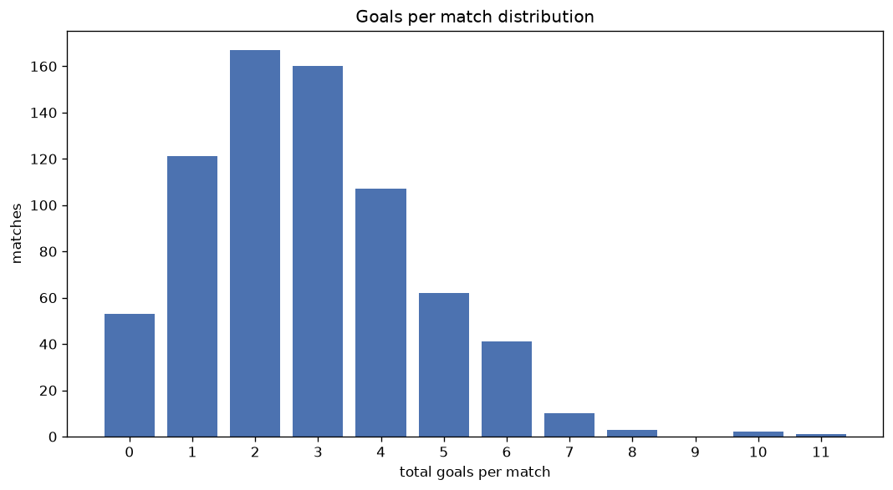
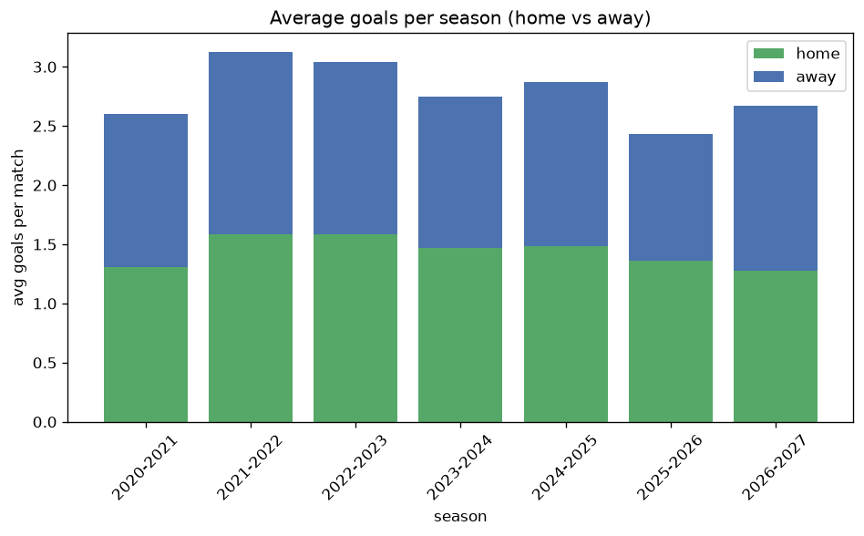

# Goal Analysis
- Report: `goals_analysis`
- Generated: 2026-10-30T03:56:42+00:00
- Script: `backend/scripts/analyze_goals.py` v1.0.0
- League: ISL (India)
- Scope: league `india1`

## 1. Goals per match distribution
| goals | matches | pct |
|---|---|---|
| 0 | 53 | 7.3% |
| 1 | 121 | 16.6% |
| 2 | 167 | 23.0% |
| 3 | 160 | 22.0% |
| 4 | 107 | 14.7% |
| 5 | 62 | 8.5% |
| 6 | 41 | 5.6% |
| 7 | 10 | 1.4% |
| 8 | 3 | 0.4% |
| 9 | 0 | 0.0% |
| 10 | 2 | 0.3% |
| 11 | 1 | 0.1% |

## 2. Goals per match per season
| season | matches | total goals | avg home | avg away | avg total |
|---|---|---|---|---|---|
| 2020-2021 | 110 | 286 | 1.309 | 1.291 | 2.6 |
| 2021-2022 | 110 | 344 | 1.582 | 1.545 | 3.127 |
| 2022-2023 | 110 | 334 | 1.582 | 1.455 | 3.036 |
| 2023-2024 | 132 | 363 | 1.47 | 1.28 | 2.75 |
| 2024-2025 | 156 | 448 | 1.487 | 1.385 | 2.872 |
| 2025-2026 | 91 | 221 | 1.363 | 1.066 | 2.429 |
| 2026-2027 | 18 | 48 | 1.278 | 1.389 | 2.667 |

## 3. Home vs away goal share
- Home goals: **1065** (52.1%)
- Away goals: **979** (47.9%)
- Home/away ratio: **1.088**

| season | home goals | away goals | total | home pct | away pct |
|---|---|---|---|---|---|
| 2020-2021 | 144 | 142 | 286 | 50.3% | 49.7% |
| 2021-2022 | 174 | 170 | 344 | 50.6% | 49.4% |
| 2022-2023 | 174 | 160 | 334 | 52.1% | 47.9% |
| 2023-2024 | 194 | 169 | 363 | 53.4% | 46.6% |
| 2024-2025 | 232 | 216 | 448 | 51.8% | 48.2% |
| 2025-2026 | 124 | 97 | 221 | 56.1% | 43.9% |
| 2026-2027 | 23 | 25 | 48 | 47.9% | 52.1% |

## 4. BTTS (Both Teams To Score)
- Overall: **406** of `727` (55.8%)

| season | matches | BTTS | pct |
|---|---|---|---|
| 2020-2021 | 110 | 63 | 57.3% |
| 2021-2022 | 110 | 70 | 63.6% |
| 2022-2023 | 110 | 60 | 54.5% |
| 2023-2024 | 132 | 71 | 53.8% |
| 2024-2025 | 156 | 83 | 53.2% |
| 2025-2026 | 91 | 48 | 52.7% |
| 2026-2027 | 18 | 11 | 61.1% |

## 5. Clean sheets
- Home clean sheets: **200** (27.5%)
- Away clean sheets: **174** (23.9%)
- Total clean sheets recorded: **374**
- Matches with at least one clean sheet: **321** (44.2%)
- Both teams kept clean sheets (0-0): **53**

| season | matches | home CS | away CS | total CS | matches w/ CS |
|---|---|---|---|---|---|
| 2020-2021 | 110 | 31 | 29 | 60 | 47 (42.7%) |
| 2021-2022 | 110 | 20 | 25 | 45 | 40 (36.4%) |
| 2022-2023 | 110 | 29 | 24 | 53 | 50 (45.5%) |
| 2023-2024 | 132 | 37 | 33 | 70 | 61 (46.2%) |
| 2024-2025 | 156 | 47 | 37 | 84 | 73 (46.8%) |
| 2025-2026 | 91 | 31 | 22 | 53 | 43 (47.3%) |
| 2026-2027 | 18 | 5 | 4 | 9 | 7 (38.9%) |

## 6. Scoring intensity
- First-half goals: **918** (45.0%)
- Second-half goals: **1123** (55.0%)
- Avg first-half goals per match: **1.264**
- Avg second-half goals per match: **1.547**
- Second-half-only scoring (HT 0-0, FT goals >= 1): **166** (22.8%)
- *1 match(es) excluded (no HT score recorded).*

| season | matches | 1st half | 2nd half | 1st half pct | 2nd half pct |
|---|---|---|---|---|---|
| 2020-2021 | 110 | 123 | 163 | 43.0% | 57.0% |
| 2021-2022 | 110 | 172 | 172 | 50.0% | 50.0% |
| 2022-2023 | 110 | 148 | 186 | 44.3% | 55.7% |
| 2023-2024 | 132 | 171 | 189 | 47.5% | 52.5% |
| 2024-2025 | 156 | 185 | 263 | 41.3% | 58.7% |
| 2025-2026 | 91 | 98 | 123 | 44.3% | 55.7% |
| 2026-2027 | 18 | 21 | 27 | 43.8% | 56.2% |

## 7. First-goal timing
- Matches with first-goal time recorded: `673` of `727` (92.6%)
- Goalless matches: `54`
- Min `1` | Max `95` | Mean `30.99` | Median (p50) `25`

| bucket | count | % of matches | % of scoring matches |
|---|---|---|---|
| 1-15 | 244 | 33.6% | 36.3% |
| 16-30 | 142 | 19.5% | 21.1% |
| 31-45 | 103 | 14.2% | 15.3% |
| 46-60 | 92 | 12.7% | 13.7% |
| 61-75 | 49 | 6.7% | 7.3% |
| 76-90 | 36 | 5.0% | 5.3% |
| 91-120 | 7 | 1.0% | 1.0% |

---
*All statistics are computed from PostgreSQL tables (read-only). Run with `python backend/scripts/analyze_goals.py` to regenerate.*

## Charts

