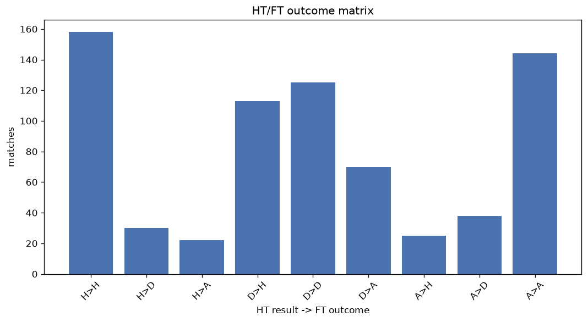
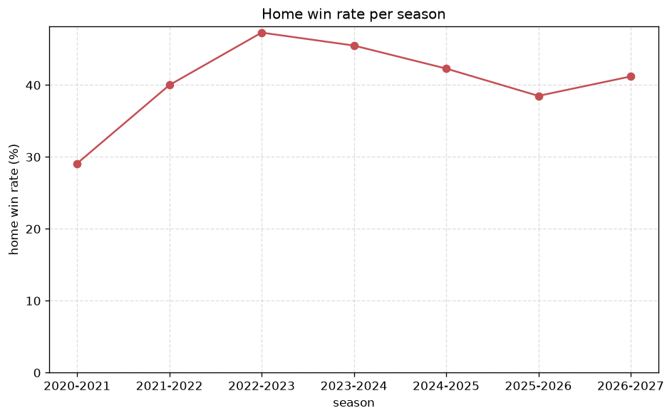

# Match Analysis
- Report: `matches_analysis`
- Generated: 2026-10-29T02:03:48+00:00
- Script: `backend/scripts/analyze_matches.py` v1.0.0
- League: ISL (India)
- Scope: league `india1`

## 1. Overall summary
| metric | value |
|---|---|
| Matches | 726 |
| Home wins | 296 (40.8%) |
| Draws | 193 (26.6%) |
| Away wins | 237 (32.6%) |
| Total goals | 2042 |
| Average goals per match | 2.813 |
| Goalless matches | 53 (7.3%) |

## 2. Per-season breakdown
| season | matches | home wins | draws | away wins | total goals | avg goals | goalless |
|---|---|---|---|---|---|---|---|
| 2020-2021 | 110 | 32 (29.1%) | 42 (38.2%) | 36 (32.7%) | 286 | 2.6 | 13 (11.8%) |
| 2021-2022 | 110 | 44 (40.0%) | 31 (28.2%) | 35 (31.8%) | 344 | 3.127 | 5 (4.5%) |
| 2022-2023 | 110 | 52 (47.3%) | 16 (14.5%) | 42 (38.2%) | 334 | 3.036 | 3 (2.7%) |
| 2023-2024 | 132 | 60 (45.5%) | 32 (24.2%) | 40 (30.3%) | 363 | 2.75 | 9 (6.8%) |
| 2024-2025 | 156 | 66 (42.3%) | 38 (24.4%) | 52 (33.3%) | 448 | 2.872 | 11 (7.1%) |
| 2025-2026 | 91 | 35 (38.5%) | 29 (31.9%) | 27 (29.7%) | 221 | 2.429 | 10 (11.0%) |
| 2026-2027 | 17 | 7 (41.2%) | 5 (29.4%) | 5 (29.4%) | 46 | 2.706 | 2 (11.8%) |

## 3. HT/FT outcome matrix
| HT result \ FT result | Home | Draw | Away | total |
|---|---|---|---|---|
| HT home lead | 158 (75.2%) | 30 (14.3%) | 22 (10.5%) | 210 |
| HT draw | 113 (36.7%) | 125 (40.6%) | 70 (22.7%) | 308 |
| HT away lead | 25 (12.1%) | 38 (18.4%) | 144 (69.6%) | 207 |
- *1 match(es) excluded (no HT score recorded).*

## 4. Comeback matches
- Home comebacks (trailing at HT, won at FT): **25** (3.4%)
- Away comebacks (trailing at HT, won at FT): **22** (3.0%)

### Home comebacks
| season | home | away | HT | FT |
|---|---|---|---|---|
| 2020-2021 | Hyderabad | East Bengal | 0-1 | 3-2 |
| 2020-2021 | Kerala Blasters | Bengaluru FC | 0-1 | 2-1 |
| 2020-2021 | Mohun Bagan | Kerala Blasters | 0-1 | 3-2 |
| 2020-2021 | Odisha FC | East Bengal | 1-2 | 6-5 |
| 2021-2022 | Odisha FC | Mumbai City | 1-2 | 4-2 |
| 2021-2022 | Chennaiyin | North East Utd | 0-1 | 2-1 |
| 2021-2022 | Bengaluru FC | Jamshedpur | 0-1 | 3-1 |
| 2022-2023 | Odisha FC | Kerala Blasters | 0-1 | 2-1 |
| 2023-2024 | Goa | Odisha FC | 0-1 | 3-2 |
| 2023-2024 | North East Utd | Jamshedpur | 0-1 | 2-1 |
| 2023-2024 | Kerala Blasters | Odisha FC | 0-1 | 2-1 |
| 2023-2024 | Mumbai City | Punjab | 0-1 | 2-1 |
| 2023-2024 | Odisha FC | Kerala Blasters | 0-1 | 2-1 |
| 2023-2024 | Jamshedpur | East Bengal | 0-1 | 2-1 |
| 2023-2024 | Kerala Blasters | Goa | 0-2 | 4-2 |
| 2023-2024 | Chennaiyin | Jamshedpur | 0-1 | 2-1 |
| 2024-2025 | Mohun Bagan | North East Utd | 1-2 | 3-2 |
| 2024-2025 | Punjab | Chennaiyin | 0-1 | 3-2 |
| 2024-2025 | East Bengal | Punjab | 0-2 | 4-2 |
| 2024-2025 | Jamshedpur | Bengaluru FC | 0-1 | 2-1 |
| 2024-2025 | Kerala Blasters | Odisha FC | 0-1 | 3-2 |
| 2024-2025 | Hyderabad | Jamshedpur | 1-2 | 3-2 |
| 2024-2025 | Odisha FC | Hyderabad | 0-1 | 3-1 |
| 2025-2026 | Punjab | Mohammedan | 0-1 | 2-1 |
| 2026-2027 | Bengaluru FC | SC Delhi | 1-2 | 3-2 |

### Away comebacks
| season | home | away | HT | FT |
|---|---|---|---|---|
| 2020-2021 | Jamshedpur | Goa | 1-0 | 1-2 |
| 2020-2021 | Kerala Blasters | Mumbai City | 1-0 | 1-2 |
| 2021-2022 | Odisha FC | Hyderabad | 1-0 | 2-3 |
| 2022-2023 | Mohun Bagan | Chennaiyin | 1-0 | 1-2 |
| 2022-2023 | Jamshedpur | Odisha FC | 2-1 | 2-3 |
| 2022-2023 | East Bengal | Odisha FC | 2-0 | 2-4 |
| 2022-2023 | East Bengal | Jamshedpur | 1-0 | 1-2 |
| 2023-2024 | East Bengal | Goa | 1-0 | 1-2 |
| 2023-2024 | Mumbai City | Jamshedpur | 2-0 | 2-3 |
| 2023-2024 | Punjab | Mumbai City | 2-1 | 2-3 |
| 2023-2024 | Mohun Bagan | Chennaiyin | 1-0 | 2-3 |
| 2024-2025 | Odisha FC | Chennaiyin | 1-0 | 2-3 |
| 2024-2025 | Goa | Jamshedpur | 1-0 | 1-2 |
| 2024-2025 | Mohammedan | Kerala Blasters | 1-0 | 1-2 |
| 2024-2025 | Mohammedan | Bengaluru FC | 1-0 | 1-2 |
| 2024-2025 | Hyderabad | North East Utd | 2-1 | 2-5 |
| 2024-2025 | Punjab | Mohun Bagan | 1-0 | 1-3 |
| 2025-2026 | East Bengal | Jamshedpur | 1-0 | 1-2 |
| 2025-2026 | Bengaluru FC | Kerala Blasters | 1-0 | 1-2 |
| 2025-2026 | Mumbai City | East Bengal | 1-0 | 1-2 |
| 2025-2026 | Inter Kashi | East Bengal | 1-0 | 1-2 |
| 2026-2027 | SC Delhi | Mohun Bagan | 1-0 | 1-2 |

## 5. HT lead conversion
| HT state | matches | converted to win | held as draw | collapsed to loss |
|---|---|---|---|---|
| Home lead | 210 | 158 (75.2%) | 30 (14.3%) | 22 (10.5%) |
| Away lead | 207 | 144 (69.6%) | 38 (18.4%) | 25 (12.1%) |

### Matches level at half-time
| FT result | count | pct |
|---|---|---|
| Home win | 113 | 36.7% |
| Draw | 125 | 40.6% |
| Away win | 70 | 22.7% |
- *1 match(es) excluded (no HT score recorded).*

## 6. First-goal timing
- Matches with a first-goal time recorded: `672` of `726` (92.6%)

Outcome distribution by first-goal timing bucket:
| bucket | matches | % of matches | home | draw | away |
|---|---|---|---|---|---|
| 1-15 | 244 | 33.6% | 99 (40.6%) | 53 (21.7%) | 92 (37.7%) |
| 16-30 | 142 | 19.6% | 60 (42.3%) | 30 (21.1%) | 52 (36.6%) |
| 31-45 | 103 | 14.2% | 46 (44.7%) | 20 (19.4%) | 37 (35.9%) |
| 46-60 | 91 | 12.5% | 43 (47.3%) | 22 (24.2%) | 26 (28.6%) |
| 61-75 | 49 | 6.7% | 22 (44.9%) | 9 (18.4%) | 18 (36.7%) |
| 76-90 | 36 | 5.0% | 21 (58.3%) | 6 (16.7%) | 9 (25.0%) |
| 91-120 | 7 | 1.0% | 5 (71.4%) | 0 (0.0%) | 2 (28.6%) |

## 7. Goalless matches
- Overall: **53** of `726` (7.3%)

| season | matches | goalless | pct |
|---|---|---|---|
| 2020-2021 | 110 | 13 | 11.8% |
| 2021-2022 | 110 | 5 | 4.5% |
| 2022-2023 | 110 | 3 | 2.7% |
| 2023-2024 | 132 | 9 | 6.8% |
| 2024-2025 | 156 | 11 | 7.1% |
| 2025-2026 | 91 | 10 | 11.0% |
| 2026-2027 | 17 | 2 | 11.8% |

---
*All statistics are computed from PostgreSQL tables (read-only). Run with `python backend/scripts/analyze_matches.py` to regenerate.*

## Charts

