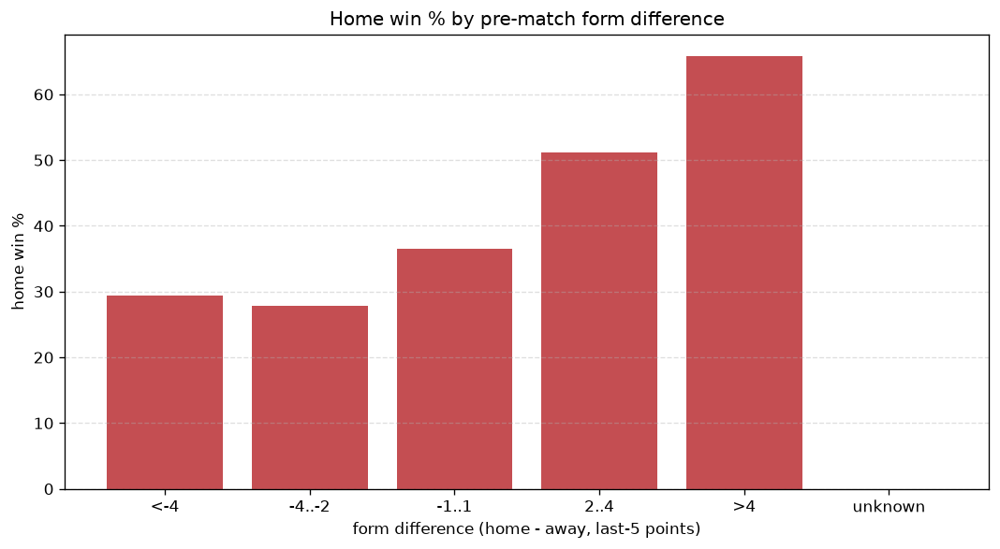
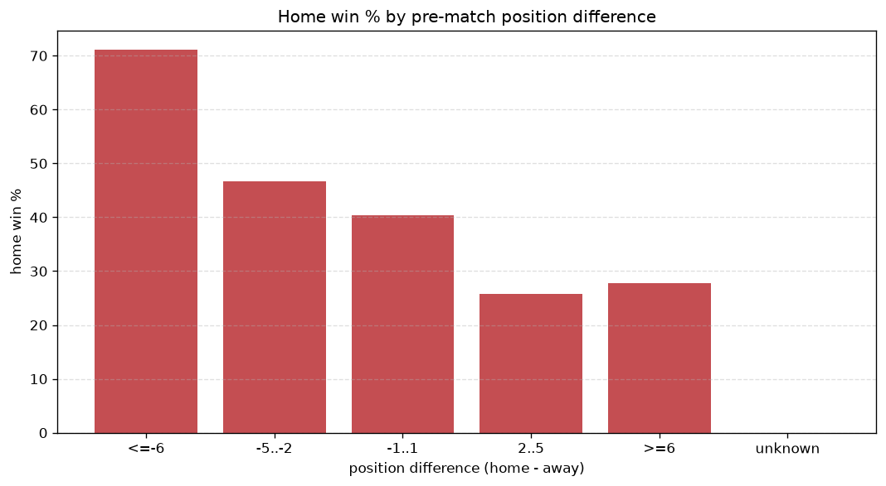

# Relationships Analysis
- Report: `relationships`
- Generated: 2026-10-30T03:56:54+00:00
- Script: `backend/scripts/analyze_relationships.py` v1.0.0
- League: ISL (India)
- Scope: league `india1`

- Matches analysed: **709** (23 leakage-safe pre-match features).

## 1. Correlation matrix
_Pearson correlation of each pre-match feature with observed goals; sorted by |corr(total goals)|._

| feature | corr(home) | corr(away) | corr(total) |
|---|---|---|---|
| home_team_goals_conceded_last_5 | -0.031 | 0.153 | 0.085 |
| home_team_home_conceded_avg | -0.039 | 0.135 | 0.067 |
| away_team_goals_conceded_last_5 | 0.114 | -0.030 | 0.060 |
| away_team_goals_scored_last_5 | -0.078 | 0.142 | 0.044 |
| away_points_before_match | -0.065 | 0.123 | 0.040 |
| home_points_before_match | 0.120 | -0.077 | 0.032 |
| home_team_points_last_5 | 0.092 | -0.136 | -0.030 |
| rest_days_difference | 0.014 | -0.054 | -0.028 |
| home_team_wins_last_5 | 0.099 | -0.139 | -0.027 |
| home_rest_days | -0.032 | -0.006 | -0.027 |
| home_team_home_goals_avg | 0.109 | -0.076 | 0.024 |
| home_position_before_match | -0.175 | 0.200 | 0.016 |
| away_team_away_conceded_avg | 0.039 | -0.061 | -0.015 |
| away_team_away_win_rate | -0.101 | 0.084 | -0.013 |
| points_difference | 0.226 | -0.247 | -0.012 |
| away_team_away_goals_avg | -0.094 | 0.106 | 0.008 |
| home_team_goals_scored_last_5 | 0.101 | -0.113 | -0.007 |
| away_position_before_match | 0.133 | -0.125 | 0.007 |
| away_team_wins_last_5 | -0.111 | 0.103 | -0.007 |
| position_difference | -0.225 | 0.237 | 0.006 |
| home_team_home_win_rate | 0.107 | -0.114 | -0.003 |
| away_team_points_last_5 | -0.117 | 0.116 | -0.002 |
| away_rest_days | -0.044 | 0.044 | -0.000 |

## 2. Form vs outcome
_Home win/draw/away % per bucket of `home_team_points_last_5 - away_team_points_last_5`._

| bucket | matches | home | draw | away | home % | draw % | away % |
|---|---|---|---|---|---|---|---|
| <-4 | 103 | 23 | 33 | 47 | 22.3% | 32.0% | 45.6% |
| -4..-2 | 142 | 37 | 43 | 62 | 26.1% | 30.3% | 43.7% |
| -1..1 | 205 | 87 | 50 | 68 | 42.4% | 24.4% | 33.2% |
| 2..4 | 158 | 74 | 41 | 43 | 46.8% | 25.9% | 27.2% |
| >4 | 101 | 68 | 21 | 12 | 67.3% | 20.8% | 11.9% |
| unknown | 0 | 0 | 0 | 0 | - | - | - |

## 3. Position vs outcome
_Home win/draw/away % per bucket of `position_difference` (home position - away position; negative favours the home team)._

| bucket | matches | home | draw | away | home % | draw % | away % |
|---|---|---|---|---|---|---|---|
| <=-6 | 95 | 63 | 17 | 15 | 66.3% | 17.9% | 15.8% |
| -5..-2 | 168 | 81 | 44 | 43 | 48.2% | 26.2% | 25.6% |
| -1..1 | 168 | 75 | 48 | 45 | 44.6% | 28.6% | 26.8% |
| 2..5 | 192 | 52 | 61 | 79 | 27.1% | 31.8% | 41.1% |
| >=6 | 86 | 18 | 18 | 50 | 20.9% | 20.9% | 58.1% |
| unknown | 0 | 0 | 0 | 0 | - | - | - |

## 4. Rest advantage
_Home win/draw/away % per bucket of `rest_days_difference` (home rest - away rest). Matches with unknown rest are bucketed separately._

| bucket | matches | home | draw | away | home % | draw % | away % |
|---|---|---|---|---|---|---|---|
| <-1 | 198 | 79 | 54 | 65 | 39.9% | 27.3% | 32.8% |
| -1..0 | 112 | 49 | 27 | 36 | 43.8% | 24.1% | 32.1% |
| 0 | 38 | 13 | 11 | 14 | 34.2% | 28.9% | 36.8% |
| 1..2 | 203 | 79 | 60 | 64 | 38.9% | 29.6% | 31.5% |
| >2 | 118 | 49 | 29 | 40 | 41.5% | 24.6% | 33.9% |
| unknown | 40 | 20 | 7 | 13 | 50.0% | 17.5% | 32.5% |
- *40 match(es) had unknown rest difference (missing rest data on at least one side).*

## 5. Home team quality
_Home win rate by `home_team_home_win_rate` tier (split at 0.5)._

- `< 0.5` tier: **35.3%** home win (153/434)
- `>= 0.5` tier: **49.5%** home win (136/275)
- Home-win gap (>= split minus < split): **+14.2 pp**

| tier | label | matches | home | draw | away | home % |
|---|---|---|---|---|---|---|
| low | < 0.5 | 434 | 153 | 125 | 156 | 35.3% |
| high | >= 0.5 | 275 | 136 | 63 | 76 | 49.5% |

## 6. Feature averages by result
_Mean feature value per outcome; `range` is home-minus-away spread of the group means._

| feature | home mean | draw mean | away mean | range |
|---|---|---|---|---|
| points_difference | 2.685 | -1.165 | -3.164 | 5.849 |
| position_difference | -1.581 | 0.415 | 1.802 | 3.383 |
| home_points_before_match | 14.893 | 11.782 | 12.013 | 3.111 |
| away_points_before_match | 12.208 | 12.947 | 15.177 | 2.969 |
| home_position_before_match | 5.706 | 6.995 | 7.733 | 2.027 |
| away_team_points_last_5 | 5.080 | 6.000 | 6.530 | 1.451 |
| home_team_points_last_5 | 6.557 | 5.463 | 5.121 | 1.436 |
| away_position_before_match | 7.287 | 6.580 | 5.931 | 1.356 |
| home_team_goals_scored_last_5 | 6.426 | 5.920 | 5.159 | 1.266 |
| away_team_goals_scored_last_5 | 5.280 | 6.133 | 6.509 | 1.228 |
| away_team_goals_conceded_last_5 | 6.343 | 5.819 | 5.276 | 1.067 |
| home_team_goals_conceded_last_5 | 5.374 | 6.085 | 6.323 | 0.950 |
| away_rest_days | 7.100 | 7.011 | 7.709 | 0.698 |
| home_team_wins_last_5 | 1.820 | 1.420 | 1.310 | 0.510 |
| away_team_wins_last_5 | 1.332 | 1.585 | 1.772 | 0.439 |
| rest_days_difference | -0.115 | 0.055 | -0.379 | 0.434 |
| home_rest_days | 6.971 | 7.050 | 7.323 | 0.352 |
| home_team_home_goals_avg | 1.415 | 1.197 | 1.155 | 0.260 |
| away_team_away_goals_avg | 1.060 | 1.247 | 1.285 | 0.225 |
| away_team_away_conceded_avg | 1.389 | 1.351 | 1.193 | 0.196 |
| home_team_home_conceded_avg | 1.091 | 1.138 | 1.237 | 0.146 |
| home_team_home_win_rate | 0.430 | 0.340 | 0.308 | 0.122 |
| away_team_away_win_rate | 0.255 | 0.309 | 0.333 | 0.078 |

---
*All features are leakage-safe pre-match values built by `ml.features.build_features.build_rows` from strictly prior matches. Run with `python backend/scripts/analyze_relationships.py` to regenerate.*

## Charts

