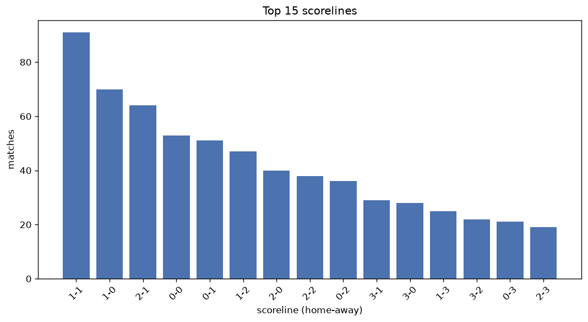
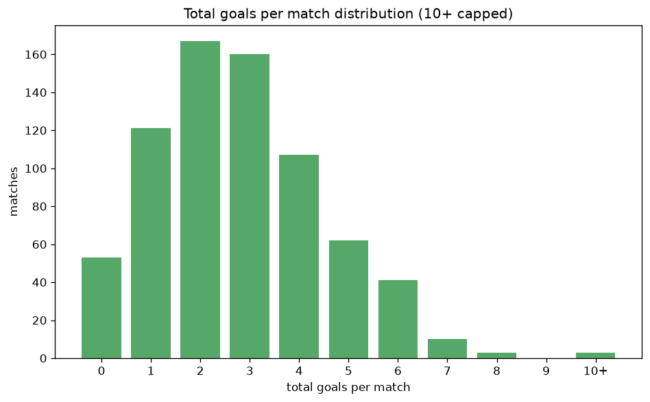

# Scoreline Analysis
- Report: `scoreline_analysis`
- Generated: 2026-10-30T03:56:51+00:00
- Script: `backend/scripts/analyze_scorelines.py` v1.0.0
- League: ISL (India)
- Scope: league `india1`

## 1. Scoreline frequency
- Matches analysed: **727** across **7** seasons.
- Distinct scorelines seen: **40**.

| scoreline | count | pct |
|---|---|---|
| 1-1 | 91 | 12.5% |
| 1-0 | 70 | 9.6% |
| 2-1 | 64 | 8.8% |
| 0-0 | 53 | 7.3% |
| 0-1 | 51 | 7.0% |
| 1-2 | 47 | 6.5% |
| 2-0 | 40 | 5.5% |
| 2-2 | 38 | 5.2% |
| 0-2 | 36 | 5.0% |
| 3-1 | 29 | 4.0% |
| 3-0 | 28 | 3.9% |
| 1-3 | 25 | 3.4% |
| 3-2 | 22 | 3.0% |
| 0-3 | 21 | 2.9% |
| 2-3 | 19 | 2.6% |
| 4-2 | 12 | 1.7% |
| 3-3 | 11 | 1.5% |
| 4-1 | 11 | 1.5% |
| 2-4 | 9 | 1.2% |
| 0-4 | 9 | 1.2% |

## 2. Scoreline frequency per season

### 2020-2021
| scoreline | count | pct |
|---|---|---|
| 1-1 | 16 | 14.5% |
| 0-0 | 13 | 11.8% |
| 0-1 | 12 | 10.9% |
| 1-2 | 12 | 10.9% |
| 2-2 | 11 | 10.0% |

### 2021-2022
| scoreline | count | pct |
|---|---|---|
| 1-1 | 18 | 16.4% |
| 2-1 | 12 | 10.9% |
| 1-0 | 9 | 8.2% |
| 0-1 | 7 | 6.4% |
| 3-1 | 5 | 4.5% |

### 2022-2023
| scoreline | count | pct |
|---|---|---|
| 1-0 | 14 | 12.7% |
| 3-1 | 10 | 9.1% |
| 2-1 | 10 | 9.1% |
| 0-1 | 9 | 8.2% |
| 1-2 | 7 | 6.4% |

### 2023-2024
| scoreline | count | pct |
|---|---|---|
| 2-1 | 19 | 14.4% |
| 1-0 | 15 | 11.4% |
| 1-1 | 15 | 11.4% |
| 0-1 | 11 | 8.3% |
| 0-0 | 9 | 6.8% |

### 2024-2025
| scoreline | count | pct |
|---|---|---|
| 1-1 | 16 | 10.3% |
| 1-0 | 15 | 9.6% |
| 2-1 | 12 | 7.7% |
| 3-0 | 11 | 7.1% |
| 0-0 | 11 | 7.1% |

### 2025-2026
| scoreline | count | pct |
|---|---|---|
| 1-1 | 16 | 17.6% |
| 0-0 | 10 | 11.0% |
| 1-2 | 10 | 11.0% |
| 1-0 | 9 | 9.9% |
| 2-0 | 8 | 8.8% |

### 2026-2027
| scoreline | count | pct |
|---|---|---|
| 1-1 | 4 | 22.2% |
| 2-1 | 2 | 11.1% |
| 1-0 | 2 | 11.1% |
| 0-0 | 2 | 11.1% |
| 3-2 | 1 | 5.6% |

## 3. Total-goal histogram
_10+ groups all matches with 10 or more total goals._

| total goals | matches | pct |
|---|---|---|
| 0 | 53 | 7.3% |
| 1 | 121 | 16.6% |
| 2 | 167 | 23.0% |
| 3 | 160 | 22.0% |
| 4 | 107 | 14.7% |
| 5 | 62 | 8.5% |
| 6 | 41 | 5.6% |
| 7 | 10 | 1.4% |
| 8 | 3 | 0.4% |
| 9 | 0 | 0.0% |
| 10+ | 3 | 0.4% |

## 4. Extreme scorelines
- Matches with 7+ total goals: **16**

| season | date | scoreline | total goals |
|---|---|---|---|
| 2020-2021 | 2021-02-27 | 6-5 | 11 |
| 2021-2022 | 2021-11-30 | 6-4 | 10 |
| 2022-2023 | 2022-12-10 | 3-7 | 10 |
| 2021-2022 | 2022-03-06 | 4-4 | 8 |
| 2022-2023 | 2022-11-12 | 2-6 | 8 |
| 2022-2023 | 2023-02-11 | 3-5 | 8 |
| 2020-2021 | 2021-02-24 | 1-6 | 7 |
| 2021-2022 | 2021-12-07 | 3-4 | 7 |
| 2021-2022 | 2021-12-28 | 6-1 | 7 |
| 2022-2023 | 2022-10-16 | 2-5 | 7 |
| 2022-2023 | 2022-12-29 | 6-1 | 7 |
| 2022-2023 | 2023-02-24 | 4-3 | 7 |
| 2023-2024 | 2024-03-13 | 3-4 | 7 |
| 2024-2025 | 2024-12-23 | 2-5 | 7 |
| 2024-2025 | 2025-03-09 | 5-2 | 7 |
| 2025-2026 | 2026-03-23 | 7-0 | 7 |

## 5. Margin-of-victory distribution (decided matches)
- Decided matches: **533** (draws: **194**)
- Average winning margin: **1.76**

| margin | matches | pct |
|---|---|---|
| 1 | 277 | 52.0% |
| 2 | 153 | 28.7% |
| 3+ | 103 | 19.3% |

## 6. Margin by outcome

### Home wins
- Matches: **296** | avg margin: **1.73** | max margin: **7**
| margin | matches | pct |
|---|---|---|
| 1 | 158 | 53.4% |
| 2 | 82 | 27.7% |
| 3+ | 56 | 18.9% |
- *Full match-by-match list available in `scoreline_analysis.json`.*

### Away wins
- Matches: **237** | avg margin: **1.8** | max margin: **6**
| margin | matches | pct |
|---|---|---|
| 1 | 119 | 50.2% |
| 2 | 71 | 30.0% |
| 3+ | 47 | 19.8% |
- *Full match-by-match list available in `scoreline_analysis.json`.*

## 7. Most common exact score by outcome type
| outcome | matches | most common score | count | pct |
|---|---|---|---|---|
| home | 296 | 1-0 | 70 | 23.6% |
| draw | 194 | 1-1 | 91 | 46.9% |
| away | 237 | 0-1 | 51 | 21.5% |

---
*All statistics are computed from PostgreSQL tables (read-only). Run with `python backend/scripts/analyze_scorelines.py` to regenerate.*

## Charts

