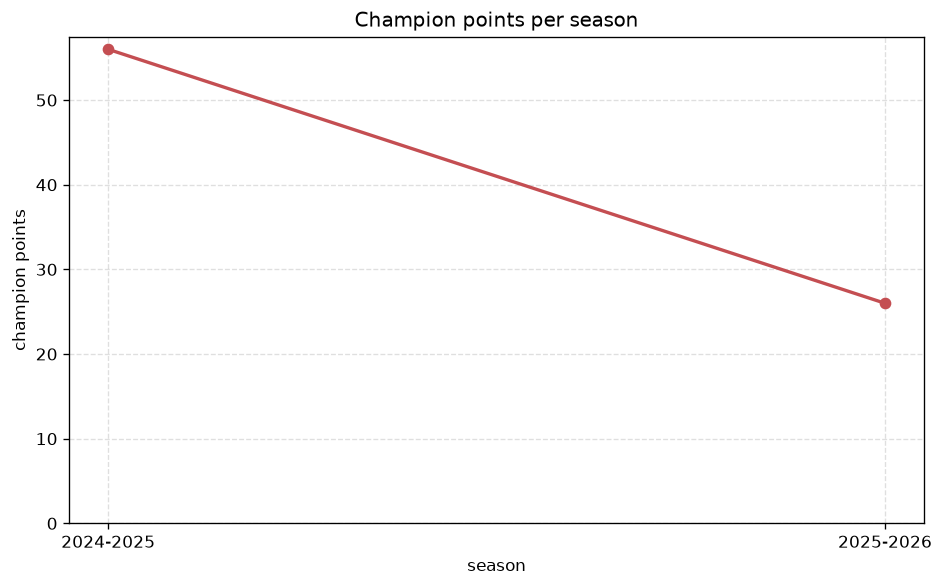
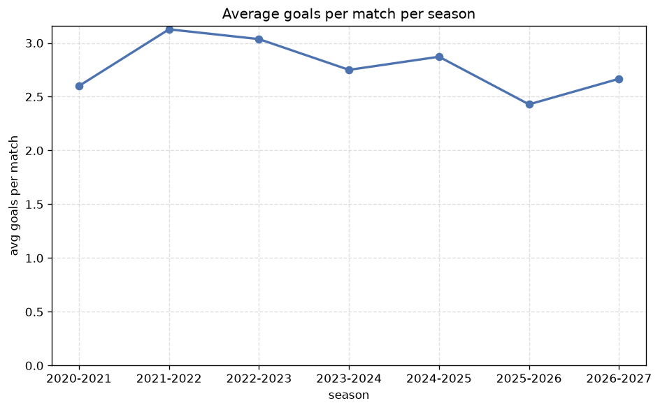

# Season Trends Analysis
- Report: `season_trends`
- Generated: 2026-10-30T03:56:48+00:00
- Script: `backend/scripts/analyze_seasons.py` v1.0.0
- League: ISL (India)
- Scope: league `india1`

## 1. Champions per season
| season | champion | pts | runner-up | margin |
|---|---|---|---|---|
| 2020-2021 | Mumbai City | 40 | Mohun Bagan | 0 pts |
| 2021-2022 | Jamshedpur | 43 | Hyderabad | 5 pts |
| 2022-2023 | Mumbai City | 46 | Hyderabad | 4 pts |
| 2023-2024 | Mohun Bagan | 48 | Mumbai City | 1 pts |
| 2024-2025 | Mohun Bagan | 56 | Goa | 8 pts |
| 2025-2026 | East Bengal | 26 | Mohun Bagan | 0 pts |
| 2026-2027 | North East Utd | 7 | Punjab | 0 pts |

## 2. Title-race tightness
- Tight races (margin <= 3 pts): **4** of 7 seasons
- Tightest race: **2020-2021** - Mumbai City beat Mohun Bagan by **0** pts

| season | margin | tight |
|---|---|---|
| 2020-2021 | 0 pts | yes |
| 2021-2022 | 5 pts |  |
| 2022-2023 | 4 pts |  |
| 2023-2024 | 1 pts | yes |
| 2024-2025 | 8 pts |  |
| 2025-2026 | 0 pts | yes |
| 2026-2027 | 0 pts | yes |

## 3. Points thresholds
_Position-specific points per season. Key: 1 = champion, 2 = runner-up, 4 = CL line, 6 = Europa, 7 = last safe, 10 = bottom._

| season | pos 1 | pos 2 | pos 4 | pos 6 | pos 7 | pos 10 |
|---|---|---|---|---|---|---|
| 2020-2021 | 40 | 40 | 31 | 27 | 22 | 17 |
| 2021-2022 | 43 | 38 | 34 | 29 | 23 | 14 |
| 2022-2023 | 46 | 42 | 34 | 30 | 27 | 19 |
| 2023-2024 | 48 | 47 | 39 | 27 | 26 | 22 |
| 2024-2025 | 56 | 48 | 38 | 36 | 33 | 28 |
| 2025-2026 | 26 | 26 | 23 | 22 | 20 | 13 |
| 2026-2027 | 7 | 7 | 6 | 4 | 3 | 2 |

## 4. Relegation battle
| season | safe pos | safe pts | drop pos | drop pts | gap |
|---|---|---|---|---|---|
| 2020-2021 | 7 | 22 | 8 | 20 | 2 pts |
| 2021-2022 | 7 | 23 | 8 | 20 | 3 pts |
| 2022-2023 | 7 | 27 | 8 | 27 | 0 pts |
| 2023-2024 | 7 | 26 | 8 | 24 | 2 pts |
| 2024-2025 | 7 | 33 | 8 | 29 | 4 pts |
| 2025-2026 | 7 | 20 | 8 | 17 | 3 pts |
| 2026-2027 | 7 | 3 | 8 | 2 | 1 pts |

## 5. League-level trends
| season | matches | total goals | avg goals | home win | draw | away win | goalless | avg pts/team |
|---|---|---|---|---|---|---|---|---|
| 2020-2021 | 110 | 286 | 2.6 | 29.1% | 38.2% | 32.7% | 11.8% | 26.18 |
| 2021-2022 | 110 | 344 | 3.127 | 40.0% | 28.2% | 31.8% | 4.5% | 27.18 |
| 2022-2023 | 110 | 334 | 3.036 | 47.3% | 14.5% | 38.2% | 2.7% | 28.55 |
| 2023-2024 | 132 | 363 | 2.75 | 45.5% | 24.2% | 30.3% | 6.8% | 30.33 |
| 2024-2025 | 156 | 448 | 2.872 | 42.3% | 24.4% | 33.3% | 7.1% | 33.08 |
| 2025-2026 | 91 | 221 | 2.429 | 38.5% | 31.9% | 29.7% | 11.0% | 17.43 |
| 2026-2027 | 18 | 48 | 2.667 | 38.9% | 33.3% | 27.8% | 11.1% | 3.69 |

## 6. View divergence
- Largest divergence: **2025-2026** (goals view, avg abs position diff = 4.714)

_Avg absolute position difference between classic view and alternative view per season._

| season | classic vs luck | classic vs goals |
|---|---|---|
| 2020-2021 | 1.636 | 4.364 |
| 2021-2022 | 1.091 | 3.818 |
| 2022-2023 | 1.636 | 4.182 |
| 2023-2024 | 0.833 | 2.667 |
| 2024-2025 | 1.692 | 3.538 |
| 2025-2026 | 2.714 | 4.714 |
| 2026-2027 | 1.692 | 3.231 |

---
*All statistics are computed from PostgreSQL tables (read-only). Run with `python backend/scripts/analyze_seasons.py` to regenerate.*

## Charts

