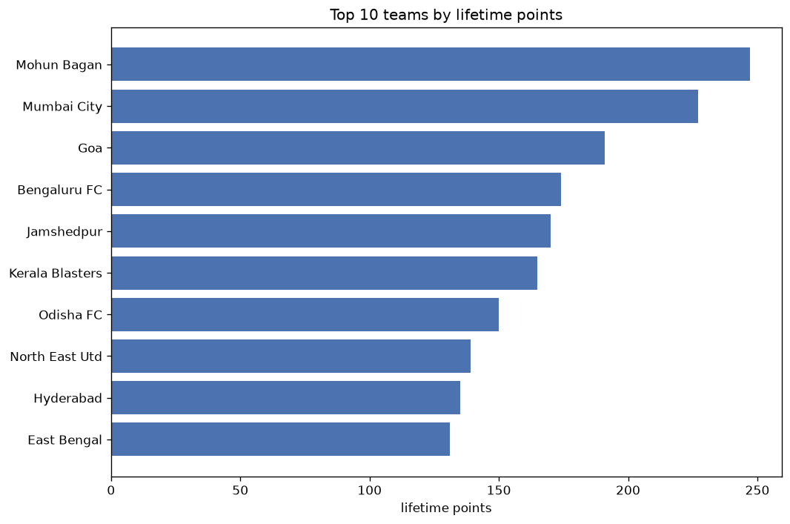
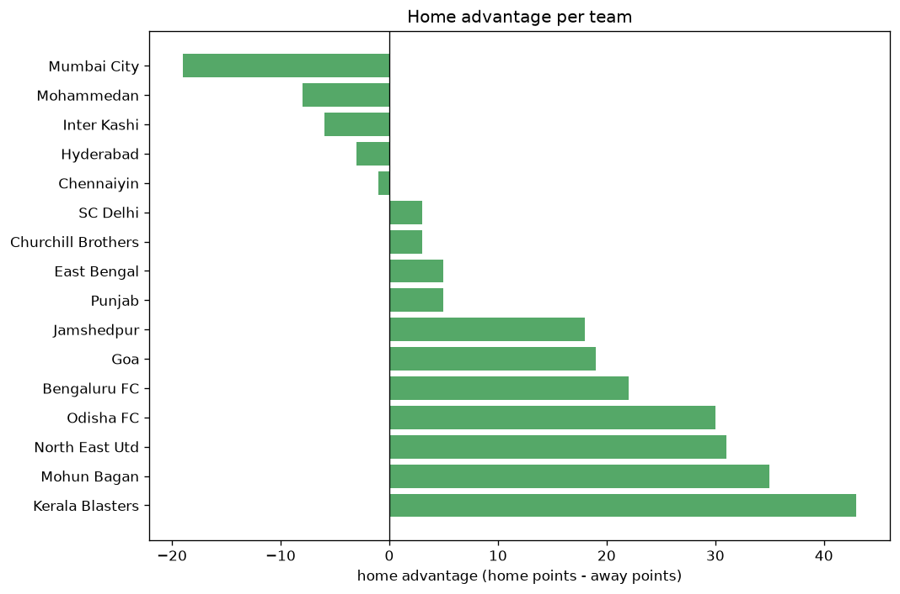

# Team Analysis
- Report: `teams_analysis`
- Generated: 2026-10-29T02:03:51+00:00
- Script: `backend/scripts/analyze_teams.py` v1.0.0
- League: ISL (India)
- Scope: league `india1`

- Teams: **16** | Seasons: **7** | Matches: **726**

## 1. Team standings (lifetime)
| team | seasons | played | W | D | L | pts | GF | GA | GD | avg pts/season | best pos | worst pos | titles |
|---|---|---|---|---|---|---|---|---|---|---|---|---|---|
| Mohun Bagan | 7 | 122 | 73 | 28 | 21 | 247 | 209 | 111 | 98 | 35.29 | 1 | 5 | 2 |
| Mumbai City | 7 | 122 | 65 | 32 | 25 | 227 | 215 | 129 | 86 | 32.43 | 1 | 8 | 2 |
| Goa | 7 | 120 | 51 | 38 | 31 | 191 | 194 | 153 | 41 | 27.29 | 2 | 10 | 0 |
| Bengaluru FC | 7 | 121 | 48 | 30 | 43 | 174 | 168 | 157 | 11 | 24.86 | 4 | 10 | 0 |
| Jamshedpur | 6 | 119 | 48 | 26 | 45 | 170 | 163 | 160 | 3 | 28.33 | 1 | 11 | 1 |
| Kerala Blasters | 7 | 122 | 46 | 27 | 49 | 165 | 168 | 177 | -9 | 23.57 | 4 | 10 | 0 |
| Odisha FC | 7 | 122 | 38 | 36 | 48 | 150 | 181 | 204 | -23 | 21.43 | 4 | 12 | 0 |
| North East Utd | 7 | 122 | 34 | 37 | 51 | 139 | 173 | 208 | -35 | 19.86 | 1 | 11 | 1 |
| Hyderabad | 5 | 106 | 35 | 30 | 41 | 135 | 138 | 148 | -10 | 27.0 | 2 | 12 | 0 |
| East Bengal | 7 | 121 | 33 | 32 | 56 | 131 | 155 | 181 | -26 | 18.71 | 1 | 11 | 1 |
| Chennaiyin | 7 | 122 | 32 | 35 | 55 | 131 | 140 | 195 | -55 | 18.71 | 6 | 13 | 0 |
| Punjab | 4 | 62 | 22 | 15 | 25 | 81 | 86 | 89 | -3 | 20.25 | 2 | 9 | 0 |
| Mohammedan | 2 | 37 | 2 | 10 | 25 | 16 | 19 | 75 | -56 | 8.0 | 13 | 14 | 0 |
| Inter Kashi | 2 | 16 | 3 | 5 | 8 | 14 | 13 | 25 | -12 | 7.0 | 10 | 12 | 0 |
| SC Delhi | 2 | 15 | 2 | 5 | 8 | 11 | 16 | 22 | -6 | 5.5 | 11 | 13 | 0 |
| Churchill Brothers | 1 | 3 | 1 | 0 | 2 | 3 | 4 | 8 | -4 | 3.0 | 7 | 7 | 0 |

## 2. Home vs away split
| team | home P | H-W | H-D | H-L | H-pts | away P | A-W | A-D | A-L | A-pts | adv |
|---|---|---|---|---|---|---|---|---|---|---|---|
| Kerala Blasters | 63 | 30 | 14 | 19 | 104 | 59 | 16 | 13 | 30 | 61 | 43 |
| Mohun Bagan | 63 | 44 | 9 | 10 | 141 | 59 | 29 | 19 | 11 | 106 | 35 |
| North East Utd | 63 | 24 | 13 | 26 | 85 | 59 | 10 | 24 | 25 | 54 | 31 |
| Odisha FC | 59 | 23 | 21 | 15 | 90 | 63 | 15 | 15 | 33 | 60 | 30 |
| Bengaluru FC | 61 | 27 | 17 | 17 | 98 | 60 | 21 | 13 | 26 | 76 | 22 |
| Goa | 60 | 30 | 15 | 15 | 105 | 60 | 21 | 23 | 16 | 86 | 19 |
| Jamshedpur | 62 | 26 | 16 | 20 | 94 | 57 | 22 | 10 | 25 | 76 | 18 |
| East Bengal | 62 | 16 | 20 | 26 | 68 | 59 | 17 | 12 | 30 | 63 | 5 |
| Punjab | 31 | 12 | 7 | 12 | 43 | 31 | 10 | 8 | 13 | 38 | 5 |
| SC Delhi | 7 | 1 | 4 | 2 | 7 | 8 | 1 | 1 | 6 | 4 | 3 |
| Churchill Brothers | 3 | 1 | 0 | 2 | 3 | 0 | 0 | 0 | 0 | 0 | 3 |
| Chennaiyin | 59 | 15 | 20 | 24 | 65 | 63 | 17 | 15 | 31 | 66 | -1 |
| Hyderabad | 53 | 17 | 15 | 21 | 66 | 53 | 18 | 15 | 20 | 69 | -3 |
| Inter Kashi | 7 | 1 | 1 | 5 | 4 | 9 | 2 | 4 | 3 | 10 | -6 |
| Mohammedan | 15 | 0 | 4 | 11 | 4 | 22 | 2 | 6 | 14 | 12 | -8 |
| Mumbai City | 58 | 29 | 17 | 12 | 104 | 64 | 36 | 15 | 13 | 123 | -19 |

## 3. Top performers
### Best points per game (PPG)
| rank | team | PPG |
|---|---|---|
| 1 | Mohun Bagan | 2.02 |
| 2 | Mumbai City | 1.86 |
| 3 | Goa | 1.59 |
| 4 | Bengaluru FC | 1.44 |
| 5 | Jamshedpur | 1.43 |

### Most goals scored
| rank | team | goals |
|---|---|---|
| 1 | Mumbai City | 215 |
| 2 | Mohun Bagan | 209 |
| 3 | Goa | 194 |
| 4 | Odisha FC | 181 |
| 5 | North East Utd | 173 |

### Best goal difference
| rank | team | GD |
|---|---|---|
| 1 | Mohun Bagan | 98 |
| 2 | Mumbai City | 86 |
| 3 | Goa | 41 |
| 4 | Bengaluru FC | 11 |
| 5 | Jamshedpur | 3 |

### Best defence (goals against per match, standings)
| rank | team | GA/match |
|---|---|---|
| 1 | Mohun Bagan | 0.910 |
| 2 | Mumbai City | 1.057 |
| 3 | Goa | 1.275 |
| 4 | Bengaluru FC | 1.298 |
| 5 | Jamshedpur | 1.345 |

## 4. Team consistency
- Teams present in all **7** seasons: **9**

Bengaluru FC, Chennaiyin, East Bengal, Goa, Kerala Blasters, Mohun Bagan, Mumbai City, North East Utd, Odisha FC

## 5. Head-to-head dominance
- Distinct fixtures: **106** (showing the 15 most frequent)

| fixture | meetings | home wins | draws | away wins | home pct | draw pct | away pct |
|---|---|---|---|---|---|---|---|
| Mohun Bagan vs North East Utd | 12 | 8 | 0 | 4 | 66.7% | 0.0% | 33.3% |
| Mumbai City vs Kerala Blasters | 12 | 7 | 1 | 4 | 58.3% | 8.3% | 33.3% |
| Bengaluru FC vs Chennaiyin | 12 | 6 | 2 | 4 | 50.0% | 16.7% | 33.3% |
| North East Utd vs Odisha FC | 12 | 6 | 3 | 3 | 50.0% | 25.0% | 25.0% |
| North East Utd vs Kerala Blasters | 12 | 5 | 6 | 1 | 41.7% | 50.0% | 8.3% |
| Mohun Bagan vs Chennaiyin | 12 | 4 | 4 | 4 | 33.3% | 33.3% | 33.3% |
| Goa vs Chennaiyin | 12 | 3 | 4 | 5 | 25.0% | 33.3% | 41.7% |
| Bengaluru FC vs Kerala Blasters | 11 | 7 | 1 | 3 | 63.6% | 9.1% | 27.3% |
| East Bengal vs Odisha FC | 11 | 7 | 1 | 3 | 63.6% | 9.1% | 27.3% |
| Goa vs Kerala Blasters | 11 | 7 | 3 | 1 | 63.6% | 27.3% | 9.1% |
| Kerala Blasters vs Odisha FC | 11 | 7 | 2 | 2 | 63.6% | 18.2% | 18.2% |
| North East Utd vs East Bengal | 11 | 7 | 2 | 2 | 63.6% | 18.2% | 18.2% |
| Bengaluru FC vs Odisha FC | 11 | 6 | 3 | 2 | 54.5% | 27.3% | 18.2% |
| Goa vs Jamshedpur | 11 | 6 | 1 | 4 | 54.5% | 9.1% | 36.4% |
| Jamshedpur vs Bengaluru FC | 11 | 6 | 2 | 3 | 54.5% | 18.2% | 27.3% |

## 6. Position per season (classic view)
_Cells show final position; '-' when the team was absent from that season._

| team | 2020-2021 | 2021-2022 | 2022-2023 | 2023-2024 | 2024-2025 | 2025-2026 | 2026-2027 |
|---|---|---|---|---|---|---|---|
| Mohun Bagan | 2 | 3 | 3 | 1 | 1 | 2 | 5 |
| Mumbai City | 1 | 5 | 1 | 2 | 6 | 3 | 8 |
| Goa | 4 | 9 | 7 | 3 | 2 | 7 | 10 |
| Bengaluru FC | 7 | 6 | 4 | 10 | 4 | 4 | 4 |
| Jamshedpur | 6 | 1 | 9 | 11 | 5 | 6 | - |
| Kerala Blasters | 10 | 4 | 5 | 5 | 8 | 8 | 6 |
| Odisha FC | 11 | 7 | 6 | 4 | 7 | 12 | 9 |
| North East Utd | 3 | 10 | 11 | 7 | 3 | 9 | 1 |
| Hyderabad | 5 | 2 | 2 | 12 | 12 | - | - |
| East Bengal | 9 | 11 | 10 | 8 | 10 | 1 | 3 |
| Chennaiyin | 8 | 8 | 8 | 6 | 11 | 13 | 11 |
| Punjab | - | - | - | 9 | 9 | 5 | 2 |
| Mohammedan | - | - | - | - | 13 | 14 | - |
| Inter Kashi | - | - | - | - | - | 10 | 12 |
| SC Delhi | - | - | - | - | - | 11 | 13 |
| Churchill Brothers | - | - | - | - | - | - | 7 |

---
*All statistics are computed from PostgreSQL tables (read-only). Run with `python backend/scripts/analyze_teams.py` to regenerate.*

## Charts

