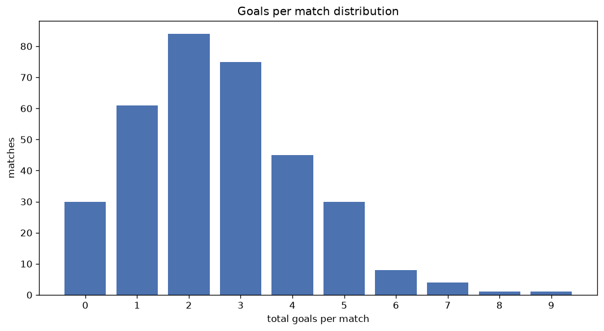
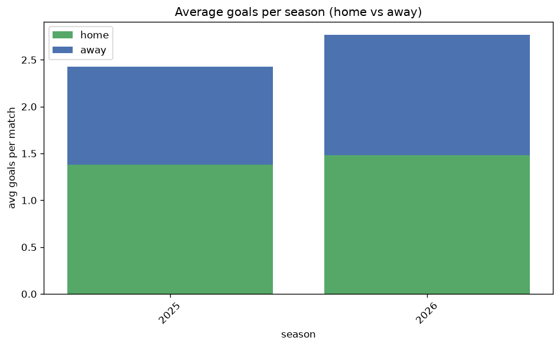

# Goal Analysis
- Report: `goals_analysis`
- Generated: 2026-10-29T02:04:07+00:00
- Script: `backend/scripts/analyze_goals.py` v1.0.0
- League: Premier Division (Ireland)
- Scope: league `ireland1`

## 1. Goals per match distribution
| goals | matches | pct |
|---|---|---|
| 0 | 95 | 8.2% |
| 1 | 233 | 20.0% |
| 2 | 296 | 25.4% |
| 3 | 261 | 22.4% |
| 4 | 156 | 13.4% |
| 5 | 85 | 7.3% |
| 6 | 25 | 2.1% |
| 7 | 8 | 0.7% |
| 8 | 4 | 0.3% |
| 9 | 1 | 0.1% |

## 2. Goals per match per season
| season | matches | total goals | avg home | avg away | avg total |
|---|---|---|---|---|---|
| 2020 | 90 | 198 | 1.222 | 0.978 | 2.2 |
| 2021 | 180 | 458 | 1.389 | 1.156 | 2.544 |
| 2022 | 179 | 448 | 1.413 | 1.089 | 2.503 |
| 2023 | 180 | 469 | 1.5 | 1.106 | 2.606 |
| 2024 | 180 | 408 | 1.272 | 0.994 | 2.267 |
| 2025 | 180 | 437 | 1.378 | 1.05 | 2.428 |
| 2026 | 175 | 486 | 1.531 | 1.246 | 2.777 |

## 3. Home vs away goal share
- Home goals: **1628** (56.1%)
- Away goals: **1276** (43.9%)
- Home/away ratio: **1.276**

| season | home goals | away goals | total | home pct | away pct |
|---|---|---|---|---|---|
| 2020 | 110 | 88 | 198 | 55.6% | 44.4% |
| 2021 | 250 | 208 | 458 | 54.6% | 45.4% |
| 2022 | 253 | 195 | 448 | 56.5% | 43.5% |
| 2023 | 270 | 199 | 469 | 57.6% | 42.4% |
| 2024 | 229 | 179 | 408 | 56.1% | 43.9% |
| 2025 | 248 | 189 | 437 | 56.8% | 43.2% |
| 2026 | 268 | 218 | 486 | 55.1% | 44.9% |

## 4. BTTS (Both Teams To Score)
- Overall: **587** of `1164` (50.4%)

| season | matches | BTTS | pct |
|---|---|---|---|
| 2020 | 90 | 31 | 34.4% |
| 2021 | 180 | 99 | 55.0% |
| 2022 | 179 | 88 | 49.2% |
| 2023 | 180 | 82 | 45.6% |
| 2024 | 180 | 86 | 47.8% |
| 2025 | 180 | 96 | 53.3% |
| 2026 | 175 | 105 | 60.0% |

## 5. Clean sheets
- Home clean sheets: **378** (32.5%)
- Away clean sheets: **294** (25.3%)
- Total clean sheets recorded: **672**
- Matches with at least one clean sheet: **577** (49.6%)
- Both teams kept clean sheets (0-0): **95**

| season | matches | home CS | away CS | total CS | matches w/ CS |
|---|---|---|---|---|---|
| 2020 | 90 | 36 | 33 | 69 | 59 (65.6%) |
| 2021 | 180 | 49 | 36 | 85 | 81 (45.0%) |
| 2022 | 179 | 59 | 45 | 104 | 91 (50.8%) |
| 2023 | 180 | 62 | 51 | 113 | 98 (54.4%) |
| 2024 | 180 | 61 | 55 | 116 | 94 (52.2%) |
| 2025 | 180 | 60 | 39 | 99 | 84 (46.7%) |
| 2026 | 175 | 51 | 35 | 86 | 70 (40.0%) |

## 6. Scoring intensity
- First-half goals: **1297** (44.7%)
- Second-half goals: **1604** (55.3%)
- Avg first-half goals per match: **1.115**
- Avg second-half goals per match: **1.379**
- Second-half-only scoring (HT 0-0, FT goals >= 1): **266** (22.9%)
- *1 match(es) excluded (no HT score recorded).*

| season | matches | 1st half | 2nd half | 1st half pct | 2nd half pct |
|---|---|---|---|---|---|
| 2020 | 90 | 98 | 100 | 49.5% | 50.5% |
| 2021 | 180 | 199 | 256 | 43.7% | 56.3% |
| 2022 | 179 | 202 | 246 | 45.1% | 54.9% |
| 2023 | 180 | 190 | 279 | 40.5% | 59.5% |
| 2024 | 180 | 179 | 229 | 43.9% | 56.1% |
| 2025 | 180 | 211 | 226 | 48.3% | 51.7% |
| 2026 | 175 | 218 | 268 | 44.9% | 55.1% |

## 7. First-goal timing
- Matches with first-goal time recorded: `1068` of `1164` (91.8%)
- Goalless matches: `96`
- Min `1` | Max `96` | Mean `31.76` | Median (p50) `26.0`

| bucket | count | % of matches | % of scoring matches |
|---|---|---|---|
| 1-15 | 322 | 27.7% | 30.1% |
| 16-30 | 271 | 23.3% | 25.4% |
| 31-45 | 190 | 16.3% | 17.8% |
| 46-60 | 149 | 12.8% | 14.0% |
| 61-75 | 63 | 5.4% | 5.9% |
| 76-90 | 57 | 4.9% | 5.3% |
| 91-120 | 16 | 1.4% | 1.5% |

---
*All statistics are computed from PostgreSQL tables (read-only). Run with `python backend/scripts/analyze_goals.py` to regenerate.*

## Charts

