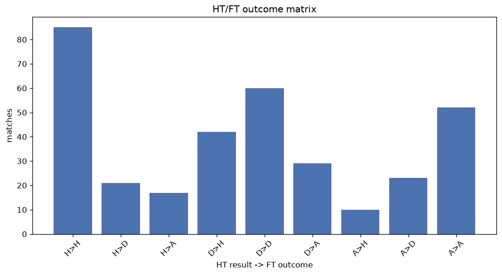
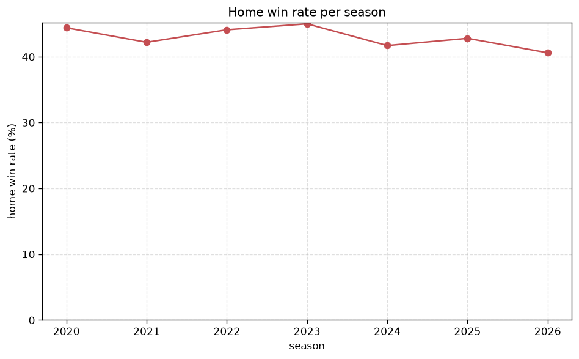

# Match Analysis
- Report: `matches_analysis`
- Generated: 2026-10-29T02:04:05+00:00
- Script: `backend/scripts/analyze_matches.py` v1.0.0
- League: Premier Division (Ireland)
- Scope: league `ireland1`

## 1. Overall summary
| metric | value |
|---|---|
| Matches | 1164 |
| Home wins | 499 (42.9%) |
| Draws | 316 (27.1%) |
| Away wins | 349 (30.0%) |
| Total goals | 2904 |
| Average goals per match | 2.495 |
| Goalless matches | 95 (8.2%) |

## 2. Per-season breakdown
| season | matches | home wins | draws | away wins | total goals | avg goals | goalless |
|---|---|---|---|---|---|---|---|
| 2020 | 90 | 40 (44.4%) | 19 (21.1%) | 31 (34.4%) | 198 | 2.2 | 10 (11.1%) |
| 2021 | 180 | 76 (42.2%) | 44 (24.4%) | 60 (33.3%) | 458 | 2.544 | 4 (2.2%) |
| 2022 | 179 | 79 (44.1%) | 48 (26.8%) | 52 (29.1%) | 448 | 2.503 | 13 (7.3%) |
| 2023 | 180 | 81 (45.0%) | 45 (25.0%) | 54 (30.0%) | 469 | 2.606 | 15 (8.3%) |
| 2024 | 180 | 75 (41.7%) | 54 (30.0%) | 51 (28.3%) | 408 | 2.267 | 22 (12.2%) |
| 2025 | 180 | 77 (42.8%) | 52 (28.9%) | 51 (28.3%) | 437 | 2.428 | 15 (8.3%) |
| 2026 | 175 | 71 (40.6%) | 54 (30.9%) | 50 (28.6%) | 486 | 2.777 | 16 (9.1%) |

## 3. HT/FT outcome matrix
| HT result \ FT result | Home | Draw | Away | total |
|---|---|---|---|---|
| HT home lead | 311 (78.1%) | 51 (12.8%) | 36 (9.0%) | 398 |
| HT draw | 154 (32.4%) | 194 (40.8%) | 127 (26.7%) | 475 |
| HT away lead | 33 (11.4%) | 71 (24.5%) | 186 (64.1%) | 290 |
- *1 match(es) excluded (no HT score recorded).*

## 4. Comeback matches
- Home comebacks (trailing at HT, won at FT): **33** (2.8%)
- Away comebacks (trailing at HT, won at FT): **36** (3.1%)

### Home comebacks
| season | home | away | HT | FT |
|---|---|---|---|---|
| 2020 | Sligo Rovers | Waterford | 0-1 | 2-1 |
| 2020 | Derry City | Cork City | 0-1 | 3-1 |
| 2020 | Bohemians | Derry City | 0-1 | 2-1 |
| 2021 | Shamrock Rovers | Longford | 0-1 | 2-1 |
| 2021 | Bohemians | Drogheda | 0-1 | 2-1 |
| 2021 | Shamrock Rovers | Drogheda | 0-1 | 2-1 |
| 2022 | Dundalk | Bohemians | 0-1 | 3-1 |
| 2022 | UC Dublin | Dundalk | 0-1 | 3-2 |
| 2022 | Shamrock Rovers | Shelbourne | 1-2 | 3-2 |
| 2023 | Dundalk | Shelbourne | 0-1 | 2-1 |
| 2023 | Bohemians | UC Dublin | 0-1 | 2-1 |
| 2023 | Shelbourne | Sligo Rovers | 0-1 | 2-1 |
| 2023 | Dundalk | Cork City | 0-1 | 2-1 |
| 2023 | Shelbourne | Drogheda | 0-1 | 3-2 |
| 2023 | UC Dublin | Sligo Rovers | 0-1 | 2-1 |
| 2023 | Bohemians | Dundalk | 1-2 | 3-2 |
| 2023 | Drogheda | Cork City | 0-1 | 3-1 |
| 2023 | Shelbourne | St. Patricks | 0-1 | 2-1 |
| 2024 | Galway | Waterford | 0-1 | 2-1 |
| 2024 | St. Patricks | Shamrock Rovers | 0-1 | 2-1 |
| 2024 | Waterford | Drogheda | 0-1 | 4-2 |
| 2024 | St. Patricks | Shamrock Rovers | 0-1 | 2-1 |
| 2024 | Sligo Rovers | Dundalk | 0-1 | 2-1 |
| 2025 | Waterford | Cork City | 0-1 | 2-1 |
| 2025 | Derry City | Cork City | 0-1 | 2-1 |
| 2025 | Bohemians | St. Patricks | 0-1 | 2-1 |
| 2025 | Galway | Drogheda | 0-1 | 2-1 |
| 2025 | Shelbourne | St. Patricks | 0-1 | 2-1 |
| 2026 | Derry City | Sligo Rovers | 0-1 | 2-1 |
| 2026 | Derry City | Waterford | 0-1 | 4-2 |
| 2026 | St. Patricks | Drogheda | 0-1 | 4-1 |
| 2026 | Bohemians | Derry City | 0-1 | 5-3 |
| 2026 | Shamrock Rovers | Waterford | 0-1 | 3-2 |

### Away comebacks
| season | home | away | HT | FT |
|---|---|---|---|---|
| 2020 | Derry City | Shamrock Rovers | 1-0 | 1-2 |
| 2020 | Waterford | Finn Harps | 1-0 | 2-3 |
| 2021 | Bohemians | Derry City | 1-0 | 1-2 |
| 2021 | Derry City | Finn Harps | 1-0 | 1-2 |
| 2021 | Waterford | Finn Harps | 1-0 | 1-2 |
| 2021 | Derry City | Shamrock Rovers | 2-1 | 2-4 |
| 2021 | Longford | Bohemians | 1-0 | 1-4 |
| 2021 | Bohemians | Waterford | 1-0 | 1-2 |
| 2021 | Waterford | Shamrock Rovers | 1-0 | 1-3 |
| 2022 | Bohemians | Derry City | 1-0 | 1-2 |
| 2022 | Derry City | Shelbourne | 1-0 | 1-2 |
| 2022 | Finn Harps | Derry City | 1-0 | 1-2 |
| 2023 | Cork City | St. Patricks | 2-1 | 2-3 |
| 2023 | Drogheda | Dundalk | 1-0 | 1-2 |
| 2023 | Drogheda | Shelbourne | 2-0 | 2-4 |
| 2024 | Bohemians | Waterford | 2-0 | 2-3 |
| 2024 | Dundalk | St. Patricks | 1-0 | 1-2 |
| 2024 | Waterford | Galway | 1-0 | 1-2 |
| 2025 | Waterford | St. Patricks | 1-0 | 1-2 |
| 2025 | Shamrock Rovers | Bohemians | 2-0 | 2-3 |
| 2025 | Galway | Bohemians | 1-0 | 1-2 |
| 2025 | Cork City | Sligo Rovers | 1-0 | 2-3 |
| 2025 | Waterford | Sligo Rovers | 1-0 | 1-2 |
| 2025 | Bohemians | Shelbourne | 2-1 | 2-3 |
| 2026 | Drogheda | Shelbourne | 1-0 | 1-2 |
| 2026 | Drogheda | Galway | 2-1 | 2-3 |
| 2026 | Shelbourne | Drogheda | 2-0 | 3-4 |
| 2026 | Dundalk | Bohemians | 1-0 | 1-3 |
| 2026 | Shamrock Rovers | Sligo Rovers | 1-0 | 1-2 |
| 2026 | Bohemians | Shamrock Rovers | 1-0 | 1-2 |
| 2026 | Dundalk | Waterford | 2-1 | 2-3 |
| 2026 | Sligo Rovers | Shamrock Rovers | 1-0 | 1-2 |
| 2026 | Dundalk | Drogheda | 1-0 | 1-2 |
| 2026 | Drogheda | Dundalk | 2-1 | 2-3 |
| 2026 | Galway | Bohemians | 1-0 | 2-3 |
| 2026 | St. Patricks | Shelbourne | 1-0 | 1-2 |

## 5. HT lead conversion
| HT state | matches | converted to win | held as draw | collapsed to loss |
|---|---|---|---|---|
| Home lead | 398 | 311 (78.1%) | 51 (12.8%) | 36 (9.0%) |
| Away lead | 290 | 186 (64.1%) | 71 (24.5%) | 33 (11.4%) |

### Matches level at half-time
| FT result | count | pct |
|---|---|---|
| Home win | 154 | 32.4% |
| Draw | 194 | 40.8% |
| Away win | 127 | 26.7% |
- *1 match(es) excluded (no HT score recorded).*

## 6. First-goal timing
- Matches with a first-goal time recorded: `1068` of `1164` (91.8%)

Outcome distribution by first-goal timing bucket:
| bucket | matches | % of matches | home | draw | away |
|---|---|---|---|---|---|
| 1-15 | 322 | 27.7% | 155 (48.1%) | 60 (18.6%) | 107 (33.2%) |
| 16-30 | 271 | 23.3% | 122 (45.0%) | 63 (23.2%) | 86 (31.7%) |
| 31-45 | 190 | 16.3% | 94 (49.5%) | 39 (20.5%) | 57 (30.0%) |
| 46-60 | 149 | 12.8% | 68 (45.6%) | 38 (25.5%) | 43 (28.9%) |
| 61-75 | 63 | 5.4% | 28 (44.4%) | 13 (20.6%) | 22 (34.9%) |
| 76-90 | 57 | 4.9% | 26 (45.6%) | 8 (14.0%) | 23 (40.4%) |
| 91-120 | 16 | 1.4% | 5 (31.2%) | 0 (0.0%) | 11 (68.8%) |

## 7. Goalless matches
- Overall: **95** of `1164` (8.2%)

| season | matches | goalless | pct |
|---|---|---|---|
| 2020 | 90 | 10 | 11.1% |
| 2021 | 180 | 4 | 2.2% |
| 2022 | 179 | 13 | 7.3% |
| 2023 | 180 | 15 | 8.3% |
| 2024 | 180 | 22 | 12.2% |
| 2025 | 180 | 15 | 8.3% |
| 2026 | 175 | 16 | 9.1% |

---
*All statistics are computed from PostgreSQL tables (read-only). Run with `python backend/scripts/analyze_matches.py` to regenerate.*

## Charts

