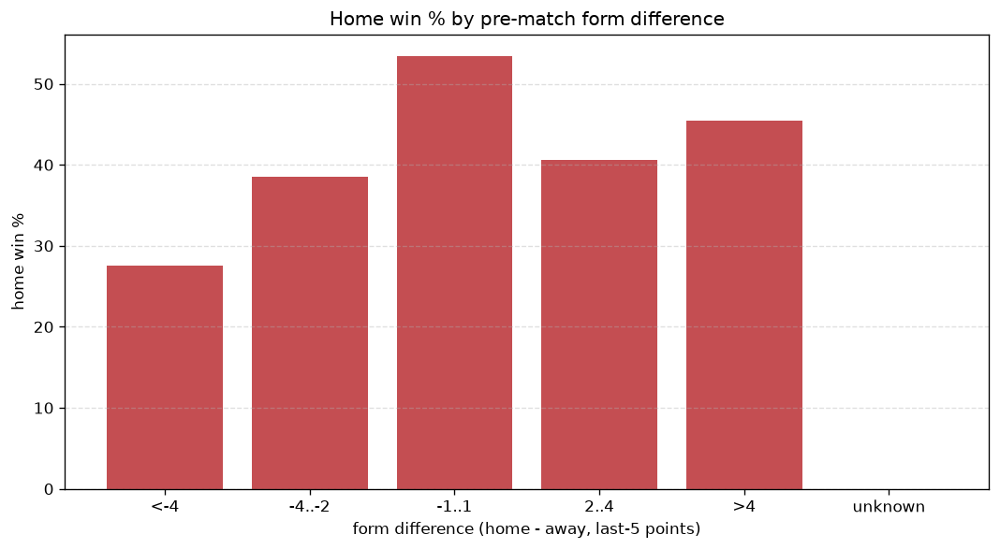
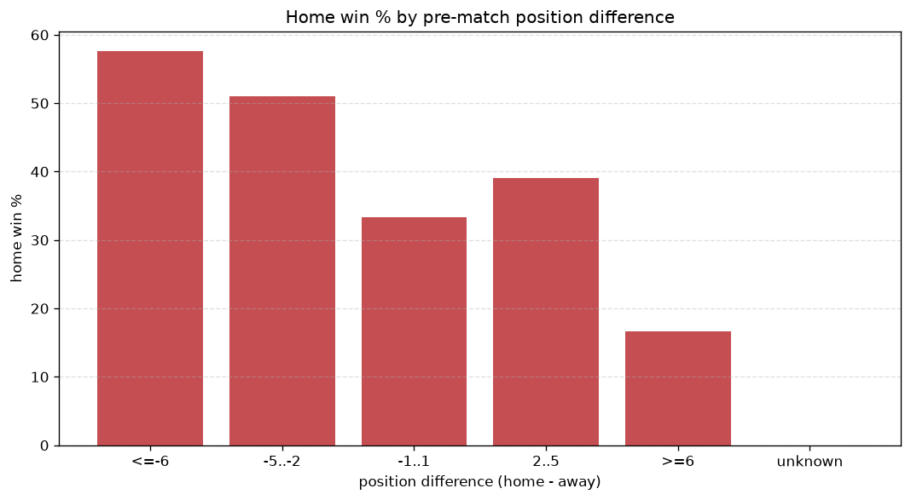

# Relationships Analysis
- Report: `relationships`
- Generated: 2026-10-29T02:04:15+00:00
- Script: `backend/scripts/analyze_relationships.py` v1.0.0
- League: Premier Division (Ireland)
- Scope: league `ireland1`

- Matches analysed: **989** (23 leakage-safe pre-match features).

## 1. Correlation matrix
_Pearson correlation of each pre-match feature with observed goals; sorted by |corr(total goals)|._

| feature | corr(home) | corr(away) | corr(total) |
|---|---|---|---|
| away_position_before_match | 0.270 | -0.105 | 0.149 |
| away_team_away_conceded_avg | 0.220 | -0.095 | 0.115 |
| points_difference | 0.316 | -0.211 | 0.115 |
| position_difference | -0.292 | 0.202 | -0.102 |
| away_team_away_win_rate | -0.159 | 0.055 | -0.093 |
| away_team_goals_conceded_last_5 | 0.189 | -0.093 | 0.092 |
| away_team_wins_last_5 | -0.144 | 0.050 | -0.084 |
| away_team_points_last_5 | -0.153 | 0.064 | -0.082 |
| away_team_away_goals_avg | -0.092 | 0.014 | -0.066 |
| away_points_before_match | -0.083 | 0.029 | -0.048 |
| home_team_home_goals_avg | 0.153 | -0.115 | 0.048 |
| home_points_before_match | 0.157 | -0.132 | 0.039 |
| home_team_goals_conceded_last_5 | -0.111 | 0.079 | -0.037 |
| away_rest_days | -0.049 | 0.008 | -0.035 |
| away_team_goals_scored_last_5 | -0.084 | 0.056 | -0.031 |
| home_team_points_last_5 | 0.136 | -0.123 | 0.029 |
| home_rest_days | -0.037 | 0.007 | -0.026 |
| rest_days_difference | 0.031 | -0.002 | 0.025 |
| home_team_home_conceded_avg | -0.034 | 0.073 | 0.022 |
| home_team_goals_scored_last_5 | 0.127 | -0.126 | 0.018 |
| home_team_wins_last_5 | 0.117 | -0.116 | 0.017 |
| home_team_home_win_rate | 0.096 | -0.105 | 0.007 |
| home_position_before_match | -0.144 | 0.181 | 0.004 |

## 2. Form vs outcome
_Home win/draw/away % per bucket of `home_team_points_last_5 - away_team_points_last_5`._

| bucket | matches | home | draw | away | home % | draw % | away % |
|---|---|---|---|---|---|---|---|
| <-4 | 160 | 46 | 47 | 67 | 28.8% | 29.4% | 41.9% |
| -4..-2 | 227 | 84 | 57 | 86 | 37.0% | 25.1% | 37.9% |
| -1..1 | 287 | 129 | 79 | 79 | 44.9% | 27.5% | 27.5% |
| 2..4 | 176 | 86 | 51 | 39 | 48.9% | 29.0% | 22.2% |
| >4 | 139 | 83 | 28 | 28 | 59.7% | 20.1% | 20.1% |
| unknown | 0 | 0 | 0 | 0 | - | - | - |

## 3. Position vs outcome
_Home win/draw/away % per bucket of `position_difference` (home position - away position; negative favours the home team)._

| bucket | matches | home | draw | away | home % | draw % | away % |
|---|---|---|---|---|---|---|---|
| <=-6 | 92 | 64 | 18 | 10 | 69.6% | 19.6% | 10.9% |
| -5..-2 | 274 | 146 | 67 | 61 | 53.3% | 24.5% | 22.3% |
| -1..1 | 237 | 97 | 75 | 65 | 40.9% | 31.6% | 27.4% |
| 2..5 | 277 | 93 | 73 | 111 | 33.6% | 26.4% | 40.1% |
| >=6 | 109 | 28 | 29 | 52 | 25.7% | 26.6% | 47.7% |
| unknown | 0 | 0 | 0 | 0 | - | - | - |

## 4. Rest advantage
_Home win/draw/away % per bucket of `rest_days_difference` (home rest - away rest). Matches with unknown rest are bucketed separately._

| bucket | matches | home | draw | away | home % | draw % | away % |
|---|---|---|---|---|---|---|---|
| <-1 | 116 | 53 | 27 | 36 | 45.7% | 23.3% | 31.0% |
| -1..0 | 80 | 30 | 24 | 26 | 37.5% | 30.0% | 32.5% |
| 0 | 568 | 260 | 145 | 163 | 45.8% | 25.5% | 28.7% |
| 1..2 | 111 | 39 | 33 | 39 | 35.1% | 29.7% | 35.1% |
| >2 | 82 | 37 | 19 | 26 | 45.1% | 23.2% | 31.7% |
| unknown | 32 | 9 | 14 | 9 | 28.1% | 43.8% | 28.1% |
- *32 match(es) had unknown rest difference (missing rest data on at least one side).*

## 5. Home team quality
_Home win rate by `home_team_home_win_rate` tier (split at 0.5)._

- `< 0.5` tier: **41.4%** home win (276/666)
- `>= 0.5` tier: **47.1%** home win (152/323)
- Home-win gap (>= split minus < split): **+5.7 pp**

| tier | label | matches | home | draw | away | home % |
|---|---|---|---|---|---|---|
| low | < 0.5 | 666 | 276 | 175 | 215 | 41.4% |
| high | >= 0.5 | 323 | 152 | 87 | 84 | 47.1% |

## 6. Feature averages by result
_Mean feature value per outcome; `range` is home-minus-away spread of the group means._

| feature | home mean | draw mean | away mean | range |
|---|---|---|---|---|
| points_difference | 3.694 | -1.015 | -5.227 | 8.921 |
| home_points_before_match | 25.287 | 22.424 | 18.833 | 6.455 |
| position_difference | -1.079 | 0.492 | 1.659 | 2.738 |
| away_points_before_match | 21.593 | 23.439 | 24.060 | 2.467 |
| away_rest_days | 7.594 | 7.699 | 9.103 | 1.509 |
| away_position_before_match | 6.110 | 5.118 | 4.612 | 1.498 |
| home_position_before_match | 5.030 | 5.611 | 6.271 | 1.241 |
| home_rest_days | 7.659 | 7.843 | 8.852 | 1.194 |
| away_team_points_last_5 | 5.834 | 6.462 | 6.943 | 1.109 |
| home_team_points_last_5 | 6.619 | 5.962 | 5.512 | 1.107 |
| away_team_goals_conceded_last_5 | 6.002 | 5.198 | 4.953 | 1.049 |
| home_team_goals_scored_last_5 | 5.895 | 5.481 | 4.953 | 0.942 |
| home_team_goals_conceded_last_5 | 5.297 | 5.603 | 6.161 | 0.864 |
| away_team_goals_scored_last_5 | 5.315 | 5.641 | 6.074 | 0.758 |
| rest_days_difference | 0.064 | 0.145 | -0.252 | 0.397 |
| home_team_wins_last_5 | 1.804 | 1.576 | 1.448 | 0.356 |
| away_team_wins_last_5 | 1.547 | 1.771 | 1.903 | 0.356 |
| away_team_away_conceded_avg | 1.377 | 1.158 | 1.063 | 0.314 |
| home_team_home_goals_avg | 1.328 | 1.201 | 1.067 | 0.261 |
| away_team_away_win_rate | 0.272 | 0.299 | 0.339 | 0.067 |
| home_team_home_win_rate | 0.404 | 0.378 | 0.340 | 0.064 |
| away_team_away_goals_avg | 1.020 | 1.016 | 1.080 | 0.064 |
| home_team_home_conceded_avg | 1.025 | 1.032 | 1.087 | 0.061 |

---
*All features are leakage-safe pre-match values built by `ml.features.build_features.build_rows` from strictly prior matches. Run with `python backend/scripts/analyze_relationships.py` to regenerate.*

## Charts

