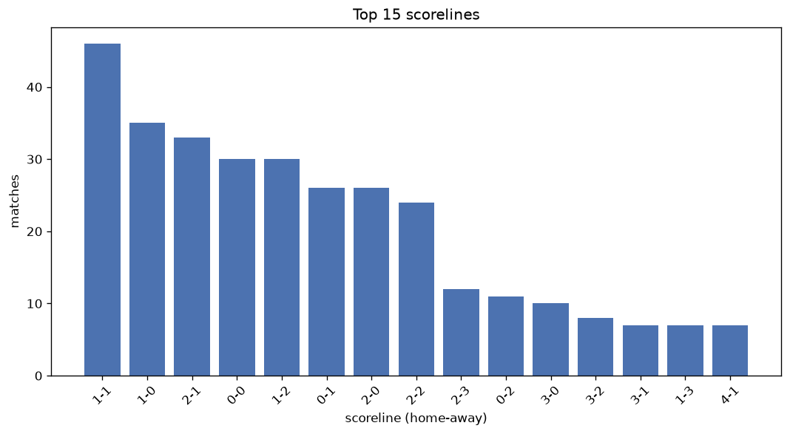
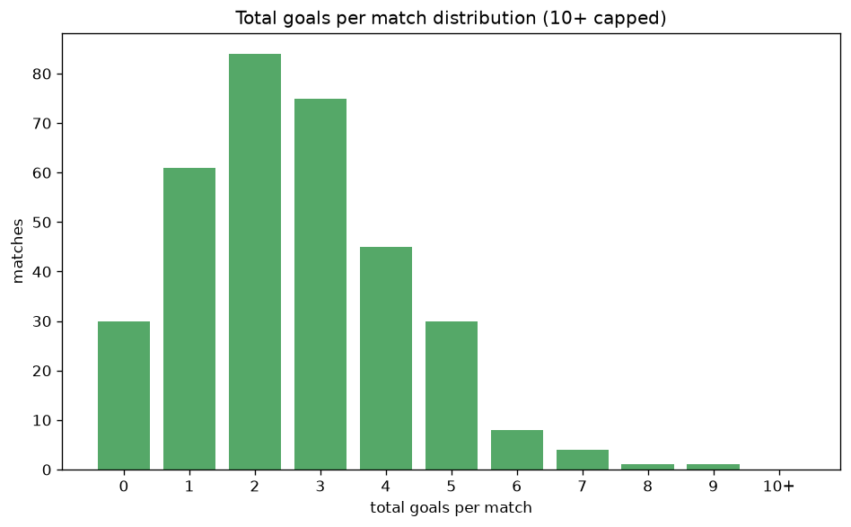

# Scoreline Analysis
- Report: `scoreline_analysis`
- Generated: 2026-10-27T01:54:53+00:00
- Script: `backend/scripts/analyze_scorelines.py` v1.0.0
- League: Premier Division (Ireland)
- Scope: league `ireland1`

## 1. Scoreline frequency
- Matches analysed: **1164** across **7** seasons.
- Distinct scorelines seen: **36**.

| scoreline | count | pct |
|---|---|---|
| 1-1 | 153 | 13.1% |
| 1-0 | 129 | 11.1% |
| 2-1 | 109 | 9.4% |
| 0-1 | 104 | 8.9% |
| 0-0 | 95 | 8.2% |
| 1-2 | 87 | 7.5% |
| 2-0 | 78 | 6.7% |
| 0-2 | 65 | 5.6% |
| 2-2 | 61 | 5.2% |
| 3-0 | 49 | 4.2% |
| 3-1 | 44 | 3.8% |
| 3-2 | 25 | 2.1% |
| 1-3 | 25 | 2.1% |
| 2-3 | 22 | 1.9% |
| 4-1 | 21 | 1.8% |
| 0-3 | 16 | 1.4% |
| 4-0 | 15 | 1.3% |
| 0-4 | 11 | 0.9% |
| 1-4 | 8 | 0.7% |
| 5-0 | 7 | 0.6% |

## 2. Scoreline frequency per season

### 2020
| scoreline | count | pct |
|---|---|---|
| 1-0 | 11 | 12.2% |
| 0-2 | 11 | 12.2% |
| 0-0 | 10 | 11.1% |
| 0-1 | 9 | 10.0% |
| 2-0 | 9 | 10.0% |

### 2021
| scoreline | count | pct |
|---|---|---|
| 1-1 | 30 | 16.7% |
| 1-0 | 21 | 11.7% |
| 0-1 | 21 | 11.7% |
| 1-2 | 19 | 10.6% |
| 2-1 | 16 | 8.9% |

### 2022
| scoreline | count | pct |
|---|---|---|
| 1-0 | 23 | 12.8% |
| 1-1 | 23 | 12.8% |
| 0-1 | 14 | 7.8% |
| 2-1 | 13 | 7.3% |
| 0-0 | 13 | 7.3% |

### 2023
| scoreline | count | pct |
|---|---|---|
| 1-1 | 21 | 11.7% |
| 1-0 | 17 | 9.4% |
| 2-1 | 16 | 8.9% |
| 0-1 | 16 | 8.9% |
| 0-0 | 15 | 8.3% |

### 2024
| scoreline | count | pct |
|---|---|---|
| 1-1 | 23 | 12.8% |
| 2-1 | 22 | 12.2% |
| 0-0 | 22 | 12.2% |
| 1-0 | 21 | 11.7% |
| 0-1 | 17 | 9.4% |

### 2025
| scoreline | count | pct |
|---|---|---|
| 1-1 | 25 | 13.9% |
| 1-0 | 22 | 12.2% |
| 2-1 | 20 | 11.1% |
| 0-1 | 17 | 9.4% |
| 1-2 | 17 | 9.4% |

### 2026
| scoreline | count | pct |
|---|---|---|
| 1-1 | 23 | 13.1% |
| 2-1 | 16 | 9.1% |
| 0-0 | 16 | 9.1% |
| 2-0 | 15 | 8.6% |
| 1-2 | 15 | 8.6% |

## 3. Total-goal histogram
_10+ groups all matches with 10 or more total goals._

| total goals | matches | pct |
|---|---|---|
| 0 | 95 | 8.2% |
| 1 | 233 | 20.0% |
| 2 | 296 | 25.4% |
| 3 | 261 | 22.4% |
| 4 | 156 | 13.4% |
| 5 | 85 | 7.3% |
| 6 | 25 | 2.1% |
| 7 | 8 | 0.7% |
| 8 | 4 | 0.3% |
| 9 | 1 | 0.1% |
| 10+ | 0 | 0.0% |

## 4. Extreme scorelines
- Matches with 7+ total goals: **13**

| season | date | scoreline | total goals |
|---|---|---|---|
| 2025 | 2025-07-04 | 7-2 | 9 |
| 2022 | 2022-04-22 | 7-1 | 8 |
| 2022 | 2022-10-03 | 4-4 | 8 |
| 2023 | 2023-03-06 | 4-4 | 8 |
| 2026 | 2026-08-21 | 5-3 | 8 |
| 2020 | 2020-09-21 | 6-1 | 7 |
| 2021 | 2021-05-08 | 0-7 | 7 |
| 2023 | 2023-06-30 | 7-0 | 7 |
| 2024 | 2024-08-23 | 7-0 | 7 |
| 2025 | 2025-02-28 | 4-3 | 7 |
| 2025 | 2025-09-12 | 3-4 | 7 |
| 2026 | 2026-03-16 | 4-3 | 7 |
| 2026 | 2026-04-24 | 3-4 | 7 |

## 5. Margin-of-victory distribution (decided matches)
- Decided matches: **848** (draws: **316**)
- Average winning margin: **1.69**

| margin | matches | pct |
|---|---|---|
| 1 | 480 | 56.6% |
| 2 | 225 | 26.5% |
| 3+ | 143 | 16.9% |

## 6. Margin by outcome

### Home wins
- Matches: **499** | avg margin: **1.79** | max margin: **7**
| margin | matches | pct |
|---|---|---|
| 1 | 265 | 53.1% |
| 2 | 130 | 26.1% |
| 3+ | 104 | 20.8% |
- *Full match-by-match list available in `scoreline_analysis.json`.*

### Away wins
- Matches: **349** | avg margin: **1.55** | max margin: **7**
| margin | matches | pct |
|---|---|---|
| 1 | 215 | 61.6% |
| 2 | 95 | 27.2% |
| 3+ | 39 | 11.2% |
- *Full match-by-match list available in `scoreline_analysis.json`.*

## 7. Most common exact score by outcome type
| outcome | matches | most common score | count | pct |
|---|---|---|---|---|
| home | 499 | 1-0 | 129 | 25.9% |
| draw | 316 | 1-1 | 153 | 48.4% |
| away | 349 | 0-1 | 104 | 29.8% |

---
*All statistics are computed from PostgreSQL tables (read-only). Run with `python backend/scripts/analyze_scorelines.py` to regenerate.*

## Charts

