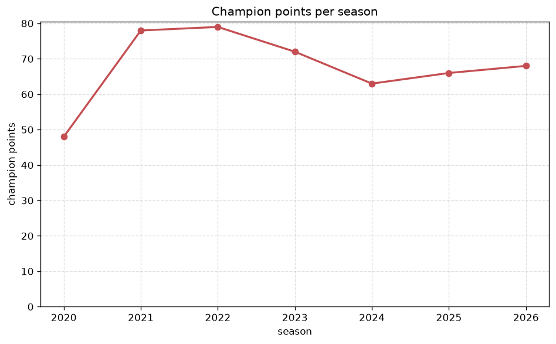
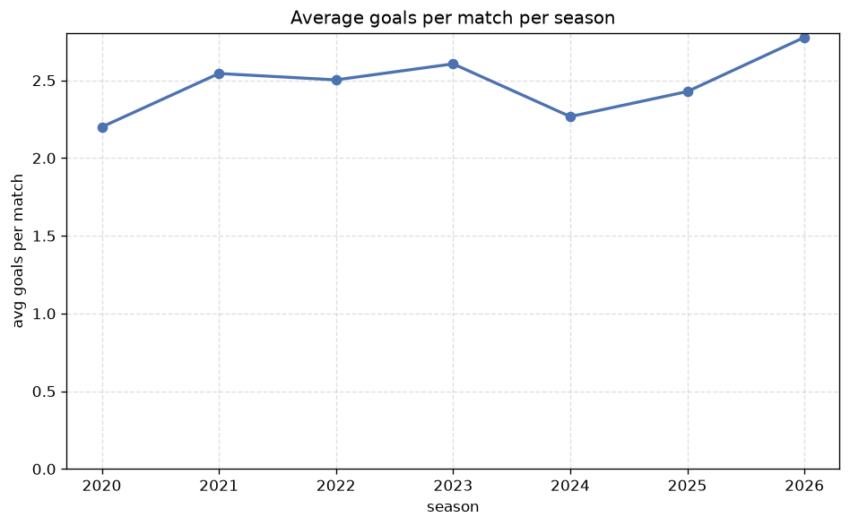

# Season Trends Analysis
- Report: `season_trends`
- Generated: 2026-10-26T01:36:49+00:00
- Script: `backend/scripts/analyze_seasons.py` v1.0.0
- League: Premier Division (Ireland)
- Scope: league `ireland1`

## 1. Champions per season
| season | champion | pts | runner-up | margin |
|---|---|---|---|---|
| 2020 | Shamrock Rovers | 48 | Bohemians | 11 pts |
| 2021 | Shamrock Rovers | 78 | St. Patricks | 16 pts |
| 2022 | Shamrock Rovers | 79 | Derry City | 13 pts |
| 2023 | Shamrock Rovers | 72 | Derry City | 7 pts |
| 2024 | Shelbourne | 63 | Shamrock Rovers | 2 pts |
| 2025 | Shamrock Rovers | 66 | Derry City | 3 pts |
| 2026 | Shamrock Rovers | 68 | Bohemians | 6 pts |

## 2. Title-race tightness
- Tight races (margin <= 3 pts): **2** of 7 seasons
- Tightest race: **2024** - Shelbourne beat Shamrock Rovers by **2** pts

| season | margin | tight |
|---|---|---|
| 2020 | 11 pts |  |
| 2021 | 16 pts |  |
| 2022 | 13 pts |  |
| 2023 | 7 pts |  |
| 2024 | 2 pts | yes |
| 2025 | 3 pts | yes |
| 2026 | 6 pts |  |

## 3. Points thresholds
_Position-specific points per season. Key: 1 = champion, 2 = runner-up, 4 = CL line, 6 = Europa, 7 = last safe, 10 = bottom._

| season | pos 1 | pos 2 | pos 4 | pos 6 | pos 7 | pos 10 |
|---|---|---|---|---|---|---|
| 2020 | 48 | 37 | 25 | 21 | 20 | 11 |
| 2021 | 78 | 62 | 54 | 48 | 44 | 15 |
| 2022 | 79 | 66 | 61 | 46 | 41 | 20 |
| 2023 | 72 | 65 | 60 | 58 | 41 | 11 |
| 2024 | 63 | 61 | 55 | 49 | 45 | 26 |
| 2025 | 66 | 63 | 54 | 51 | 41 | 24 |
| 2026 | 68 | 62 | 49 | 42 | 42 | 24 |

## 4. Relegation battle
| season | safe pos | safe pts | drop pos | drop pts | gap |
|---|---|---|---|---|---|
| 2020 | 7 | 20 | 8 | 20 | 0 pts |
| 2021 | 7 | 44 | 8 | 44 | 0 pts |
| 2022 | 7 | 41 | 8 | 38 | 3 pts |
| 2023 | 7 | 41 | 8 | 37 | 4 pts |
| 2024 | 7 | 45 | 8 | 42 | 3 pts |
| 2025 | 7 | 41 | 8 | 39 | 2 pts |
| 2026 | 7 | 42 | 8 | 40 | 2 pts |

## 5. League-level trends
| season | matches | total goals | avg goals | home win | draw | away win | goalless | avg pts/team |
|---|---|---|---|---|---|---|---|---|
| 2020 | 90 | 198 | 2.2 | 44.4% | 21.1% | 34.4% | 11.1% | 25.1 |
| 2021 | 180 | 458 | 2.544 | 42.2% | 24.4% | 33.3% | 2.2% | 49.6 |
| 2022 | 179 | 448 | 2.503 | 44.1% | 26.8% | 29.1% | 7.3% | 48.9 |
| 2023 | 180 | 469 | 2.606 | 45.0% | 25.0% | 30.0% | 8.3% | 49.5 |
| 2024 | 180 | 408 | 2.267 | 41.7% | 30.0% | 28.3% | 12.2% | 48.6 |
| 2025 | 180 | 437 | 2.428 | 42.8% | 28.9% | 28.3% | 8.3% | 48.8 |
| 2026 | 175 | 486 | 2.777 | 40.6% | 30.9% | 28.6% | 9.1% | 47.1 |

## 6. View divergence
- Largest divergence: **2022** (goals view, avg abs position diff = 4.400)

_Avg absolute position difference between classic view and alternative view per season._

| season | classic vs luck | classic vs goals |
|---|---|---|
| 2020 | 2.200 | 2.000 |
| 2021 | 2.600 | 3.800 |
| 2022 | 2.000 | 4.400 |
| 2023 | 2.400 | 3.600 |
| 2024 | 2.400 | 4.000 |
| 2025 | 2.600 | 4.000 |
| 2026 | 2.800 | 3.600 |

---
*All statistics are computed from PostgreSQL tables (read-only). Run with `python backend/scripts/analyze_seasons.py` to regenerate.*

## Charts

