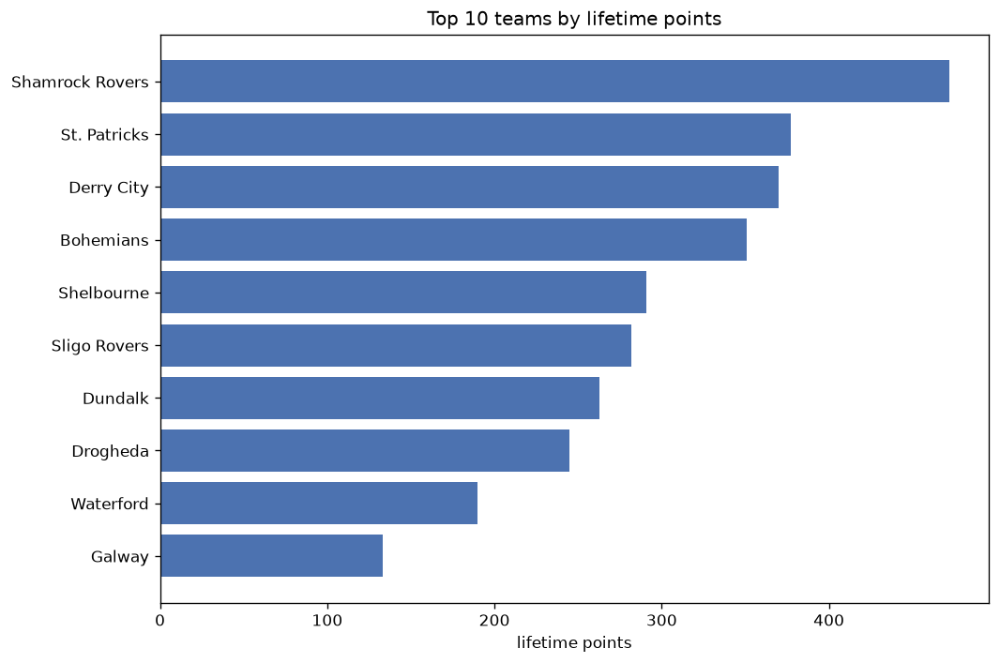
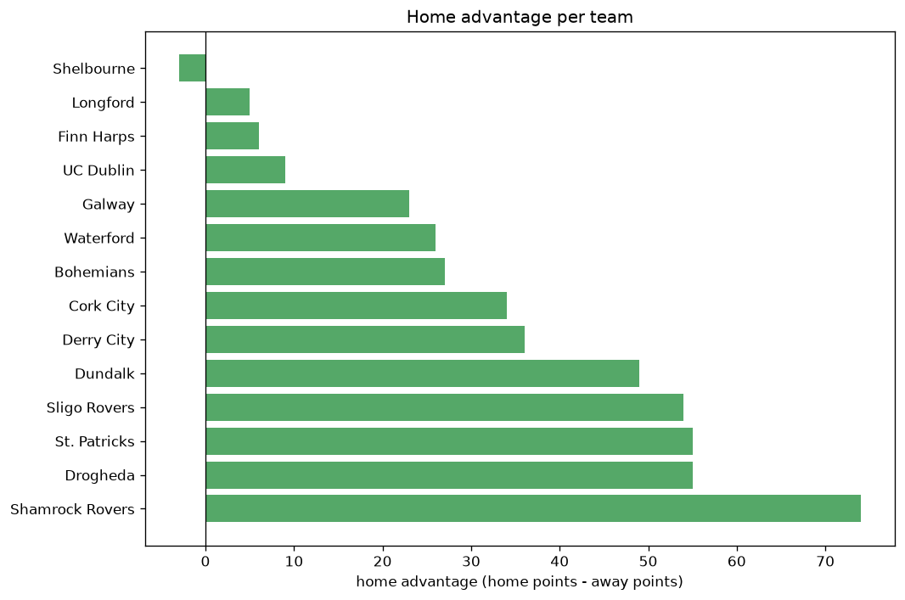

# Team Analysis
- Report: `teams_analysis`
- Generated: 2026-10-26T01:36:48+00:00
- Script: `backend/scripts/analyze_teams.py` v1.0.0
- League: Premier Division (Ireland)
- Scope: league `ireland1`

- Teams: **14** | Seasons: **7** | Matches: **1164**

## 1. Team standings (lifetime)
| team | seasons | played | W | D | L | pts | GF | GA | GD | avg pts/season | best pos | worst pos | titles |
|---|---|---|---|---|---|---|---|---|---|---|---|---|---|
| Shamrock Rovers | 7 | 233 | 139 | 55 | 39 | 472 | 395 | 187 | 208 | 67.43 | 1 | 2 | 6 |
| St. Patricks | 7 | 233 | 107 | 56 | 70 | 377 | 332 | 235 | 97 | 53.86 | 2 | 6 | 0 |
| Derry City | 7 | 233 | 98 | 76 | 59 | 370 | 325 | 226 | 99 | 52.86 | 2 | 7 | 0 |
| Bohemians | 7 | 233 | 98 | 57 | 78 | 351 | 328 | 268 | 60 | 50.14 | 2 | 8 | 0 |
| Shelbourne | 6 | 197 | 74 | 69 | 54 | 291 | 235 | 209 | 26 | 48.5 | 1 | 9 | 1 |
| Sligo Rovers | 7 | 232 | 76 | 54 | 102 | 282 | 253 | 316 | -63 | 40.29 | 3 | 10 | 0 |
| Dundalk | 6 | 196 | 69 | 56 | 71 | 263 | 253 | 251 | 2 | 43.83 | 3 | 10 | 0 |
| Drogheda | 6 | 215 | 59 | 68 | 88 | 245 | 240 | 308 | -68 | 40.83 | 6 | 9 | 0 |
| Waterford | 5 | 161 | 52 | 34 | 75 | 190 | 188 | 244 | -56 | 38.0 | 5 | 9 | 0 |
| Galway | 3 | 107 | 32 | 37 | 38 | 133 | 116 | 124 | -8 | 44.33 | 5 | 8 | 0 |
| Finn Harps | 3 | 90 | 20 | 24 | 46 | 84 | 92 | 147 | -55 | 28.0 | 8 | 10 | 0 |
| Cork City | 3 | 90 | 14 | 24 | 52 | 66 | 78 | 155 | -77 | 22.0 | 9 | 10 | 0 |
| UC Dublin | 2 | 72 | 8 | 13 | 51 | 37 | 47 | 163 | -116 | 18.5 | 9 | 10 | 0 |
| Longford | 1 | 36 | 2 | 9 | 25 | 15 | 22 | 71 | -49 | 15.0 | 10 | 10 | 0 |

## 2. Home vs away split
| team | home P | H-W | H-D | H-L | H-pts | away P | A-W | A-D | A-L | A-pts | adv |
|---|---|---|---|---|---|---|---|---|---|---|---|
| Shamrock Rovers | 117 | 83 | 24 | 10 | 273 | 116 | 56 | 31 | 29 | 199 | 74 |
| St. Patricks | 116 | 64 | 24 | 28 | 216 | 117 | 43 | 32 | 42 | 161 | 55 |
| Drogheda | 107 | 38 | 36 | 33 | 150 | 108 | 21 | 32 | 55 | 95 | 55 |
| Sligo Rovers | 115 | 46 | 30 | 39 | 168 | 117 | 30 | 24 | 63 | 114 | 54 |
| Dundalk | 98 | 44 | 24 | 30 | 156 | 98 | 25 | 32 | 41 | 107 | 49 |
| Derry City | 117 | 54 | 41 | 22 | 203 | 116 | 44 | 35 | 37 | 167 | 36 |
| Cork City | 45 | 12 | 14 | 19 | 50 | 45 | 2 | 10 | 33 | 16 | 34 |
| Bohemians | 117 | 54 | 27 | 36 | 189 | 116 | 44 | 30 | 42 | 162 | 27 |
| Waterford | 81 | 29 | 21 | 31 | 108 | 80 | 23 | 13 | 44 | 82 | 26 |
| Galway | 54 | 20 | 18 | 16 | 78 | 53 | 12 | 19 | 22 | 55 | 23 |
| UC Dublin | 36 | 5 | 8 | 23 | 23 | 36 | 3 | 5 | 28 | 14 | 9 |
| Finn Harps | 45 | 11 | 12 | 22 | 45 | 45 | 9 | 12 | 24 | 39 | 6 |
| Longford | 18 | 2 | 4 | 12 | 10 | 18 | 0 | 5 | 13 | 5 | 5 |
| Shelbourne | 98 | 37 | 33 | 28 | 144 | 99 | 37 | 36 | 26 | 147 | -3 |

## 3. Top performers
### Best points per game (PPG)
| rank | team | PPG |
|---|---|---|
| 1 | Shamrock Rovers | 2.03 |
| 2 | St. Patricks | 1.62 |
| 3 | Derry City | 1.59 |
| 4 | Bohemians | 1.51 |
| 5 | Shelbourne | 1.48 |

### Most goals scored
| rank | team | goals |
|---|---|---|
| 1 | Shamrock Rovers | 395 |
| 2 | St. Patricks | 332 |
| 3 | Bohemians | 328 |
| 4 | Derry City | 325 |
| 5 | Sligo Rovers | 253 |

### Best goal difference
| rank | team | GD |
|---|---|---|
| 1 | Shamrock Rovers | 208 |
| 2 | Derry City | 99 |
| 3 | St. Patricks | 97 |
| 4 | Bohemians | 60 |
| 5 | Shelbourne | 26 |

### Best defence (goals against per match, standings)
| rank | team | GA/match |
|---|---|---|
| 1 | Shamrock Rovers | 0.803 |
| 2 | Derry City | 0.970 |
| 3 | St. Patricks | 1.009 |
| 4 | Shelbourne | 1.061 |
| 5 | Bohemians | 1.150 |

## 4. Team consistency
- Teams present in all **7** seasons: **5**

Bohemians, Derry City, Shamrock Rovers, Sligo Rovers, St. Patricks

## 5. Head-to-head dominance
- Distinct fixtures: **84** (showing the 15 most frequent)

| fixture | meetings | home wins | draws | away wins | home pct | draw pct | away pct |
|---|---|---|---|---|---|---|---|
| Bohemians vs Shamrock Rovers | 26 | 18 | 3 | 5 | 69.2% | 11.5% | 19.2% |
| Sligo Rovers vs St. Patricks | 26 | 14 | 4 | 8 | 53.8% | 15.4% | 30.8% |
| Shamrock Rovers vs St. Patricks | 26 | 13 | 6 | 7 | 50.0% | 23.1% | 26.9% |
| St. Patricks vs Derry City | 26 | 13 | 8 | 5 | 50.0% | 30.8% | 19.2% |
| Bohemians vs Sligo Rovers | 26 | 11 | 4 | 11 | 42.3% | 15.4% | 42.3% |
| Shamrock Rovers vs Derry City | 26 | 11 | 8 | 7 | 42.3% | 30.8% | 26.9% |
| Shamrock Rovers vs Sligo Rovers | 26 | 11 | 6 | 9 | 42.3% | 23.1% | 34.6% |
| Bohemians vs Derry City | 26 | 9 | 9 | 8 | 34.6% | 34.6% | 30.8% |
| Sligo Rovers vs Derry City | 25 | 13 | 8 | 4 | 52.0% | 32.0% | 16.0% |
| Bohemians vs St. Patricks | 25 | 10 | 7 | 8 | 40.0% | 28.0% | 32.0% |
| Sligo Rovers vs Drogheda | 24 | 13 | 9 | 2 | 54.2% | 37.5% | 8.3% |
| Derry City vs Drogheda | 24 | 11 | 9 | 4 | 45.8% | 37.5% | 16.7% |
| Bohemians vs Drogheda | 24 | 10 | 6 | 8 | 41.7% | 25.0% | 33.3% |
| St. Patricks vs Drogheda | 24 | 10 | 6 | 8 | 41.7% | 25.0% | 33.3% |
| Shamrock Rovers vs Drogheda | 24 | 9 | 8 | 7 | 37.5% | 33.3% | 29.2% |

## 6. Position per season (classic view)
_Cells show final position; '-' when the team was absent from that season._

| team | 2020 | 2021 | 2022 | 2023 | 2024 | 2025 | 2026 |
|---|---|---|---|---|---|---|---|
| Shamrock Rovers | 1 | 1 | 1 | 1 | 2 | 1 | 1 |
| St. Patricks | 6 | 2 | 4 | 3 | 3 | 5 | 3 |
| Derry City | 7 | 4 | 2 | 2 | 4 | 2 | 5 |
| Bohemians | 2 | 5 | 6 | 6 | 8 | 4 | 2 |
| Shelbourne | 9 | - | 7 | 4 | 1 | 3 | 4 |
| Sligo Rovers | 4 | 3 | 5 | 8 | 6 | 7 | 10 |
| Dundalk | 3 | 6 | 3 | 5 | 10 | - | 7 |
| Drogheda | - | 7 | 8 | 7 | 9 | 6 | 9 |
| Waterford | 5 | 9 | - | - | 7 | 9 | 8 |
| Galway | - | - | - | - | 5 | 8 | 6 |
| Finn Harps | 8 | 8 | 10 | - | - | - | - |
| Cork City | 10 | - | - | 9 | - | 10 | - |
| UC Dublin | - | - | 9 | 10 | - | - | - |
| Longford | - | 10 | - | - | - | - | - |

---
*All statistics are computed from PostgreSQL tables (read-only). Run with `python backend/scripts/analyze_teams.py` to regenerate.*

## Charts

