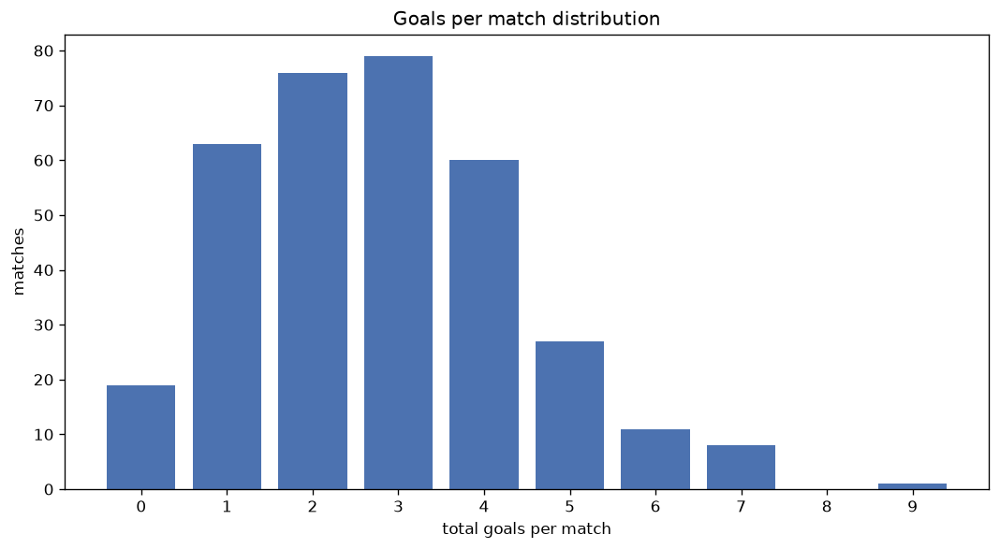
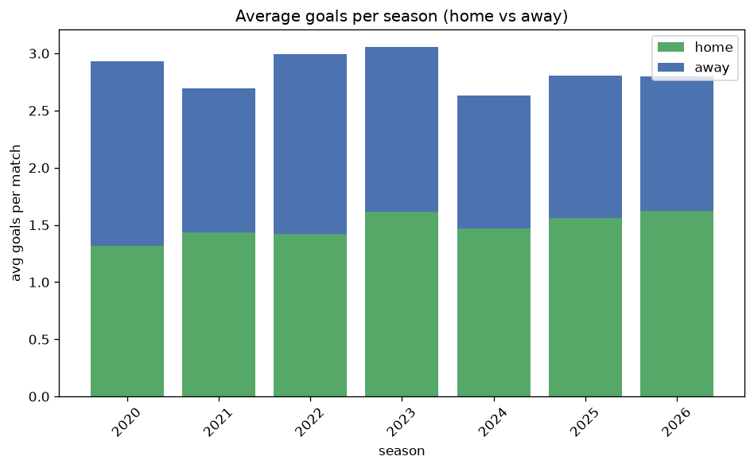

# Goal Analysis
- Report: `goals_analysis`
- Generated: 2026-10-30T03:57:44+00:00
- Script: `backend/scripts/analyze_goals.py` v1.0.0
- League: Division 1 (Ireland)
- Scope: league `ireland2`

## 1. Goals per match distribution
| goals | matches | pct |
|---|---|---|
| 0 | 68 | 6.3% |
| 1 | 186 | 17.1% |
| 2 | 240 | 22.1% |
| 3 | 239 | 22.0% |
| 4 | 181 | 16.7% |
| 5 | 93 | 8.6% |
| 6 | 52 | 4.8% |
| 7 | 21 | 1.9% |
| 8 | 4 | 0.4% |
| 9 | 1 | 0.1% |
| 10 | 1 | 0.1% |

## 2. Goals per match per season
| season | matches | total goals | avg home | avg away | avg total |
|---|---|---|---|---|---|
| 2020 | 88 | 258 | 1.318 | 1.614 | 2.932 |
| 2021 | 135 | 364 | 1.437 | 1.259 | 2.696 |
| 2022 | 144 | 431 | 1.417 | 1.576 | 2.993 |
| 2023 | 180 | 550 | 1.617 | 1.439 | 3.056 |
| 2024 | 180 | 473 | 1.467 | 1.161 | 2.628 |
| 2025 | 179 | 502 | 1.559 | 1.246 | 2.804 |
| 2026 | 180 | 504 | 1.622 | 1.178 | 2.8 |

## 3. Home vs away goal share
- Home goals: **1640** (53.2%)
- Away goals: **1442** (46.8%)
- Home/away ratio: **1.137**

| season | home goals | away goals | total | home pct | away pct |
|---|---|---|---|---|---|
| 2020 | 116 | 142 | 258 | 45.0% | 55.0% |
| 2021 | 194 | 170 | 364 | 53.3% | 46.7% |
| 2022 | 204 | 227 | 431 | 47.3% | 52.7% |
| 2023 | 291 | 259 | 550 | 52.9% | 47.1% |
| 2024 | 264 | 209 | 473 | 55.8% | 44.2% |
| 2025 | 279 | 223 | 502 | 55.6% | 44.4% |
| 2026 | 292 | 212 | 504 | 57.9% | 42.1% |

## 4. BTTS (Both Teams To Score)
- Overall: **575** of `1086` (52.9%)

| season | matches | BTTS | pct |
|---|---|---|---|
| 2020 | 88 | 40 | 45.5% |
| 2021 | 135 | 69 | 51.1% |
| 2022 | 144 | 80 | 55.6% |
| 2023 | 180 | 95 | 52.8% |
| 2024 | 180 | 98 | 54.4% |
| 2025 | 179 | 97 | 54.2% |
| 2026 | 180 | 96 | 53.3% |

## 5. Clean sheets
- Home clean sheets: **311** (28.6%)
- Away clean sheets: **268** (24.7%)
- Total clean sheets recorded: **579**
- Matches with at least one clean sheet: **511** (47.1%)
- Both teams kept clean sheets (0-0): **68**

| season | matches | home CS | away CS | total CS | matches w/ CS |
|---|---|---|---|---|---|
| 2020 | 88 | 21 | 33 | 54 | 48 (54.5%) |
| 2021 | 135 | 43 | 36 | 79 | 66 (48.9%) |
| 2022 | 144 | 40 | 36 | 76 | 64 (44.4%) |
| 2023 | 180 | 46 | 48 | 94 | 85 (47.2%) |
| 2024 | 180 | 61 | 30 | 91 | 82 (45.6%) |
| 2025 | 179 | 45 | 47 | 92 | 82 (45.8%) |
| 2026 | 180 | 55 | 38 | 93 | 84 (46.7%) |

## 6. Scoring intensity
- First-half goals: **1344** (43.7%)
- Second-half goals: **1732** (56.3%)
- Avg first-half goals per match: **1.24**
- Avg second-half goals per match: **1.598**
- Second-half-only scoring (HT 0-0, FT goals >= 1): **243** (22.4%)
- *2 match(es) excluded (no HT score recorded).*

| season | matches | 1st half | 2nd half | 1st half pct | 2nd half pct |
|---|---|---|---|---|---|
| 2020 | 88 | 104 | 154 | 40.3% | 59.7% |
| 2021 | 135 | 152 | 209 | 42.1% | 57.9% |
| 2022 | 144 | 185 | 246 | 42.9% | 57.1% |
| 2023 | 180 | 250 | 300 | 45.5% | 54.5% |
| 2024 | 180 | 218 | 255 | 46.1% | 53.9% |
| 2025 | 179 | 221 | 278 | 44.3% | 55.7% |
| 2026 | 180 | 214 | 290 | 42.5% | 57.5% |

## 7. First-goal timing
- Matches with first-goal time recorded: `1016` of `1086` (93.6%)
- Goalless matches: `70`
- Min `1` | Max `99` | Mean `30.08` | Median (p50) `24.0`

| bucket | count | % of matches | % of scoring matches |
|---|---|---|---|
| 1-15 | 352 | 32.4% | 34.6% |
| 16-30 | 246 | 22.7% | 24.2% |
| 31-45 | 160 | 14.7% | 15.7% |
| 46-60 | 129 | 11.9% | 12.7% |
| 61-75 | 79 | 7.3% | 7.8% |
| 76-90 | 40 | 3.7% | 3.9% |
| 91-120 | 10 | 0.9% | 1.0% |

---
*All statistics are computed from PostgreSQL tables (read-only). Run with `python backend/scripts/analyze_goals.py` to regenerate.*

## Charts

