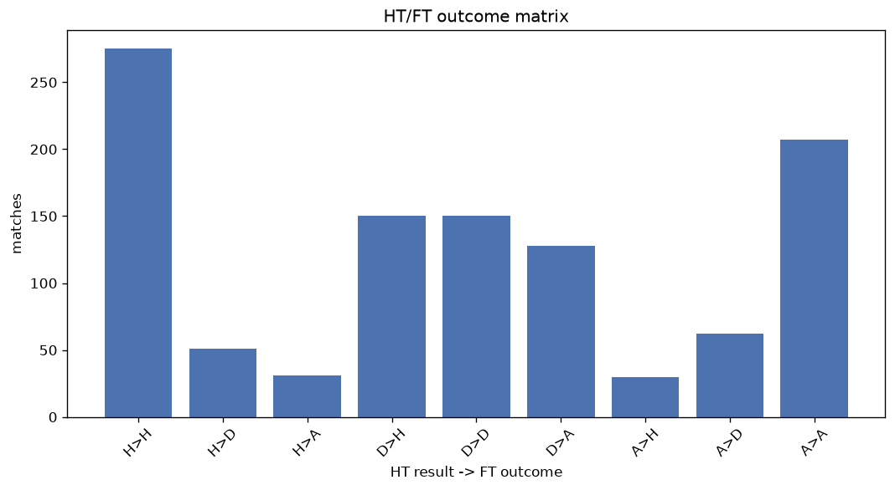
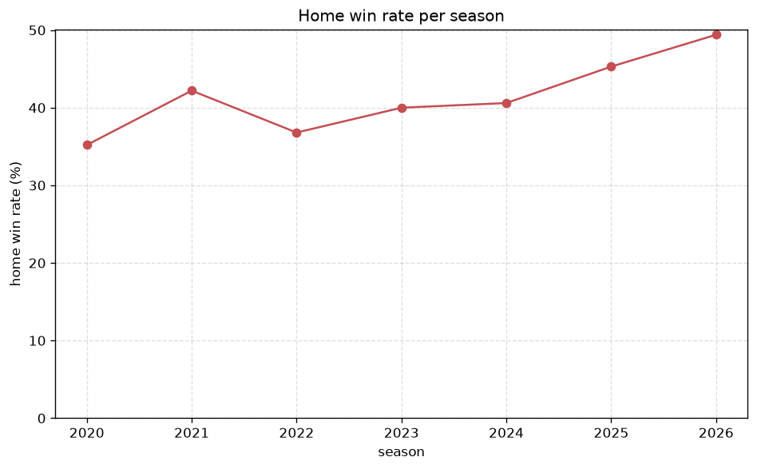

# Match Analysis
- Report: `matches_analysis`
- Generated: 2026-10-26T01:37:01+00:00
- Script: `backend/scripts/analyze_matches.py` v1.0.0
- League: Division 1 (Ireland)
- Scope: league `ireland2`

## 1. Overall summary
| metric | value |
|---|---|
| Matches | 1086 |
| Home wins | 456 (42.0%) |
| Draws | 263 (24.2%) |
| Away wins | 367 (33.8%) |
| Total goals | 3082 |
| Average goals per match | 2.838 |
| Goalless matches | 68 (6.3%) |

## 2. Per-season breakdown
| season | matches | home wins | draws | away wins | total goals | avg goals | goalless |
|---|---|---|---|---|---|---|---|
| 2020 | 88 | 31 (35.2%) | 15 (17.0%) | 42 (47.7%) | 258 | 2.932 | 6 (6.8%) |
| 2021 | 135 | 57 (42.2%) | 32 (23.7%) | 46 (34.1%) | 364 | 2.696 | 13 (9.6%) |
| 2022 | 144 | 53 (36.8%) | 35 (24.3%) | 56 (38.9%) | 431 | 2.993 | 12 (8.3%) |
| 2023 | 180 | 72 (40.0%) | 43 (23.9%) | 65 (36.1%) | 550 | 3.056 | 9 (5.0%) |
| 2024 | 180 | 73 (40.6%) | 54 (30.0%) | 53 (29.4%) | 473 | 2.628 | 9 (5.0%) |
| 2025 | 179 | 81 (45.3%) | 42 (23.5%) | 56 (31.3%) | 502 | 2.804 | 10 (5.6%) |
| 2026 | 180 | 89 (49.4%) | 42 (23.3%) | 49 (27.2%) | 504 | 2.8 | 9 (5.0%) |

## 3. HT/FT outcome matrix
| HT result \ FT result | Home | Draw | Away | total |
|---|---|---|---|---|
| HT home lead | 275 (77.0%) | 51 (14.3%) | 31 (8.7%) | 357 |
| HT draw | 150 (35.0%) | 150 (35.0%) | 128 (29.9%) | 428 |
| HT away lead | 30 (10.0%) | 62 (20.7%) | 207 (69.2%) | 299 |
- *2 match(es) excluded (no HT score recorded).*

## 4. Comeback matches
- Home comebacks (trailing at HT, won at FT): **30** (2.8%)
- Away comebacks (trailing at HT, won at FT): **31** (2.9%)

### Home comebacks
| season | home | away | HT | FT |
|---|---|---|---|---|
| 2020 | Longford | UC Dublin | 0-1 | 3-1 |
| 2020 | Wexford | Longford | 0-1 | 2-1 |
| 2021 | UC Dublin | Treaty United | 1-2 | 3-2 |
| 2021 | Athlone | Cobh Ramblers | 0-1 | 2-1 |
| 2021 | Galway | Athlone | 0-1 | 2-1 |
| 2021 | Cobh Ramblers | Wexford | 0-1 | 3-2 |
| 2021 | Wexford | Bray | 1-2 | 4-2 |
| 2022 | Waterford | Cobh Ramblers | 1-2 | 4-2 |
| 2022 | Athlone | Cork City | 1-2 | 3-2 |
| 2023 | Athlone | Finn Harps | 0-1 | 3-1 |
| 2023 | Treaty United | Athlone | 0-1 | 2-1 |
| 2023 | Wexford | Kerry | 0-1 | 3-2 |
| 2024 | Longford | Treaty United | 0-1 | 2-1 |
| 2024 | Cork City | Longford | 1-2 | 3-2 |
| 2025 | Longford | Kerry | 1-2 | 3-2 |
| 2025 | Finn Harps | Kerry | 1-2 | 4-2 |
| 2025 | Longford | Athlone | 1-2 | 3-2 |
| 2025 | Wexford | Kerry | 1-3 | 4-3 |
| 2025 | Wexford | Finn Harps | 0-1 | 2-1 |
| 2025 | Bray | Treaty United | 0-1 | 3-2 |
| 2025 | Bray | Finn Harps | 1-2 | 3-2 |
| 2026 | UC Dublin | Kerry | 0-1 | 2-1 |
| 2026 | Bray | Kerry | 0-1 | 2-1 |
| 2026 | Wexford | Bray | 0-1 | 2-1 |
| 2026 | Cork City | Kerry | 0-2 | 4-2 |
| 2026 | Cobh Ramblers | Finn Harps | 0-1 | 3-1 |
| 2026 | Treaty United | Kerry | 0-1 | 2-1 |
| 2026 | Longford | UC Dublin | 0-1 | 2-1 |
| 2026 | Cork City | Kerry | 0-1 | 3-1 |
| 2026 | UC Dublin | Finn Harps | 1-2 | 5-4 |

### Away comebacks
| season | home | away | HT | FT |
|---|---|---|---|---|
| 2020 | Wexford | Bray | 1-0 | 1-3 |
| 2020 | UC Dublin | Drogheda | 1-0 | 1-3 |
| 2020 | Longford | Galway | 2-1 | 2-6 |
| 2020 | Athlone | UC Dublin | 1-0 | 2-4 |
| 2021 | Cobh Ramblers | Shelbourne | 1-0 | 1-2 |
| 2021 | Athlone | UC Dublin | 2-1 | 2-3 |
| 2021 | Cork City | Treaty United | 2-1 | 2-3 |
| 2021 | Wexford | Galway | 1-0 | 1-3 |
| 2021 | Bray | Cabinteely | 1-0 | 1-2 |
| 2022 | Cobh Ramblers | Wexford | 1-0 | 2-3 |
| 2022 | Treaty United | Galway | 1-0 | 2-3 |
| 2022 | Athlone | Cork City | 1-0 | 1-2 |
| 2022 | Waterford | Longford | 1-0 | 1-2 |
| 2023 | Bray | Waterford | 1-0 | 1-2 |
| 2023 | Longford | Finn Harps | 1-0 | 2-3 |
| 2023 | Treaty United | Longford | 2-1 | 2-3 |
| 2023 | Bray | Longford | 1-0 | 2-4 |
| 2023 | Treaty United | Wexford | 1-0 | 1-2 |
| 2024 | Longford | Finn Harps | 2-1 | 2-3 |
| 2024 | Kerry | Bray | 1-0 | 2-3 |
| 2024 | Wexford | Finn Harps | 1-0 | 1-2 |
| 2024 | Wexford | Bray | 1-0 | 1-2 |
| 2024 | Athlone | Wexford | 2-0 | 2-3 |
| 2024 | Treaty United | Athlone | 1-0 | 1-2 |
| 2024 | Finn Harps | Treaty United | 1-0 | 1-2 |
| 2025 | Treaty United | Cobh Ramblers | 1-0 | 2-3 |
| 2025 | Wexford | Dundalk | 2-1 | 2-3 |
| 2025 | Athlone | Longford | 1-0 | 1-2 |
| 2026 | Cobh Ramblers | UC Dublin | 1-0 | 1-2 |
| 2026 | Cork City | Cobh Ramblers | 1-0 | 2-3 |
| 2026 | Finn Harps | Kerry | 1-0 | 1-2 |

## 5. HT lead conversion
| HT state | matches | converted to win | held as draw | collapsed to loss |
|---|---|---|---|---|
| Home lead | 357 | 275 (77.0%) | 51 (14.3%) | 31 (8.7%) |
| Away lead | 299 | 207 (69.2%) | 62 (20.7%) | 30 (10.0%) |

### Matches level at half-time
| FT result | count | pct |
|---|---|---|
| Home win | 150 | 35.0% |
| Draw | 150 | 35.0% |
| Away win | 128 | 29.9% |
- *2 match(es) excluded (no HT score recorded).*

## 6. First-goal timing
- Matches with a first-goal time recorded: `1016` of `1086` (93.6%)

Outcome distribution by first-goal timing bucket:
| bucket | matches | % of matches | home | draw | away |
|---|---|---|---|---|---|
| 1-15 | 352 | 32.4% | 159 (45.2%) | 70 (19.9%) | 123 (34.9%) |
| 16-30 | 246 | 22.7% | 105 (42.7%) | 51 (20.7%) | 90 (36.6%) |
| 31-45 | 160 | 14.7% | 77 (48.1%) | 28 (17.5%) | 55 (34.4%) |
| 46-60 | 129 | 11.9% | 55 (42.6%) | 24 (18.6%) | 50 (38.8%) |
| 61-75 | 79 | 7.3% | 39 (49.4%) | 15 (19.0%) | 25 (31.6%) |
| 76-90 | 40 | 3.7% | 13 (32.5%) | 7 (17.5%) | 20 (50.0%) |
| 91-120 | 10 | 0.9% | 7 (70.0%) | 0 (0.0%) | 3 (30.0%) |

## 7. Goalless matches
- Overall: **68** of `1086` (6.3%)

| season | matches | goalless | pct |
|---|---|---|---|
| 2020 | 88 | 6 | 6.8% |
| 2021 | 135 | 13 | 9.6% |
| 2022 | 144 | 12 | 8.3% |
| 2023 | 180 | 9 | 5.0% |
| 2024 | 180 | 9 | 5.0% |
| 2025 | 179 | 10 | 5.6% |
| 2026 | 180 | 9 | 5.0% |

---
*All statistics are computed from PostgreSQL tables (read-only). Run with `python backend/scripts/analyze_matches.py` to regenerate.*

## Charts

