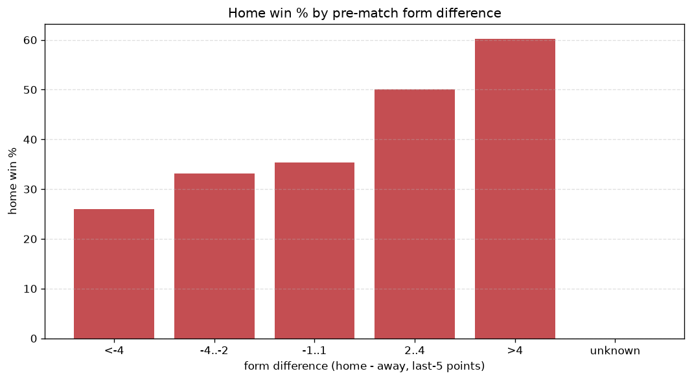
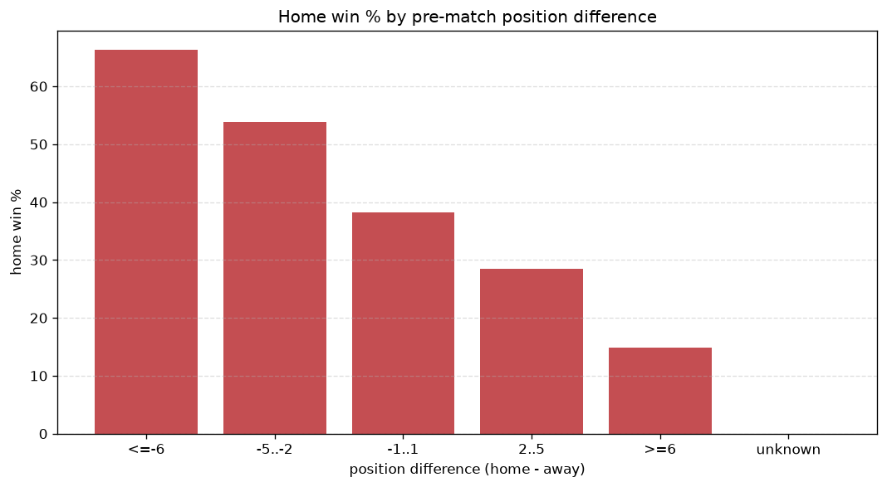

# Relationships Analysis
- Report: `relationships`
- Generated: 2026-10-26T01:37:11+00:00
- Script: `backend/scripts/analyze_relationships.py` v1.0.0
- League: Division 1 (Ireland)
- Scope: league `ireland2`

- Matches analysed: **906** (23 leakage-safe pre-match features).

## 1. Correlation matrix
_Pearson correlation of each pre-match feature with observed goals; sorted by |corr(total goals)|._

| feature | corr(home) | corr(away) | corr(total) |
|---|---|---|---|
| home_points_before_match | 0.191 | -0.124 | 0.059 |
| away_points_before_match | -0.045 | 0.110 | 0.045 |
| home_rest_days | -0.054 | 0.003 | -0.041 |
| away_team_goals_scored_last_5 | -0.091 | 0.151 | 0.040 |
| away_team_goals_conceded_last_5 | 0.140 | -0.102 | 0.035 |
| away_rest_days | -0.048 | 0.006 | -0.033 |
| rest_days_difference | -0.028 | -0.015 | -0.033 |
| home_team_home_conceded_avg | -0.092 | 0.143 | 0.032 |
| away_team_away_conceded_avg | 0.147 | -0.117 | 0.030 |
| away_team_away_goals_avg | -0.103 | 0.072 | -0.028 |
| away_position_before_match | 0.204 | -0.184 | 0.026 |
| home_team_home_win_rate | 0.148 | -0.184 | -0.019 |
| away_team_away_win_rate | -0.130 | 0.115 | -0.018 |
| points_difference | 0.271 | -0.268 | 0.017 |
| home_team_goals_scored_last_5 | 0.121 | -0.110 | 0.015 |
| home_team_home_goals_avg | 0.138 | -0.167 | -0.015 |
| home_position_before_match | -0.179 | 0.212 | 0.015 |
| home_team_wins_last_5 | 0.139 | -0.167 | -0.013 |
| home_team_points_last_5 | 0.144 | -0.172 | -0.013 |
| position_difference | -0.272 | 0.280 | -0.008 |
| away_team_points_last_5 | -0.129 | 0.131 | -0.005 |
| home_team_goals_conceded_last_5 | -0.113 | 0.126 | 0.003 |
| away_team_wins_last_5 | -0.137 | 0.144 | -0.002 |

## 2. Form vs outcome
_Home win/draw/away % per bucket of `home_team_points_last_5 - away_team_points_last_5`._

| bucket | matches | home | draw | away | home % | draw % | away % |
|---|---|---|---|---|---|---|---|
| <-4 | 177 | 46 | 41 | 90 | 26.0% | 23.2% | 50.8% |
| -4..-2 | 157 | 52 | 38 | 67 | 33.1% | 24.2% | 42.7% |
| -1..1 | 229 | 81 | 66 | 82 | 35.4% | 28.8% | 35.8% |
| 2..4 | 182 | 91 | 44 | 47 | 50.0% | 24.2% | 25.8% |
| >4 | 161 | 97 | 32 | 32 | 60.2% | 19.9% | 19.9% |
| unknown | 0 | 0 | 0 | 0 | - | - | - |

## 3. Position vs outcome
_Home win/draw/away % per bucket of `position_difference` (home position - away position; negative favours the home team)._

| bucket | matches | home | draw | away | home % | draw % | away % |
|---|---|---|---|---|---|---|---|
| <=-6 | 83 | 55 | 19 | 9 | 66.3% | 22.9% | 10.8% |
| -5..-2 | 271 | 146 | 65 | 60 | 53.9% | 24.0% | 22.1% |
| -1..1 | 212 | 81 | 53 | 78 | 38.2% | 25.0% | 36.8% |
| 2..5 | 253 | 72 | 64 | 117 | 28.5% | 25.3% | 46.2% |
| >=6 | 87 | 13 | 20 | 54 | 14.9% | 23.0% | 62.1% |
| unknown | 0 | 0 | 0 | 0 | - | - | - |

## 4. Rest advantage
_Home win/draw/away % per bucket of `rest_days_difference` (home rest - away rest). Matches with unknown rest are bucketed separately._

| bucket | matches | home | draw | away | home % | draw % | away % |
|---|---|---|---|---|---|---|---|
| <-1 | 61 | 25 | 19 | 17 | 41.0% | 31.1% | 27.9% |
| -1..0 | 68 | 24 | 19 | 25 | 35.3% | 27.9% | 36.8% |
| 0 | 595 | 252 | 137 | 206 | 42.4% | 23.0% | 34.6% |
| 1..2 | 75 | 33 | 19 | 23 | 44.0% | 25.3% | 30.7% |
| >2 | 74 | 25 | 20 | 29 | 33.8% | 27.0% | 39.2% |
| unknown | 33 | 8 | 7 | 18 | 24.2% | 21.2% | 54.5% |
- *33 match(es) had unknown rest difference (missing rest data on at least one side).*

## 5. Home team quality
_Home win rate by `home_team_home_win_rate` tier (split at 0.5)._

- `< 0.5` tier: **35.1%** home win (207/589)
- `>= 0.5` tier: **50.5%** home win (160/317)
- Home-win gap (>= split minus < split): **+15.4 pp**

| tier | label | matches | home | draw | away | home % |
|---|---|---|---|---|---|---|
| low | < 0.5 | 589 | 207 | 143 | 239 | 35.1% |
| high | >= 0.5 | 317 | 160 | 78 | 79 | 50.5% |

## 6. Feature averages by result
_Mean feature value per outcome; `range` is home-minus-away spread of the group means._

| feature | home mean | draw mean | away mean | range |
|---|---|---|---|---|
| points_difference | 5.131 | -0.548 | -5.601 | 10.731 |
| home_points_before_match | 24.722 | 21.670 | 17.456 | 7.266 |
| away_points_before_match | 19.591 | 22.217 | 23.057 | 3.465 |
| position_difference | -1.540 | 0.100 | 1.673 | 3.212 |
| away_rest_days | 7.072 | 9.484 | 7.980 | 2.411 |
| home_rest_days | 7.192 | 9.477 | 8.342 | 2.285 |
| away_position_before_match | 6.169 | 5.321 | 4.478 | 1.691 |
| home_team_points_last_5 | 6.970 | 6.181 | 5.321 | 1.649 |
| home_position_before_match | 4.629 | 5.421 | 6.151 | 1.522 |
| away_team_points_last_5 | 5.548 | 6.367 | 6.962 | 1.415 |
| away_team_goals_conceded_last_5 | 6.981 | 6.100 | 5.689 | 1.292 |
| home_team_goals_scored_last_5 | 6.951 | 6.208 | 5.767 | 1.184 |
| home_team_goals_conceded_last_5 | 5.956 | 6.213 | 7.006 | 1.050 |
| away_team_goals_scored_last_5 | 5.834 | 6.516 | 6.827 | 0.993 |
| home_team_wins_last_5 | 1.962 | 1.697 | 1.421 | 0.540 |
| away_team_wins_last_5 | 1.455 | 1.756 | 1.972 | 0.517 |
| rest_days_difference | 0.120 | 0.009 | 0.357 | 0.347 |
| home_team_home_goals_avg | 1.459 | 1.286 | 1.154 | 0.305 |
| away_team_away_conceded_avg | 1.466 | 1.293 | 1.193 | 0.273 |
| home_team_home_conceded_avg | 1.150 | 1.262 | 1.393 | 0.242 |
| away_team_away_goals_avg | 1.121 | 1.349 | 1.322 | 0.229 |
| home_team_home_win_rate | 0.413 | 0.354 | 0.292 | 0.121 |
| away_team_away_win_rate | 0.284 | 0.349 | 0.387 | 0.103 |

---
*All features are leakage-safe pre-match values built by `ml.features.build_features.build_rows` from strictly prior matches. Run with `python backend/scripts/analyze_relationships.py` to regenerate.*

## Charts

