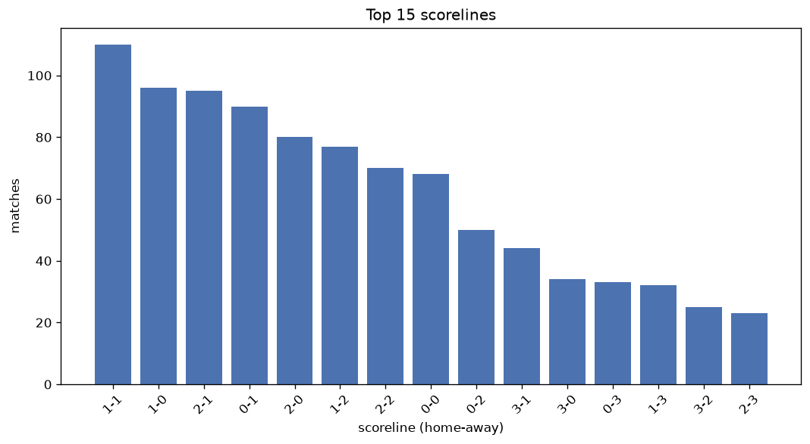
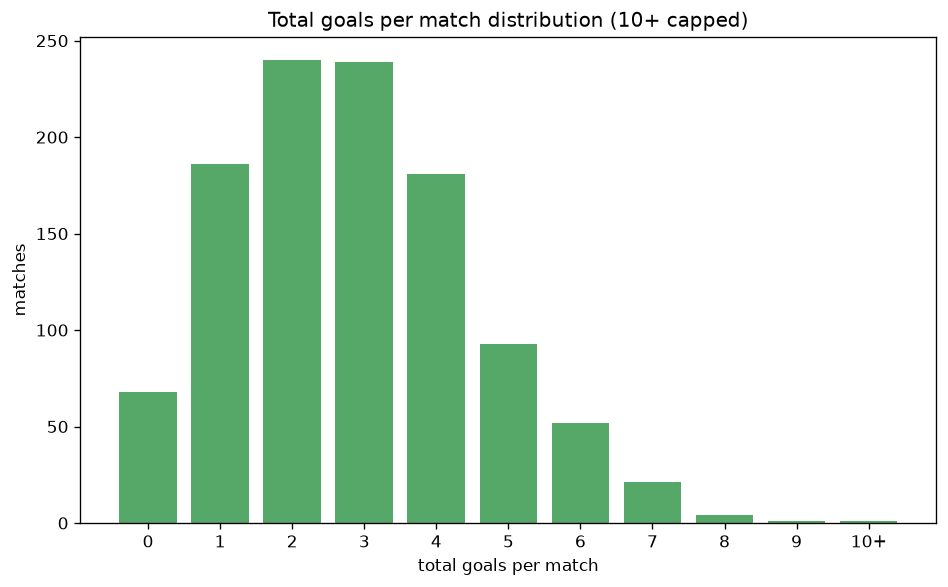

# Scoreline Analysis
- Report: `scoreline_analysis`
- Generated: 2026-10-26T01:37:09+00:00
- Script: `backend/scripts/analyze_scorelines.py` v1.0.0
- League: Division 1 (Ireland)
- Scope: league `ireland2`

## 1. Scoreline frequency
- Matches analysed: **1086** across **7** seasons.
- Distinct scorelines seen: **41**.

| scoreline | count | pct |
|---|---|---|
| 1-1 | 110 | 10.1% |
| 1-0 | 96 | 8.8% |
| 2-1 | 95 | 8.7% |
| 0-1 | 90 | 8.3% |
| 2-0 | 80 | 7.4% |
| 1-2 | 77 | 7.1% |
| 2-2 | 70 | 6.4% |
| 0-0 | 68 | 6.3% |
| 0-2 | 50 | 4.6% |
| 3-1 | 44 | 4.1% |
| 3-0 | 34 | 3.1% |
| 0-3 | 33 | 3.0% |
| 1-3 | 32 | 2.9% |
| 3-2 | 25 | 2.3% |
| 2-3 | 23 | 2.1% |
| 4-0 | 18 | 1.7% |
| 0-4 | 17 | 1.6% |
| 1-4 | 17 | 1.6% |
| 4-1 | 17 | 1.6% |
| 3-3 | 14 | 1.3% |

## 2. Scoreline frequency per season

### 2020
| scoreline | count | pct |
|---|---|---|
| 0-1 | 11 | 12.5% |
| 0-2 | 8 | 9.1% |
| 1-3 | 7 | 8.0% |
| 2-0 | 6 | 6.8% |
| 1-0 | 6 | 6.8% |

### 2021
| scoreline | count | pct |
|---|---|---|
| 1-0 | 16 | 11.9% |
| 2-1 | 14 | 10.4% |
| 1-2 | 13 | 9.6% |
| 0-0 | 13 | 9.6% |
| 1-1 | 11 | 8.1% |

### 2022
| scoreline | count | pct |
|---|---|---|
| 1-2 | 14 | 9.7% |
| 2-0 | 13 | 9.0% |
| 1-1 | 13 | 9.0% |
| 2-1 | 12 | 8.3% |
| 0-0 | 12 | 8.3% |

### 2023
| scoreline | count | pct |
|---|---|---|
| 1-1 | 18 | 10.0% |
| 0-1 | 17 | 9.4% |
| 1-0 | 15 | 8.3% |
| 2-2 | 14 | 7.8% |
| 2-1 | 12 | 6.7% |

### 2024
| scoreline | count | pct |
|---|---|---|
| 1-1 | 26 | 14.4% |
| 1-0 | 21 | 11.7% |
| 2-0 | 20 | 11.1% |
| 1-2 | 18 | 10.0% |
| 0-1 | 14 | 7.8% |

### 2025
| scoreline | count | pct |
|---|---|---|
| 1-1 | 21 | 11.7% |
| 0-1 | 19 | 10.6% |
| 2-1 | 16 | 8.9% |
| 1-0 | 13 | 7.3% |
| 3-1 | 12 | 6.7% |

### 2026
| scoreline | count | pct |
|---|---|---|
| 2-1 | 26 | 14.4% |
| 2-0 | 18 | 10.0% |
| 1-1 | 17 | 9.4% |
| 1-0 | 17 | 9.4% |
| 0-1 | 15 | 8.3% |

## 3. Total-goal histogram
_10+ groups all matches with 10 or more total goals._

| total goals | matches | pct |
|---|---|---|
| 0 | 68 | 6.3% |
| 1 | 186 | 17.1% |
| 2 | 240 | 22.1% |
| 3 | 239 | 22.0% |
| 4 | 181 | 16.7% |
| 5 | 93 | 8.6% |
| 6 | 52 | 4.8% |
| 7 | 21 | 1.9% |
| 8 | 4 | 0.4% |
| 9 | 1 | 0.1% |
| 10+ | 1 | 0.1% |

## 4. Extreme scorelines
- Matches with 7+ total goals: **27**

| season | date | scoreline | total goals |
|---|---|---|---|
| 2023 | 2023-03-10 | 9-1 | 10 |
| 2026 | 2026-08-28 | 5-4 | 9 |
| 2020 | 2020-09-04 | 8-0 | 8 |
| 2020 | 2020-10-03 | 2-6 | 8 |
| 2021 | 2021-07-02 | 4-4 | 8 |
| 2023 | 2023-03-31 | 7-1 | 8 |
| 2020 | 2020-09-26 | 2-5 | 7 |
| 2021 | 2021-09-03 | 4-3 | 7 |
| 2021 | 2021-09-10 | 5-2 | 7 |
| 2022 | 2022-02-18 | 2-5 | 7 |
| 2022 | 2022-06-10 | 5-2 | 7 |
| 2022 | 2022-06-27 | 2-5 | 7 |
| 2022 | 2022-08-05 | 6-1 | 7 |
| 2023 | 2023-04-21 | 4-3 | 7 |
| 2023 | 2023-06-02 | 7-0 | 7 |
| 2023 | 2023-06-30 | 6-1 | 7 |
| 2023 | 2023-07-14 | 4-3 | 7 |
| 2024 | 2024-03-22 | 3-4 | 7 |
| 2025 | 2025-06-27 | 4-3 | 7 |
| 2025 | 2025-08-08 | 6-1 | 7 |
| 2025 | 2025-08-22 | 0-7 | 7 |
| 2025 | 2025-10-17 | 3-4 | 7 |
| 2026 | 2026-05-15 | 3-4 | 7 |
| 2026 | 2026-06-19 | 5-2 | 7 |
| 2026 | 2026-07-10 | 3-4 | 7 |
| 2026 | 2026-07-24 | 5-2 | 7 |
| 2026 | 2026-10-16 | 2-5 | 7 |

## 5. Margin-of-victory distribution (decided matches)
- Decided matches: **823** (draws: **263**)
- Average winning margin: **1.88**

| margin | matches | pct |
|---|---|---|
| 1 | 415 | 50.4% |
| 2 | 221 | 26.9% |
| 3+ | 187 | 22.7% |

## 6. Margin by outcome

### Home wins
- Matches: **456** | avg margin: **1.91** | max margin: **8**
| margin | matches | pct |
|---|---|---|
| 1 | 221 | 48.5% |
| 2 | 134 | 29.4% |
| 3+ | 101 | 22.1% |
- *Full match-by-match list available in `scoreline_analysis.json`.*

### Away wins
- Matches: **367** | avg margin: **1.84** | max margin: **7**
| margin | matches | pct |
|---|---|---|
| 1 | 194 | 52.9% |
| 2 | 87 | 23.7% |
| 3+ | 86 | 23.4% |
- *Full match-by-match list available in `scoreline_analysis.json`.*

## 7. Most common exact score by outcome type
| outcome | matches | most common score | count | pct |
|---|---|---|---|---|
| home | 456 | 1-0 | 96 | 21.1% |
| draw | 263 | 1-1 | 110 | 41.8% |
| away | 367 | 0-1 | 90 | 24.5% |

---
*All statistics are computed from PostgreSQL tables (read-only). Run with `python backend/scripts/analyze_scorelines.py` to regenerate.*

## Charts

