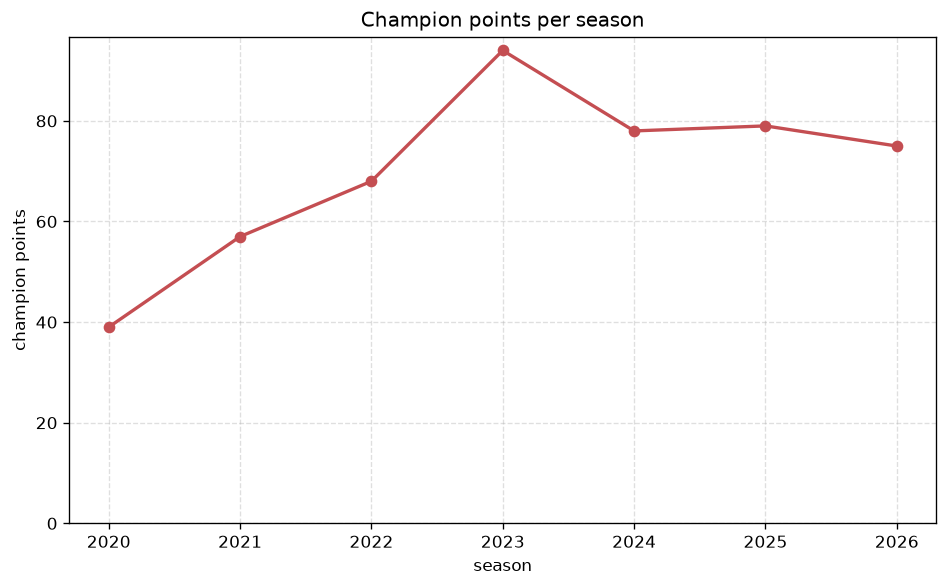
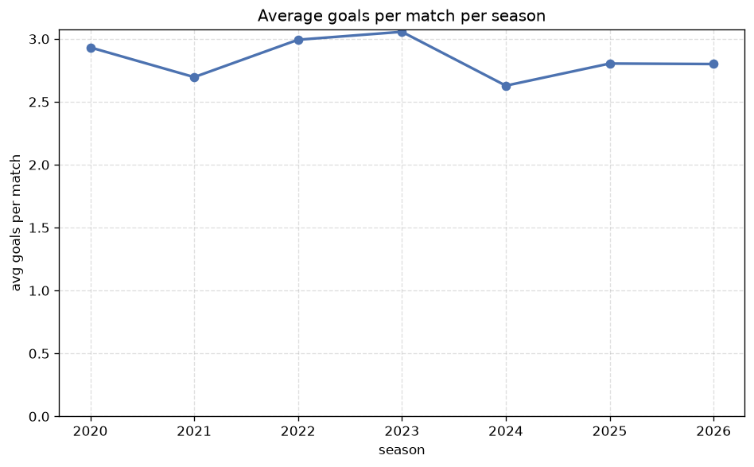

# Season Trends Analysis
- Report: `season_trends`
- Generated: 2026-10-26T01:37:07+00:00
- Script: `backend/scripts/analyze_seasons.py` v1.0.0
- League: Division 1 (Ireland)
- Scope: league `ireland2`

## 1. Champions per season
| season | champion | pts | runner-up | margin |
|---|---|---|---|---|
| 2020 | Drogheda | 39 | Bray | 1 pts |
| 2021 | Shelbourne | 57 | Galway | 6 pts |
| 2022 | Cork City | 68 | Waterford | 4 pts |
| 2023 | Galway | 94 | Waterford | 25 pts |
| 2024 | Cork City | 78 | UC Dublin | 22 pts |
| 2025 | Dundalk | 79 | Cobh Ramblers | 10 pts |
| 2026 | Cork City | 75 | UC Dublin | 19 pts |

## 2. Title-race tightness
- Tight races (margin <= 3 pts): **1** of 7 seasons
- Tightest race: **2020** - Drogheda beat Bray by **1** pts

| season | margin | tight |
|---|---|---|
| 2020 | 1 pts | yes |
| 2021 | 6 pts |  |
| 2022 | 4 pts |  |
| 2023 | 25 pts |  |
| 2024 | 22 pts |  |
| 2025 | 10 pts |  |
| 2026 | 19 pts |  |

## 3. Points thresholds
_Position-specific points per season. Key: 1 = champion, 2 = runner-up, 4 = CL line, 6 = Europa, 7 = last safe, 10 = bottom._

| season | pos 1 | pos 2 | pos 4 | pos 6 | pos 7 | pos 10 |
|---|---|---|---|---|---|---|
| 2020 | 39 | 38 | 29 | 26 | 24 | 12 |
| 2021 | 57 | 51 | 42 | 33 | 33 | 21 |
| 2022 | 68 | 64 | 52 | 41 | 27 | - |
| 2023 | 94 | 69 | 53 | 44 | 44 | 10 |
| 2024 | 78 | 56 | 55 | 46 | 44 | 27 |
| 2025 | 79 | 69 | 59 | 45 | 44 | 20 |
| 2026 | 75 | 56 | 52 | 49 | 48 | 28 |

## 4. Relegation battle
| season | safe pos | safe pts | drop pos | drop pts | gap |
|---|---|---|---|---|---|
| 2020 | 7 | 24 | 8 | 12 | 12 pts |
| 2021 | 7 | 33 | 8 | 28 | 5 pts |
| 2022 | 7 | 27 | 8 | 24 | 3 pts |
| 2023 | 7 | 44 | 8 | 40 | 4 pts |
| 2024 | 7 | 44 | 8 | 44 | 0 pts |
| 2025 | 7 | 44 | 8 | 36 | 8 pts |
| 2026 | 7 | 48 | 8 | 42 | 6 pts |

## 5. League-level trends
| season | matches | total goals | avg goals | home win | draw | away win | goalless | avg pts/team |
|---|---|---|---|---|---|---|---|---|
| 2020 | 88 | 258 | 2.932 | 35.2% | 17.0% | 47.7% | 6.8% | 24.9 |
| 2021 | 135 | 364 | 2.696 | 42.2% | 23.7% | 34.1% | 9.6% | 37.3 |
| 2022 | 144 | 431 | 2.993 | 36.8% | 24.3% | 38.9% | 8.3% | 44.11 |
| 2023 | 180 | 550 | 3.056 | 40.0% | 23.9% | 36.1% | 5.0% | 49.7 |
| 2024 | 180 | 473 | 2.628 | 40.6% | 30.0% | 29.4% | 5.0% | 48.6 |
| 2025 | 179 | 502 | 2.804 | 45.3% | 23.5% | 31.3% | 5.6% | 49.5 |
| 2026 | 180 | 504 | 2.8 | 49.4% | 23.3% | 27.2% | 5.0% | 49.8 |

## 6. View divergence
- Largest divergence: **2021** (goals view, avg abs position diff = 4.200)

_Avg absolute position difference between classic view and alternative view per season._

| season | classic vs luck | classic vs goals |
|---|---|---|
| 2020 | 2.000 | 3.600 |
| 2021 | 2.400 | 4.200 |
| 2022 | 1.556 | 4.000 |
| 2023 | 2.200 | 2.800 |
| 2024 | 1.200 | 3.600 |
| 2025 | 1.200 | 2.200 |
| 2026 | 2.400 | 2.400 |

---
*All statistics are computed from PostgreSQL tables (read-only). Run with `python backend/scripts/analyze_seasons.py` to regenerate.*

## Charts

