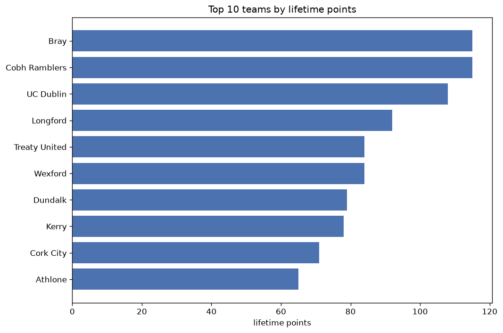
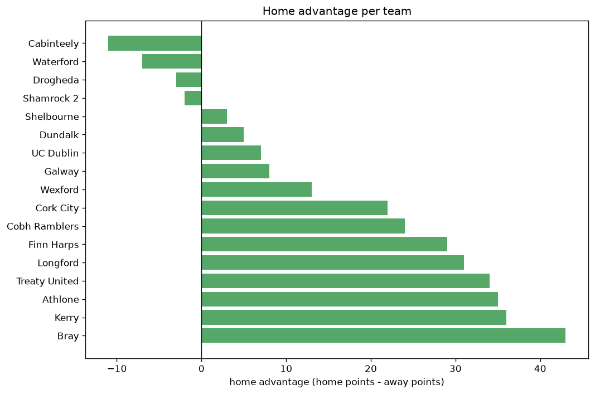

# Team Analysis
- Report: `teams_analysis`
- Generated: 2026-10-29T02:04:27+00:00
- Script: `backend/scripts/analyze_teams.py` v1.0.0
- League: Division 1 (Ireland)
- Scope: league `ireland2`

- Teams: **17** | Seasons: **7** | Matches: **1086**

## 1. Team standings (lifetime)
| team | seasons | played | W | D | L | pts | GF | GA | GD | avg pts/season | best pos | worst pos | titles |
|---|---|---|---|---|---|---|---|---|---|---|---|---|---|
| Bray | 7 | 221 | 86 | 55 | 80 | 313 | 328 | 321 | 7 | 44.71 | 2 | 7 | 0 |
| Cobh Ramblers | 7 | 220 | 82 | 44 | 94 | 290 | 298 | 343 | -45 | 41.43 | 2 | 9 | 0 |
| Wexford | 7 | 219 | 72 | 53 | 94 | 269 | 282 | 350 | -68 | 38.43 | 3 | 10 | 0 |
| Treaty United | 6 | 203 | 69 | 57 | 77 | 264 | 251 | 275 | -24 | 44.0 | 4 | 9 | 0 |
| Cork City | 4 | 131 | 73 | 35 | 23 | 254 | 238 | 108 | 130 | 63.5 | 1 | 6 | 3 |
| UC Dublin | 5 | 153 | 69 | 40 | 44 | 247 | 263 | 195 | 68 | 49.4 | 2 | 4 | 0 |
| Longford | 6 | 194 | 65 | 52 | 77 | 247 | 247 | 284 | -37 | 41.17 | 4 | 9 | 0 |
| Athlone | 7 | 221 | 64 | 47 | 110 | 239 | 274 | 383 | -109 | 34.14 | 4 | 10 | 0 |
| Galway | 4 | 113 | 69 | 25 | 19 | 232 | 219 | 91 | 128 | 58.0 | 1 | 5 | 1 |
| Finn Harps | 4 | 143 | 36 | 39 | 68 | 147 | 153 | 242 | -89 | 36.75 | 6 | 10 | 0 |
| Waterford | 2 | 68 | 40 | 13 | 15 | 133 | 154 | 66 | 88 | 66.5 | 2 | 2 | 0 |
| Kerry | 4 | 143 | 28 | 38 | 77 | 122 | 146 | 245 | -99 | 30.5 | 4 | 10 | 0 |
| Dundalk | 1 | 36 | 23 | 10 | 3 | 79 | 74 | 31 | 43 | 79.0 | 1 | 1 | 1 |
| Shelbourne | 1 | 27 | 16 | 9 | 2 | 57 | 49 | 23 | 26 | 57.0 | 1 | 1 | 1 |
| Cabinteely | 2 | 45 | 16 | 3 | 26 | 51 | 48 | 80 | -32 | 25.5 | 6 | 9 | 0 |
| Drogheda | 1 | 18 | 12 | 3 | 3 | 39 | 39 | 17 | 22 | 39.0 | 1 | 1 | 1 |
| Shamrock 2 | 1 | 17 | 3 | 3 | 11 | 12 | 19 | 28 | -9 | 12.0 | 8 | 8 | 0 |

## 2. Home vs away split
| team | home P | H-W | H-D | H-L | H-pts | away P | A-W | A-D | A-L | A-pts | adv |
|---|---|---|---|---|---|---|---|---|---|---|---|
| Bray | 110 | 51 | 25 | 34 | 178 | 111 | 35 | 30 | 46 | 135 | 43 |
| Kerry | 71 | 20 | 19 | 32 | 79 | 72 | 8 | 19 | 45 | 43 | 36 |
| Athlone | 110 | 37 | 26 | 47 | 137 | 111 | 27 | 21 | 63 | 102 | 35 |
| Treaty United | 101 | 41 | 26 | 34 | 149 | 102 | 28 | 31 | 43 | 115 | 34 |
| Longford | 97 | 39 | 22 | 36 | 139 | 97 | 26 | 30 | 41 | 108 | 31 |
| Finn Harps | 72 | 22 | 22 | 28 | 88 | 71 | 14 | 17 | 40 | 59 | 29 |
| Cobh Ramblers | 109 | 44 | 25 | 40 | 157 | 111 | 38 | 19 | 54 | 133 | 24 |
| Cork City | 66 | 41 | 15 | 10 | 138 | 65 | 32 | 20 | 13 | 116 | 22 |
| Wexford | 110 | 38 | 27 | 45 | 141 | 109 | 34 | 26 | 49 | 128 | 13 |
| Galway | 57 | 36 | 12 | 9 | 120 | 56 | 33 | 13 | 10 | 112 | 8 |
| UC Dublin | 77 | 35 | 22 | 20 | 127 | 76 | 34 | 18 | 24 | 120 | 7 |
| Dundalk | 18 | 12 | 6 | 0 | 42 | 18 | 11 | 4 | 3 | 37 | 5 |
| Shelbourne | 14 | 8 | 6 | 0 | 30 | 13 | 8 | 3 | 2 | 27 | 3 |
| Shamrock 2 | 8 | 1 | 2 | 5 | 5 | 9 | 2 | 1 | 6 | 7 | -2 |
| Drogheda | 9 | 6 | 0 | 3 | 18 | 9 | 6 | 3 | 0 | 21 | -3 |
| Waterford | 34 | 19 | 6 | 9 | 63 | 34 | 21 | 7 | 6 | 70 | -7 |
| Cabinteely | 23 | 6 | 2 | 15 | 20 | 22 | 10 | 1 | 11 | 31 | -11 |

## 3. Top performers
### Best points per game (PPG)
| rank | team | PPG |
|---|---|---|
| 1 | Dundalk | 2.19 |
| 2 | Drogheda | 2.17 |
| 3 | Shelbourne | 2.11 |
| 4 | Galway | 2.05 |
| 5 | Waterford | 1.96 |

### Most goals scored
| rank | team | goals |
|---|---|---|
| 1 | Bray | 328 |
| 2 | Cobh Ramblers | 298 |
| 3 | Wexford | 282 |
| 4 | Athlone | 274 |
| 5 | UC Dublin | 263 |

### Best goal difference
| rank | team | GD |
|---|---|---|
| 1 | Cork City | 130 |
| 2 | Galway | 128 |
| 3 | Waterford | 88 |
| 4 | UC Dublin | 68 |
| 5 | Dundalk | 43 |

### Best defence (goals against per match, standings)
| rank | team | GA/match |
|---|---|---|
| 1 | Galway | 0.805 |
| 2 | Cork City | 0.824 |
| 3 | Shelbourne | 0.852 |
| 4 | Dundalk | 0.861 |
| 5 | Drogheda | 0.944 |

## 4. Team consistency
- Teams present in all **7** seasons: **4**

Athlone, Bray, Cobh Ramblers, Wexford

## 5. Head-to-head dominance
- Distinct fixtures: **109** (showing the 15 most frequent)

| fixture | meetings | home wins | draws | away wins | home pct | draw pct | away pct |
|---|---|---|---|---|---|---|---|
| Bray vs Athlone | 25 | 14 | 3 | 8 | 56.0% | 12.0% | 32.0% |
| Cobh Ramblers vs Athlone | 25 | 13 | 4 | 8 | 52.0% | 16.0% | 32.0% |
| Bray vs Wexford | 25 | 12 | 6 | 7 | 48.0% | 24.0% | 28.0% |
| Bray vs Cobh Ramblers | 25 | 11 | 7 | 7 | 44.0% | 28.0% | 28.0% |
| Wexford vs Athlone | 25 | 9 | 6 | 10 | 36.0% | 24.0% | 40.0% |
| Cobh Ramblers vs Wexford | 24 | 11 | 4 | 9 | 45.8% | 16.7% | 37.5% |
| Athlone vs Treaty United | 23 | 12 | 5 | 6 | 52.2% | 21.7% | 26.1% |
| Bray vs Treaty United | 23 | 11 | 8 | 4 | 47.8% | 34.8% | 17.4% |
| Cobh Ramblers vs Treaty United | 23 | 10 | 5 | 8 | 43.5% | 21.7% | 34.8% |
| Wexford vs Treaty United | 23 | 7 | 7 | 9 | 30.4% | 30.4% | 39.1% |
| Longford vs Cobh Ramblers | 22 | 11 | 6 | 5 | 50.0% | 27.3% | 22.7% |
| Longford vs Wexford | 22 | 11 | 4 | 7 | 50.0% | 18.2% | 31.8% |
| Longford vs Athlone | 22 | 8 | 8 | 6 | 36.4% | 36.4% | 27.3% |
| Longford vs Bray | 22 | 6 | 6 | 10 | 27.3% | 27.3% | 45.5% |
| Longford vs Treaty United | 20 | 9 | 4 | 7 | 45.0% | 20.0% | 35.0% |

## 6. Position per season (classic view)
_Cells show final position; '-' when the team was absent from that season._

| team | 2020 | 2021 | 2022 | 2023 | 2024 | 2025 | 2026 |
|---|---|---|---|---|---|---|---|
| Bray | 2 | 5 | 7 | 7 | 5 | 3 | 3 |
| Cobh Ramblers | 7 | 8 | 9 | 3 | 8 | 2 | 6 |
| Wexford | 9 | 10 | 6 | 4 | 3 | 7 | 8 |
| Treaty United | - | 4 | 5 | 6 | 7 | 5 | 9 |
| Cork City | - | 6 | 1 | - | 1 | - | 1 |
| UC Dublin | 3 | 3 | - | - | 2 | 4 | 2 |
| Longford | 4 | - | 4 | 8 | 9 | 6 | 5 |
| Athlone | 10 | 7 | 8 | 5 | 4 | 10 | 7 |
| Galway | 5 | 2 | 3 | 1 | - | - | - |
| Finn Harps | - | - | - | 9 | 6 | 8 | 10 |
| Waterford | - | - | 2 | 2 | - | - | - |
| Kerry | - | - | - | 10 | 10 | 9 | 4 |
| Dundalk | - | - | - | - | - | 1 | - |
| Shelbourne | - | 1 | - | - | - | - | - |
| Cabinteely | 6 | 9 | - | - | - | - | - |
| Drogheda | 1 | - | - | - | - | - | - |
| Shamrock 2 | 8 | - | - | - | - | - | - |

---
*All statistics are computed from PostgreSQL tables (read-only). Run with `python backend/scripts/analyze_teams.py` to regenerate.*

## Charts

