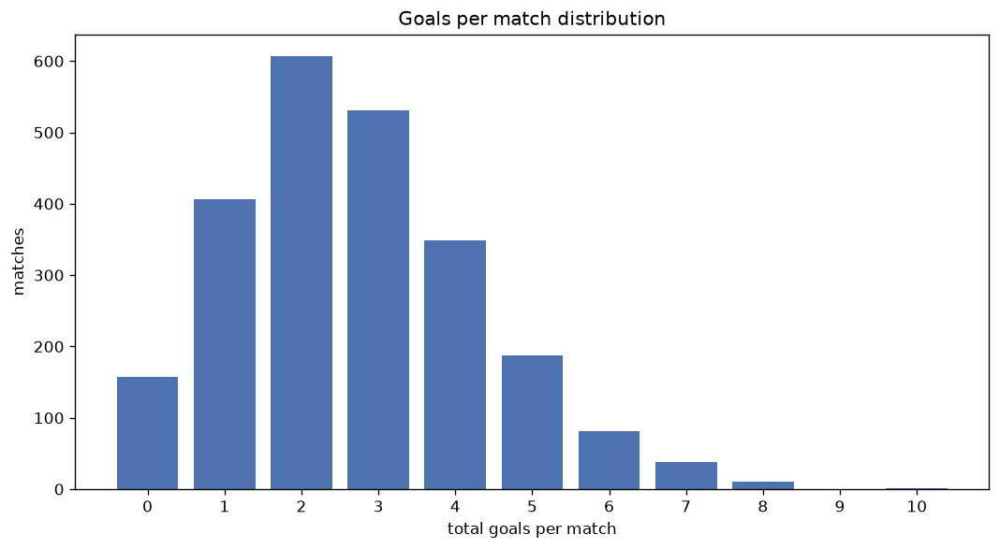
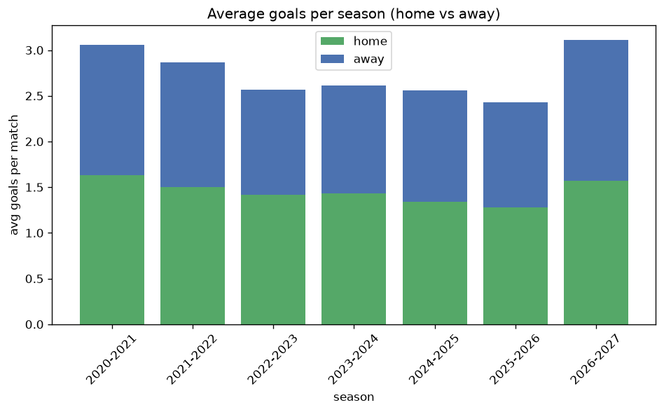

# Goal Analysis
- Report: `goals_analysis`
- Generated: 2026-10-30T03:58:07+00:00
- Script: `backend/scripts/analyze_goals.py` v1.0.0
- League: Serie A (Italy)
- Scope: league `italy1`

## 1. Goals per match distribution
| goals | matches | pct |
|---|---|---|
| 0 | 157 | 6.6% |
| 1 | 407 | 17.2% |
| 2 | 607 | 25.6% |
| 3 | 531 | 22.4% |
| 4 | 349 | 14.7% |
| 5 | 187 | 7.9% |
| 6 | 81 | 3.4% |
| 7 | 38 | 1.6% |
| 8 | 10 | 0.4% |
| 9 | 0 | 0.0% |
| 10 | 1 | 0.0% |

## 2. Goals per match per season
| season | matches | total goals | avg home | avg away | avg total |
|---|---|---|---|---|---|
| 2020-2021 | 380 | 1163 | 1.634 | 1.426 | 3.061 |
| 2021-2022 | 380 | 1089 | 1.503 | 1.363 | 2.866 |
| 2022-2023 | 380 | 974 | 1.413 | 1.15 | 2.563 |
| 2023-2024 | 380 | 992 | 1.434 | 1.176 | 2.611 |
| 2024-2025 | 380 | 973 | 1.339 | 1.221 | 2.561 |
| 2025-2026 | 380 | 922 | 1.276 | 1.15 | 2.426 |
| 2026-2027 | 88 | 274 | 1.568 | 1.545 | 3.114 |

## 3. Home vs away goal share
- Home goals: **3406** (53.3%)
- Away goals: **2981** (46.7%)
- Home/away ratio: **1.143**

| season | home goals | away goals | total | home pct | away pct |
|---|---|---|---|---|---|
| 2020-2021 | 621 | 542 | 1163 | 53.4% | 46.6% |
| 2021-2022 | 571 | 518 | 1089 | 52.4% | 47.6% |
| 2022-2023 | 537 | 437 | 974 | 55.1% | 44.9% |
| 2023-2024 | 545 | 447 | 992 | 54.9% | 45.1% |
| 2024-2025 | 509 | 464 | 973 | 52.3% | 47.7% |
| 2025-2026 | 485 | 437 | 922 | 52.6% | 47.4% |
| 2026-2027 | 138 | 136 | 274 | 50.4% | 49.6% |

## 4. BTTS (Both Teams To Score)
- Overall: **1253** of `2368` (52.9%)

| season | matches | BTTS | pct |
|---|---|---|---|
| 2020-2021 | 380 | 227 | 59.7% |
| 2021-2022 | 380 | 218 | 57.4% |
| 2022-2023 | 380 | 191 | 50.3% |
| 2023-2024 | 380 | 199 | 52.4% |
| 2024-2025 | 380 | 196 | 51.6% |
| 2025-2026 | 380 | 172 | 45.3% |
| 2026-2027 | 88 | 50 | 56.8% |

## 5. Clean sheets
- Home clean sheets: **696** (29.4%)
- Away clean sheets: **576** (24.3%)
- Total clean sheets recorded: **1272**
- Matches with at least one clean sheet: **1115** (47.1%)
- Both teams kept clean sheets (0-0): **157**

| season | matches | home CS | away CS | total CS | matches w/ CS |
|---|---|---|---|---|---|
| 2020-2021 | 380 | 94 | 78 | 172 | 153 (40.3%) |
| 2021-2022 | 380 | 105 | 79 | 184 | 162 (42.6%) |
| 2022-2023 | 380 | 116 | 93 | 209 | 189 (49.7%) |
| 2023-2024 | 380 | 125 | 86 | 211 | 181 (47.6%) |
| 2024-2025 | 380 | 111 | 101 | 212 | 184 (48.4%) |
| 2025-2026 | 380 | 125 | 119 | 244 | 208 (54.7%) |
| 2026-2027 | 88 | 20 | 20 | 40 | 38 (43.2%) |

## 6. Scoring intensity
- First-half goals: **2797** (43.8%)
- Second-half goals: **3587** (56.2%)
- Avg first-half goals per match: **1.182**
- Avg second-half goals per match: **1.515**
- Second-half-only scoring (HT 0-0, FT goals >= 1): **542** (22.9%)
- *1 match(es) excluded (no HT score recorded).*

| season | matches | 1st half | 2nd half | 1st half pct | 2nd half pct |
|---|---|---|---|---|---|
| 2020-2021 | 380 | 495 | 665 | 42.7% | 57.3% |
| 2021-2022 | 380 | 493 | 596 | 45.3% | 54.7% |
| 2022-2023 | 380 | 439 | 535 | 45.1% | 54.9% |
| 2023-2024 | 380 | 429 | 563 | 43.2% | 56.8% |
| 2024-2025 | 380 | 424 | 549 | 43.6% | 56.4% |
| 2025-2026 | 380 | 396 | 526 | 43.0% | 57.0% |
| 2026-2027 | 88 | 121 | 153 | 44.2% | 55.8% |

## 7. First-goal timing
- Matches with first-goal time recorded: `2210` of `2368` (93.3%)
- Goalless matches: `158`
- Min `1` | Max `101` | Mean `31.03` | Median (p50) `26.0`

| bucket | count | % of matches | % of scoring matches |
|---|---|---|---|
| 1-15 | 730 | 30.8% | 33.0% |
| 16-30 | 529 | 22.3% | 23.9% |
| 31-45 | 366 | 15.5% | 16.6% |
| 46-60 | 300 | 12.7% | 13.6% |
| 61-75 | 165 | 7.0% | 7.5% |
| 76-90 | 91 | 3.8% | 4.1% |
| 91-120 | 29 | 1.2% | 1.3% |

---
*All statistics are computed from PostgreSQL tables (read-only). Run with `python backend/scripts/analyze_goals.py` to regenerate.*

## Charts

