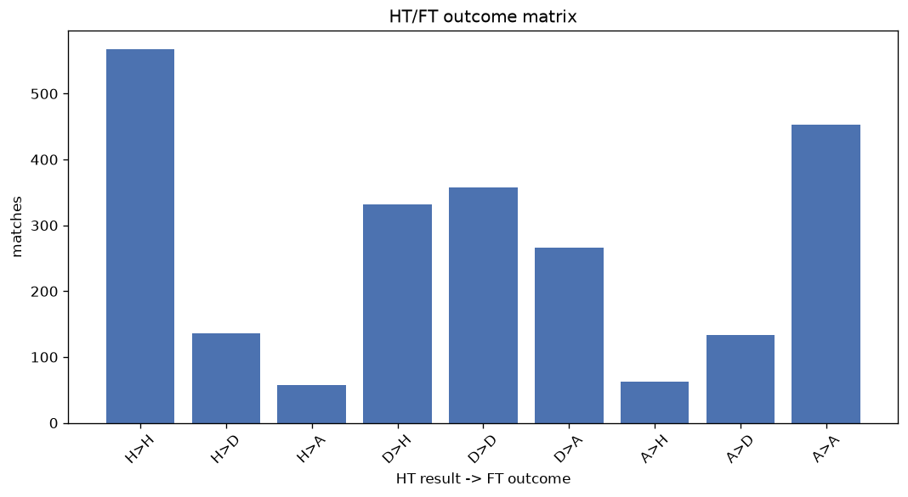
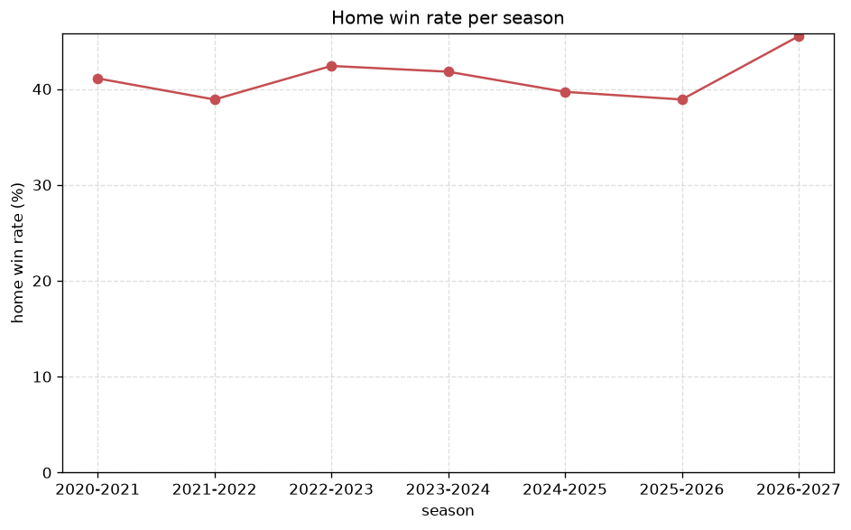

# Match Analysis
- Report: `matches_analysis`
- Generated: 2026-10-30T03:58:05+00:00
- Script: `backend/scripts/analyze_matches.py` v1.0.0
- League: Serie A (Italy)
- Scope: league `italy1`

## 1. Overall summary
| metric | value |
|---|---|
| Matches | 2368 |
| Home wins | 963 (40.7%) |
| Draws | 628 (26.5%) |
| Away wins | 777 (32.8%) |
| Total goals | 6387 |
| Average goals per match | 2.697 |
| Goalless matches | 157 (6.6%) |

## 2. Per-season breakdown
| season | matches | home wins | draws | away wins | total goals | avg goals | goalless |
|---|---|---|---|---|---|---|---|
| 2020-2021 | 380 | 156 (41.1%) | 96 (25.3%) | 128 (33.7%) | 1163 | 3.061 | 19 (5.0%) |
| 2021-2022 | 380 | 148 (38.9%) | 98 (25.8%) | 134 (35.3%) | 1089 | 2.866 | 22 (5.8%) |
| 2022-2023 | 380 | 161 (42.4%) | 100 (26.3%) | 119 (31.3%) | 974 | 2.563 | 20 (5.3%) |
| 2023-2024 | 380 | 159 (41.8%) | 112 (29.5%) | 109 (28.7%) | 992 | 2.611 | 30 (7.9%) |
| 2024-2025 | 380 | 151 (39.7%) | 108 (28.4%) | 121 (31.8%) | 973 | 2.561 | 28 (7.4%) |
| 2025-2026 | 380 | 148 (38.9%) | 99 (26.1%) | 133 (35.0%) | 922 | 2.426 | 36 (9.5%) |
| 2026-2027 | 88 | 40 (45.5%) | 15 (17.0%) | 33 (37.5%) | 274 | 3.114 | 2 (2.3%) |

## 3. HT/FT outcome matrix
| HT result \ FT result | Home | Draw | Away | total |
|---|---|---|---|---|
| HT home lead | 567 (74.5%) | 136 (17.9%) | 58 (7.6%) | 761 |
| HT draw | 332 (34.7%) | 358 (37.4%) | 266 (27.8%) | 956 |
| HT away lead | 63 (9.7%) | 134 (20.6%) | 453 (69.7%) | 650 |
- *1 match(es) excluded (no HT score recorded).*

## 4. Comeback matches
- Home comebacks (trailing at HT, won at FT): **63** (2.7%)
- Away comebacks (trailing at HT, won at FT): **58** (2.4%)

### Home comebacks
| season | home | away | HT | FT |
|---|---|---|---|---|
| 2020-2021 | Inter | Torino | 0-1 | 4-2 |
| 2020-2021 | Juventus | Torino | 0-1 | 2-1 |
| 2020-2021 | Napoli | Sampdoria | 0-1 | 2-1 |
| 2020-2021 | Atalanta | AS Roma | 0-1 | 4-1 |
| 2020-2021 | Torino | Sassuolo | 0-2 | 3-2 |
| 2020-2021 | Spezia | Crotone | 0-1 | 3-2 |
| 2020-2021 | Sampdoria | Verona | 0-1 | 3-1 |
| 2020-2021 | Sassuolo | Fiorentina | 0-1 | 3-1 |
| 2020-2021 | Cagliari | Parma | 1-2 | 4-3 |
| 2020-2021 | Torino | AS Roma | 0-1 | 3-1 |
| 2021-2022 | Napoli | Juventus | 0-1 | 2-1 |
| 2021-2022 | Verona | AS Roma | 0-1 | 3-2 |
| 2021-2022 | Spezia | Salernitana | 0-1 | 2-1 |
| 2021-2022 | Lazio | Inter | 0-1 | 3-1 |
| 2021-2022 | AC Milan | Verona | 0-2 | 3-2 |
| 2021-2022 | Venezia | AS Roma | 1-2 | 3-2 |
| 2021-2022 | Sampdoria | Verona | 0-1 | 3-1 |
| 2021-2022 | Empoli | Udinese | 0-1 | 3-1 |
| 2021-2022 | Sassuolo | Lazio | 0-1 | 2-1 |
| 2021-2022 | Napoli | Udinese | 0-1 | 2-1 |
| 2021-2022 | AS Roma | Salernitana | 0-1 | 2-1 |
| 2021-2022 | Empoli | Napoli | 0-1 | 3-2 |
| 2022-2023 | Lazio | Bologna | 0-1 | 2-1 |
| 2022-2023 | Bologna | Torino | 0-1 | 2-1 |
| 2022-2023 | Lecce | Lazio | 0-1 | 2-1 |
| 2022-2023 | Atalanta | Empoli | 0-1 | 2-1 |
| 2022-2023 | Verona | Sassuolo | 0-1 | 2-1 |
| 2022-2023 | Inter | Lazio | 0-1 | 3-1 |
| 2022-2023 | Sassuolo | Empoli | 0-1 | 2-1 |
| 2022-2023 | Salernitana | Udinese | 1-2 | 3-2 |
| 2022-2023 | Fiorentina | AS Roma | 0-1 | 2-1 |
| 2023-2024 | Lecce | Lazio | 0-1 | 2-1 |
| 2023-2024 | Bologna | Cagliari | 0-1 | 2-1 |
| 2023-2024 | Frosinone | Sassuolo | 1-2 | 4-2 |
| 2023-2024 | Cagliari | Frosinone | 0-2 | 4-3 |
| 2023-2024 | Salernitana | Lazio | 0-1 | 2-1 |
| 2023-2024 | Cagliari | Sassuolo | 0-1 | 2-1 |
| 2023-2024 | Atalanta | Salernitana | 0-1 | 4-1 |
| 2023-2024 | Frosinone | Cagliari | 0-1 | 3-1 |
| 2023-2024 | Genoa | Lecce | 0-1 | 2-1 |
| 2023-2024 | Bologna | Sassuolo | 1-2 | 4-2 |
| 2023-2024 | Fiorentina | Lazio | 0-1 | 2-1 |
| 2023-2024 | Genoa | Sassuolo | 0-1 | 2-1 |
| 2024-2025 | Napoli | Parma | 0-1 | 2-1 |
| 2024-2025 | Fiorentina | Lazio | 0-1 | 2-1 |
| 2024-2025 | AS Roma | Venezia | 0-1 | 2-1 |
| 2024-2025 | Venezia | Udinese | 1-2 | 3-2 |
| 2024-2025 | Atalanta | Udinese | 0-1 | 2-1 |
| 2024-2025 | Cagliari | Lecce | 0-1 | 4-1 |
| 2024-2025 | Napoli | Juventus | 0-1 | 2-1 |
| 2024-2025 | Juventus | Empoli | 0-1 | 4-1 |
| 2024-2025 | Bologna | AC Milan | 0-1 | 2-1 |
| 2024-2025 | Bologna | Cagliari | 0-1 | 2-1 |
| 2024-2025 | AS Roma | Como | 0-1 | 2-1 |
| 2024-2025 | Inter | Monza | 1-2 | 3-2 |
| 2024-2025 | AC Milan | Como | 0-1 | 2-1 |
| 2025-2026 | Napoli | Genoa | 0-1 | 2-1 |
| 2025-2026 | Torino | Genoa | 0-1 | 2-1 |
| 2025-2026 | Genoa | Bologna | 0-1 | 3-2 |
| 2025-2026 | Atalanta | Napoli | 0-1 | 2-1 |
| 2025-2026 | Napoli | Lecce | 0-1 | 2-1 |
| 2025-2026 | Como | AS Roma | 0-1 | 2-1 |
| 2025-2026 | Sassuolo | Cagliari | 0-1 | 2-1 |

### Away comebacks
| season | home | away | HT | FT |
|---|---|---|---|---|
| 2020-2021 | Sampdoria | Benevento | 2-1 | 2-3 |
| 2020-2021 | Bologna | Sassuolo | 2-1 | 3-4 |
| 2020-2021 | Benevento | Napoli | 1-0 | 1-2 |
| 2020-2021 | Torino | Lazio | 2-1 | 3-4 |
| 2020-2021 | Cagliari | Inter | 1-0 | 1-3 |
| 2020-2021 | Parma | Genoa | 1-0 | 1-2 |
| 2020-2021 | Crotone | Bologna | 2-0 | 2-3 |
| 2020-2021 | AC Milan | Sassuolo | 1-0 | 1-2 |
| 2020-2021 | Udinese | Juventus | 1-0 | 1-2 |
| 2021-2022 | Verona | Inter | 1-0 | 1-3 |
| 2021-2022 | Cagliari | Genoa | 1-0 | 2-3 |
| 2021-2022 | Fiorentina | Inter | 1-0 | 1-3 |
| 2021-2022 | Sassuolo | Inter | 1-0 | 1-2 |
| 2021-2022 | Venezia | Salernitana | 1-0 | 1-2 |
| 2021-2022 | Sassuolo | Empoli | 1-0 | 1-2 |
| 2021-2022 | Venezia | Verona | 3-0 | 3-4 |
| 2021-2022 | Sampdoria | Cagliari | 1-0 | 1-2 |
| 2021-2022 | AC Milan | Spezia | 1-0 | 1-2 |
| 2021-2022 | Inter | AC Milan | 1-0 | 1-2 |
| 2021-2022 | Lazio | AC Milan | 1-0 | 1-2 |
| 2021-2022 | Spezia | Lazio | 2-1 | 3-4 |
| 2022-2023 | Sassuolo | Udinese | 1-0 | 1-3 |
| 2022-2023 | Verona | Udinese | 1-0 | 1-2 |
| 2022-2023 | Lazio | Salernitana | 1-0 | 1-3 |
| 2022-2023 | Verona | Spezia | 1-0 | 1-2 |
| 2022-2023 | Bologna | Atalanta | 1-0 | 1-2 |
| 2022-2023 | Udinese | Bologna | 1-0 | 1-2 |
| 2022-2023 | Sassuolo | Monza | 1-0 | 1-2 |
| 2022-2023 | Lecce | Bologna | 1-0 | 2-3 |
| 2023-2024 | Inter | Sassuolo | 1-0 | 1-2 |
| 2023-2024 | Sassuolo | AS Roma | 1-0 | 1-2 |
| 2023-2024 | Sassuolo | Genoa | 1-0 | 1-2 |
| 2023-2024 | Salernitana | Juventus | 1-0 | 1-2 |
| 2023-2024 | AS Roma | Inter | 2-1 | 2-4 |
| 2023-2024 | Atalanta | Bologna | 1-0 | 1-2 |
| 2023-2024 | Monza | Napoli | 1-0 | 2-4 |
| 2023-2024 | Udinese | Inter | 1-0 | 1-2 |
| 2023-2024 | Udinese | AS Roma | 1-0 | 1-2 |
| 2023-2024 | Salernitana | Atalanta | 1-0 | 1-2 |
| 2024-2025 | Parma | Udinese | 2-0 | 2-3 |
| 2024-2025 | Atalanta | Como | 1-0 | 2-3 |
| 2024-2025 | Udinese | Napoli | 1-0 | 1-3 |
| 2024-2025 | Fiorentina | Udinese | 1-0 | 1-2 |
| 2024-2025 | Como | Atalanta | 1-0 | 1-2 |
| 2024-2025 | Udinese | AS Roma | 1-0 | 1-2 |
| 2024-2025 | Lecce | AC Milan | 1-0 | 2-3 |
| 2024-2025 | Genoa | Atalanta | 1-0 | 2-3 |
| 2024-2025 | Monza | Empoli | 1-0 | 1-3 |
| 2024-2025 | Udinese | Fiorentina | 1-0 | 2-3 |
| 2024-2025 | Atalanta | Parma | 2-0 | 2-3 |
| 2025-2026 | Fiorentina | Como | 1-0 | 1-2 |
| 2025-2026 | Torino | AC Milan | 2-1 | 2-3 |
| 2025-2026 | Lecce | Parma | 1-0 | 1-2 |
| 2025-2026 | Udinese | Sassuolo | 1-0 | 1-2 |
| 2025-2026 | Como | Inter | 2-1 | 3-4 |
| 2025-2026 | Cremonese | Lazio | 1-0 | 1-2 |
| 2026-2027 | Torino | Como | 1-0 | 1-3 |
| 2026-2027 | AC Milan | Bologna | 2-1 | 2-4 |

## 5. HT lead conversion
| HT state | matches | converted to win | held as draw | collapsed to loss |
|---|---|---|---|---|
| Home lead | 761 | 567 (74.5%) | 136 (17.9%) | 58 (7.6%) |
| Away lead | 650 | 453 (69.7%) | 134 (20.6%) | 63 (9.7%) |

### Matches level at half-time
| FT result | count | pct |
|---|---|---|
| Home win | 332 | 34.7% |
| Draw | 358 | 37.4% |
| Away win | 266 | 27.8% |
- *1 match(es) excluded (no HT score recorded).*

## 6. First-goal timing
- Matches with a first-goal time recorded: `2210` of `2368` (93.3%)

Outcome distribution by first-goal timing bucket:
| bucket | matches | % of matches | home | draw | away |
|---|---|---|---|---|---|
| 1-15 | 730 | 30.8% | 330 (45.2%) | 158 (21.6%) | 242 (33.2%) |
| 16-30 | 529 | 22.3% | 208 (39.3%) | 128 (24.2%) | 193 (36.5%) |
| 31-45 | 366 | 15.5% | 162 (44.3%) | 74 (20.2%) | 130 (35.5%) |
| 46-60 | 300 | 12.7% | 133 (44.3%) | 65 (21.7%) | 102 (34.0%) |
| 61-75 | 165 | 7.0% | 74 (44.8%) | 29 (17.6%) | 62 (37.6%) |
| 76-90 | 91 | 3.8% | 39 (42.9%) | 15 (16.5%) | 37 (40.7%) |
| 91-120 | 29 | 1.2% | 16 (55.2%) | 2 (6.9%) | 11 (37.9%) |

## 7. Goalless matches
- Overall: **157** of `2368` (6.6%)

| season | matches | goalless | pct |
|---|---|---|---|
| 2020-2021 | 380 | 19 | 5.0% |
| 2021-2022 | 380 | 22 | 5.8% |
| 2022-2023 | 380 | 20 | 5.3% |
| 2023-2024 | 380 | 30 | 7.9% |
| 2024-2025 | 380 | 28 | 7.4% |
| 2025-2026 | 380 | 36 | 9.5% |
| 2026-2027 | 88 | 2 | 2.3% |

---
*All statistics are computed from PostgreSQL tables (read-only). Run with `python backend/scripts/analyze_matches.py` to regenerate.*

## Charts

