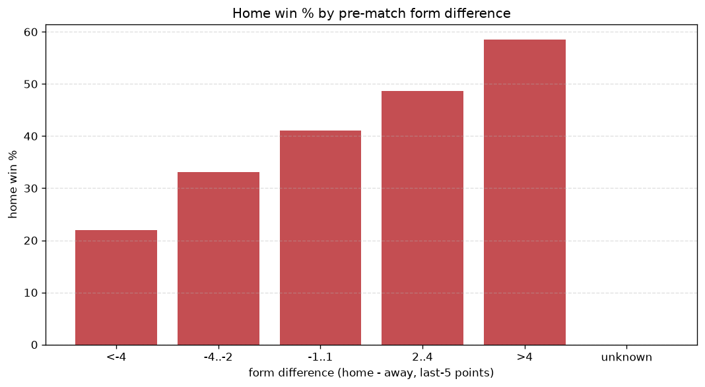
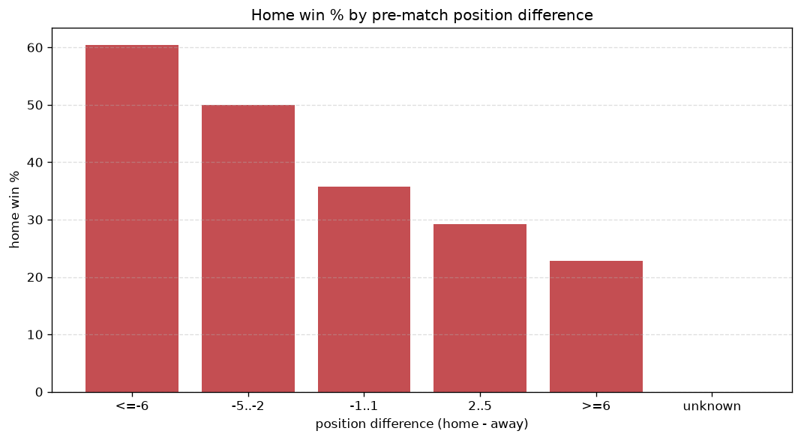

# Relationships Analysis
- Report: `relationships`
- Generated: 2026-10-29T02:04:50+00:00
- Script: `backend/scripts/analyze_relationships.py` v1.0.0
- League: Serie A (Italy)
- Scope: league `italy1`

- Matches analysed: **2280** (23 leakage-safe pre-match features).

## 1. Correlation matrix
_Pearson correlation of each pre-match feature with observed goals; sorted by |corr(total goals)|._

| feature | corr(home) | corr(away) | corr(total) |
|---|---|---|---|
| home_team_home_goals_avg | 0.181 | -0.094 | 0.072 |
| home_team_goals_scored_last_5 | 0.146 | -0.088 | 0.050 |
| home_position_before_match | -0.223 | 0.176 | -0.047 |
| away_team_away_goals_avg | -0.092 | 0.159 | 0.041 |
| home_team_home_win_rate | 0.165 | -0.140 | 0.028 |
| away_team_goals_scored_last_5 | -0.113 | 0.158 | 0.025 |
| home_team_home_conceded_avg | -0.071 | 0.114 | 0.025 |
| position_difference | -0.300 | 0.292 | -0.024 |
| home_team_wins_last_5 | 0.140 | -0.120 | 0.023 |
| home_team_goals_conceded_last_5 | -0.080 | 0.114 | 0.018 |
| points_difference | 0.277 | -0.278 | 0.017 |
| away_rest_days | -0.018 | -0.004 | -0.017 |
| home_rest_days | -0.019 | -0.003 | -0.017 |
| away_team_away_conceded_avg | 0.106 | -0.095 | 0.014 |
| away_team_away_win_rate | -0.141 | 0.173 | 0.013 |
| away_position_before_match | 0.195 | -0.231 | -0.013 |
| home_team_points_last_5 | 0.125 | -0.119 | 0.012 |
| home_points_before_match | 0.101 | -0.100 | 0.007 |
| away_points_before_match | -0.133 | 0.135 | -0.007 |
| away_team_wins_last_5 | -0.145 | 0.150 | -0.006 |
| away_team_points_last_5 | -0.147 | 0.153 | -0.005 |
| away_team_goals_conceded_last_5 | 0.096 | -0.110 | -0.004 |
| rest_days_difference | -0.002 | 0.004 | 0.002 |

## 2. Form vs outcome
_Home win/draw/away % per bucket of `home_team_points_last_5 - away_team_points_last_5`._

| bucket | matches | home | draw | away | home % | draw % | away % |
|---|---|---|---|---|---|---|---|
| <-4 | 378 | 83 | 98 | 197 | 22.0% | 25.9% | 52.1% |
| -4..-2 | 492 | 163 | 137 | 192 | 33.1% | 27.8% | 39.0% |
| -1..1 | 610 | 251 | 168 | 191 | 41.1% | 27.5% | 31.3% |
| 2..4 | 422 | 205 | 117 | 100 | 48.6% | 27.7% | 23.7% |
| >4 | 378 | 221 | 93 | 64 | 58.5% | 24.6% | 16.9% |
| unknown | 0 | 0 | 0 | 0 | - | - | - |

## 3. Position vs outcome
_Home win/draw/away % per bucket of `position_difference` (home position - away position; negative favours the home team)._

| bucket | matches | home | draw | away | home % | draw % | away % |
|---|---|---|---|---|---|---|---|
| <=-6 | 574 | 360 | 135 | 79 | 62.7% | 23.5% | 13.8% |
| -5..-2 | 379 | 180 | 117 | 82 | 47.5% | 30.9% | 21.6% |
| -1..1 | 309 | 121 | 103 | 85 | 39.2% | 33.3% | 27.5% |
| 2..5 | 426 | 140 | 119 | 167 | 32.9% | 27.9% | 39.2% |
| >=6 | 592 | 122 | 139 | 331 | 20.6% | 23.5% | 55.9% |
| unknown | 0 | 0 | 0 | 0 | - | - | - |

## 4. Rest advantage
_Home win/draw/away % per bucket of `rest_days_difference` (home rest - away rest). Matches with unknown rest are bucketed separately._

| bucket | matches | home | draw | away | home % | draw % | away % |
|---|---|---|---|---|---|---|---|
| <-1 | 226 | 78 | 68 | 80 | 34.5% | 30.1% | 35.4% |
| -1..0 | 508 | 222 | 116 | 170 | 43.7% | 22.8% | 33.5% |
| 0 | 759 | 305 | 200 | 254 | 40.2% | 26.4% | 33.5% |
| 1..2 | 670 | 273 | 201 | 196 | 40.7% | 30.0% | 29.3% |
| >2 | 54 | 20 | 13 | 21 | 37.0% | 24.1% | 38.9% |
| unknown | 63 | 25 | 15 | 23 | 39.7% | 23.8% | 36.5% |
- *63 match(es) had unknown rest difference (missing rest data on at least one side).*

## 5. Home team quality
_Home win rate by `home_team_home_win_rate` tier (split at 0.5)._

- `< 0.5` tier: **32.3%** home win (458/1418)
- `>= 0.5` tier: **53.9%** home win (465/862)
- Home-win gap (>= split minus < split): **+21.6 pp**

| tier | label | matches | home | draw | away | home % |
|---|---|---|---|---|---|---|
| low | < 0.5 | 1418 | 458 | 403 | 557 | 32.3% |
| high | >= 0.5 | 862 | 465 | 210 | 187 | 53.9% |

## 6. Feature averages by result
_Mean feature value per outcome; `range` is home-minus-away spread of the group means._

| feature | home mean | draw mean | away mean | range |
|---|---|---|---|---|
| points_difference | 5.543 | 0.259 | -7.503 | 13.045 |
| position_difference | -2.979 | 0.104 | 4.137 | 7.117 |
| away_points_before_match | 22.557 | 24.421 | 29.546 | 6.989 |
| home_points_before_match | 28.100 | 24.680 | 22.043 | 6.057 |
| away_position_before_match | 12.059 | 11.157 | 8.413 | 3.646 |
| home_position_before_match | 9.079 | 11.261 | 12.550 | 3.471 |
| away_team_points_last_5 | 5.716 | 6.173 | 7.300 | 1.584 |
| home_team_points_last_5 | 6.977 | 5.974 | 5.489 | 1.488 |
| away_team_goals_scored_last_5 | 5.679 | 5.943 | 7.036 | 1.357 |
| home_team_goals_scored_last_5 | 6.704 | 5.788 | 5.543 | 1.161 |
| home_team_goals_conceded_last_5 | 5.700 | 6.289 | 6.712 | 1.012 |
| away_team_goals_conceded_last_5 | 6.547 | 6.036 | 5.540 | 1.007 |
| away_team_wins_last_5 | 1.483 | 1.631 | 2.035 | 0.552 |
| home_team_wins_last_5 | 1.936 | 1.568 | 1.397 | 0.540 |
| home_team_home_goals_avg | 1.563 | 1.347 | 1.235 | 0.328 |
| away_team_away_goals_avg | 1.087 | 1.152 | 1.335 | 0.248 |
| home_rest_days | 7.297 | 7.507 | 7.405 | 0.210 |
| away_team_away_conceded_avg | 1.468 | 1.420 | 1.271 | 0.197 |
| away_rest_days | 7.301 | 7.463 | 7.482 | 0.181 |
| home_team_home_conceded_avg | 1.096 | 1.214 | 1.263 | 0.166 |
| home_team_home_win_rate | 0.448 | 0.370 | 0.321 | 0.127 |
| rest_days_difference | -0.006 | 0.043 | -0.074 | 0.117 |
| away_team_away_win_rate | 0.261 | 0.287 | 0.378 | 0.116 |

---
*All features are leakage-safe pre-match values built by `ml.features.build_features.build_rows` from strictly prior matches. Run with `python backend/scripts/analyze_relationships.py` to regenerate.*

## Charts

