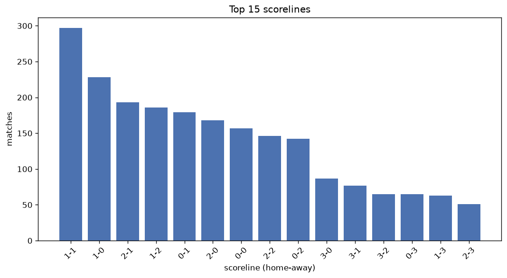
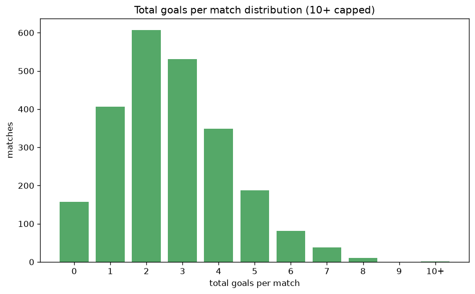

# Scoreline Analysis
- Report: `scoreline_analysis`
- Generated: 2026-10-30T03:58:12+00:00
- Script: `backend/scripts/analyze_scorelines.py` v1.0.0
- League: Serie A (Italy)
- Scope: league `italy1`

## 1. Scoreline frequency
- Matches analysed: **2368** across **7** seasons.
- Distinct scorelines seen: **41**.

| scoreline | count | pct |
|---|---|---|
| 1-1 | 297 | 12.5% |
| 1-0 | 228 | 9.6% |
| 2-1 | 193 | 8.2% |
| 1-2 | 186 | 7.9% |
| 0-1 | 179 | 7.6% |
| 2-0 | 168 | 7.1% |
| 0-0 | 157 | 6.6% |
| 2-2 | 146 | 6.2% |
| 0-2 | 142 | 6.0% |
| 3-0 | 87 | 3.7% |
| 3-1 | 77 | 3.3% |
| 3-2 | 65 | 2.7% |
| 0-3 | 65 | 2.7% |
| 1-3 | 63 | 2.7% |
| 2-3 | 51 | 2.2% |
| 4-0 | 40 | 1.7% |
| 4-1 | 31 | 1.3% |
| 3-3 | 24 | 1.0% |
| 1-4 | 23 | 1.0% |
| 0-4 | 23 | 1.0% |

## 2. Scoreline frequency per season

### 2020-2021
| scoreline | count | pct |
|---|---|---|
| 1-1 | 46 | 12.1% |
| 1-2 | 31 | 8.2% |
| 0-2 | 28 | 7.4% |
| 1-0 | 27 | 7.1% |
| 2-0 | 26 | 6.8% |

### 2021-2022
| scoreline | count | pct |
|---|---|---|
| 1-1 | 48 | 12.6% |
| 1-2 | 37 | 9.7% |
| 1-0 | 34 | 8.9% |
| 2-1 | 29 | 7.6% |
| 0-1 | 27 | 7.1% |

### 2022-2023
| scoreline | count | pct |
|---|---|---|
| 1-1 | 54 | 14.2% |
| 1-0 | 39 | 10.3% |
| 0-1 | 35 | 9.2% |
| 2-0 | 33 | 8.7% |
| 1-2 | 30 | 7.9% |

### 2023-2024
| scoreline | count | pct |
|---|---|---|
| 1-1 | 51 | 13.4% |
| 1-0 | 43 | 11.3% |
| 2-1 | 33 | 8.7% |
| 0-0 | 30 | 7.9% |
| 2-0 | 27 | 7.1% |

### 2024-2025
| scoreline | count | pct |
|---|---|---|
| 1-1 | 53 | 13.9% |
| 1-0 | 38 | 10.0% |
| 2-1 | 36 | 9.5% |
| 0-1 | 33 | 8.7% |
| 0-0 | 28 | 7.4% |

### 2025-2026
| scoreline | count | pct |
|---|---|---|
| 1-0 | 41 | 10.8% |
| 1-1 | 37 | 9.7% |
| 0-1 | 37 | 9.7% |
| 0-0 | 36 | 9.5% |
| 2-1 | 33 | 8.7% |

### 2026-2027
| scoreline | count | pct |
|---|---|---|
| 2-1 | 10 | 11.4% |
| 1-1 | 8 | 9.1% |
| 0-2 | 8 | 9.1% |
| 2-0 | 7 | 8.0% |
| 1-2 | 6 | 6.8% |

## 3. Total-goal histogram
_10+ groups all matches with 10 or more total goals._

| total goals | matches | pct |
|---|---|---|
| 0 | 157 | 6.6% |
| 1 | 407 | 17.2% |
| 2 | 607 | 25.6% |
| 3 | 531 | 22.4% |
| 4 | 349 | 14.7% |
| 5 | 187 | 7.9% |
| 6 | 81 | 3.4% |
| 7 | 38 | 1.6% |
| 8 | 10 | 0.4% |
| 9 | 0 | 0.0% |
| 10+ | 1 | 0.0% |

## 4. Extreme scorelines
- Matches with 7+ total goals: **49**

| season | date | scoreline | total goals |
|---|---|---|---|
| 2022-2023 | 2023-01-15 | 8-2 | 10 |
| 2020-2021 | 2021-01-03 | 6-2 | 8 |
| 2020-2021 | 2021-04-18 | 5-3 | 8 |
| 2021-2022 | 2021-12-02 | 4-4 | 8 |
| 2021-2022 | 2022-01-09 | 2-6 | 8 |
| 2021-2022 | 2022-04-27 | 4-4 | 8 |
| 2024-2025 | 2024-10-27 | 4-4 | 8 |
| 2025-2026 | 2026-01-23 | 6-2 | 8 |
| 2026-2027 | 2026-09-14 | 5-3 | 8 |
| 2026-2027 | 2026-10-25 | 4-4 | 8 |
| 2026-2027 | 2026-10-27 | 2-6 | 8 |
| 2020-2021 | 2020-09-26 | 4-3 | 7 |
| 2020-2021 | 2020-09-30 | 2-5 | 7 |
| 2020-2021 | 2020-10-04 | 5-2 | 7 |
| 2020-2021 | 2020-10-18 | 3-4 | 7 |
| 2020-2021 | 2020-10-18 | 5-2 | 7 |
| 2020-2021 | 2020-11-01 | 3-4 | 7 |
| 2020-2021 | 2021-01-23 | 4-3 | 7 |
| 2020-2021 | 2021-04-03 | 4-3 | 7 |
| 2020-2021 | 2021-04-17 | 4-3 | 7 |
| 2020-2021 | 2021-04-22 | 5-2 | 7 |
| 2020-2021 | 2021-04-24 | 3-4 | 7 |
| 2020-2021 | 2021-05-02 | 4-3 | 7 |
| 2020-2021 | 2021-05-09 | 2-5 | 7 |
| 2020-2021 | 2021-05-12 | 0-7 | 7 |
| 2020-2021 | 2021-05-15 | 3-4 | 7 |
| 2021-2022 | 2021-08-28 | 6-1 | 7 |
| 2021-2022 | 2021-09-18 | 6-1 | 7 |
| 2021-2022 | 2021-11-20 | 5-2 | 7 |
| 2021-2022 | 2021-11-20 | 4-3 | 7 |
| 2021-2022 | 2021-12-05 | 3-4 | 7 |
| 2021-2022 | 2022-01-09 | 3-4 | 7 |
| 2021-2022 | 2022-04-30 | 6-1 | 7 |
| 2021-2022 | 2022-04-30 | 3-4 | 7 |
| 2021-2022 | 2022-05-08 | 4-3 | 7 |
| 2022-2023 | 2022-08-15 | 2-5 | 7 |
| 2022-2023 | 2022-10-22 | 3-4 | 7 |
| 2022-2023 | 2022-11-09 | 6-1 | 7 |
| 2022-2023 | 2023-01-29 | 2-5 | 7 |
| 2022-2023 | 2023-03-12 | 3-4 | 7 |
| 2022-2023 | 2023-06-04 | 5-2 | 7 |
| 2023-2024 | 2023-09-17 | 7-0 | 7 |
| 2023-2024 | 2023-10-29 | 4-3 | 7 |
| 2023-2024 | 2023-11-26 | 3-4 | 7 |
| 2023-2024 | 2024-02-28 | 1-6 | 7 |
| 2024-2025 | 2024-10-26 | 6-1 | 7 |
| 2025-2026 | 2025-09-13 | 4-3 | 7 |
| 2025-2026 | 2026-04-05 | 5-2 | 7 |
| 2025-2026 | 2026-04-12 | 3-4 | 7 |

## 5. Margin-of-victory distribution (decided matches)
- Decided matches: **1740** (draws: **628**)
- Average winning margin: **1.76**

| margin | matches | pct |
|---|---|---|
| 1 | 922 | 53.0% |
| 2 | 480 | 27.6% |
| 3+ | 338 | 19.4% |

## 6. Margin by outcome

### Home wins
- Matches: **963** | avg margin: **1.81** | max margin: **7**
| margin | matches | pct |
|---|---|---|
| 1 | 495 | 51.4% |
| 2 | 264 | 27.4% |
| 3+ | 204 | 21.2% |
- *Full match-by-match list available in `scoreline_analysis.json`.*

### Away wins
- Matches: **777** | avg margin: **1.7** | max margin: **7**
| margin | matches | pct |
|---|---|---|
| 1 | 427 | 55.0% |
| 2 | 216 | 27.8% |
| 3+ | 134 | 17.2% |
- *Full match-by-match list available in `scoreline_analysis.json`.*

## 7. Most common exact score by outcome type
| outcome | matches | most common score | count | pct |
|---|---|---|---|---|
| home | 963 | 1-0 | 228 | 23.7% |
| draw | 628 | 1-1 | 297 | 47.3% |
| away | 777 | 1-2 | 186 | 23.9% |

---
*All statistics are computed from PostgreSQL tables (read-only). Run with `python backend/scripts/analyze_scorelines.py` to regenerate.*

## Charts

