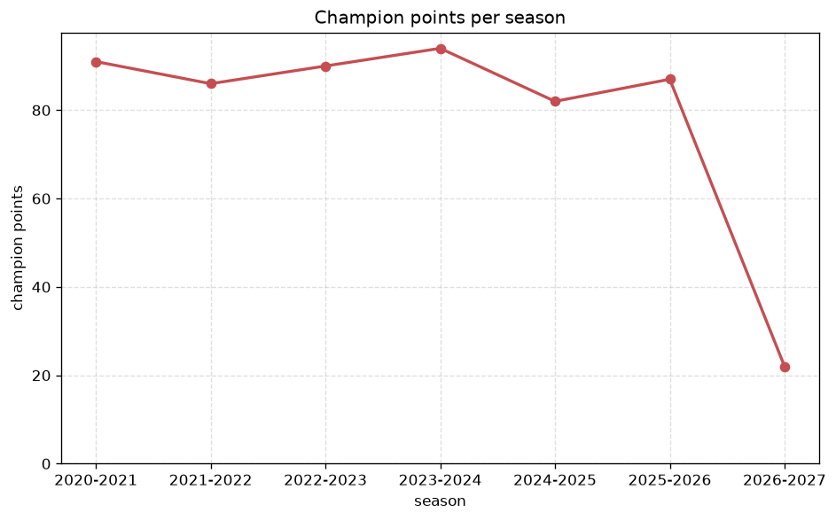
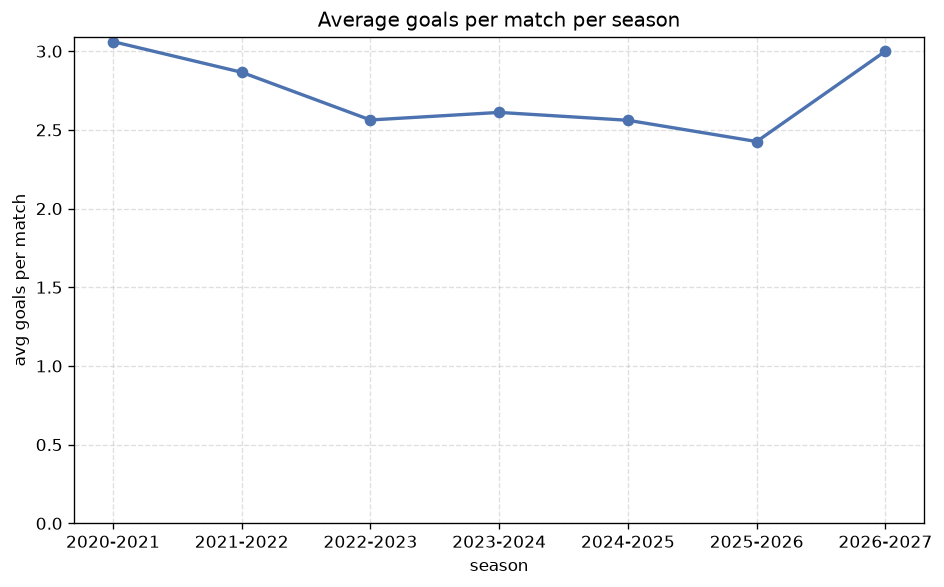

# Season Trends Analysis
- Report: `season_trends`
- Generated: 2026-10-26T01:37:27+00:00
- Script: `backend/scripts/analyze_seasons.py` v1.0.0
- League: Serie A (Italy)
- Scope: league `italy1`

## 1. Champions per season
| season | champion | pts | runner-up | margin |
|---|---|---|---|---|
| 2020-2021 | Inter | 91 | AC Milan | 12 pts |
| 2021-2022 | AC Milan | 86 | Inter | 2 pts |
| 2022-2023 | Napoli | 90 | Lazio | 16 pts |
| 2023-2024 | Inter | 94 | AC Milan | 19 pts |
| 2024-2025 | Napoli | 82 | Inter | 1 pts |
| 2025-2026 | Inter | 87 | Napoli | 11 pts |
| 2026-2027 | Lazio | 22 | Inter | 3 pts |

## 2. Title-race tightness
- Tight races (margin <= 3 pts): **3** of 7 seasons
- Tightest race: **2024-2025** - Napoli beat Inter by **1** pts

| season | margin | tight |
|---|---|---|
| 2020-2021 | 12 pts |  |
| 2021-2022 | 2 pts | yes |
| 2022-2023 | 16 pts |  |
| 2023-2024 | 19 pts |  |
| 2024-2025 | 1 pts | yes |
| 2025-2026 | 11 pts |  |
| 2026-2027 | 3 pts | yes |

## 3. Points thresholds
_Position-specific points per season. Key: 1 = champion, 2 = runner-up, 4 = CL line, 6 = Europa, 17 = last safe, 20 = bottom._

| season | pos 1 | pos 2 | pos 4 | pos 6 | pos 17 | pos 20 |
|---|---|---|---|---|---|---|
| 2020-2021 | 91 | 79 | 78 | 68 | 37 | 20 |
| 2021-2022 | 86 | 84 | 70 | 63 | 31 | 27 |
| 2022-2023 | 90 | 74 | 72 | 64 | 31 | 19 |
| 2023-2024 | 94 | 75 | 69 | 63 | 36 | 17 |
| 2024-2025 | 82 | 81 | 70 | 65 | 34 | 18 |
| 2025-2026 | 87 | 76 | 71 | 69 | 38 | 18 |
| 2026-2027 | 22 | 19 | 17 | 13 | 4 | 3 |

## 4. Relegation battle
| season | safe pos | safe pts | drop pos | drop pts | gap |
|---|---|---|---|---|---|
| 2020-2021 | 17 | 37 | 18 | 33 | 4 pts |
| 2021-2022 | 17 | 31 | 18 | 30 | 1 pts |
| 2022-2023 | 17 | 31 | 18 | 31 | 0 pts |
| 2023-2024 | 17 | 36 | 18 | 35 | 1 pts |
| 2024-2025 | 17 | 34 | 18 | 31 | 3 pts |
| 2025-2026 | 17 | 38 | 18 | 34 | 4 pts |
| 2026-2027 | 17 | 4 | 18 | 4 | 0 pts |

## 5. League-level trends
| season | matches | total goals | avg goals | home win | draw | away win | goalless | avg pts/team |
|---|---|---|---|---|---|---|---|---|
| 2020-2021 | 380 | 1163 | 3.061 | 41.1% | 25.3% | 33.7% | 5.0% | 52.2 |
| 2021-2022 | 380 | 1089 | 2.866 | 38.9% | 25.8% | 35.3% | 5.8% | 52.1 |
| 2022-2023 | 380 | 974 | 2.563 | 42.4% | 26.3% | 31.3% | 5.3% | 52.0 |
| 2023-2024 | 380 | 992 | 2.611 | 41.8% | 29.5% | 28.7% | 7.9% | 51.4 |
| 2024-2025 | 380 | 973 | 2.561 | 39.7% | 28.4% | 31.8% | 7.4% | 51.6 |
| 2025-2026 | 380 | 922 | 2.426 | 38.9% | 26.1% | 35.0% | 9.5% | 52.05 |
| 2026-2027 | 75 | 225 | 3.0 | 48.0% | 17.3% | 34.7% | 1.3% | 10.6 |

## 6. View divergence
- Largest divergence: **2021-2022** (goals view, avg abs position diff = 6.700)

_Avg absolute position difference between classic view and alternative view per season._

| season | classic vs luck | classic vs goals |
|---|---|---|
| 2020-2021 | 3.200 | 5.900 |
| 2021-2022 | 3.600 | 6.700 |
| 2022-2023 | 3.700 | 5.800 |
| 2023-2024 | 2.400 | 5.900 |
| 2024-2025 | 2.300 | 5.200 |
| 2025-2026 | 4.000 | 5.700 |
| 2026-2027 | 2.600 | 6.600 |

---
*All statistics are computed from PostgreSQL tables (read-only). Run with `python backend/scripts/analyze_seasons.py` to regenerate.*

## Charts

