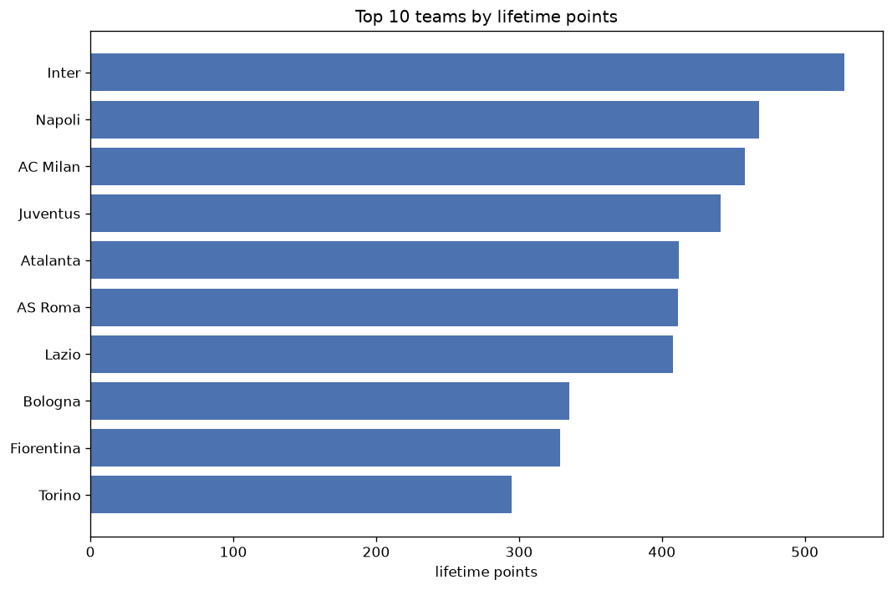
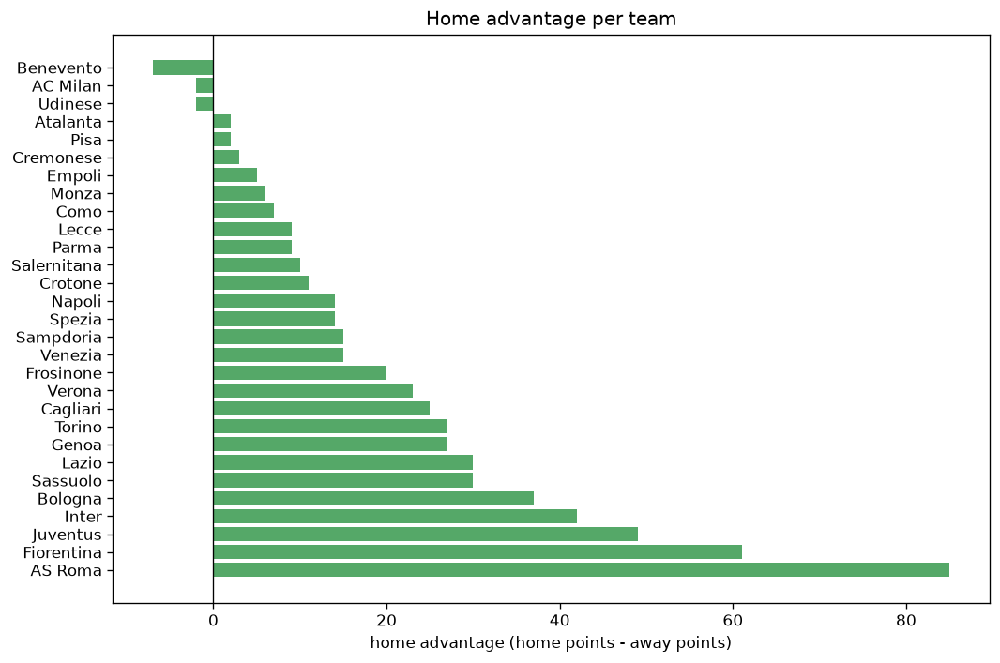

# Team Analysis
- Report: `teams_analysis`
- Generated: 2026-10-26T01:37:24+00:00
- Script: `backend/scripts/analyze_teams.py` v1.0.0
- League: Serie A (Italy)
- Scope: league `italy1`

- Teams: **29** | Seasons: **7** | Matches: **2355**

## 1. Team standings (lifetime)
| team | seasons | played | W | D | L | pts | GF | GA | GD | avg pts/season | best pos | worst pos | titles |
|---|---|---|---|---|---|---|---|---|---|---|---|---|---|
| Inter | 7 | 235 | 162 | 42 | 31 | 528 | 522 | 210 | 312 | 75.43 | 1 | 3 | 3 |
| Napoli | 7 | 236 | 139 | 51 | 46 | 468 | 422 | 221 | 201 | 66.86 | 1 | 9 | 2 |
| AC Milan | 7 | 235 | 134 | 56 | 45 | 458 | 411 | 249 | 162 | 65.43 | 1 | 8 | 1 |
| Juventus | 7 | 235 | 124 | 69 | 42 | 441 | 372 | 216 | 156 | 63.0 | 3 | 10 | 0 |
| Atalanta | 7 | 235 | 119 | 55 | 61 | 412 | 432 | 269 | 163 | 58.86 | 3 | 11 | 0 |
| AS Roma | 7 | 236 | 120 | 51 | 65 | 411 | 376 | 257 | 119 | 58.71 | 3 | 7 | 0 |
| Lazio | 7 | 236 | 118 | 54 | 64 | 408 | 365 | 276 | 89 | 58.29 | 1 | 9 | 1 |
| Bologna | 7 | 236 | 88 | 71 | 77 | 335 | 316 | 304 | 12 | 47.86 | 5 | 13 | 0 |
| Fiorentina | 7 | 235 | 89 | 62 | 84 | 329 | 329 | 307 | 22 | 47.0 | 6 | 18 | 0 |
| Torino | 7 | 236 | 73 | 76 | 87 | 295 | 270 | 306 | -36 | 42.14 | 7 | 17 | 0 |
| Udinese | 7 | 235 | 65 | 73 | 97 | 268 | 282 | 337 | -55 | 38.29 | 10 | 16 | 0 |
| Sassuolo | 6 | 198 | 65 | 49 | 84 | 244 | 276 | 324 | -48 | 40.67 | 8 | 19 | 0 |
| Verona | 6 | 228 | 54 | 63 | 111 | 225 | 239 | 344 | -105 | 37.5 | 9 | 19 | 0 |
| Genoa | 6 | 197 | 47 | 66 | 84 | 207 | 202 | 276 | -74 | 34.5 | 11 | 19 | 0 |
| Cagliari | 6 | 198 | 47 | 54 | 97 | 195 | 205 | 313 | -108 | 32.5 | 8 | 18 | 0 |
| Lecce | 5 | 159 | 37 | 44 | 78 | 155 | 129 | 220 | -91 | 31.0 | 12 | 17 | 0 |
| Empoli | 4 | 152 | 35 | 46 | 71 | 151 | 149 | 232 | -83 | 37.75 | 14 | 18 | 0 |
| Como | 3 | 84 | 38 | 23 | 23 | 137 | 128 | 88 | 40 | 45.67 | 4 | 10 | 0 |
| Monza | 4 | 122 | 30 | 32 | 60 | 122 | 130 | 190 | -60 | 30.5 | 11 | 20 | 0 |
| Sampdoria | 3 | 114 | 28 | 23 | 63 | 107 | 122 | 188 | -66 | 35.67 | 9 | 20 | 0 |
| Spezia | 3 | 114 | 25 | 31 | 58 | 106 | 124 | 205 | -81 | 35.33 | 15 | 18 | 0 |
| Parma | 4 | 122 | 22 | 39 | 61 | 105 | 116 | 202 | -86 | 26.25 | 12 | 20 | 0 |
| Salernitana | 3 | 114 | 18 | 36 | 60 | 90 | 113 | 221 | -108 | 30.0 | 15 | 20 | 0 |
| Cremonese | 2 | 76 | 13 | 22 | 41 | 61 | 68 | 126 | -58 | 30.5 | 18 | 19 | 0 |
| Venezia | 3 | 83 | 12 | 23 | 48 | 59 | 72 | 141 | -69 | 19.67 | 19 | 20 | 0 |
| Frosinone | 2 | 45 | 12 | 12 | 21 | 48 | 57 | 78 | -21 | 24.0 | 6 | 18 | 0 |
| Benevento | 1 | 38 | 7 | 12 | 19 | 33 | 40 | 75 | -35 | 33.0 | 18 | 18 | 0 |
| Crotone | 1 | 38 | 6 | 5 | 27 | 23 | 45 | 92 | -47 | 23.0 | 19 | 19 | 0 |
| Pisa | 1 | 38 | 2 | 12 | 24 | 18 | 26 | 71 | -45 | 18.0 | 20 | 20 | 0 |

## 2. Home vs away split
| team | home P | H-W | H-D | H-L | H-pts | away P | A-W | A-D | A-L | A-pts | adv |
|---|---|---|---|---|---|---|---|---|---|---|---|
| AS Roma | 118 | 75 | 23 | 20 | 248 | 118 | 45 | 28 | 45 | 163 | 85 |
| Fiorentina | 118 | 54 | 33 | 31 | 195 | 117 | 35 | 29 | 53 | 134 | 61 |
| Juventus | 118 | 71 | 32 | 15 | 245 | 117 | 53 | 37 | 27 | 196 | 49 |
| Inter | 118 | 90 | 15 | 13 | 285 | 117 | 72 | 27 | 18 | 243 | 42 |
| Bologna | 118 | 50 | 36 | 32 | 186 | 118 | 38 | 35 | 45 | 149 | 37 |
| Lazio | 118 | 62 | 33 | 23 | 219 | 118 | 56 | 21 | 41 | 189 | 30 |
| Sassuolo | 98 | 37 | 26 | 35 | 137 | 100 | 28 | 23 | 49 | 107 | 30 |
| Torino | 118 | 40 | 41 | 37 | 161 | 118 | 33 | 35 | 50 | 134 | 27 |
| Genoa | 99 | 28 | 33 | 38 | 117 | 98 | 19 | 33 | 46 | 90 | 27 |
| Cagliari | 99 | 28 | 26 | 45 | 110 | 99 | 19 | 28 | 52 | 85 | 25 |
| Verona | 114 | 32 | 28 | 54 | 124 | 114 | 22 | 35 | 57 | 101 | 23 |
| Frosinone | 23 | 10 | 4 | 9 | 34 | 22 | 2 | 8 | 12 | 14 | 20 |
| Sampdoria | 57 | 16 | 13 | 28 | 61 | 57 | 12 | 10 | 35 | 46 | 15 |
| Venezia | 42 | 9 | 10 | 23 | 37 | 41 | 3 | 13 | 25 | 22 | 15 |
| Napoli | 118 | 72 | 25 | 21 | 241 | 118 | 67 | 26 | 25 | 227 | 14 |
| Spezia | 57 | 14 | 18 | 25 | 60 | 57 | 11 | 13 | 33 | 46 | 14 |
| Crotone | 19 | 5 | 2 | 12 | 17 | 19 | 1 | 3 | 15 | 6 | 11 |
| Salernitana | 57 | 11 | 17 | 29 | 50 | 57 | 7 | 19 | 31 | 40 | 10 |
| Lecce | 79 | 19 | 25 | 35 | 82 | 80 | 18 | 19 | 43 | 73 | 9 |
| Parma | 61 | 13 | 18 | 30 | 57 | 61 | 9 | 21 | 31 | 48 | 9 |
| Como | 41 | 20 | 12 | 9 | 72 | 43 | 18 | 11 | 14 | 65 | 7 |
| Monza | 60 | 16 | 16 | 28 | 64 | 62 | 14 | 16 | 32 | 58 | 6 |
| Empoli | 76 | 19 | 21 | 36 | 78 | 76 | 16 | 25 | 35 | 73 | 5 |
| Cremonese | 38 | 7 | 11 | 20 | 32 | 38 | 6 | 11 | 21 | 29 | 3 |
| Atalanta | 118 | 60 | 27 | 31 | 207 | 117 | 59 | 28 | 30 | 205 | 2 |
| Pisa | 19 | 2 | 4 | 13 | 10 | 19 | 0 | 8 | 11 | 8 | 2 |
| AC Milan | 117 | 66 | 30 | 21 | 228 | 118 | 68 | 26 | 24 | 230 | -2 |
| Udinese | 118 | 31 | 40 | 47 | 133 | 117 | 34 | 33 | 50 | 135 | -2 |
| Benevento | 19 | 2 | 7 | 10 | 13 | 19 | 5 | 5 | 9 | 20 | -7 |

## 3. Top performers
### Best points per game (PPG)
| rank | team | PPG |
|---|---|---|
| 1 | Inter | 2.25 |
| 2 | Napoli | 1.98 |
| 3 | AC Milan | 1.95 |
| 4 | Juventus | 1.88 |
| 5 | Atalanta | 1.75 |

### Most goals scored
| rank | team | goals |
|---|---|---|
| 1 | Inter | 522 |
| 2 | Atalanta | 432 |
| 3 | Napoli | 422 |
| 4 | AC Milan | 411 |
| 5 | AS Roma | 376 |

### Best goal difference
| rank | team | GD |
|---|---|---|
| 1 | Inter | 312 |
| 2 | Napoli | 201 |
| 3 | Atalanta | 163 |
| 4 | AC Milan | 162 |
| 5 | Juventus | 156 |

### Best defence (goals against per match, standings)
| rank | team | GA/match |
|---|---|---|
| 1 | Inter | 0.894 |
| 2 | Juventus | 0.919 |
| 3 | Napoli | 0.936 |
| 4 | Como | 1.048 |
| 5 | AC Milan | 1.060 |

## 4. Team consistency
- Teams present in all **7** seasons: **11**

AC Milan, AS Roma, Atalanta, Bologna, Fiorentina, Inter, Juventus, Lazio, Napoli, Torino, Udinese

## 5. Head-to-head dominance
- Distinct fixtures: **372** (showing the 15 most frequent)

| fixture | meetings | home wins | draws | away wins | home pct | draw pct | away pct |
|---|---|---|---|---|---|---|---|
| AS Roma vs Fiorentina | 13 | 9 | 2 | 2 | 69.2% | 15.4% | 15.4% |
| AC Milan vs Lazio | 13 | 8 | 2 | 3 | 61.5% | 15.4% | 23.1% |
| AC Milan vs Torino | 13 | 8 | 2 | 3 | 61.5% | 15.4% | 23.1% |
| Lazio vs Bologna | 13 | 8 | 2 | 3 | 61.5% | 15.4% | 23.1% |
| Atalanta vs AS Roma | 13 | 7 | 3 | 3 | 53.8% | 23.1% | 23.1% |
| Inter vs Bologna | 13 | 7 | 3 | 3 | 53.8% | 23.1% | 23.1% |
| Inter vs Udinese | 13 | 7 | 1 | 5 | 53.8% | 7.7% | 38.5% |
| Juventus vs Lazio | 13 | 7 | 4 | 2 | 53.8% | 30.8% | 15.4% |
| Inter vs Napoli | 13 | 6 | 6 | 1 | 46.2% | 46.2% | 7.7% |
| Napoli vs Bologna | 13 | 6 | 3 | 4 | 46.2% | 23.1% | 30.8% |
| Udinese vs Torino | 13 | 6 | 2 | 5 | 46.2% | 15.4% | 38.5% |
| AC Milan vs Atalanta | 13 | 5 | 3 | 5 | 38.5% | 23.1% | 38.5% |
| AS Roma vs Torino | 13 | 5 | 2 | 6 | 38.5% | 15.4% | 46.2% |
| Bologna vs Torino | 13 | 5 | 6 | 2 | 38.5% | 46.2% | 15.4% |
| Atalanta vs Bologna | 13 | 4 | 3 | 6 | 30.8% | 23.1% | 46.2% |

## 6. Position per season (classic view)
_Cells show final position; '-' when the team was absent from that season._

| team | 2020-2021 | 2021-2022 | 2022-2023 | 2023-2024 | 2024-2025 | 2025-2026 | 2026-2027 |
|---|---|---|---|---|---|---|---|
| Inter | 1 | 2 | 3 | 1 | 2 | 1 | 2 |
| Napoli | 5 | 3 | 1 | 9 | 1 | 2 | 9 |
| AC Milan | 2 | 1 | 5 | 2 | 8 | 5 | 5 |
| Juventus | 4 | 4 | 4 | 3 | 4 | 6 | 10 |
| Atalanta | 3 | 8 | 6 | 4 | 3 | 7 | 11 |
| AS Roma | 7 | 6 | 7 | 6 | 5 | 3 | 3 |
| Lazio | 6 | 5 | 2 | 7 | 7 | 9 | 1 |
| Bologna | 12 | 13 | 9 | 5 | 9 | 8 | 13 |
| Fiorentina | 13 | 7 | 8 | 8 | 6 | 15 | 18 |
| Torino | 17 | 10 | 10 | 10 | 11 | 13 | 7 |
| Udinese | 14 | 12 | 12 | 15 | 12 | 10 | 16 |
| Sassuolo | 8 | 11 | 13 | 19 | - | 11 | 14 |
| Verona | 10 | 9 | 17 | 13 | 14 | 19 | - |
| Genoa | 11 | 19 | - | 11 | 13 | 16 | 17 |
| Cagliari | 16 | 18 | - | 17 | 16 | 14 | 8 |
| Lecce | - | - | 16 | 14 | 17 | 17 | 12 |
| Empoli | - | 14 | 14 | 16 | 18 | - | - |
| Como | - | - | - | - | 10 | 4 | 4 |
| Monza | - | - | 11 | 12 | 20 | - | 15 |
| Sampdoria | 9 | 15 | 20 | - | - | - | - |
| Spezia | 15 | 16 | 18 | - | - | - | - |
| Parma | 20 | - | - | - | 15 | 12 | 19 |
| Salernitana | - | 17 | 15 | 20 | - | - | - |
| Cremonese | - | - | 19 | - | - | 18 | - |
| Venezia | - | 20 | - | - | 19 | - | 20 |
| Frosinone | - | - | - | 18 | - | - | 6 |
| Benevento | 18 | - | - | - | - | - | - |
| Crotone | 19 | - | - | - | - | - | - |
| Pisa | - | - | - | - | - | 20 | - |

---
*All statistics are computed from PostgreSQL tables (read-only). Run with `python backend/scripts/analyze_teams.py` to regenerate.*

## Charts

