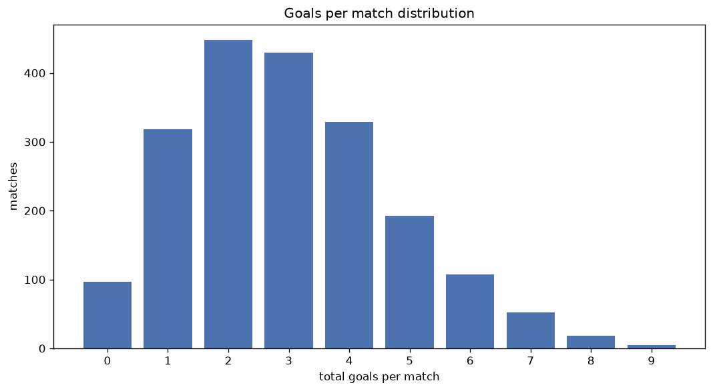
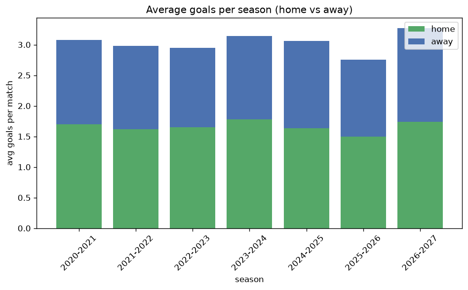

# Goal Analysis
- Report: `goals_analysis`
- Generated: 2026-10-26T01:37:43+00:00
- Script: `backend/scripts/analyze_goals.py` v1.0.0
- League: Primavera 1 (Italy)
- Scope: league `italy19`

## 1. Goals per match distribution
| goals | matches | pct |
|---|---|---|
| 0 | 97 | 4.9% |
| 1 | 318 | 15.9% |
| 2 | 448 | 22.4% |
| 3 | 430 | 21.5% |
| 4 | 329 | 16.5% |
| 5 | 193 | 9.7% |
| 6 | 107 | 5.4% |
| 7 | 52 | 2.6% |
| 8 | 18 | 0.9% |
| 9 | 5 | 0.3% |

## 2. Goals per match per season
| season | matches | total goals | avg home | avg away | avg total |
|---|---|---|---|---|---|
| 2020-2021 | 240 | 739 | 1.7 | 1.379 | 3.079 |
| 2021-2022 | 306 | 911 | 1.621 | 1.356 | 2.977 |
| 2022-2023 | 306 | 901 | 1.65 | 1.294 | 2.944 |
| 2023-2024 | 306 | 962 | 1.781 | 1.363 | 3.144 |
| 2024-2025 | 380 | 1164 | 1.634 | 1.429 | 3.063 |
| 2025-2026 | 382 | 1051 | 1.497 | 1.254 | 2.751 |
| 2026-2027 | 77 | 252 | 1.74 | 1.532 | 3.273 |

## 3. Home vs away goal share
- Home goals: **3281** (54.9%)
- Away goals: **2699** (45.1%)
- Home/away ratio: **1.216**

| season | home goals | away goals | total | home pct | away pct |
|---|---|---|---|---|---|
| 2020-2021 | 408 | 331 | 739 | 55.2% | 44.8% |
| 2021-2022 | 496 | 415 | 911 | 54.4% | 45.6% |
| 2022-2023 | 505 | 396 | 901 | 56.0% | 44.0% |
| 2023-2024 | 545 | 417 | 962 | 56.7% | 43.3% |
| 2024-2025 | 621 | 543 | 1164 | 53.4% | 46.6% |
| 2025-2026 | 572 | 479 | 1051 | 54.4% | 45.6% |
| 2026-2027 | 134 | 118 | 252 | 53.2% | 46.8% |

## 4. BTTS (Both Teams To Score)
- Overall: **1200** of `1997` (60.1%)

| season | matches | BTTS | pct |
|---|---|---|---|
| 2020-2021 | 240 | 139 | 57.9% |
| 2021-2022 | 306 | 179 | 58.5% |
| 2022-2023 | 306 | 180 | 58.8% |
| 2023-2024 | 306 | 196 | 64.1% |
| 2024-2025 | 380 | 228 | 60.0% |
| 2025-2026 | 382 | 224 | 58.6% |
| 2026-2027 | 77 | 54 | 70.1% |

## 5. Clean sheets
- Home clean sheets: **528** (26.4%)
- Away clean sheets: **366** (18.3%)
- Total clean sheets recorded: **894**
- Matches with at least one clean sheet: **797** (39.9%)
- Both teams kept clean sheets (0-0): **97**

| season | matches | home CS | away CS | total CS | matches w/ CS |
|---|---|---|---|---|---|
| 2020-2021 | 240 | 65 | 48 | 113 | 101 (42.1%) |
| 2021-2022 | 306 | 88 | 50 | 138 | 127 (41.5%) |
| 2022-2023 | 306 | 86 | 56 | 142 | 126 (41.2%) |
| 2023-2024 | 306 | 86 | 36 | 122 | 110 (35.9%) |
| 2024-2025 | 380 | 91 | 76 | 167 | 152 (40.0%) |
| 2025-2026 | 382 | 102 | 85 | 187 | 158 (41.4%) |
| 2026-2027 | 77 | 10 | 15 | 25 | 23 (29.9%) |

## 6. Scoring intensity
- First-half goals: **2741** (46.0%)
- Second-half goals: **3221** (54.0%)
- Avg first-half goals per match: **1.377**
- Avg second-half goals per match: **1.619**
- Second-half-only scoring (HT 0-0, FT goals >= 1): **418** (20.9%)
- *7 match(es) excluded (no HT score recorded).*

| season | matches | 1st half | 2nd half | 1st half pct | 2nd half pct |
|---|---|---|---|---|---|
| 2020-2021 | 240 | 342 | 397 | 46.3% | 53.7% |
| 2021-2022 | 306 | 433 | 478 | 47.5% | 52.5% |
| 2022-2023 | 306 | 411 | 490 | 45.6% | 54.4% |
| 2023-2024 | 306 | 430 | 526 | 45.0% | 55.0% |
| 2024-2025 | 380 | 536 | 628 | 46.0% | 54.0% |
| 2025-2026 | 382 | 463 | 580 | 44.4% | 55.6% |
| 2026-2027 | 77 | 126 | 122 | 50.8% | 49.2% |

## 7. First-goal timing
- Matches with first-goal time recorded: `1889` of `1997` (94.6%)
- Goalless matches: `108`
- Min `1` | Max `95` | Mean `28.55` | Median (p50) `22`

| bucket | count | % of matches | % of scoring matches |
|---|---|---|---|
| 1-15 | 705 | 35.3% | 37.3% |
| 16-30 | 467 | 23.4% | 24.7% |
| 31-45 | 282 | 14.1% | 14.9% |
| 46-60 | 221 | 11.1% | 11.7% |
| 61-75 | 118 | 5.9% | 6.2% |
| 76-90 | 82 | 4.1% | 4.3% |
| 91-120 | 14 | 0.7% | 0.7% |

---
*All statistics are computed from PostgreSQL tables (read-only). Run with `python backend/scripts/analyze_goals.py` to regenerate.*

## Charts

