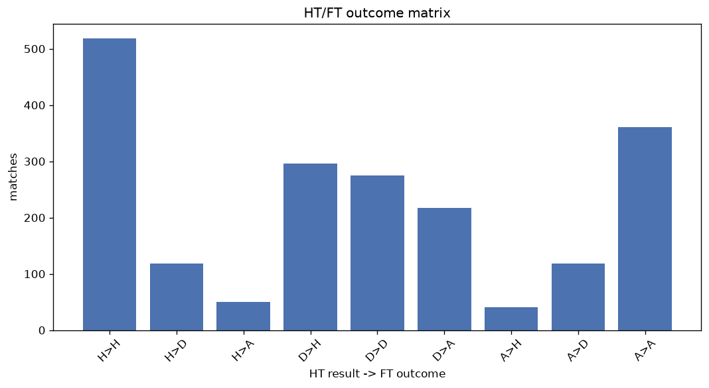
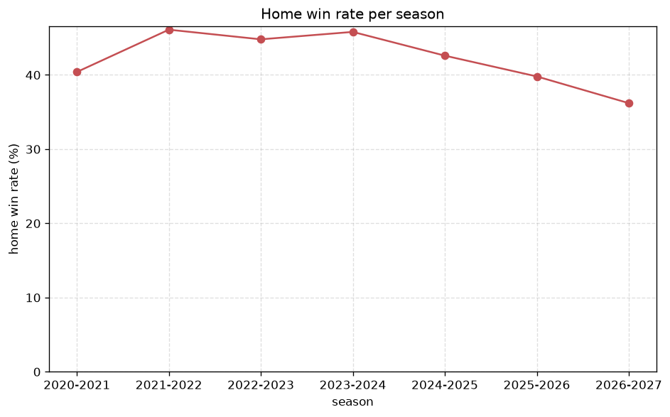

# Match Analysis
- Report: `matches_analysis`
- Generated: 2026-10-29T02:04:59+00:00
- Script: `backend/scripts/analyze_matches.py` v1.0.0
- League: Primavera 1 (Italy)
- Scope: league `italy19`

## 1. Overall summary
| metric | value |
|---|---|
| Matches | 2000 |
| Home wins | 858 (42.9%) |
| Draws | 513 (25.6%) |
| Away wins | 629 (31.4%) |
| Total goals | 5992 |
| Average goals per match | 2.996 |
| Goalless matches | 97 (4.8%) |

## 2. Per-season breakdown
| season | matches | home wins | draws | away wins | total goals | avg goals | goalless |
|---|---|---|---|---|---|---|---|
| 2020-2021 | 240 | 97 (40.4%) | 61 (25.4%) | 82 (34.2%) | 739 | 3.079 | 12 (5.0%) |
| 2021-2022 | 306 | 141 (46.1%) | 68 (22.2%) | 97 (31.7%) | 911 | 2.977 | 11 (3.6%) |
| 2022-2023 | 306 | 137 (44.8%) | 75 (24.5%) | 94 (30.7%) | 901 | 2.944 | 16 (5.2%) |
| 2023-2024 | 306 | 140 (45.8%) | 83 (27.1%) | 83 (27.1%) | 962 | 3.144 | 12 (3.9%) |
| 2024-2025 | 380 | 162 (42.6%) | 82 (21.6%) | 136 (35.8%) | 1164 | 3.063 | 15 (3.9%) |
| 2025-2026 | 382 | 152 (39.8%) | 117 (30.6%) | 113 (29.6%) | 1051 | 2.751 | 29 (7.6%) |
| 2026-2027 | 80 | 29 (36.2%) | 27 (33.8%) | 24 (30.0%) | 264 | 3.3 | 2 (2.5%) |

## 3. HT/FT outcome matrix
| HT result \ FT result | Home | Draw | Away | total |
|---|---|---|---|---|
| HT home lead | 518 (75.5%) | 118 (17.2%) | 50 (7.3%) | 686 |
| HT draw | 296 (37.6%) | 275 (34.9%) | 217 (27.5%) | 788 |
| HT away lead | 41 (7.9%) | 118 (22.7%) | 361 (69.4%) | 520 |
- *6 match(es) excluded (no HT score recorded).*

## 4. Comeback matches
- Home comebacks (trailing at HT, won at FT): **41** (2.0%)
- Away comebacks (trailing at HT, won at FT): **50** (2.5%)

### Home comebacks
| season | home | away | HT | FT |
|---|---|---|---|---|
| 2020-2021 | AS Roma U19 | Genoa U19 | 0-1 | 3-2 |
| 2020-2021 | Empoli U19 | Fiorentina U19 | 0-1 | 3-1 |
| 2020-2021 | Sassuolo U19 | AS Roma U19 | 0-1 | 2-1 |
| 2021-2022 | Spal U19 | Napoli U19 | 2-3 | 4-3 |
| 2021-2022 | AC Milan U19 | Genoa U19 | 1-2 | 4-2 |
| 2022-2023 | Juventus U19 | Atalanta U19 | 0-1 | 3-2 |
| 2022-2023 | Torino U19 | Cesena U19 | 0-1 | 2-1 |
| 2022-2023 | Atalanta U19 | Fiorentina U19 | 0-1 | 3-2 |
| 2022-2023 | Sampdoria U19 | Cesena U19 | 1-2 | 4-2 |
| 2022-2023 | Udinese U19 | Torino U19 | 0-1 | 2-1 |
| 2022-2023 | Bologna U19 | AS Roma U19 | 1-2 | 3-2 |
| 2022-2023 | Sassuolo U19 | Sampdoria U19 | 0-1 | 2-1 |
| 2022-2023 | Frosinone U19 | Sampdoria U19 | 1-2 | 5-2 |
| 2022-2023 | Cagliari U19 | Juventus U19 | 1-2 | 5-3 |
| 2022-2023 | AC Milan U19 | Torino U19 | 0-1 | 2-1 |
| 2022-2023 | Empoli U19 | Bologna U19 | 0-2 | 3-2 |
| 2022-2023 | AS Roma U19 | Fiorentina U19 | 0-1 | 2-1 |
| 2022-2023 | Udinese U19 | Cesena U19 | 0-1 | 3-1 |
| 2022-2023 | Torino U19 | Empoli U19 | 0-2 | 3-2 |
| 2023-2024 | Sassuolo U19 | Sampdoria U19 | 2-3 | 4-3 |
| 2023-2024 | AC Milan U19 | Bologna U19 | 0-1 | 4-1 |
| 2023-2024 | Atalanta U19 | Cagliari U19 | 0-1 | 4-1 |
| 2023-2024 | AS Roma U19 | Sampdoria U19 | 0-1 | 3-1 |
| 2023-2024 | AC Milan U19 | Atalanta U19 | 0-1 | 3-1 |
| 2023-2024 | Cagliari U19 | Sassuolo U19 | 0-1 | 2-1 |
| 2023-2024 | Lecce U19 | Genoa U19 | 0-1 | 3-2 |
| 2023-2024 | Cagliari U19 | Atalanta U19 | 0-1 | 3-1 |
| 2024-2025 | Genoa U20 | Fiorentina U20 | 0-1 | 3-2 |
| 2024-2025 | Cagliari U20 | Sassuolo U20 | 0-1 | 3-1 |
| 2024-2025 | Bologna U20 | Udinese U20 | 0-1 | 3-2 |
| 2024-2025 | Cesena U20 | Lecce U20 | 0-1 | 3-1 |
| 2024-2025 | Juventus U20 | Inter U20 | 0-1 | 3-2 |
| 2024-2025 | Juventus U20 | Udinese U20 | 0-2 | 3-2 |
| 2024-2025 | Bologna U20 | Monza U20 | 0-2 | 4-3 |
| 2025-2026 | Cesena U20 | AS Roma U20 | 0-1 | 3-1 |
| 2025-2026 | Inter U20 | Cagliari U20 | 1-2 | 4-3 |
| 2025-2026 | Inter U20 | Genoa U20 | 0-1 | 3-1 |
| 2025-2026 | Napoli U20 | Cesena U20 | 0-1 | 2-1 |
| 2025-2026 | Atalanta U20 | Cesena U20 | 0-1 | 2-1 |
| 2025-2026 | Inter U20 | Lazio U20 | 0-2 | 3-2 |
| 2025-2026 | Parma U20 | AC Milan U20 | 1-2 | 4-2 |

### Away comebacks
| season | home | away | HT | FT |
|---|---|---|---|---|
| 2020-2021 | Cagliari U19 | Sassuolo U19 | 2-1 | 3-4 |
| 2020-2021 | Atalanta U19 | Empoli U19 | 2-1 | 2-4 |
| 2020-2021 | Bologna U19 | Spal U19 | 1-0 | 1-2 |
| 2020-2021 | Genoa U19 | Sassuolo U19 | 2-0 | 2-3 |
| 2021-2022 | Fiorentina U19 | Torino U19 | 1-0 | 2-3 |
| 2021-2022 | Torino U19 | Juventus U19 | 2-1 | 3-4 |
| 2021-2022 | Inter U19 | Sampdoria U19 | 2-1 | 2-3 |
| 2021-2022 | Juventus U19 | Verona U19 | 1-0 | 1-2 |
| 2021-2022 | AC Milan U19 | Bologna U19 | 1-0 | 1-4 |
| 2022-2023 | AC Milan U19 | Frosinone U19 | 3-1 | 3-5 |
| 2022-2023 | Atalanta U19 | Torino U19 | 2-1 | 2-3 |
| 2022-2023 | Torino U19 | Juventus U19 | 3-1 | 3-4 |
| 2022-2023 | Lecce U19 | Torino U19 | 1-0 | 2-3 |
| 2022-2023 | Sampdoria U19 | Lecce U19 | 1-0 | 1-2 |
| 2022-2023 | Atalanta U19 | AC Milan U19 | 2-1 | 2-3 |
| 2023-2024 | Juventus U19 | Verona U19 | 1-0 | 2-3 |
| 2023-2024 | Fiorentina U19 | Lazio U19 | 1-0 | 1-2 |
| 2023-2024 | AS Roma U19 | Juventus U19 | 1-0 | 1-2 |
| 2023-2024 | Frosinone U19 | Atalanta U19 | 1-0 | 1-3 |
| 2023-2024 | Atalanta U19 | Fiorentina U19 | 1-0 | 1-2 |
| 2023-2024 | Empoli U19 | Inter U19 | 1-0 | 1-2 |
| 2023-2024 | Sassuolo U19 | Lazio U19 | 1-0 | 1-2 |
| 2023-2024 | AC Milan U19 | Fiorentina U19 | 1-0 | 1-4 |
| 2023-2024 | Monza U19 | Sassuolo U19 | 1-0 | 1-2 |
| 2023-2024 | AC Milan U19 | Monza U19 | 1-0 | 1-2 |
| 2023-2024 | Fiorentina U19 | Cagliari U19 | 1-0 | 1-2 |
| 2023-2024 | Atalanta U19 | Verona U19 | 1-0 | 1-2 |
| 2024-2025 | Cesena U20 | Sassuolo U20 | 2-1 | 2-3 |
| 2024-2025 | Empoli U20 | Torino U20 | 2-1 | 2-3 |
| 2024-2025 | Udinese U20 | Lazio U20 | 1-0 | 1-3 |
| 2024-2025 | Genoa U20 | Sassuolo U20 | 1-0 | 2-3 |
| 2024-2025 | AC Milan U20 | Cremonese U20 | 1-0 | 2-3 |
| 2024-2025 | Genoa U20 | Cagliari U20 | 1-0 | 1-2 |
| 2024-2025 | Cesena U20 | Juventus U20 | 2-1 | 3-4 |
| 2024-2025 | Monza U20 | Genoa U20 | 1-0 | 3-4 |
| 2024-2025 | Monza U20 | Cesena U20 | 1-0 | 1-2 |
| 2024-2025 | Sampdoria U20 | Torino U20 | 1-0 | 1-3 |
| 2024-2025 | Udinese U20 | Verona U20 | 1-0 | 1-3 |
| 2025-2026 | Bologna U20 | Atalanta U20 | 1-0 | 1-2 |
| 2025-2026 | Inter U20 | Juventus U20 | 1-0 | 1-3 |
| 2025-2026 | Lazio U20 | Verona U20 | 2-0 | 2-4 |
| 2025-2026 | Frosinone U20 | Monza U20 | 1-0 | 1-2 |
| 2025-2026 | AS Roma U20 | Lazio U20 | 1-0 | 1-2 |
| 2025-2026 | Sassuolo U20 | Cesena U20 | 2-1 | 2-4 |
| 2025-2026 | Atalanta U20 | Lecce U20 | 2-0 | 2-3 |
| 2025-2026 | Frosinone U20 | Parma U20 | 2-0 | 2-3 |
| 2025-2026 | Sassuolo U20 | Inter U20 | 1-0 | 1-2 |
| 2025-2026 | Genoa U20 | Cesena U20 | 3-0 | 3-5 |
| 2025-2026 | Atalanta U20 | Fiorentina U20 | 1-0 | 1-2 |
| 2025-2026 | AS Roma U20 | Bologna U20 | 1-0 | 1-2 |

## 5. HT lead conversion
| HT state | matches | converted to win | held as draw | collapsed to loss |
|---|---|---|---|---|
| Home lead | 686 | 518 (75.5%) | 118 (17.2%) | 50 (7.3%) |
| Away lead | 520 | 361 (69.4%) | 118 (22.7%) | 41 (7.9%) |

### Matches level at half-time
| FT result | count | pct |
|---|---|---|
| Home win | 296 | 37.6% |
| Draw | 275 | 34.9% |
| Away win | 217 | 27.5% |
- *6 match(es) excluded (no HT score recorded).*

## 6. First-goal timing
- Matches with a first-goal time recorded: `1892` of `2000` (94.6%)

Outcome distribution by first-goal timing bucket:
| bucket | matches | % of matches | home | draw | away |
|---|---|---|---|---|---|
| 1-15 | 708 | 35.4% | 304 (42.9%) | 167 (23.6%) | 237 (33.5%) |
| 16-30 | 469 | 23.4% | 207 (44.1%) | 108 (23.0%) | 154 (32.8%) |
| 31-45 | 280 | 14.0% | 131 (46.8%) | 58 (20.7%) | 91 (32.5%) |
| 46-60 | 221 | 11.1% | 107 (48.4%) | 49 (22.2%) | 65 (29.4%) |
| 61-75 | 118 | 5.9% | 60 (50.8%) | 21 (17.8%) | 37 (31.4%) |
| 76-90 | 82 | 4.1% | 37 (45.1%) | 10 (12.2%) | 35 (42.7%) |
| 91-120 | 14 | 0.7% | 8 (57.1%) | 0 (0.0%) | 6 (42.9%) |

## 7. Goalless matches
- Overall: **97** of `2000` (4.8%)

| season | matches | goalless | pct |
|---|---|---|---|
| 2020-2021 | 240 | 12 | 5.0% |
| 2021-2022 | 306 | 11 | 3.6% |
| 2022-2023 | 306 | 16 | 5.2% |
| 2023-2024 | 306 | 12 | 3.9% |
| 2024-2025 | 380 | 15 | 3.9% |
| 2025-2026 | 382 | 29 | 7.6% |
| 2026-2027 | 80 | 2 | 2.5% |

---
*All statistics are computed from PostgreSQL tables (read-only). Run with `python backend/scripts/analyze_matches.py` to regenerate.*

## Charts

